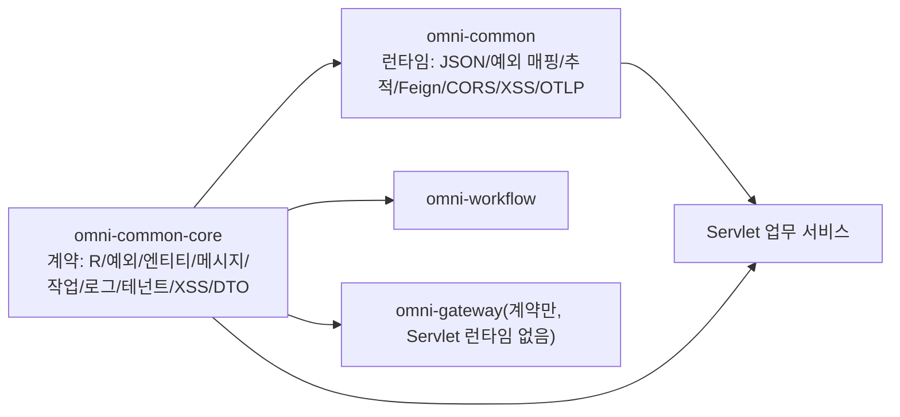

# common-core: 서비스 간 공유 계약

`omni-common-core`는 "유틸리티 모음"이 아니라 **계약**의 집합입니다. 응답 봉투, 업무 예외, 엔티티 기반 클래스, 그리고 메시지·작업·운영 로그·테넌트·XSS·내부 신원의 인터페이스와 DTO를 제공합니다. `AutoConfiguration.imports`가 없고 자동 설정도 하지 않습니다. **의존해도 얻는 것은 타입이며 실행 능력이 아닙니다.**

이 글은 "문제 → 사용법 → 원리 → 구현 원문 → 확장과 실패 복구" 순서로 기능군을 설명합니다. 코드는 현재 소스 원문이며, 이번 라운드에 애플리케이션을 기동하지 않았으므로 실행 시 조립 결론은 소스 조건에 근거합니다.

> 사실 경계: `omni-common-core/src/main/java`에는 현재 Java 파일이 18개 있습니다. 이 글은 이를 9개 기능군으로 묶고, getter·Lombok 생성 메서드·단일 DTO 필드를 독립 능력으로 세지 않습니다.

## 먼저 core와 common 구분

| | `omni-common-core` | `omni-common` |
| --- | --- | --- |
| 위치 | 계약과 타입 | Servlet 런타임 설정 |
| 자동 설정 | 없음 | `AutoConfiguration.imports` 7건 |
| 의존 방향 | 서드파티 의존 거의 없음 | core, spring-web, security, Jackson, Feign, OTLP 의존 |
| 도입 시 일어나는 일 | 컴파일되고 `R`을 반환할 수 있음 | 필터·예외 매핑·JSON 형식이 효력을 가짐 |

`omni-common`이 `omni-common-core`에 의존하며 반대는 아닙니다. 업무 서비스는 보통 둘 다 의존하지만, **런타임 능력의 유무는 `omni-common`의 조건부 조립으로 결정**되며 core에 인터페이스가 있는지로 결정되지 않습니다.



## 통일 응답과 페이지네이션

### 문제

각 Controller가 `{code, message, data}`를 직접 만들면 프론트는 엔드포인트마다 파서를 작성해야 하고, 페이지 필드명이 다르면 목록 화면이 깨집니다.

### 사용법

```java
@GetMapping("/{id}")
public R<SupplierVO> detail(@PathVariable Long id) {
    return R.ok(supplierService.getDetail(id));
}

@GetMapping("/list")
public R<PageResult<SupplierVO>> list(SupplierQuery query) {
    return R.ok(supplierService.page(query));
}
```

### 구현 원문

```java
    public static <T> R<T> ok(T data) {
        R<T> r = new R<>();
        r.setCode(200);
        r.setMessage("success");
        r.setData(data);
        return r;
    }
```

```java
    public static <T> R<T> fail(int code, String message) {
        R<T> r = new R<>();
        r.setCode(code);
        r.setMessage(message);
        r.setData(null);
        return r;
    }
```

```java
    public PageResult(List<T> records, long total, long size, long current) {
        this.records = records;
        this.total = total;
        this.size = size;
        this.current = current;
        // 向上取整计算总页数
        this.pages = (total + size - 1) / size;
    }
```

### 경계

- `R`은 `code/message/data` 세 필드뿐이며 **traceId가 없습니다**. 추적 ID는 `X-Trace-Id` 응답 헤더로 갑니다.
- `R.code`와 HTTP 상태는 다른 계층입니다. 많은 업무 실패가 HTTP 200 + 업무 코드로 반환되므로 성공 판정은 `code`로 합니다.
- `R`과 `PageResult`는 서비스 간 공유 계약입니다. 변경할 때는 한 서비스만 검증하지 말고 모든 호출부를 확인해야 합니다.

### 확장과 실패 복구

응답 필드 추가는 서비스 간 계약 변경이며 프론트 파서와 모든 서비스를 함께 평가합니다. `code != 200`은 업무 코드로 처리하고 모든 실패를 재시도하지 않습니다.

## 업무 예외

### 문제

업무 검증 실패에는 업무 코드를 가진 예외가 필요합니다. 각 서비스가 자체 예외를 정의하면 전역 매핑이 모든 타입을 알아야 합니다.

### 사용법

```java
if (!String.valueOf(userId).equals(task.getAssignee())) {
    throw new BusinessException(403, "无权操作该审批任务");
}
```

### 구현 원문

```java
    public BusinessException(String message) {
        super(message);
        this.code = 500;
    }

```

```java
    public BusinessException(int code, String message) {
        super(message);
        this.code = code;
    }
```

### 원리와 경계

- 단일 인자는 기본 `500`, 두 인자는 업무 코드를 유지합니다.
- `RuntimeException` + 업무 코드일 뿐이며 **HTTP 상태를 결정하지 않습니다**.
- Servlet 서비스에서는 `omni-common`의 `GlobalExceptionHandler`가 `R`로 변환합니다([common](common.kr.md#전역-예외-매핑)). WebFlux 게이트웨이는 이 핸들러를 조립하지 않습니다.

### 확장과 실패 복구

새 업무 코드는 core 변경이 필요 없습니다. 기대한 응답이 아니면 전역 핸들러 조립 여부와 더 구체적인 advice가 먼저 처리하는지 확인합니다.

## 엔티티 기반 클래스

### 문제

모든 업무 테이블이 `id`, 생성/수정 시각, 생성/수정자를 가지므로 중복 선언은 누락을 부릅니다.

### 사용법

엔티티가 기반 클래스를 상속하고, 삽입 시 MyBatis-Plus `MetaObjectHandler`가 시각과 작업자를 채웁니다.

### 현재 사실

저장소에는 **두 개의** `BaseEntity`가 있습니다.

| 파일 | 패키지 | 필드 |
| --- | --- | --- |
| `omni-common-core/.../core/model/BaseEntity.java` | `com.omni.common.core.model` | id, createTime, updateTime, createBy, updateBy |
| `omni-common/.../common/model/BaseEntity.java` | `com.omni.common.model` | 동일 |

둘 다 사용 중이며 어느 것을 쓰는지는 `import`로 판단합니다. 같은 클래스로 쓰거나 자동 동기화를 가정하면 안 됩니다.

### 경계

- 기반 클래스는 필드와 직렬화만 선언하고 **자동 채움 로직이 없습니다**. 채움은 `omni-common-mybatis`에 속합니다.
- MyBatis-Plus를 도입한 서비스에서만 채워지며, 없으면 `null`로 남고 오류가 나지 않습니다.

### 확장과 실패 복구

공통 필드 추가는 두 기반 클래스와 채움기를 함께 평가합니다. 시각이 비어 있으면 mybatis 모듈과 채움기 도입을 확인합니다.

## 신뢰성 메시지 계약

### 문제

업무 트랜잭션 안에서 Outbox에 써야 하지만 구현은 `omni-common-mqlog`에 의존합니다. `ReliableMessageRelay` 인터페이스를 core에 두면 업무 서비스는 계약에만 의존할 수 있습니다.

### 사용법

```java
reliableMessageRelay.send(BINDING_NAME, event, tenantId, eventId);
```

### 구현 원문

```java
    void send(String bindingName, Object payload, Long tenantId);
```

```java
    void send(String bindingName, Object payload, Long tenantId, String msgKey);
```

### 의미와 경계

- 두 오버로드의 차이는 선택적 업무 키 `msgKey`이며 운영 조사에 사용합니다.
- **인터페이스는 전달 성공을 보장하지 않고** 로컬 Outbox 기록만 보장합니다. 전달은 릴레이가 비동기로 수행합니다.
- `tenantId`는 명시적으로 전달하며 **ThreadLocal로 암묵 해석하면 안 됩니다**. Outbox 행 테넌트 분리의 유일한 근거입니다.
- `omni-common-mqlog`를 도입한 서비스만 구현 Bean을 가집니다. core만으로는 전송 능력이 없습니다.

### 확장과 실패 복구

새 broker는 `MessageSender`를 구현하고 인터페이스나 호출부를 바꾸지 않습니다. "기록됐지만 도달하지 않음"은 Outbox 행 → 릴레이 → 데드레터 순으로 확인하고 업무 작업을 재전송하지 않습니다.

## 사용자 작업 계약

### 문제

개인 스케줄 작업의 메시지와 핸들러를 공통화해 단일 XXL-JOB 핸들러가 라우팅해야 합니다.

### 사용법

```java
@Component("crmLeadReminder") // Bean 名必须等于 sys_user_job_type.type_code
public class CrmLeadReminderHandler implements UserJobHandler {
    @Override
    public void execute(UserJobMessage message) throws Exception {
        // 读取 message.getJobParams() 执行任务
    }
}
```

### 구현 원문

```java
    void execute(UserJobMessage message) throws Exception;
```

### 경계

- 메시지 필드: `jobId`, `tenantId`, `jobType`, `jobName`, `jobParams`.
- 정상 반환은 성공, 예외는 실패입니다.
- **Bean 이름이 `type_code`와 다르면 해당 핸들러를 찾지 못합니다**. 레지스트리는 기동을 막지 않지만, 그 작업을 실행하면 실패와 핸들러 누락 로그가 기록됩니다.
- core는 계약만이며 레지스트리와 실행 진입은 `omni-common-job`과 Base에 있습니다.

### 확장과 실패 복구

새 작업 유형 = 새 `type_code` + 동일 이름 Bean이며 공유 핸들러 이름은 바꾸지 않습니다. 실행되지 않으면 Bean 이름과 `jobType`, 다음으로 레지스트리 스캔을 확인합니다.

## 운영 로그 어노테이션 계약

### 문제

업무 메서드가 "이 작업을 기록하라"를 어노테이션으로 선언하고, 수집과 저장은 core에 두지 않아야 합니다.

### 사용법

```java
@OperLog(module = "srm", operType = OperType.UPDATE)
@PutMapping("/{id}")
public R<Void> update(@PathVariable Long id, @RequestBody SupplierUpdateRequest request) { ... }
```

### 구현 원문

```java
    String module() default "";
```

```java
    OperType operType();
```

```java
    String idExpr() default "";
```

```java
    boolean recordParams() default true;
```

```java
    boolean recordSnapshot() default true;
```

### 경계

- 어노테이션이 있다고 **수집되는 것은 아닙니다**. `omni-common-operlog`의 aspect 조립이 필요합니다.
- `omni-auth`는 common-operlog를 **도입하지 않습니다**. 인증은 `sys_audit_log`에 기록하므로 Auth에서 `@OperLog`를 쓰면 안 됩니다.
- `recordSnapshot`은 `tenantId` 속성이 있고 요청 테넌트와 일치하는 엔티티에만 적용됩니다.

### 확장과 실패 복구

새 작업 유형은 `OperType` 열거를 확장하고, 수집 필드는 메시지와 aspect를 변경합니다. 로그가 없으면 의존과 aspect 조립, 다음으로 메서드가 프록시를 거쳤는지(자기 호출은 발화하지 않음) 확인합니다.

## XSS 설정 SPI

### 문제

공유 필터는 현재 테넌트의 XSS 스위치와 규칙을 필요로 하지만 설정 권위는 Auth에 있습니다.

### 사용법

서비스가 Bean을 구현합니다.

```java
@Component
public class XssConfigProviderImpl implements XssConfigProvider {
    @Override
    public XssSettings getXssSettings(Long tenantId) {
        // 从本服务的缓存或权威接口读取开关与规则，不得返回 null
        return settings;
    }
}
```

### 구현 원문

```java
    XssSettings getXssSettings(Long tenantId);
```

### 경계

- 반환하는 `XssSettings`는 `enabled`와 `rules`를 포함하며 **null을 반환하면 안 됩니다**.
- SPI는 읽기 계약만 정의하며 저장·캐시·테넌트 검증은 Auth 또는 각 서비스 구현에 있습니다.
- 이 Bean이 없으면 `omni-common`의 XSS 필터와 Jackson 모듈이 조립되지 않습니다.

### 확장과 실패 복구

규칙 유형 확장은 `XssSanitizer`에서 하고 SPI 서명은 바꾸지 않습니다. 정화가 안 되면 SPI 구현 여부, 다음으로 스위치와 규칙의 공백 여부를 확인합니다.

## 테넌트 모듈 공급 계약

### 문제

새 테넌트의 각 업무 모듈 개통에는 통일된 요청/결과 이벤트 구조와 모듈 결과 열거가 필요하며, Auth가 이를 편성할 수 있어야 합니다.

### 사용법

모듈이 `TenantModuleProvisioner`를 구현하고 `tenant.provision-requested.v1`을 소비해 `tenant.provision-result.v1`을 반환합니다.

```java
    public record ProvisionRequestedEvent(
            String eventId,
            String requestId,
            Long tenantId,
            String tenantCode,
            String tenantName,
            List<String> moduleIds,
            Instant occurredAt) implements Serializable {
```

```java
    public record ProvisionResultEvent(
            String eventId,
            String requestId,
            Long tenantId,
            String moduleId,
            ModuleResultStatus status,
            String errorCode,
            String errorMessage,
            Instant occurredAt) implements Serializable {
```

### 경계

- 결과 상태는 `SUCCESS` / `FAILED`뿐입니다. 둘 중 어느 영수증이든 있으면 같은 `requestId + moduleId`의 재전달은 건너뜁니다. 실패 시 Auth의 정식 재시도 진입점이 새 요청 ID를 만들며 이전 ID의 재전송과 다릅니다.
- `moduleIds`는 생성 시 불변 목록으로 복사되어 호출자의 이후 변경이 이벤트에 영향을 주지 않습니다.
- 계약은 개통 순서나 재시도 정책을 포함하지 않으며 편성은 Auth에 있습니다.

### 확장과 실패 복구

새 모듈 = `TenantModuleProvisioner` 구현 + Auth 편성에 모듈 ID 등록입니다. 실패 시 Auth의 정식 재시도 진입점으로 새 `requestId`를 만들고 실패 모듈만 다시 처리합니다. 요청을 위조하거나 이전 영수증을 삭제하지 마세요. 이 규칙은 테넌트 개통용이며 승인 시작 등 다른 요청 ID 흐름에 일괄 적용하면 안 됩니다.

## 내부 신원과 데이터 범위 DTO

### 문제

서비스 간 사용자·조직·데이터 범위 조회에는 안정적인 JSON 구조가 필요하며, 각 서비스가 DTO를 복제하면 필드가 어긋납니다.

### 현재 DTO

| DTO | 주요 필드 |
| --- | --- |
| `InternalUserDTO` | id, username, nickname, tenantId, primaryUnitId, email, phone, avatar, status |
| `InternalOrgDTO` | id, tenantId, parentId, name, type, unitCode, path, status |
| `InternalDataScopeDTO` | userId, tenantId, permissionCode, primaryUnitId, effectiveScope, accessibleUnitIds, securityVersion |
| `InternalUserOptionDTO` | id, username, nickname, tenantId, primaryUnitId, avatar |

실제 호출 예: `omni-asset`의 `AuthInternalClient`가 이 타입으로 `/api/internal/user`와 `/api/internal/data-scopes` 응답을 받습니다.

### 경계

- **DTO는 전송 구조일 뿐이며** 신뢰는 내부 토큰 검증(`X-Internal-Token` + `X-Tenant-Id`)에서 옵니다. 클라이언트 자기 신고를 신원으로 쓰면 안 됩니다.
- 호출 실패를 허용으로 강등하면 안 됩니다. Asset의 `AssetIdentityGuard` 등은 403/503으로 처리합니다.
- 필드 확장은 Auth 응답과 모든 소비자를 함께 바꾸는 서비스 간 계약 변경입니다.

### 확장과 실패 복구

내부 필드 추가 전에 모든 소비자가 미지 필드를 허용하는지 확인합니다. 신원 조회 실패는 실패 폐쇄로 처리하고 자기 신고 헤더로 후퇴하지 않습니다.

## 부록: 기능군과 절

| 기능군 | 절 | 검증 진입 |
| --- | --- | --- |
| 통일 응답과 페이지네이션 | 1 | 각 서비스 Controller 테스트 |
| 업무 예외 | 2 | 전역 예외 매핑(common 편) |
| 엔티티 기반 | 3 | MyBatis 채움기(WP-21 확인) |
| 신뢰성 메시지 계약 | 4 | Fw10OutboxAtomicityIT(기존) |
| 사용자 작업 계약 | 5 | Base 레지스트리 테스트 |
| 운영 로그 계약 | 6 | operlog aspect와 소비(WP-22) |
| XSS 설정 SPI | 7 | XssJsonDeserializationTest |
| 테넌트 공급 계약 | 8 | TenantProvisionContractsTest |
| 내부 신원 DTO | 9 | AssetIdentityGuardTest |

다음 장 [common](common.kr.md)은 이 계약들이 Servlet 서비스에서 어떻게 자동 조립되는지 설명합니다.
