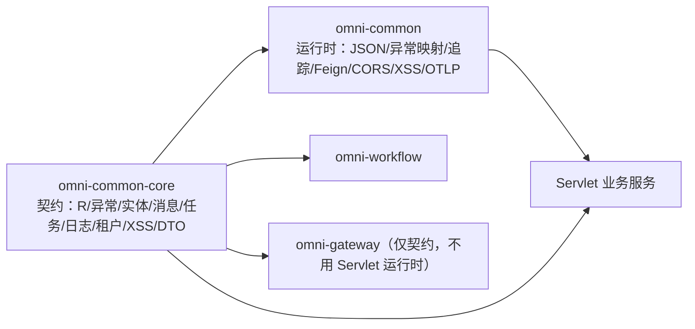

# common-core：跨服务共享的契约

`omni-common-core` 不是“工具类大杂烩”，而是一组**契约**：响应信封、业务异常、实体基类，以及消息、任务、日志、租户、XSS 和内部身份的接口与 DTO。它没有 `AutoConfiguration.imports`，也不做任何自动装配——**引入它只意味着你拿到了类型，不意味着某项能力已经生效**。

本文按“解决什么问题 → 怎么用 → 原理 → 实现原文 → 扩展与失败恢复”逐个功能族说明。代码为当前源码原文；本轮未启动应用，运行期装配结论以源码条件为准。

> 事实边界：`omni-common-core/src/main/java` 当前有 18 个 Java 文件。本文把它们归为 9 个功能族，不把 getter、Lombok 生成方法或单个 DTO 字段算作独立能力。

## 先分清 core 与 common

| | `omni-common-core` | `omni-common` |
| --- | --- | --- |
| 定位 | 契约与类型 | Servlet 运行时配置 |
| 自动配置 | 无 | 7 条 `AutoConfiguration.imports` |
| 依赖方向 | 几乎无第三方依赖 | 依赖 core、spring-web、security、Jackson、Feign、OTLP |
| 引入后发生什么 | 可以编译、可以返回 `R` | 过滤器、异常映射、JSON 格式开始生效 |

`omni-common` 依赖 `omni-common-core`，反之不成立。业务服务通常两者都依赖，但**是否获得某项运行时能力，要看 `omni-common` 的条件装配**，不能只看 core 的接口是否存在。



## 统一响应与分页

### 问题

如果每个 Controller 自己拼 `{code, message, data}`，前端要为每个接口写一套解析；分页字段一旦不一致，列表页就会出现“有的接口叫 total，有的叫 count”。

### 怎么用

```java
@GetMapping("/{id}")
public R<SupplierVO> detail(@PathVariable Long id) {
    return R.ok(supplierService.getDetail(id));
}

@GetMapping("/list")
public R<PageResult<SupplierVO>> list(SupplierQuery query) {
    return R.ok(supplierService.page(query));
}
```

### 实现原文

`R.ok(T)` 固定 `code=200`、`message="success"`；`R.fail` 保留业务码：

```java
    public static <T> R<T> ok(T data) {
        R<T> r = new R<>();
        r.setCode(200);
        r.setMessage("success");
        r.setData(data);
        return r;
    }
```

```java
    public static <T> R<T> fail(int code, String message) {
        R<T> r = new R<>();
        r.setCode(code);
        r.setMessage(message);
        r.setData(null);
        return r;
    }
```

`PageResult` 在构造时算总页数：

```java
    public PageResult(List<T> records, long total, long size, long current) {
        this.records = records;
        this.total = total;
        this.size = size;
        this.current = current;
        // 向上取整计算总页数
        this.pages = (total + size - 1) / size;
    }
```

### 边界

- `R` 只有 `code/message/data` 三个字段，**没有 traceId**。追踪号走响应头 `X-Trace-Id`。
- `R.code` 与 HTTP 状态是两层语义：不少业务异常仍返回 HTTP 200 + 业务码，判断成功要看 `code`，不能只看 HTTP 状态。
- `R` 与 `PageResult` 是跨服务共用契约，修改时要核对所有调用方，不能只验证一个服务。

### 扩展与失败恢复

新增响应字段属于跨服务契约变更，必须同时评估前端解析与所有服务；不存在“只在某个服务扩展 R”的做法。若前端收到 `code != 200`，应按业务码处理，不要重试所有失败。

## 业务异常

### 问题

业务校验失败需要一个能携带业务码的异常；如果每个服务自定义异常类型，全局映射就要认识所有类型。

### 怎么用

```java
if (!String.valueOf(userId).equals(task.getAssignee())) {
    throw new BusinessException(403, "无权操作该审批任务");
}
```

### 实现原文

```java
    public BusinessException(String message) {
        super(message);
        this.code = 500;
    }

```

```java
    public BusinessException(int code, String message) {
        super(message);
        this.code = code;
    }
```

### 原理与边界

- 单参构造默认 `500`，双参保留业务码。
- 它只是 `RuntimeException` + 业务码，**本身不决定 HTTP 状态**。
- Servlet 服务由 `omni-common` 的 `GlobalExceptionHandler` 统一转成 `R`（见 [common](common.md#全局异常映射)）；WebFlux 网关不装配该处理器。

### 扩展与失败恢复

新增业务码不需要改 core。若异常没有被映射成预期响应，先确认服务是否装配了全局处理器、是否有更具体的异常类型被别的 advice 抢先处理。

## 实体基类

### 问题

每张业务表都有 `id`、创建/更新时间、创建/更新人，重复声明容易漏字段。

### 怎么用

实体继承基类后，插入时由 MyBatis-Plus 的 `MetaObjectHandler` 填充时间与操作人。

### 当前事实

仓库里**存在两份** `BaseEntity`：

| 文件 | 包 | 字段 |
| --- | --- | --- |
| `omni-common-core/.../core/model/BaseEntity.java` | `com.omni.common.core.model` | id、createTime、updateTime、createBy、updateBy |
| `omni-common/.../common/model/BaseEntity.java` | `com.omni.common.model` | 同上 |

两者都在使用中，具体实体用哪一份要看 `import`。文章不能把它们写成同一份，也不能假设两份会自动同步。

### 边界

- 基类只声明字段与序列化，**不包含自动填充逻辑**；填充属于 `omni-common-mybatis`。
- 只在引入 MyBatis-Plus 的服务里才会填充；未引入时字段保持 `null`，不会报错。

### 扩展与失败恢复

新增公共字段要同时评估两份基类与填充器，否则会出现“部分实体有值、部分没有”。若时间字段为空，先查该服务是否引入了 mybatis 模块与填充器。

## 可靠消息发送契约

### 问题

业务事务内要写 Outbox，但发送实现依赖 `omni-common-mqlog`；把 `ReliableMessageRelay` 接口放在 core，业务服务才能只依赖契约。

### 怎么用

```java
reliableMessageRelay.send(BINDING_NAME, event, tenantId, eventId);
```

### 实现原文

```java
    void send(String bindingName, Object payload, Long tenantId);
```

```java
    void send(String bindingName, Object payload, Long tenantId, String msgKey);
```

### 语义与边界

- 两个重载的差别是可选业务键 `msgKey`，用于运维排查。
- **接口不保证投递成功**，只保证把消息写入本地 Outbox；投递由中继异步完成。
- `tenantId` 必须显式传入，**不得用 ThreadLocal 隐式解析**；这是 Outbox 回溯租户的唯一依据。
- 只有引入 `omni-common-mqlog` 的服务才有实现 Bean；仅依赖 core 不会产生发送能力。

### 扩展与失败恢复

新增 broker 应实现 `MessageSender`，而不是改接口或改调用方。若“消息写了但业务没收到”，按 Outbox 记录 → 中继 → 死信的顺序排查，而不是重发业务操作。

## 用户任务契约

### 问题

个人定时任务的执行参数与处理器需要跨服务统一结构，才能由同一个 XXL-JOB handler 路由。

### 怎么用

```java
@Component("crmLeadReminder") // Bean 名必须等于 sys_user_job_type.type_code
public class CrmLeadReminderHandler implements UserJobHandler {
    @Override
    public void execute(UserJobMessage message) throws Exception {
        // 读取 message.getJobParams() 执行任务
    }
}
```

### 实现原文

```java
    void execute(UserJobMessage message) throws Exception;
```

### 边界

- 消息字段：`jobId`、`tenantId`、`jobType`、`jobName`、`jobParams`。
- 正常返回视为成功，抛异常视为失败。
- **Bean 名与 `type_code` 不一致时找不到处理器**，注册表不会因此阻止应用启动；执行该任务时会记录失败和“未找到处理器”日志。
- core 只定义契约，注册表与执行入口在 `omni-common-job` 与 Base。

### 扩展与失败恢复

新增任务类型 = 新增 `type_code` + 同名 Bean，不改共享 handler 名。任务不执行时先核对 Bean 名与 `jobType`，再看注册表是否扫描到。

## 操作日志注解契约

### 问题

业务方法需要以注解声明“这个操作要记日志”，但采集与落库不应由 core 实现。

### 怎么用

```java
@OperLog(module = "srm", operType = OperType.UPDATE)
@PutMapping("/{id}")
public R<Void> update(@PathVariable Long id, @RequestBody SupplierUpdateRequest request) { ... }
```

### 实现原文

```java
    String module() default "";
```

```java
    OperType operType();
```

```java
    String idExpr() default "";
```

```java
    boolean recordParams() default true;
```

```java
    boolean recordSnapshot() default true;
```

### 边界

- 注解存在**不代表一定被采集**：需要 `omni-common-operlog` 的切面装配条件满足。
- `omni-auth` 明确**不引入** common-operlog，认证行为走 `sys_audit_log`，因此不要在 Auth 上使用 `@OperLog`。
- `recordSnapshot` 只对带 `tenantId` 属性且匹配请求租户的实体生效。

### 扩展与失败恢复

新增操作类型改 `OperType` 枚举；新增采集字段改消息与切面。日志缺失时先确认依赖与切面是否装配，再看方法是否被代理（内部自调用不会触发切面）。

## XSS 配置 SPI

### 问题

共享过滤器需要拿到当前租户的 XSS 开关与规则，但配置权威在 Auth。

### 怎么用

服务实现一个 Bean：

```java
@Component
public class XssConfigProviderImpl implements XssConfigProvider {
    @Override
    public XssSettings getXssSettings(Long tenantId) {
        // 从本服务的缓存或权威接口读取开关与规则，不得返回 null
        return settings;
    }
}
```

### 实现原文

```java
    XssSettings getXssSettings(Long tenantId);
```

### 边界

- 返回的 `XssSettings` 含 `enabled` 与 `rules`；实现**不得返回 null**。
- SPI 只定义读取契约；规则存储、缓存与租户校验在 Auth 或该服务自己的实现中。
- 没有该 Bean 时，`omni-common` 的 XSS 过滤器与 Jackson 模块都不会装配。

### 扩展与失败恢复

规则类型扩展在 `XssSanitizer`，SPI 签名不变。若某服务没有净化效果，先查它是否实现了该 SPI，再查开关与规则是否为空。

## 租户模块供给契约

### 问题

新租户开通各业务模块时，需要统一的请求/结果事件结构与模块结果枚举，否则 Auth 无法编排。

### 怎么用

模块实现 `TenantModuleProvisioner`，消费 `tenant.provision-requested.v1`，回发 `tenant.provision-result.v1`：

```java
    public record ProvisionRequestedEvent(
            String eventId,
            String requestId,
            Long tenantId,
            String tenantCode,
            String tenantName,
            List<String> moduleIds,
            Instant occurredAt) implements Serializable {
```

```java
    public record ProvisionResultEvent(
            String eventId,
            String requestId,
            Long tenantId,
            String moduleId,
            ModuleResultStatus status,
            String errorCode,
            String errorMessage,
            Instant occurredAt) implements Serializable {
```

### 边界

- 结果状态只有 `SUCCESS` / `FAILED`。同一 `requestId + moduleId` 一旦已有任一收据，重复投递会被跳过；失败重试由 Auth 正式入口生成新的请求编号，不是重发旧编号。
- 请求记录的 `moduleIds` 在构造时被复制为不可变列表，调用方之后修改原列表不会影响事件。
- 契约不含开通顺序与重试策略，编排在 Auth。

### 扩展与失败恢复

新增模块 = 实现 `TenantModuleProvisioner` + 在 Auth 编排中登记模块 ID。开通失败时使用 Auth 的正式重试入口，只重试失败模块并生成新 `requestId`；不要自行伪造请求或删除旧收据。这个规则属于租户开通，不能套用到审批启动等其他使用请求编号的流程。

## 内部身份与数据范围 DTO

### 问题

服务间查询用户、组织与数据范围时需要稳定的 JSON 结构，避免各自复制一份 DTO 后在字段上漂移。

### 当前 DTO

| DTO | 关键字段 |
| --- | --- |
| `InternalUserDTO` | id、username、nickname、tenantId、primaryUnitId、email、phone、avatar、status |
| `InternalOrgDTO` | id、tenantId、parentId、name、type、unitCode、path、status |
| `InternalDataScopeDTO` | userId、tenantId、permissionCode、primaryUnitId、effectiveScope、accessibleUnitIds、securityVersion |
| `InternalUserOptionDTO` | id、username、nickname、tenantId、primaryUnitId、avatar |

真实调用例：`omni-asset` 的 `AuthInternalClient` 用这些类型接收 `/api/internal/user` 与 `/api/internal/data-scopes` 的响应。

### 边界

- **DTO 只是传输结构**；信任来自内部令牌校验（`X-Internal-Token` + `X-Tenant-Id`），不能把客户端自报字段当身份。
- 调用失败不能降级为放行；Asset 的 `AssetIdentityGuard` 等按 403/503 处理。
- 字段扩展要同时改 Auth 返回与所有消费者，属于跨服务契约变更。

### 扩展与失败恢复

新增内部字段前先确认所有消费者能容忍未知字段；身份查询失败时按失败关闭处理，不能回退到请求头里的自报身份。

## 附：功能族与文章小节

| 功能族 | 小节 | 验证入口 |
| --- | --- | --- |
| 统一响应与分页 | 1 | 各服务 Controller 测试 |
| 业务异常 | 2 | 全局异常映射（common 篇） |
| 实体基类 | 3 | MyBatis 填充器（WP-21 复核） |
| 可靠消息契约 | 4 | Fw10OutboxAtomicityIT（既有） |
| 用户任务契约 | 5 | Base 注册表测试 |
| 操作日志契约 | 6 | operlog 切面与消费（WP-22） |
| XSS 配置 SPI | 7 | XssJsonDeserializationTest |
| 租户供给契约 | 8 | TenantProvisionContractsTest |
| 内部身份 DTO | 9 | AssetIdentityGuardTest |

下一章 [common](common.md) 讲这些契约在 Servlet 服务里如何被自动装配。
