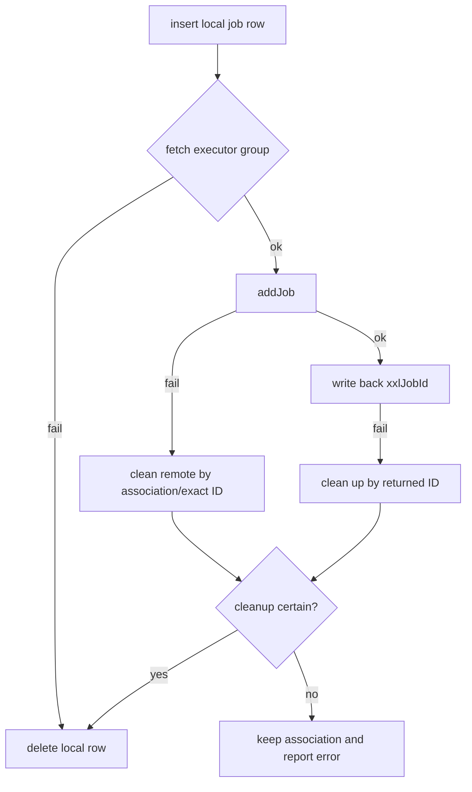

# common-job: XXL-JOB executor, system jobs and user jobs

`omni-common-job` solves two scheduling problems:

- **System jobs**: maintenance jobs shipped with a service (log archive and MQ relay) that must be discovered by the scheduler and displayed in the admin UI;
- **User jobs**: personal scheduled jobs created in the UI, which must be registered, updated, enabled/disabled and deleted dynamically in the scheduler.

Within a service, both share an executor and connect to the same XXL-JOB Admin. Different services retain distinct AppNames and executor groups. Registration paths and failure recovery differ.

This page explains the shared library. The standalone [distributed scheduling chapter](distributed-jobs-principles.en.md) covers concepts, framework excerpts, project flows and real screens. Source explanations do not replace evidence of a particular execution.

## 1. Executor and system job registration

### Problem

The scheduler must know which handlers a service exposes, their default cron and parameters. Manual configuration in the scheduler drifts across environments.

### Usage

Annotate the execution method with both annotations:

```java
@XxlJob("operLogArchiveHandler")
@SystemJobMeta(name = "操作日志归档", description = "...", defaultCron = "0 0 2 * * ?", routeStrategy = "FIRST")
public void archive() { ... }
```

Real dual-annotation examples are Base's `OperLogArchiver` and mqlog's `MqMessageRelayJob`. `UserJobExecuteHandler` is the shared personal-job entry with only the execution annotation; it does not belong in the system maintenance catalog.

### Source

Executor bean conditions:

```java
    @Bean
    @ConditionalOnMissingBean
    @ConditionalOnProperty(prefix = "xxl.job.executor", name = "enabled", havingValue = "true", matchIfMissing = true)
    public XxlJobSpringExecutor xxlJobSpringExecutor(
            XxlJobProperties properties,
            @Value("${spring.application.name}") String appName) {
```

Registry scan:

```java
                XxlJob xxlJob = AnnotationUtils.findAnnotation(method, XxlJob.class);
                SystemJobMeta meta = AnnotationUtils.findAnnotation(method, SystemJobMeta.class);
                if (xxlJob != null && meta != null) {
```

### Key rules

1. **The system catalog requires both annotations**. `@XxlJob` alone identifies an execution entry to the framework but supplies no project system-job metadata. `@SystemJobMeta` alone does not supply an XXL-JOB invocation entry.
2. An empty `appname` falls back to `spring.application.name`.
3. Before creating the executor, group registration is attempted up to five times, ten seconds apart. Exhaustion records a failure and returns; this branch does not throw to stop the entire application. Application startup does not prove scheduling readiness.
4. The registry scans in `@PostConstruct`; a bean that cannot be fetched is skipped without blocking startup.

### Boundaries and recovery

- Job not listed: check both annotations, then whether proxying hides the method annotation (`AnnotationUtils` searches superclasses/interfaces, but `private` methods still need care).
- Job not running: check scheduler enablement, cron and executor registration.
- Executor AppNames differ per service, so same-named handlers are naturally isolated.

## 2. Admin client and user job registration

### Problem

User jobs are created at runtime, not shipped with code. The service must call the XXL-JOB Admin HTTP API to register, update and delete, and handle "local success, remote failure" inconsistencies.

### Implementation points

`XxlJobAdminClient`:

- logs in via `/auth/doLogin` and obtains the `xxl_job_login_token` cookie;
- caches the cookie in a `volatile` field and re-logs in once when authentication expires;
- does not persist across restarts.

`UserJobServiceImpl.createJob()` order:

1. insert the local `sys_user_job` row;
2. fetch the executor group;
3. `addJob` registers with the scheduler;
4. write back `xxl_job_id`.

### Failure recovery (real branches)

| Failure point | Handling |
| --- | --- |
| executor group fetch fails | delete the just-inserted local row |
| `addJob` fails | clean up remote by trusted association or exact ID, then delete the local row |
| `xxlJobId` write-back fails | `addJob` returned an exact ID; clean up by that ID |
| cleanup result unknown | **keep the local row and association and report an error**; verify remotely, never delete blindly |
| name-only edit | the scheduler description is not updated (known limitation) |



### Boundaries

- "Registration accepted" does not mean "the job ran as expected"; check scheduler logs.
- After a timeout, query the remote side before retrying, to avoid duplicate jobs.
- The startup sync scans enabled local rows without an XXL ID, but it cannot replace manual reconciliation of unknown registration results.

## 3. Parameter metadata and execution metrics

### ParamDef

System jobs declare parameters with `ParamDef` inside `@SystemJobMeta(params = ...)`. The registry collects these definitions, and the Base page uses them to build an input form explaining what to enter.

The annotation is **metadata**, not proof that every constraint is enforced. UI constraints depend on the actual form. Handlers must still validate types, ranges and business meaning rather than trusting input because a description exists.

### JobMetrics

`JobMetrics` counts the relevant success and failure branches of the execution entry. Without a registry it may emit nothing, and a database exception can interrupt later counting. Missing metrics alone prove neither non-execution nor business success.

## 4. Extension and choices

| Goal | How | Do not |
| --- | --- | --- |
| New system job | new method + both annotations | add only `@XxlJob` |
| New user job type | new `type_code` + same-named bean | change the shared handler name |
| Adjust existing arguments/routing | Use the formal management entry; annotation defaults apply to new registrations and do not overwrite existing settings | Assume a default-annotation change updated the remote job |
| New scheduling platform | new executor implementation | branch on platform inside handlers |

## Verification

- `SystemJobRegistry` scan and dual-annotation behavior;
- `UserJobServiceImpl` registration rollback branches (unit tests);
- `JobMetricsTest`;
- Real scheduling requires new logs, trigger origin and business results; registration or screenshots alone are insufficient.

Previous: [common-operlog](common-operlog.en.md); next: [common-mqlog](common-mqlog.en.md).
