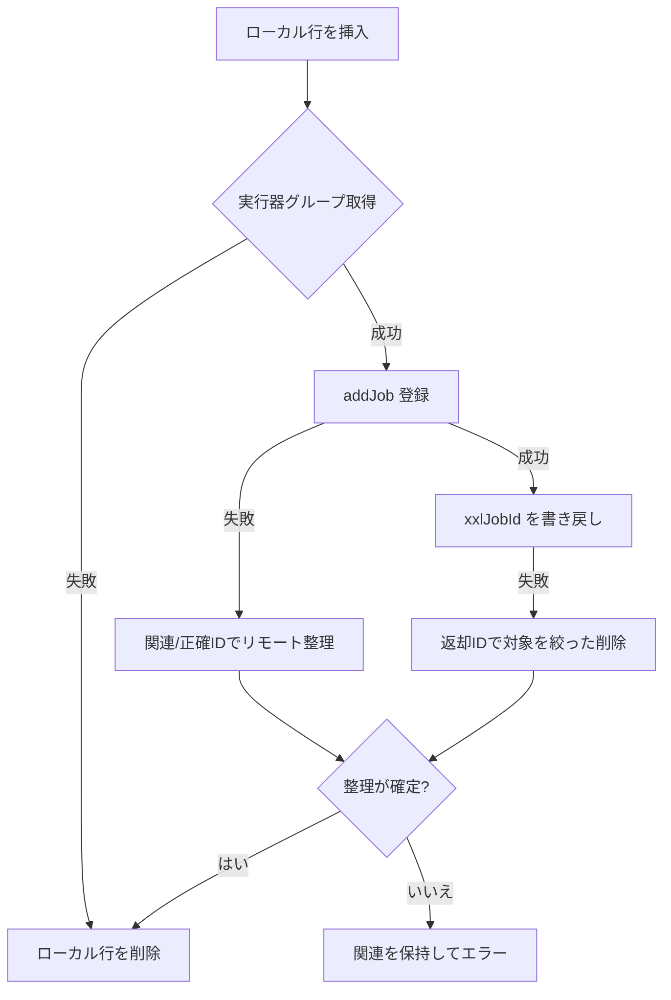

# common-job：XXL-JOB 実行器・システムタスク・ユーザータスク

`omni-common-job` は 2 種類のスケジューリング問題を解決します。

- **システムタスク**：サービスと共に配布される保守タスク（ログアーカイブ、MQ 中継）。スケジューラに発見され、管理画面に表示される必要があります。
- **ユーザータスク**：画面で作成される個人の定期タスク。スケジューラへ動的に登録・更新・起動停止・削除します。

同一サービス内では実行器を共有し、共通の XXL-JOB 管理端へ接続します。サービスごとの AppName と実行器グループは別です。登録経路と失敗復旧も異なります。

本ページは共通ライブラリの役割を説明します。基礎、フレームワーク原文、プロジェクト内の流れ、実画面は独立した[分散定期ジョブの章](distributed-jobs-principles.jp.md)にあります。ソースの説明は個別実行のログを代替しません。

## 1. 実行器とシステムタスク登録

### 問題

スケジューラは「このサービスにどの handler があり、既定 cron とパラメータは何か」を知る必要があります。手作業設定は環境移行で漏れます。

### 使い方

実行メソッドに両方の注釈を付けます。

```java
@XxlJob("operLogArchiveHandler")
@SystemJobMeta(name = "操作日志归档", description = "...", defaultCron = "0 0 2 * * ?", routeStrategy = "FIRST")
public void archive() { ... }
```

二つのアノテーションの実例は Base の `OperLogArchiver` と mqlog の `MqMessageRelayJob` です。`UserJobExecuteHandler` は実行用アノテーションだけを持つ個人ジョブの共通入口で、システム保守一覧には属しません。

### 実装原文

実行器 Bean の条件：

```java
    @Bean
    @ConditionalOnMissingBean
    @ConditionalOnProperty(prefix = "xxl.job.executor", name = "enabled", havingValue = "true", matchIfMissing = true)
    public XxlJobSpringExecutor xxlJobSpringExecutor(
            XxlJobProperties properties,
            @Value("${spring.application.name}") String appName) {
```

システムタスクのスキャン：

```java
                XxlJob xxlJob = AnnotationUtils.findAnnotation(method, XxlJob.class);
                SystemJobMeta meta = AnnotationUtils.findAnnotation(method, SystemJobMeta.class);
                if (xxlJob != null && meta != null) {
```

### 重要ルール

1. **システム一覧には両アノテーションが必要**です。`@XxlJob` だけならフレームワークの実行入口を示せますが、プロジェクトのシステムメタデータは収集されません。`@SystemJobMeta` だけでは XXL-JOB の呼び出し入口になりません。
2. `appname` が空なら `spring.application.name` に戻します。
3. 実行器の作成前に最大五回、十秒間隔でグループ登録を試みます。使い切ると失敗を記録して戻り、この分岐から例外を投げてアプリ全体を止めません。アプリの起動とスケジューリングの準備完了は別です。
4. 登録表は `@PostConstruct` でスキャンし、Bean 取得失敗はスキップして起動を止めません。

### 境界と失敗復旧

- タスクが出ない：両アノテーション、次に Spring のプロキシでメソッドのアノテーションが見えるかを確認します。`AnnotationUtils` は親クラスやインターフェースをたどりますが、`private` メソッドには引き続き注意が必要です。
- 実行されない：スケジューラの有効化、cron、実行器登録を確認。
- 実行器 AppName はサービスごとに異なるため、同名 handler は自然に分離されます。

## 2. 管理端クライアントとユーザータスク登録

### 問題

ユーザータスクはコード配布時ではなく実行時に作られます。サービスは XXL-JOB Admin の HTTP API で登録・更新・削除し、「ローカル成功・リモート失敗」の不整合を処理します。

### 実装要点

`XxlJobAdminClient`：

- `/auth/doLogin` で `xxl_job_login_token` Cookie を取得。
- Cookie は `volatile` にキャッシュし、認証失効時に再ログインして 1 回再試行。
- 再起動をまたいで永続化しません。

`UserJobServiceImpl.createJob()` の順序：

1. ローカル `sys_user_job` 行を挿入。
2. 実行器グループを取得。
3. `addJob` でスケジューラへ登録。
4. `xxl_job_id` を書き戻し。

### 失敗復旧（実際の分岐）

| 失敗点 | 処理 |
| --- | --- |
| 実行器グループ取得失敗 | 挿入直後のローカル行を削除 |
| `addJob` 失敗 | 信頼できる関連または正確な ID でリモートを整理後、ローカル行を削除 |
| `xxlJobId` 書き戻し失敗 | 返却された正確な ID のジョブだけを対象に削除 |
| 整理結果が不明 | **ローカル行と関連を保持してエラー報告**。リモートを確認し、盲目的に削除しない |
| 名前だけ変更 | スケジューラの説明は更新しない（既知の制限） |



### 境界

- 「登録受理」は「期待通り実行された」と同じではありません。実行結果はスケジュールログで確認します。
- タイムアウト後はリモートを照会してから再試行し、重複タスクを避けます。
- 起動時同期は XXL ID のない有効行を走査しますが、不明な登録結果の人手照合を代替しません。

## 3. パラメータ構造と実行指標

### ParamDef

システムタスクは `@SystemJobMeta(params = ...)` 内の `ParamDef` で引数を定義します。登録表が収集し、Base の画面が入力フォームを作って必要な内容を示します。

アノテーションは**メタデータ**で、全制約の検証を保証しません。画面の制約は実フォームに従い、処理器も型、範囲、業務上の意味を確認します。説明があるだけで入力を信頼してはいけません。

### JobMetrics

`JobMetrics` は実行入口の該当する成功・失敗分岐を数えます。登録先がなければ出力されず、DB 例外で後続の計数が止まる場合もあります。指標がないことだけで未実行や業務成功を断定できません。

## 4. 拡張と選択

| やりたいこと | 方法 | やってはいけない |
| --- | --- | --- |
| システムタスク追加 | 新メソッド + 両注釈 | `@XxlJob` だけ付ける |
| ユーザータスク種別追加 | 新 `type_code` + 同名 Bean | 共有 handler 名を変える |
| 既存引数・ルーティングの変更 | 正式な管理入口で変更する。アノテーションの既定値は新規登録用で既存設定を上書きしない | 既定値だけを変えて遠隔も更新済みと思う |
| 別スケジューラ対応 | 新実行器実装 | handler 内でプラットフォーム分岐 |

## 検証入口

- `SystemJobRegistry` のスキャンと両注釈の挙動。
- `UserJobServiceImpl` の登録ロールバック分岐（単体テスト）。
- `JobMetricsTest`。
- 実際のスケジューリングは新しいログ、起動元、業務結果で検証し、登録や画像だけで代用しません。

前章：[common-operlog](common-operlog.jp.md)。次章：[common-mqlog](common-mqlog.jp.md)。
