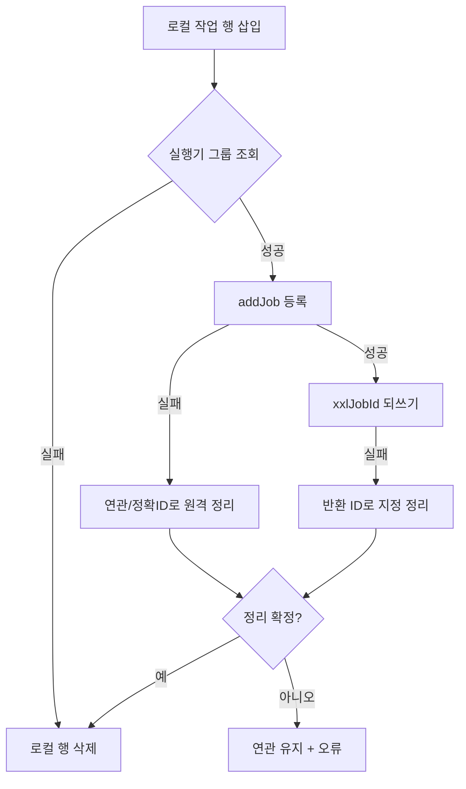

# common-job: XXL-JOB 실행기, 시스템 작업과 사용자 작업

`omni-common-job`은 두 가지 스케줄링 문제를 해결합니다.

- **시스템 작업**: 서비스와 함께 배포되는 유지보수 작업(로그 아카이브, MQ 릴레이). 스케줄러가 발견하고 관리 화면에 표시해야 합니다.
- **사용자 작업**: 화면에서 만드는 개인 예약 작업. 스케줄러에 동적으로 등록·수정·시작/중지·삭제합니다.

같은 서비스에서는 실행기를 공유하고 공통 XXL-JOB Admin에 연결합니다. 서비스마다 AppName과 실행기 그룹은 다릅니다. 등록 경로와 실패 복구도 다릅니다.

이 글은 공통 라이브러리의 역할을 설명합니다. 기초, 프레임워크 원문, 프로젝트 흐름, 실제 화면은 독립된 [분산 예약 작업 장](distributed-jobs-principles.kr.md)에 있습니다. 소스 설명은 특정 실행의 로그를 대신하지 않습니다.

## 1. 실행기와 시스템 작업 등록

### 문제

스케줄러는 "이 서비스에 어떤 handler가 있고 기본 cron과 파라미터가 무엇인지" 알아야 합니다. 수동 설정은 환경 이동 시 누락됩니다.

### 사용법

실행 메서드에 두 어노테이션을 모두 붙입니다.

```java
@XxlJob("operLogArchiveHandler")
@SystemJobMeta(name = "操作日志归档", description = "...", defaultCron = "0 0 2 * * ?", routeStrategy = "FIRST")
public void archive() { ... }
```

두 애너테이션을 쓰는 실제 예는 Base의 `OperLogArchiver`와 mqlog의 `MqMessageRelayJob`입니다. `UserJobExecuteHandler`는 실행 애너테이션만 있는 개인 작업 공통 진입점이며 시스템 유지보수 목록에 속하지 않습니다.

### 구현 원문

실행기 Bean이 생성되는 조건입니다.

```java
    @Bean
    @ConditionalOnMissingBean
    @ConditionalOnProperty(prefix = "xxl.job.executor", name = "enabled", havingValue = "true", matchIfMissing = true)
    public XxlJobSpringExecutor xxlJobSpringExecutor(
            XxlJobProperties properties,
            @Value("${spring.application.name}") String appName) {
```

시스템 작업을 스캔하는 부분입니다.

```java
                XxlJob xxlJob = AnnotationUtils.findAnnotation(method, XxlJob.class);
                SystemJobMeta meta = AnnotationUtils.findAnnotation(method, SystemJobMeta.class);
                if (xxlJob != null && meta != null) {
```

### 핵심 규칙

1. **시스템 목록에 포함하려면 두 애너테이션이 필요**합니다. `@XxlJob`만 있으면 프레임워크의 실행 진입점을 나타내지만 프로젝트 시스템 메타데이터는 수집하지 않습니다. `@SystemJobMeta`만으로는 XXL-JOB 호출 진입점을 제공하지 못합니다.
2. `appname`이 비면 `spring.application.name`으로 대체합니다.
3. 실행기 생성 전에 최대 다섯 번, 10초 간격으로 그룹 등록을 시도합니다. 모두 실패하면 실패를 기록하고 반환하며 이 분기에서 예외로 앱 전체를 중단하지 않습니다. 앱 기동이 스케줄링 준비 완료를 뜻하지는 않습니다.
4. 등록표는 `@PostConstruct`에서 스캔하며 Bean 조회 실패는 건너뛰고 기동을 막지 않습니다.

### 경계와 실패 복구

- 작업이 안 보이면 두 애너테이션과 Spring 프록시에서 메서드 애너테이션이 보이는지 확인합니다. `AnnotationUtils`는 상위 클래스와 인터페이스를 탐색하지만 `private` 메서드는 여전히 주의해야 합니다.
- 실행 안 됨: 스케줄러 활성화, cron, 실행기 등록을 확인합니다.
- 실행기 AppName이 서비스마다 달라 동명 handler는 자연히 격리됩니다.

## 2. 관리자 클라이언트와 사용자 작업 등록

### 문제

사용자 작업은 코드 배포가 아니라 런타임에 생성됩니다. 서비스는 XXL-JOB Admin HTTP API로 등록·수정·삭제하고 "로컬 성공·원격 실패" 불일치를 처리해야 합니다.

### 구현 요점

`XxlJobAdminClient`:

- `/auth/doLogin`으로 `xxl_job_login_token` 쿠키 획득.
- 쿠키는 `volatile`에 캐시하고 인증 만료 시 재로그인 후 한 번 재시도.
- 재시작을 넘겨 영속화하지 않습니다.

`UserJobServiceImpl.createJob()` 순서:

1. 로컬 `sys_user_job` 행 삽입;
2. 실행기 그룹 조회;
3. `addJob`으로 스케줄러 등록;
4. `xxl_job_id` 되쓰기.

### 실패 복구(실제 분기)

| 실패 지점 | 처리 |
| --- | --- |
| 실행기 그룹 조회 실패 | 방금 삽입한 로컬 행 삭제 |
| `addJob` 실패 | 신뢰 연관 또는 정확한 ID로 원격 정리 후 로컬 행 삭제 |
| `xxlJobId` 되쓰기 실패 | 반환된 정확한 ID로 지정 정리 |
| 정리 결과 불명 | **로컬 행과 연관을 유지하고 오류 보고**. 원격 확인 후 삭제, 맹목 삭제 금지 |
| 이름만 수정 | 스케줄러 설명은 갱신하지 않음(알려진 제한) |



### 경계

- "등록 접수"는 "예상대로 실행됨"이 아닙니다. 실행 결과는 스케줄 로그를 봅니다.
- 타임아웃 후에는 원격을 먼저 조회한 뒤 재시도해 중복 작업을 피합니다.
- 기동 동기화는 XXL ID가 없는 활성 행을 스캔하지만 불명 등록 결과의 수동 대조를 대체하지 않습니다.

## 3. 파라미터 구조와 실행 지표

### ParamDef

시스템 작업은 `@SystemJobMeta(params = ...)` 안의 `ParamDef`로 인수를 정의합니다. 등록표가 이를 모으고 Base 화면은 입력 양식을 만들어 필요한 내용을 안내합니다.

애너테이션은 **메타데이터**이며 모든 제약의 검증을 보장하지 않습니다. 화면 제약은 실제 양식에 따르고 처리기도 타입, 범위, 업무 의미를 검증해야 합니다. 설명이 있다고 입력을 신뢰해서는 안 됩니다.

### JobMetrics

`JobMetrics`는 실행 진입점의 해당 성공·실패 분기를 집계합니다. 등록기가 없으면 출력하지 않을 수 있고 DB 예외가 후속 집계를 중단할 수도 있습니다. 지표 부재만으로 미실행이나 업무 성공을 단정할 수 없습니다.

## 4. 확장과 선택

| 하고 싶은 일 | 방법 | 하면 안 되는 일 |
| --- | --- | --- |
| 시스템 작업 추가 | 새 메서드 + 두 어노테이션 | `@XxlJob`만 추가 |
| 사용자 작업 유형 추가 | 새 `type_code` + 같은 이름 Bean | 공유 handler 이름 변경 |
| 기존 인수·라우팅 수정 | 정식 관리 진입점에서 수정. 애너테이션 기본값은 새 등록에 쓰며 기존 설정을 덮어쓰지 않음 | 기본 애너테이션만 바꾸고 원격도 갱신됐다고 판단 |
| 다른 스케줄러 지원 | 새 실행기 구현 | handler 안에서 플랫폼 분기 |

## 검증 진입

- `SystemJobRegistry` 스캔과 두 어노테이션 동작.
- `UserJobServiceImpl` 등록 롤백 분기(단위 테스트).
- `JobMetricsTest`.
- 실제 스케줄링은 새로운 로그, 실행 출처, 업무 결과로 검증하며 등록이나 이미지만으로 대신하지 않습니다.

이전: [common-operlog](common-operlog.kr.md). 다음: [common-mqlog](common-mqlog.kr.md).
