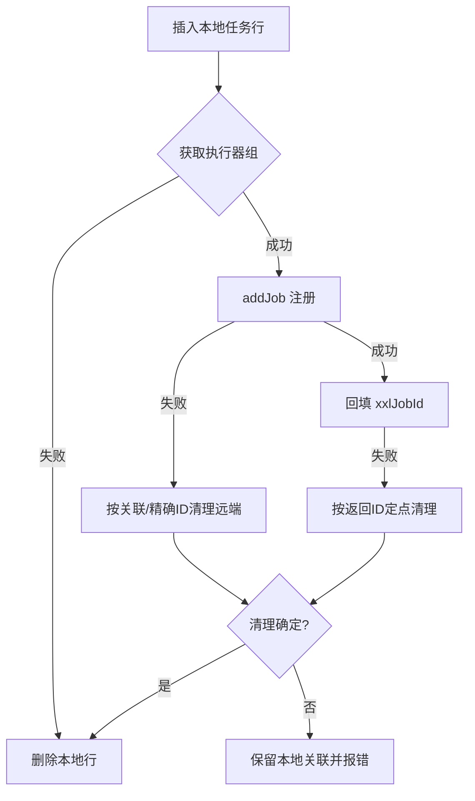

# common-job：XXL-JOB 执行器、系统任务与用户任务

`omni-common-job` 解决两类调度问题：

- **系统任务**：随服务发布的固定维护任务（日志归档、MQ 中继），需要被调度中心发现并在管理界面展示；
- **用户任务**：用户在页面上创建的个人定时任务，需要在调度中心动态注册、更新、启停、删除。

同一服务内两者共用执行器，并连接统一的 XXL-JOB 管理端；不同服务仍使用各自 AppName 和执行器组。注册路径与失败恢复不同。

本页解释公共库的职责。完整的基础概念、框架原文、工程流程和真实网页见独立的[分布式定时任务章节](distributed-jobs-principles.md)；源码说明不能代替某次实际执行的日志。

## 一、执行器与系统任务注册

### 问题

调度中心需要知道“这个服务有哪些 handler、默认 cron 是什么、参数怎么填”。如果靠人工在调度中心配置，环境迁移就会漏配。

### 怎么用

在执行方法上同时标注两个注解：

```java
@XxlJob("operLogArchiveHandler")
@SystemJobMeta(name = "操作日志归档", description = "...", defaultCron = "0 0 2 * * ?", routeStrategy = "FIRST")
public void archive() { ... }
```

双注解的真实例子是 Base 的 `OperLogArchiver` 和 mqlog 的 `MqMessageRelayJob`。`UserJobExecuteHandler` 是个人任务的共享执行入口，只有执行注解，不属于系统维护任务目录。

### 实现原文

执行器 Bean 的条件：

```java
    @Bean
    @ConditionalOnMissingBean
    @ConditionalOnProperty(prefix = "xxl.job.executor", name = "enabled", havingValue = "true", matchIfMissing = true)
    public XxlJobSpringExecutor xxlJobSpringExecutor(
            XxlJobProperties properties,
            @Value("${spring.application.name}") String appName) {
```

系统任务扫描：

```java
                XxlJob xxlJob = AnnotationUtils.findAnnotation(method, XxlJob.class);
                SystemJobMeta meta = AnnotationUtils.findAnnotation(method, SystemJobMeta.class);
                if (xxlJob != null && meta != null) {
```

### 关键规则

1. **进入系统任务目录需要双注解**：只有 `@XxlJob` 时框架可以识别执行入口，但项目不收集系统任务元数据；只有 `@SystemJobMeta` 也不会提供 XXL-JOB 的调用入口。
2. `appname` 为空时回退 `spring.application.name`。
3. 创建执行器前尝试注册执行器组（最多 5 次、间隔 10 秒）；耗尽后记录注册失败并返回，不在这个分支抛异常终止整个应用。应用能启动不代表调度已经就绪。
4. 注册表在 `@PostConstruct` 扫描；单个 Bean 获取失败会被跳过，不阻断启动。

### 边界与失败恢复

- 任务不显示：先查双注解，再查是否被 Spring 代理后方法注解不可见（`AnnotationUtils` 会沿父类/接口查找，但 `private` 方法仍需注意）。
- 任务不执行：检查调度中心是否启用、cron 是否正确、执行器是否注册成功。
- 执行器的 AppName 各服务不同，因此同名 handler 在不同服务间天然隔离。

## 二、管理端客户端与用户任务注册

### 问题

用户任务不是随代码发布的，而是运行期新增的。服务需要调用 XXL-JOB Admin 的 HTTP 接口完成注册、更新、删除，并处理“本地成功、远端失败”的不一致。

### 实现要点

`XxlJobAdminClient`：

- 通过 `/auth/doLogin` 获取 `xxl_job_login_token` Cookie；
- Cookie 缓存在 `volatile` 字段，认证失效时自动重新登录并重试一次；
- 不跨重启持久化，重启后重新登录。

`UserJobServiceImpl.createJob()` 的顺序：

1. 插入本地 `sys_user_job` 行；
2. 获取执行器组；
3. `addJob` 注册到调度中心；
4. 回填 `xxl_job_id`。

### 失败恢复（真实分支）

| 失败点 | 处理 |
| --- | --- |
| 获取执行器组失败 | 删除刚插入的本地行 |
| `addJob` 失败 | 按可信关联或精确远端 ID 清理后删除本地行 |
| 回填 `xxlJobId` 失败 | `addJob` 已返回精确 ID，按 ID 定点清理 |
| 清理结果未知 | **保留本地行与关联并报错**，先核对远端，不盲删 |
| 只改名称 | 不更新调度中心描述（已知限制） |



### 边界

- “注册受理”不等于“任务已按预期执行”；执行结果要看调度日志。
- 写操作超时后应先查询远端是否已创建，再决定是否重试，避免重复任务。
- 启动同步会扫描启用且没有 XXL ID 的本地行，但它不能替代对未知注册结果的人工对账。

## 三、参数结构与执行指标

### ParamDef

系统任务在 `@SystemJobMeta(params = ...)` 中使用 `ParamDef` 声明参数。注册表收集这些定义，Base 页面据此形成输入表单，帮助使用者知道要填什么。

注解本身是**元数据**，不保证每项限制都已执行校验。界面的输入约束以实际表单为准，处理器仍须核对参数类型、范围和业务含义，不能仅因有参数说明就信任输入。

### JobMetrics

`JobMetrics` 在执行入口的相应成功、失败分支记录计数。没有注册表时可不产生指标，数据库异常等也可能中断后续计数；指标缺失不能单独证明任务没执行，更不能反推业务成功。

## 四、扩展与选择

| 想做的事 | 做法 | 不要做 |
| --- | --- | --- |
| 新增系统任务 | 新方法 + 双注解 | 只加 `@XxlJob` |
| 新增用户任务类型 | 新 `type_code` + 同名 Bean | 改共享 handler 名 |
| 调整既有任务参数/路由 | 通过正式管理入口维护；默认注解元数据只用于新注册，不覆盖已有设置 | 只改默认注解就认为远端已更新 |
| 新增调度平台 | 新执行器实现 | 在 handler 里判断平台 |

## 验证入口

- `SystemJobRegistry` 的扫描与双注解行为；
- `UserJobServiceImpl` 的注册回滚分支（单元测试）；
- `JobMetricsTest`；
- 真实调度执行属于运行态验证，需要新的调度日志、触发来源和业务结果，不能只看注册或截图。

上一章：[common-operlog](common-operlog.md)；下一章：[common-mqlog](common-mqlog.md)。
