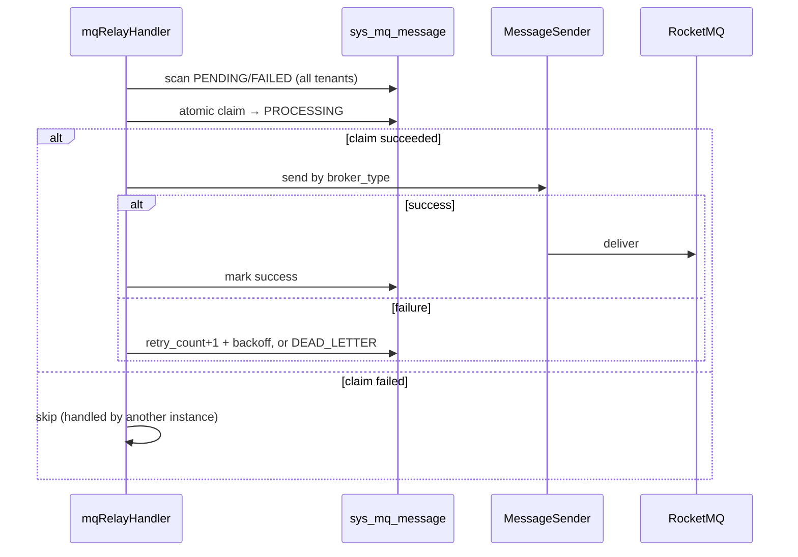

# common-mqlog: transactional Outbox, relay and tenant provisioning

`omni-common-mqlog` addresses "business succeeds, message lost": call it within an effective business transaction to commit business data and a local Outbox row **together**, then let a background relay deliver to MQ. Failed attempts use exponential backoff and enter dead letter when the failure limit is reached.

It also provides idempotent receipts for tenant provisioning requests and an internal message query endpoint.

> Source scope: 15 Java files; backoff and dead-letter logic come from `MqMessageRelayService`. Source and state descriptions alone do not prove runtime delivery.

## Problem

The business database and MQ commit separately. Direct sending can deliver a message before the business rolls back, or the business can commit before sending fails. The Outbox separates "record the intent" from "deliver it": the former is stored with the business locally, the latter can be retried.

## 1. Reliable message template and Outbox

### Usage

```java
reliableMessageRelay.send("order-out-0", payload, tenantId, "order:12345");
```

Call the injected bean from an effective `@Transactional` business Service method. The four-argument implementation uses `Propagation.REQUIRED`: it joins an existing transaction or creates one for this call. It cannot make already-committed business work atomic retroactively. If business and message must roll back together, do not swallow send exceptions and continue as if successful.

### Source

```java
    public void send(String bindingName, Object payload, Long tenantId, String msgKey) {
        if (tenantId == null || tenantId <= 0) {
            throw new IllegalArgumentException("可靠消息 tenantId 必须为正整数");
        }
        if (bindingName == null || bindingName.isBlank()) {
            throw new IllegalArgumentException("可靠消息 bindingName 不能为空");
        }
        if (payload == null) {
            throw new IllegalArgumentException("可靠消息 payload 不能为空");
        }
        String msgId = UUID.randomUUID().toString();
        String jsonPayload;
        try {
            jsonPayload = objectMapper.writeValueAsString(payload);
        } catch (JsonProcessingException e) {
            throw new RuntimeException("消息体 JSON 序列化失败: " + e.getMessage(), e);
        }

        SysMqMessage message = new SysMqMessage();
        message.setMsgId(msgId);
        message.setTopic(bindingName);
        message.setBindingName(bindingName);
        message.setMsgKey(msgKey);
        message.setPayload(jsonPayload);
        message.setBrokerType("rocketmq");
        message.setStatus(SysMqMessage.STATUS_PENDING);
        message.setRetryCount(0);
        message.setMaxRetry(3);
        message.setServiceName(serviceName);
        message.setProducerTraceId(MDC.get("traceId"));
        message.setTenantId(tenantId);
        message.setCreateTime(LocalDateTime.now());

        sysMqMessageMapper.insert(message);
        mqLogMetrics.recordOperation(bindingName, "enqueued");
```

### Semantics

- the row is stored as `PENDING`, with `maxRetry` defaulting to 3;
- `producerTraceId` takes the current MDC `traceId` for correlation;
- when called within an effective business transaction, the insert joins it: **insert failure affects that transaction's ability to commit**;
- a successful insert does not mean delivery succeeded.

### Boundaries

- `tenantId` must be explicit and positive; **implicit ThreadLocal resolution is not allowed**.
- Non-blank `bindingName` and non-null `payload` are required.
- Serialization failure throws `RuntimeException` and also rolls back the business transaction.
- The template currently writes `broker_type=rocketmq`, and the relay selects a `MessageSender` by that field. Another MQ needs both a sender strategy and an explicit way for new records to select its broker type. Adding a bean alone does not switch existing records.

## 2. Relay, retry and dead letters

### Relay entry

```java
    @XxlJob("mqRelayHandler")
    @SystemJobMeta(
            name = "MQ消息投递",
            description = "轮询 PENDING/待重试 状态的消息并投递到 MQ，支持指数退避重试",
            defaultCron = "0/10 * * * * ?",
            routeStrategy = "FIRST"
    )
    public void relay() {
```

The annotation supplies a 10-second default and route strategy "FIRST". Actual scheduling also depends on the executor, relay switches and registered Admin configuration.

### Flow



### Failure branch source

```java
    private void handleSendFailure(SysMqMessage msg, String rawError) {
        int newRetryCount = (msg.getRetryCount() == null ? 0 : msg.getRetryCount()) + 1;
        int maxRetry = msg.getMaxRetry() == null ? 0 : msg.getMaxRetry();
        String sanitized = sanitizeError(rawError);
        LocalDateTime now = LocalDateTime.now();

        if (newRetryCount >= maxRetry) {
            // 超过最大重试次数，标记死信：CAS 命中失败写（清空退避时间），retry_count 数据库端自增。
            sysMqMessageMapper.casApplyFailure(msg.getId(), SysMqMessage.STATUS_DEAD_LETTER,
                    null, sanitized, now);
            mqLogMetrics.recordOperation(msg.getBindingName(), "dead_letter");
```

```java
            mqLogMetrics.recordOperation(msg.getBindingName(), "retry");
            // 计算下次重试时间（指数退避：2^retryCount * 基数秒）
            int backoffSeconds = (int) Math.pow(2, newRetryCount) * BACKOFF_BASE_SECONDS;
            LocalDateTime nextRetryTime = now.plusSeconds(backoffSeconds);
            sysMqMessageMapper.casApplyFailure(msg.getId(), SysMqMessage.STATUS_FAILED,
                    nextRetryTime, sanitized, now);
```

### Three key rules

1. **The relay deliberately scans across tenants**: it must process every tenant's messages and must not add a tenant filter. "Fixing" this would strand some tenants' messages forever.
2. **Claim before send**: only the execution that acquires the `PROCESSING` lease with one affected row sends. Candidates also include expired `PROCESSING` leases. This protects against simultaneous claims, not all redelivery: a crash after sending but before recording success can still cause another delivery. Consumers must be idempotent.
3. **Unknown `broker_type` also enters the failure state machine**: it will not sit in a fake `PENDING` forever; it retries, backs off and eventually dead-letters.

### Recovery

- `FAILED`: wait for the backoff retry, or investigate and resend manually.
- `DEAD_LETTER`: resend or skip through the admin UI.
- Business did not receive it: check Outbox row → relay logs → dead letter → consumer Inbox, **never replay the business operation directly**.
- Consumers must be idempotent, or redelivery causes duplicate processing.
- The default `maxRetry=3` counts failures: wait 20 seconds after the first failure and 40 after the second; the third failure enters dead letter. It is not three extra retries after an initial failure.

## 3. Tenant provisioning requests and receipts

### Problem

When Auth provisions a new tenant it publishes `tenant.provision-requested.v1`. Network redelivery or concurrent consumption may deliver the same request more than once; module initialization must be idempotent.

### Implementation points

- the handler and Function are assembled only when a `TenantModuleProvisioner` bean exists (`MqLogAutoConfiguration.java:101-118`);
- it looks up a receipt by `requestId + moduleId` and skips if present;
- initialization, the `SUCCESS` receipt and success-result Outbox commit together. On failure, that transaction rolls back before a separate transaction records the `FAILED` receipt and failure-result message;
- result events use deterministic IDs for replay verification.

### Boundaries

- receipts provide request idempotency, not business result handling;
- both `SUCCESS` and `FAILED` receipts make repeated `requestId + moduleId` deliveries skip processing. Use Auth's formal failed-module retry entry for a real retry: it creates a new `requestId` and retries only failed modules. Do not handcraft requests or delete old receipts to bypass this;
- ordering and retry policy belong to Auth's orchestration.

## 4. Internal message query

`MqMessageInternalController` exposes internal tenant queries in Servlet applications. With `omni.service.internal-api.enabled=true`, the shared service module protects it with `InternalApiAuthenticationFilter`; when disabled or absent, the MQ module registers the compatibility `InternalApiAuthFilter`. This switch selects authentication implementation; it does not remove the Controller or make it unauthenticated.

### Boundaries

- `tenantId` is mandatory to avoid cross-tenant leakage;
- a missing or wrong internal token is rejected (401);
- external admin queries use each service's `MqMessageController` with `X-Tenant-Id`.

## Appendix: states and handling

| State | Meaning | Handling |
| --- | --- | --- |
| PENDING | awaiting delivery | relay scan |
| PROCESSING | claimed by an instance | lease expires, relay re-processes |
| FAILED | delivery failed, backing off | retried when due |
| SENT | sender handed it to MQ | separately check consumer processing |
| DEAD_LETTER | failure limit reached | manual resend or skip |
| SKIPPED | admin chose to skip | retain the record; not business success |

Previous: [common-job](common-job.en.md); next: [common-workflow](common-workflow.en.md).
