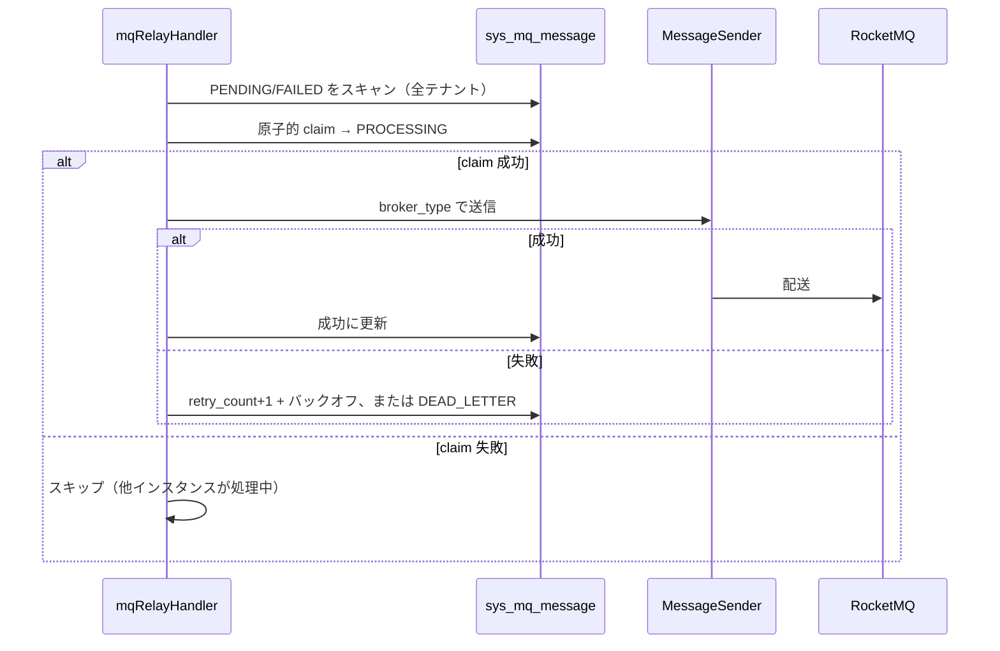

# common-mqlog：トランザクショナル Outbox・中継・テナント開通

`omni-common-mqlog` は「業務成功・メッセージ喪失」に対処します。有効な業務トランザクション内から呼び、業務データとローカル Outbox 行を**一緒にコミット**して、後から中継が MQ に配送します。失敗は指数バックオフで再試行し、失敗回数の上限に達するとデッドレターになります。

さらに、テナント開通要求の冪等レシートと内部メッセージ照会を提供します。

> ソースの範囲：Java ファイル 15 個。バックオフとデッドレターは `MqMessageRelayService` に基づきます。ソースや状態の説明だけでは、実行環境での配送成功を証明できません。

## 問題

業務 DB と MQ は別々にコミットします。直接送信では、メッセージの配送後に業務がロールバックしたり、業務コミット後に送信が失敗したりします。Outbox は「送る予定の記録」と「実際の配送」を分け、前者を業務と一緒にローカル保存し、後者を再試行可能にします。

## 1. 信頼性メッセージテンプレートと Outbox

### 使い方

```java
reliableMessageRelay.send("order-out-0", payload, tenantId, "order:12345");
```

有効な `@Transactional` 業務 Service メソッド内から、注入した Bean を呼びます。4 引数の実装は `Propagation.REQUIRED` で、既存トランザクションに参加し、無ければ今回の呼び出し用に作ります。既にコミット済みの業務を後から一体化するものではありません。一緒にロールバックする必要がある場合、送信例外を握りつぶして成功扱いにしないでください。

### 実装原文

```java
    public void send(String bindingName, Object payload, Long tenantId, String msgKey) {
        if (tenantId == null || tenantId <= 0) {
            throw new IllegalArgumentException("可靠消息 tenantId 必须为正整数");
        }
        if (bindingName == null || bindingName.isBlank()) {
            throw new IllegalArgumentException("可靠消息 bindingName 不能为空");
        }
        if (payload == null) {
            throw new IllegalArgumentException("可靠消息 payload 不能为空");
        }
        String msgId = UUID.randomUUID().toString();
        String jsonPayload;
        try {
            jsonPayload = objectMapper.writeValueAsString(payload);
        } catch (JsonProcessingException e) {
            throw new RuntimeException("消息体 JSON 序列化失败: " + e.getMessage(), e);
        }

        SysMqMessage message = new SysMqMessage();
        message.setMsgId(msgId);
        message.setTopic(bindingName);
        message.setBindingName(bindingName);
        message.setMsgKey(msgKey);
        message.setPayload(jsonPayload);
        message.setBrokerType("rocketmq");
        message.setStatus(SysMqMessage.STATUS_PENDING);
        message.setRetryCount(0);
        message.setMaxRetry(3);
        message.setServiceName(serviceName);
        message.setProducerTraceId(MDC.get("traceId"));
        message.setTenantId(tenantId);
        message.setCreateTime(LocalDateTime.now());

        sysMqMessageMapper.insert(message);
        mqLogMetrics.recordOperation(bindingName, "enqueued");
```

### 意味

- 行は `PENDING` で保存され、`maxRetry` の既定は 3。
- `producerTraceId` は現在の MDC `traceId`。
- 有効な業務トランザクション内から呼ぶと挿入もそこに参加し、**挿入失敗はそのトランザクションのコミットに影響**します。
- 挿入成功は配送成功を意味しません。

### 境界

- `tenantId` は明示的かつ正の整数で、**ThreadLocal の暗黙解決は禁止**。
- `bindingName` は非空、`payload` は非 null が必須。
- 直列化失敗は `RuntimeException` で業務トランザクションもロールバック。
- テンプレートは現在 `broker_type=rocketmq` を書き、中継がこの項目で `MessageSender` を選びます。他の MQ を追加するときは送信戦略だけでなく、新しい記録がその broker 種別を選ぶ方法も必要です。Bean を追加しただけでは既存の記録は切り替わりません。

## 2. 中継・再試行・デッドレター

### 中継入口

```java
    @XxlJob("mqRelayHandler")
    @SystemJobMeta(
            name = "MQ消息投递",
            description = "轮询 PENDING/待重试 状态的消息并投递到 MQ，支持指数退避重试",
            defaultCron = "0/10 * * * * ?",
            routeStrategy = "FIRST"
    )
    public void relay() {
```

注釈の既定は 10 秒ごと、ルーティングは「最初の 1 台」です。実際のスケジュールは実行器、中継スイッチ、調整センターの登録設定にも依存します。

### 処理フロー



### 失敗分岐の原文

```java
    private void handleSendFailure(SysMqMessage msg, String rawError) {
        int newRetryCount = (msg.getRetryCount() == null ? 0 : msg.getRetryCount()) + 1;
        int maxRetry = msg.getMaxRetry() == null ? 0 : msg.getMaxRetry();
        String sanitized = sanitizeError(rawError);
        LocalDateTime now = LocalDateTime.now();

        if (newRetryCount >= maxRetry) {
            // 超过最大重试次数，标记死信：CAS 命中失败写（清空退避时间），retry_count 数据库端自增。
            sysMqMessageMapper.casApplyFailure(msg.getId(), SysMqMessage.STATUS_DEAD_LETTER,
                    null, sanitized, now);
            mqLogMetrics.recordOperation(msg.getBindingName(), "dead_letter");
```

```java
            mqLogMetrics.recordOperation(msg.getBindingName(), "retry");
            // 计算下次重试时间（指数退避：2^retryCount * 基数秒）
            int backoffSeconds = (int) Math.pow(2, newRetryCount) * BACKOFF_BASE_SECONDS;
            LocalDateTime nextRetryTime = now.plusSeconds(backoffSeconds);
            sysMqMessageMapper.casApplyFailure(msg.getId(), SysMqMessage.STATUS_FAILED,
                    nextRetryTime, sanitized, now);
```

### 3 つの重要ルール

1. **中継は意図的に全テナントをスキャン**します。全テナントのメッセージを処理する必要があり、テナントフィルタを足してはいけません。「漏れ」と誤認して直すと、一部テナントのメッセージが永遠に配送されません。
2. **送信前に原子的に claim** し、`PROCESSING` のリースを 1 行獲得できた実行だけが送信します。候補にはリース切れの `PROCESSING` も含まれます。同時の取り合いを防ぐ仕組みであり、重複配送を完全には防ぎません。送信後・成功記録前の停止では再配送があり得るため、消費側も冪等にします。
3. **未知の `broker_type` も失敗状態機械に載せます**。偽 `PENDING` で滞留せず、再試行・バックオフ・最終的にデッドレターになります。

### 失敗復旧

- `FAILED`：バックオフ時間を待つか、調査後に手動再送。
- `DEAD_LETTER`：管理画面で手動再送またはスキップ。
- 業務が受け取らない：Outbox 行 → 中継ログ → デッドレター → 消費側 Inbox の順に調べ、**業務操作を直接再実行しない**。
- 消費側は冪等でなければ、再配送で二重処理になります。
- 既定の `maxRetry=3` は失敗回数です。1 回目の失敗後は 20 秒、2 回目は 40 秒待ち、3 回目の失敗でデッドレターになります。初回の失敗に加えて 3 回再試行する意味ではありません。

## 3. テナント開通要求とレシート

### 問題

Auth が新テナントを開通すると `tenant.provision-requested.v1` を発行します。再配送や並行消費で同じ要求が複数回到達し得るため、モジュール初期化は冪等でなければなりません。

### 実装要点

- `TenantModuleProvisioner` Bean がある場合のみ handler と Function を組み込み（`MqLogAutoConfiguration.java:101-118`）。
- `requestId + moduleId` でレシートを照会し、存在すればスキップ。
- 初期化、`SUCCESS` レシート、成功結果の Outbox は同一トランザクションで確定します。失敗時は先にロールバックし、独立トランザクションで `FAILED` レシートと失敗結果メッセージを保存します。
- 結果イベントは決定論的 ID を使い、再送時の照合を可能にする。

### 境界

- レシートは要求の冪等性を担い、業務結果処理の代替ではありません。
- `SUCCESS` も `FAILED` も、同じ `requestId + moduleId` の再配送をスキップさせます。本当の再試行は Auth の正式な失敗モジュール再試行入口を使います。新しい `requestId` が生成され、失敗したモジュールだけを処理します。手作りの要求や旧レシートの削除で迂回してはいけません。
- 開通順序と再試行方針は Auth の編成に属します。

## 4. 内部メッセージ照会

`MqMessageInternalController` は Servlet アプリでテナント別の内部照会を提供します。`omni.service.internal-api.enabled=true` では共通サービスモジュールの `InternalApiAuthenticationFilter` が保護し、無効または未設定では MQ モジュールが互換用の `InternalApiAuthFilter` を登録します。このスイッチは認証実装の選択であり、Controller の削除や認証不要化ではありません。

### 境界

- `tenantId` は必須で、テナント間漏洩を防ぎます。
- 内部トークン欠落・誤りは 401。
- 外部管理画面の照会は各サービスの `MqMessageController` が `X-Tenant-Id` で行います。

## 付録：状態と扱い

| 状態 | 意味 | 扱い |
| --- | --- | --- |
| PENDING | 配送待ち | 中継がスキャン |
| PROCESSING | いずれかのインスタンスが claim | リース失効後に再処理 |
| FAILED | 配送失敗・バックオフ中 | 時刻到達後に再試行 |
| SENT | 送信側から MQ に引き渡し済み | 消費側の処理成功は別途確認 |
| DEAD_LETTER | 失敗回数の上限に到達 | 手動再送またはスキップ |
| SKIPPED | 管理側がスキップを選択 | 記録を残し、業務成功とは扱わない |

前章：[common-job](common-job.jp.md)。次章：[common-workflow](common-workflow.jp.md)。
