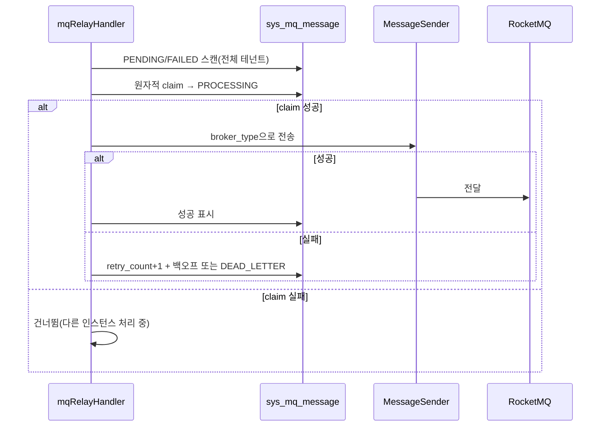

# common-mqlog: 트랜잭션 Outbox, 릴레이, 테넌트 개통

`omni-common-mqlog`는 "업무 성공, 메시지 유실"에 대응합니다. 유효한 업무 트랜잭션 안에서 호출해 업무 데이터와 로컬 Outbox 행을 **함께 커밋**하고, 백그라운드 릴레이가 나중에 MQ로 전달합니다. 실패는 지수 백오프로 재시도하며 실패 횟수 상한에 도달하면 데드레터가 됩니다.

또한 테넌트 개통 요청의 멱등 영수증과 내부 메시지 조회를 제공합니다.

> 소스 범위: Java 파일 15개. 백오프·데드레터는 `MqMessageRelayService`에 근거합니다. 소스와 상태 설명만으로 실제 환경의 메시지 전달 성공을 증명할 수 없습니다.

## 문제

업무 DB와 MQ는 따로 커밋됩니다. 직접 전송하면 메시지가 나간 뒤 업무가 롤백되거나, 업무가 커밋된 뒤 전송이 실패할 수 있습니다. Outbox는 "보낼 의도 기록"과 "실제 전달"을 나눕니다. 전자는 업무와 함께 로컬에 저장하고 후자는 재시도할 수 있습니다.

## 1. 신뢰성 메시지 템플릿과 Outbox

### 사용법

```java
reliableMessageRelay.send("order-out-0", payload, tenantId, "order:12345");
```

유효한 `@Transactional` 업무 Service 메서드 안에서 주입된 Bean을 호출합니다. 네 인자 구현은 `Propagation.REQUIRED`이므로 기존 트랜잭션에 참여하고, 없으면 이번 호출용으로 만듭니다. 이미 커밋된 업무를 소급해 하나로 묶는 기능은 아닙니다. 업무와 메시지가 함께 롤백돼야 한다면 전송 예외를 삼킨 뒤 성공으로 처리하지 마세요.

### 구현 원문

```java
    public void send(String bindingName, Object payload, Long tenantId, String msgKey) {
        if (tenantId == null || tenantId <= 0) {
            throw new IllegalArgumentException("可靠消息 tenantId 必须为正整数");
        }
        if (bindingName == null || bindingName.isBlank()) {
            throw new IllegalArgumentException("可靠消息 bindingName 不能为空");
        }
        if (payload == null) {
            throw new IllegalArgumentException("可靠消息 payload 不能为空");
        }
        String msgId = UUID.randomUUID().toString();
        String jsonPayload;
        try {
            jsonPayload = objectMapper.writeValueAsString(payload);
        } catch (JsonProcessingException e) {
            throw new RuntimeException("消息体 JSON 序列化失败: " + e.getMessage(), e);
        }

        SysMqMessage message = new SysMqMessage();
        message.setMsgId(msgId);
        message.setTopic(bindingName);
        message.setBindingName(bindingName);
        message.setMsgKey(msgKey);
        message.setPayload(jsonPayload);
        message.setBrokerType("rocketmq");
        message.setStatus(SysMqMessage.STATUS_PENDING);
        message.setRetryCount(0);
        message.setMaxRetry(3);
        message.setServiceName(serviceName);
        message.setProducerTraceId(MDC.get("traceId"));
        message.setTenantId(tenantId);
        message.setCreateTime(LocalDateTime.now());

        sysMqMessageMapper.insert(message);
        mqLogMetrics.recordOperation(bindingName, "enqueued");
```

### 의미

- 행은 `PENDING`, `maxRetry` 기본 3.
- `producerTraceId`는 현재 MDC `traceId`.
- 유효한 업무 트랜잭션 안에서 호출하면 삽입도 참여하며 **삽입 실패가 해당 트랜잭션의 커밋에 영향**을 줍니다.
- 삽입 성공은 전달 성공이 아닙니다.

### 경계

- `tenantId`는 명시적 양의 정수여야 하며 **ThreadLocal 암묵 해석 금지**.
- `bindingName` 비어 있지 않음, `payload` non-null 필수.
- 직렬화 실패는 `RuntimeException`으로 업무 트랜잭션도 롤백.
- 템플릿은 현재 `broker_type=rocketmq`를 쓰고 릴레이가 이 필드로 `MessageSender`를 고릅니다. 다른 MQ를 추가하려면 전송 전략뿐 아니라 새 기록이 해당 broker 타입을 선택할 방법도 필요합니다. Bean만 추가해도 기존 기록이 자동 전환되지는 않습니다.

## 2. 릴레이, 재시도, 데드레터

### 릴레이 진입

```java
    @XxlJob("mqRelayHandler")
    @SystemJobMeta(
            name = "MQ消息投递",
            description = "轮询 PENDING/待重试 状态的消息并投递到 MQ，支持指数退避重试",
            defaultCron = "0/10 * * * * ?",
            routeStrategy = "FIRST"
    )
    public void relay() {
```

어노테이션 기본값은 10초 주기, 라우팅은 "첫 번째"입니다. 실제 스케줄은 실행기, 릴레이 스위치와 관리 센터에 등록된 설정에도 달려 있습니다.

### 처리 흐름



### 실패 분기 원문

```java
    private void handleSendFailure(SysMqMessage msg, String rawError) {
        int newRetryCount = (msg.getRetryCount() == null ? 0 : msg.getRetryCount()) + 1;
        int maxRetry = msg.getMaxRetry() == null ? 0 : msg.getMaxRetry();
        String sanitized = sanitizeError(rawError);
        LocalDateTime now = LocalDateTime.now();

        if (newRetryCount >= maxRetry) {
            // 超过最大重试次数，标记死信：CAS 命中失败写（清空退避时间），retry_count 数据库端自增。
            sysMqMessageMapper.casApplyFailure(msg.getId(), SysMqMessage.STATUS_DEAD_LETTER,
                    null, sanitized, now);
            mqLogMetrics.recordOperation(msg.getBindingName(), "dead_letter");
```

```java
            mqLogMetrics.recordOperation(msg.getBindingName(), "retry");
            // 计算下次重试时间（指数退避：2^retryCount * 基数秒）
            int backoffSeconds = (int) Math.pow(2, newRetryCount) * BACKOFF_BASE_SECONDS;
            LocalDateTime nextRetryTime = now.plusSeconds(backoffSeconds);
            sysMqMessageMapper.casApplyFailure(msg.getId(), SysMqMessage.STATUS_FAILED,
                    nextRetryTime, sanitized, now);
```

### 세 가지 핵심 규칙

1. **릴레이는 의도적으로 전체 테넌트를 스캔**합니다. 모든 테넌트 메시지를 처리해야 하며 테넌트 필터를 추가하면 안 됩니다. "누락"으로 오판해 고치면 일부 테넌트 메시지가 영원히 전달되지 않습니다.
2. **전송 전 원자적 claim**: `PROCESSING` 리스를 1행 확보한 실행만 전송하며, 리스가 만료된 `PROCESSING`도 후보입니다. 동시 경쟁을 막지만 모든 재전달을 막는 것은 아닙니다. 전송 뒤 성공 기록 전에 중단되면 재전달될 수 있어 소비자도 멱등이어야 합니다.
3. **알 수 없는 `broker_type`도 실패 상태기계**로 갑니다. 가짜 `PENDING`에 머물지 않고 재시도·백오프·최종 데드레터가 됩니다.

### 실패 복구

- `FAILED`: 백오프 시간을 기다리거나 조사 후 수동 재전송.
- `DEAD_LETTER`: 관리 화면에서 수동 재전송 또는 건너뛰기.
- 업무가 받지 못함: Outbox 행 → 릴레이 로그 → 데드레터 → 소비자 Inbox 순으로 확인하고 **업무 작업을 직접 재실행하지 않습니다**.
- 소비자는 멱등이어야 하며 아니면 재전달이 중복 처리됩니다.
- 기본 `maxRetry=3`은 실패 횟수입니다. 첫 실패 후 20초, 두 번째 후 40초를 기다리고 세 번째 실패에 데드레터로 갑니다. 최초 실패 뒤 추가로 세 번 재시도한다는 뜻이 아닙니다.

## 3. 테넌트 개통 요청과 영수증

### 문제

Auth가 새 테넌트를 개통하면 `tenant.provision-requested.v1`을 발행합니다. 재전달이나 동시 소비로 같은 요청이 여러 번 도착할 수 있어 모듈 초기화는 멱등이어야 합니다.

### 구현 요점

- `TenantModuleProvisioner` Bean이 있을 때만 handler와 Function을 조립(`MqLogAutoConfiguration.java:101-118`).
- `requestId + moduleId`로 영수증을 조회해 있으면 건너뜁니다.
- 초기화, `SUCCESS` 영수증, 성공 결과 Outbox는 같은 트랜잭션으로 커밋합니다. 실패하면 먼저 롤백한 뒤 독립 트랜잭션으로 `FAILED` 영수증과 실패 결과 메시지를 저장합니다.
- 결과 이벤트는 결정적 ID를 사용해 재전송 대조가 가능합니다.

### 경계

- 영수증은 요청 멱등성을 담당하며 업무 결과 처리의 대체가 아닙니다.
- `SUCCESS`와 `FAILED` 영수증 모두 같은 `requestId + moduleId`의 재전달을 건너뛰게 합니다. 실제 재시도는 Auth의 정식 실패 모듈 재시도 진입점을 사용합니다. 새 `requestId`를 만들고 실패 모듈만 처리합니다. 요청을 직접 만들거나 이전 영수증을 지워 우회하지 마세요.
- 개통 순서와 재시도 정책은 Auth 편성에 속합니다.

## 4. 내부 메시지 조회

`MqMessageInternalController`는 Servlet 앱에서 테넌트별 내부 조회를 제공합니다. `omni.service.internal-api.enabled=true`면 공용 서비스 모듈의 `InternalApiAuthenticationFilter`가 보호하며, 비활성 또는 미설정이면 MQ 모듈이 호환용 `InternalApiAuthFilter`를 등록합니다. 이 스위치는 인증 구현을 고르는 것이며 Controller를 없애거나 인증을 생략하지 않습니다.

### 경계

- `tenantId`는 필수이며 테넌트 간 누출을 막습니다.
- 내부 토큰 누락·오류는 401.
- 외부 관리 화면 조회는 각 서비스의 `MqMessageController`가 `X-Tenant-Id`로 수행합니다.

## 부록: 상태와 처리

| 상태 | 의미 | 처리 |
| --- | --- | --- |
| PENDING | 전달 대기 | 릴레이 스캔 |
| PROCESSING | 인스턴스가 claim | 리스 만료 후 재처리 |
| FAILED | 전달 실패·백오프 | 시각 도달 후 재시도 |
| SENT | 송신자가 MQ로 전달함 | 소비자 처리 성공은 별도 확인 |
| DEAD_LETTER | 실패 횟수 상한 도달 | 수동 재전송 또는 건너뛰기 |
| SKIPPED | 관리자가 건너뛰기로 결정함 | 기록을 남기며 업무 성공이 아님 |

이전: [common-job](common-job.kr.md). 다음: [common-workflow](common-workflow.kr.md).
