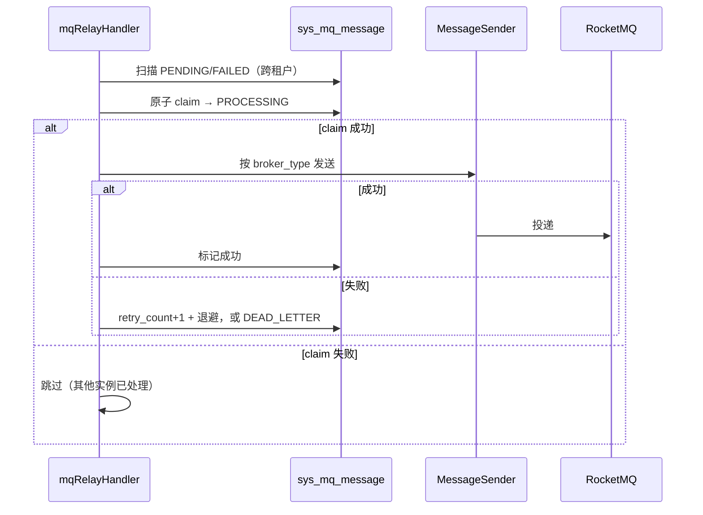

# common-mqlog：事务性 Outbox、中继与租户开通

`omni-common-mqlog` 解决“业务成功、消息丢失”这一类问题：在有效业务事务内调用发送接口，把业务数据与本地 Outbox 记录**一起提交**，再由后台中继异步投递到 MQ；失败按指数退避重试，达到失败次数上限进入死信。

它还提供租户开通请求的幂等收据与内部消息查询接口。

> 源码范围：模块 15 个 Java 文件；退避与死信逻辑来自 `MqMessageRelayService`。下文的源码与状态说明不能单独证明运行环境已经完成消息投递。

## 问题

业务数据库与 MQ 各自提交，直接发送时可能出现消息先发出、业务却回滚，或业务先提交、消息却发送失败。Outbox 把“记录要发”与“真正发送”分开：前者与业务一起写本地数据库，后者可重试。

## 一、可靠消息模板与 Outbox

### 怎么用

```java
reliableMessageRelay.send("order-out-0", payload, tenantId, "order:12345");
```

请在业务 Service 的有效 `@Transactional` 方法内，通过注入的 Bean 调用。四参数实现使用 `Propagation.REQUIRED`：有事务就加入，没有则为本次调用创建事务；它不能让已提交的其他业务操作重新变成原子操作。需要业务与消息一起回滚时，也不能吞掉发送异常后继续当成功处理。

### 实现原文

```java
    public void send(String bindingName, Object payload, Long tenantId, String msgKey) {
        if (tenantId == null || tenantId <= 0) {
            throw new IllegalArgumentException("可靠消息 tenantId 必须为正整数");
        }
        if (bindingName == null || bindingName.isBlank()) {
            throw new IllegalArgumentException("可靠消息 bindingName 不能为空");
        }
        if (payload == null) {
            throw new IllegalArgumentException("可靠消息 payload 不能为空");
        }
        String msgId = UUID.randomUUID().toString();
        String jsonPayload;
        try {
            jsonPayload = objectMapper.writeValueAsString(payload);
        } catch (JsonProcessingException e) {
            throw new RuntimeException("消息体 JSON 序列化失败: " + e.getMessage(), e);
        }

        SysMqMessage message = new SysMqMessage();
        message.setMsgId(msgId);
        message.setTopic(bindingName);
        message.setBindingName(bindingName);
        message.setMsgKey(msgKey);
        message.setPayload(jsonPayload);
        message.setBrokerType("rocketmq");
        message.setStatus(SysMqMessage.STATUS_PENDING);
        message.setRetryCount(0);
        message.setMaxRetry(3);
        message.setServiceName(serviceName);
        message.setProducerTraceId(MDC.get("traceId"));
        message.setTenantId(tenantId);
        message.setCreateTime(LocalDateTime.now());

        sysMqMessageMapper.insert(message);
        mqLogMetrics.recordOperation(bindingName, "enqueued");
```

### 语义

- 记录以 `PENDING` 落库，`maxRetry` 默认 3；
- `producerTraceId` 取当前 MDC 的 `traceId`，便于串联；
- 在有效业务事务内调用时，插入参与该事务：**插入失败会影响该业务事务的提交**；
- 插入成功不代表已投递。

### 边界

- `tenantId` 必须显式传入且为正整数，**不允许 ThreadLocal 隐式解析**。
- `bindingName` 与 `payload` 必须有值；空值直接抛 `IllegalArgumentException`。
- 序列化失败抛 `RuntimeException`，同样会回滚业务事务。
- 模板当前固定写入 `broker_type=rocketmq`，中继按该字段选择 `MessageSender`。扩展其他 MQ 时既要提供发送策略，也要明确新记录如何选择 broker 类型；只新增一个 Bean 不会自动切换已有记录。

## 二、中继、重试与死信

### 中继入口

```java
    @XxlJob("mqRelayHandler")
    @SystemJobMeta(
            name = "MQ消息投递",
            description = "轮询 PENDING/待重试 状态的消息并投递到 MQ，支持指数退避重试",
            defaultCron = "0/10 * * * * ?",
            routeStrategy = "FIRST"
    )
    public void relay() {
```

注解给出的默认周期是每 10 秒、路由策略为「第一个」；实际调度还取决于执行器、中继开关与调度中心的登记配置。

### 处理流程



### 失败分支原文

```java
    private void handleSendFailure(SysMqMessage msg, String rawError) {
        int newRetryCount = (msg.getRetryCount() == null ? 0 : msg.getRetryCount()) + 1;
        int maxRetry = msg.getMaxRetry() == null ? 0 : msg.getMaxRetry();
        String sanitized = sanitizeError(rawError);
        LocalDateTime now = LocalDateTime.now();

        if (newRetryCount >= maxRetry) {
            // 超过最大重试次数，标记死信：CAS 命中失败写（清空退避时间），retry_count 数据库端自增。
            sysMqMessageMapper.casApplyFailure(msg.getId(), SysMqMessage.STATUS_DEAD_LETTER,
                    null, sanitized, now);
            mqLogMetrics.recordOperation(msg.getBindingName(), "dead_letter");
```

```java
            mqLogMetrics.recordOperation(msg.getBindingName(), "retry");
            // 计算下次重试时间（指数退避：2^retryCount * 基数秒）
            int backoffSeconds = (int) Math.pow(2, newRetryCount) * BACKOFF_BASE_SECONDS;
            LocalDateTime nextRetryTime = now.plusSeconds(backoffSeconds);
            sysMqMessageMapper.casApplyFailure(msg.getId(), SysMqMessage.STATUS_FAILED,
                    nextRetryTime, sanitized, now);
```

### 三条关键规则

1. **中继有意跨租户扫描**：它要处理所有租户的消息，不能加租户过滤。把它当“漏加租户条件”的缺陷去修，会让部分租户的消息永远不投递。
2. **先原子抢占再发送**：只有抢到 `PROCESSING` 租约且影响行数为 1 的执行流才发送；候选还包括租约过期的 `PROCESSING`。这防止同时争抢，不能保证全程只投递一次：发送后、记成功前崩溃仍可能重投，消费者必须幂等。
3. **未知 `broker_type` 也走失败状态机**：不会停在假 `PENDING` 长期不告警，而是重试、退避、最终死信。

### 失败恢复

- 消息停在 `FAILED`：按退避时间等待中继重试，或人工排查后重发。
- 进入 `DEAD_LETTER`：通过管理界面人工重发或跳过。
- 业务没收到：按 Outbox 记录 → 中继日志 → 死信 → 消费者 Inbox 的顺序排查，**不要直接重放业务操作**。
- 消费者必须幂等，否则重投会重复处理。
- 默认 `maxRetry=3` 按失败计数判断：第一次失败后等 20 秒，第二次等 40 秒，第三次失败即进入死信，不是首次失败后再额外重试三次。

## 三、租户开通请求与收据

### 问题

新租户开通时，Auth 会向各模块发 `tenant.provision-requested.v1`。网络重投或并发消费都可能让同一请求到达多次，模块初始化必须幂等。

### 实现要点

- 只有存在 `TenantModuleProvisioner` Bean 时才装配 handler 与 Function（`MqLogAutoConfiguration.java:101-118`）；
- 按 `requestId + moduleId` 查询收据，已存在则跳过；
- 初始化、`SUCCESS` 收据与成功结果 Outbox 在同一事务内提交；失败先回滚，再用独立事务写 `FAILED` 收据和失败结果消息；
- 结果事件使用确定性 ID，便于重放核对。

### 边界

- 收据按请求幂等，不能替代业务侧的结果处理；
- `SUCCESS` 和 `FAILED` 收据都会让相同 `requestId + moduleId` 的重投被跳过。真正重试应走 Auth 的正式失败模块重试入口：它生成新 `requestId`，仅重新开通失败模块；不要手工造请求或删旧收据绕过；
- 开通顺序与重试策略不在本模块，而在 Auth 编排。

## 四、内部消息查询

`MqMessageInternalController` 在 Servlet 应用中提供按租户查询消息状态的内部接口。开启 `omni.service.internal-api.enabled=true` 时，由公共服务模块的 `InternalApiAuthenticationFilter` 保护；未开启或未配置时，MQ 模块注册兼容的 `InternalApiAuthFilter`。开关选择认证实现，不是让这个 Controller 自动消失或免认证。

### 边界

- 必须带 `tenantId` 查询，避免跨租户泄露；
- 内部令牌缺失或错误一律拒绝（401）；
- 外部管理端查询由各服务的 `MqMessageController` 负责，使用 `X-Tenant-Id`。

## 附：状态与处理方式

| 状态 | 含义 | 处理 |
| --- | --- | --- |
| PENDING | 待投递 | 中继扫描 |
| PROCESSING | 已被某实例抢占 | 租约超时后由中继重新处理 |
| FAILED | 投递失败，等待退避 | 到时间后重试 |
| SENT | 发送方已交给 MQ | 仍需另查消费者是否处理成功 |
| DEAD_LETTER | 失败次数达到上限 | 人工重发或跳过 |
| SKIPPED | 管理端决定跳过 | 保留记录，不当作业务成功 |

上一章：[common-job](common-job.md)；下一章：[common-workflow](common-workflow.md)。
