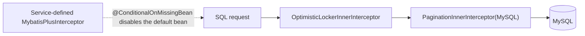

# common-mybatis: the default MyBatis-Plus interceptor chain

`omni-common-mybatis` has exactly **one** Java file. It solves a narrow problem: services using MyBatis-Plus should not assemble optimistic locking and pagination themselves, and the order between them must be correct.

It is not "all database capabilities": tenant isolation and data permission are **not in this module**. They live in `omni-common-service` and override this default chain entirely. That is the easiest misunderstanding in this chapter.

> Evidence boundary: conclusions come from `MybatisPlusAutoConfiguration`; no application was started this round.

## Problem

MyBatis-Plus interceptors form a chain: with the wrong order, pagination may run before data permission, or optimistic locking may miss its version. If every service writes its own `MybatisPlusInterceptor`, someone will reverse the order or omit one.

## Usage

Add the dependency; no configuration is needed:

```xml
<dependency>
    <groupId>com.omni</groupId>
    <artifactId>omni-common-mybatis</artifactId>
</dependency>
```

Then use MyBatis-Plus normally: an entity with `@Version` enables optimistic locking, and `selectPage` uses pagination.

## Principle and source

```java
@ConditionalOnClass(MybatisPlusInterceptor.class)
public class MybatisPlusAutoConfiguration {
```

```java
    @Bean
    @ConditionalOnMissingBean
    public MybatisPlusInterceptor mybatisPlusInterceptor() {
        MybatisPlusInterceptor interceptor = new MybatisPlusInterceptor();
        interceptor.addInnerInterceptor(new OptimisticLockerInnerInterceptor());
        interceptor.addInnerInterceptor(new PaginationInnerInterceptor(DbType.MYSQL));
        return interceptor;
    }
```

Fixed order: **optimistic lock → pagination**; the dialect is fixed to MySQL.



## Relation to tenant/data permission

When a service enables `omni.service.tenant.enabled` or `omni.service.data-scope.enabled`, `omni-common-service` provides a bean of the same type, so the default bean here is not created. That chain's order is:

**TenantLine → DataPermission → OptimisticLocker → Pagination**

In other words:

- only `omni-common-mybatis`: optimistic locking and pagination only;
- with tenant or data permission enabled: `common-service` takes over the whole chain;
- the two **do not stack**.

## Boundaries and recovery

- The default chain has no tenant or data permission; including the mybatis module does not mean data is isolated.
- A service-defined `MybatisPlusInterceptor` replaces the default chain entirely; custom chains must still put optimistic locking before pagination.
- `@ConditionalOnMissingBean` matches by type, not by bean name.

## Extension

A new built-in interceptor (for example, blocking full-table updates) belongs in this default chain, with an explicit statement of whether it still applies outside tenant/data permission. If only some services need it, put it in their own configuration instead of affecting the whole repository.

## Verification

- `MybatisPlusConfigTest` in `omni-asset` asserts the service-level bean overrides the default;
- `ServicePersistenceAutoConfigurationTest` in `omni-common-service` asserts tenant/data-permission assembly and order.

Next: [common-redis](common-redis.en.md) and [common-redis-reactive](common-redis-reactive.en.md) cover the blocking and reactive Redis paths.
