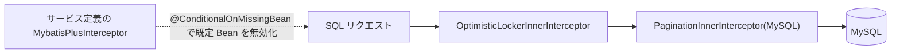

# common-mybatis：MyBatis-Plus の既定インターセプタチェーン

`omni-common-mybatis` の Java ファイルは**1 つ**だけです。解決する問題は明確で、MyBatis-Plus を使うサービスが楽観ロックとページングを自前で組み込みせずに済み、両者の順序も正しくなるようにします。

「データベース機能の全部」ではありません。テナント分離とデータ権限は**このモジュールにありません**。`omni-common-service` にあり、ここの既定チェーンを丸ごと上書きします。本章で最も誤解されやすい点です。

> 事実境界：以下の結論は `MybatisPlusAutoConfiguration` のソースに基づきます。今回はアプリを起動していません。

## 問題

MyBatis-Plus のインターセプタはチェーンであり、順序を誤るとページングがデータ権限より先に実行されたり、楽観ロックがバージョンを取得できなかったりします。各サービスが `MybatisPlusInterceptor` を書くと、順序を逆にしたり 1 つ漏らしたりする人が出ます。

## 使い方

依存を追加するだけで、設定は不要です。

```xml
<dependency>
    <groupId>com.omni</groupId>
    <artifactId>omni-common-mybatis</artifactId>
</dependency>
```

その後は通常どおり MyBatis-Plus を使います。`@Version` を持つエンティティで楽観ロックが有効になり、`selectPage` がページングを使います。

## 原理と実装原文

```java
@ConditionalOnClass(MybatisPlusInterceptor.class)
public class MybatisPlusAutoConfiguration {
```

```java
    @Bean
    @ConditionalOnMissingBean
    public MybatisPlusInterceptor mybatisPlusInterceptor() {
        MybatisPlusInterceptor interceptor = new MybatisPlusInterceptor();
        interceptor.addInnerInterceptor(new OptimisticLockerInnerInterceptor());
        interceptor.addInnerInterceptor(new PaginationInnerInterceptor(DbType.MYSQL));
        return interceptor;
    }
```

固定順序は**楽観ロック → ページング**、方言は MySQL 固定です。



## テナント/データ権限との関係

`omni.service.tenant.enabled` または `omni.service.data-scope.enabled` を有効にすると、`omni-common-service` が同型の Bean を提供するため、ここの既定 Bean は生成されません。そのチェーンの順序は次のとおりです。

**TenantLine → DataPermission → OptimisticLocker → Pagination**

つまり：

- `omni-common-mybatis` のみ：楽観ロックとページングだけ。
- テナントまたはデータ権限を有効化：`common-service` がチェーン全体を引き継ぐ。
- 両者は**重ならない**。

## 境界と失敗復旧

- 既定チェーンにテナント/データ権限はなく、mybatis モジュールを入れたからといってデータが分離されるわけではありません。
- サービス定義の `MybatisPlusInterceptor` は既定チェーンを丸ごと置き換えます。独自チェーンでも楽観ロックをページングより前に置きます。
- `@ConditionalOnMissingBean` は型で判定し、Bean 名では判定しません。

## 拡張

新しい組み込みインターセプタ（全表更新の防止など）はこの既定チェーンに追加し、テナント/データ権限の外でも適用されるかを明示します。一部のサービスだけが必要なら、全倉に影響しないよう各サービスの設定に置きます。

## 検証入口

- `omni-asset` の `MybatisPlusConfigTest` がサービス側 Bean による上書きを断言。
- `omni-common-service` の `ServicePersistenceAutoConfigurationTest` がテナント/データ権限の組み込みと順序を断言。

次章：[common-redis](common-redis.jp.md) と [common-redis-reactive](common-redis-reactive.jp.md)。
