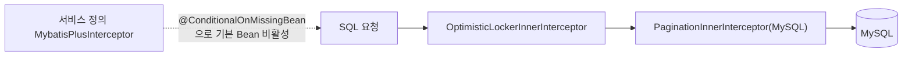

# common-mybatis: MyBatis-Plus 기본 인터셉터 체인

`omni-common-mybatis`에는 Java 파일이 **하나**뿐입니다. 해결하는 문제는 명확합니다. MyBatis-Plus를 쓰는 서비스가 낙관적 잠금과 페이지네이션을 직접 조립하지 않아도 되고, 둘의 순서도 올바르게 유지됩니다.

"데이터베이스 기능 전체"가 아닙니다. 테넌트 격리와 데이터 권한은 **이 모듈에 없습니다**. `omni-common-service`에 있고, 여기의 기본 체인을 통째로 대체합니다. 이 장에서 가장 오해하기 쉬운 지점입니다.

> 사실 경계: 결론은 `MybatisPlusAutoConfiguration` 소스에 근거합니다. 이번 라운드에 애플리케이션을 기동하지 않았습니다.

## 문제

MyBatis-Plus 인터셉터는 체인이라 순서가 틀리면 페이지네이션이 데이터 권한보다 먼저 실행되거나 낙관적 잠금이 버전을 얻지 못합니다. 서비스마다 `MybatisPlusInterceptor`를 직접 작성하면 순서를 뒤집거나 하나를 빠뜨리는 사람이 생깁니다.

## 사용법

의존만 추가하면 설정이 필요 없습니다.

```xml
<dependency>
    <groupId>com.omni</groupId>
    <artifactId>omni-common-mybatis</artifactId>
</dependency>
```

이후 MyBatis-Plus를 평소처럼 사용합니다. `@Version` 필드가 있으면 낙관적 잠금이, `selectPage`가 페이지네이션을 사용합니다.

## 원리와 구현 원문

```java
@ConditionalOnClass(MybatisPlusInterceptor.class)
public class MybatisPlusAutoConfiguration {
```

```java
    @Bean
    @ConditionalOnMissingBean
    public MybatisPlusInterceptor mybatisPlusInterceptor() {
        MybatisPlusInterceptor interceptor = new MybatisPlusInterceptor();
        interceptor.addInnerInterceptor(new OptimisticLockerInnerInterceptor());
        interceptor.addInnerInterceptor(new PaginationInnerInterceptor(DbType.MYSQL));
        return interceptor;
    }
```

고정 순서는 **낙관적 잠금 → 페이지네이션**, 방언은 MySQL 고정입니다.



## 테넌트/데이터 권한과의 관계

`omni.service.tenant.enabled` 또는 `omni.service.data-scope.enabled`가 켜지면 `omni-common-service`가 같은 타입의 Bean을 제공하므로 여기의 기본 Bean은 생성되지 않습니다. 그 체인의 순서는 다음과 같습니다.

**TenantLine → DataPermission → OptimisticLocker → Pagination**

즉:

- `omni-common-mybatis`만: 낙관적 잠금과 페이지네이션만.
- 테넌트 또는 데이터 권한 활성: `common-service`가 체인 전체를 인계.
- 둘은 **겹치지 않습니다**.

## 경계와 실패 복구

- 기본 체인에는 테넌트/데이터 권한이 없으며, mybatis 모듈을 넣었다고 데이터가 격리되지는 않습니다.
- 서비스 정의 `MybatisPlusInterceptor`는 기본 체인을 전부 대체합니다. 사용자 정의에서도 낙관적 잠금을 페이지네이션 앞에 둡니다.
- `@ConditionalOnMissingBean`은 타입으로 판정하며 Bean 이름으로 판정하지 않습니다.

## 확장

새 내장 인터셉터(전체 테이블 갱신 방지 등)는 이 기본 체인에 추가하고, 테넌트/데이터 권한 밖에서도 적용되는지 명시합니다. 일부 서비스만 필요하면 전체 저장소에 영향을 주지 않도록 해당 서비스 설정에 둡니다.

## 검증 진입

- `omni-asset`의 `MybatisPlusConfigTest`가 서비스 수준 Bean의 대체를 검증.
- `omni-common-service`의 `ServicePersistenceAutoConfigurationTest`가 테넌트/데이터 권한 조립과 순서를 검증.

다음: [common-redis](common-redis.kr.md), [common-redis-reactive](common-redis-reactive.kr.md).
