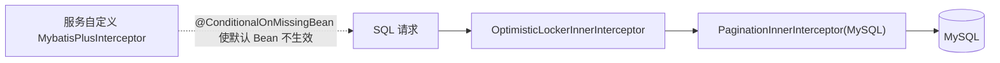

# common-mybatis：MyBatis-Plus 的默认拦截器链

`omni-common-mybatis` 只有**一个** Java 文件，它解决的问题很具体：让使用 MyBatis-Plus 的服务不用每处自己装配乐观锁与分页插件，并保证两者顺序正确。

它不是“数据库能力全集”：租户隔离与数据权限**不在这个模块**，而在 `omni-common-service`，并且会整体覆盖这里的默认链。这一点是本章最容易误解的地方。

> 事实边界：以下结论来自 `MybatisPlusAutoConfiguration` 源码；本轮未启动应用。

## 问题

MyBatis-Plus 的拦截器是链式的：顺序错了，分页可能先于数据权限执行，乐观锁也可能拿不到版本。每个服务各写一份 `MybatisPlusInterceptor`，就会有人把顺序写反，或者漏掉其中一个。

## 怎么用

引入依赖即可，服务不需要写配置：

```xml
<dependency>
    <groupId>com.omni</groupId>
    <artifactId>omni-common-mybatis</artifactId>
</dependency>
```

随后正常使用 MyBatis-Plus：实体带 `@Version` 字段启用乐观锁，`selectPage` 使用分页。

## 原理与实现原文

```java
@ConditionalOnClass(MybatisPlusInterceptor.class)
public class MybatisPlusAutoConfiguration {
```

```java
    @Bean
    @ConditionalOnMissingBean
    public MybatisPlusInterceptor mybatisPlusInterceptor() {
        MybatisPlusInterceptor interceptor = new MybatisPlusInterceptor();
        interceptor.addInnerInterceptor(new OptimisticLockerInnerInterceptor());
        interceptor.addInnerInterceptor(new PaginationInnerInterceptor(DbType.MYSQL));
        return interceptor;
    }
```

固定顺序：**乐观锁 → 分页**；数据库方言固定为 MySQL。



## 与租户/数据权限的关系

当服务启用 `omni.service.tenant.enabled` 或 `omni.service.data-scope.enabled` 时，`omni-common-service` 会提供一个**同名类型的 Bean**，因此这里的默认 Bean 不再创建。那条链的顺序是：

**TenantLine → DataPermission → OptimisticLocker → Pagination**

也就是说：

- 只引入 `omni-common-mybatis`：只有乐观锁与分页。
- 再启用租户或数据权限：由 `common-service` 接管整条链。
- 两者**不会叠加**。

## 边界与失败恢复

- 默认链不包含租户与数据权限，不能因为“引了 mybatis 模块”就认为数据已隔离。
- 服务自定义 `MybatisPlusInterceptor` 会整体覆盖默认链；自定义时仍要保证乐观锁在分页之前。
- `@ConditionalOnMissingBean` 是“按类型”判断，不是按 Bean 名。

## 扩展

新增内置拦截器（例如防全表更新）应加在这个默认链里，并明确它在租户/数据权限之外是否仍然适用；若只在部分服务需要，放在服务自己的配置中，避免影响全仓。

## 验证入口

- `omni-asset` 的 `MybatisPlusConfigTest` 断言服务级 Bean 覆盖默认链；
- `omni-common-service` 的 `ServicePersistenceAutoConfigurationTest` 断言租户/数据权限的装配与顺序。

下一章：[common-redis](common-redis.md) 与 [common-redis-reactive](common-redis-reactive.md) 分别讲阻塞与响应式两条 Redis 路径。
