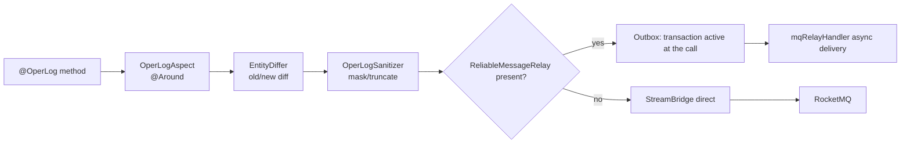

# common-operlog: collection, diff and sanitization of operation logs

`omni-common-operlog` solves one cross-cutting need: record **who did what, when, to which object, and with what result**, without intruding into business methods. An annotation declares the collection point, an aspect collects, and a producer sends the message.

It is not security auditing: authentication and login auditing go to Auth's `sys_audit_log`, and **Auth does not depend on this module**.

> Source scope: 5 Java files; 28 files across 5 business services currently use `@OperLog` (asset 3, base 4, crm 5, procurement 6, srm 10), Auth 0. These counts locate integrations; they do not prove runtime delivery.

## Problem

Hand-writing "record a log" in every write endpoint produces three kinds of drift: omissions, inconsistent fields, and sensitive values persisted as-is. An aspect decouples collection from business code; unified diff and sanitization keep the output readable.

## 1. Collection chain

### Usage

```java
@OperLog(module = "srm", operType = OperType.UPDATE)
@PutMapping("/{id}")
public R<Void> update(@PathVariable Long id, @RequestBody SupplierUpdateRequest request) { ... }
```

After adding the dependency, the aspect assembles automatically.

### Assembly conditions

```java
@ConditionalOnWebApplication(type = ConditionalOnWebApplication.Type.SERVLET)
@ConditionalOnClass(name = "org.aspectj.lang.ProceedingJoinPoint")
public class OperLogAutoConfiguration {
```

- Servlet application only;
- AspectJ must be on the classpath;
- the aspect entry is `@Around("@annotation(operLog)")` (`OperLogAspect.java:84`).

### Sending: Outbox first

```java
    public void send(OperLogMessage message) {
        try {
            Long tenantId = message.getTenantId();
            if (reliableRelay != null) {
                reliableRelay.send(BINDING_NAME, message, tenantId, message.getEventId());
            } else {
                streamBridge.send(BINDING_NAME, message);
            }
        } catch (Exception e) {
            log.warn("操作日志：MQ 消息发送失败: {}", e.getMessage(), e);
        }
    }
```



### Boundaries

- The producer catches send exceptions and logs a warning without deliberately changing the business return value. **This does not guarantee that every calling arrangement leaves the business transaction unaffected.** If sending joins an unfinished transaction, an exception may already have marked that transaction rollback-only; catching it cannot undo that mark.
- Current annotations are mainly on Controllers: the business Service transaction has usually ended before the operation-log Outbox is written. Do not describe this as guaranteed atomic business/log commit. For atomic business/message commit, call the reliable-message API within an effective business transaction.
- Direct sending is used only when `ReliableMessageRelay` is absent; once present, an Outbox write failure does not fall back to direct sending.
- Self-invocation (same-class method calls) bypasses the proxy and **does not trigger the aspect**.
- `@OperLog` in a service without this module does not fail, but nothing is collected.

### Recovery

- When logs are missing, check: dependency present, Servlet app, AspectJ on classpath, method proxied.
- If only some logs are missing, look for same-class self-invocation.
- In Outbox mode, "log written but not stored" means checking `sys_mq_message` and the relay, not replaying the business operation.

## 2. Diff: EntityDiffer

### Problem

"Supplier updated" is not enough for troubleshooting; you need **which field changed from what to what**.

### Semantics

- UPDATE/DELETE reads the old snapshot first. Only UPDATE reads a new snapshot after the method and computes a diff; DELETE retains the old value with a null new value. CREATE attempts to read the new entity using the returned ID;
- when both JSON snapshots exist, changed fields are extracted;
- no change yields an empty diff.

### Boundaries

- The old snapshot is read before the business call. An entity with `tenantId` must match the request tenant, otherwise its snapshot is omitted. Global entities without that property can still be read; they are not automatically skipped.
- The current old-snapshot database read precedes the target method's try/finally. An exception there can prevent the business call; the later catch handles post-processing errors. Do not promise that all logging failures leave business execution unaffected.
- Snapshots are controlled by `recordSnapshot` and `entityClass/idExpr`; not every method reads the database.
- An empty diff means "no readable change", not "no operation happened".

## 3. Sanitization: OperLogSanitizer

### Problem

Parameters, snapshots and exception text may contain phone numbers, emails, IDs or tokens; they must not be stored as-is.

### Semantics

- sanitizes parameters, snapshots and exception text before sending;
- supports additional excluded fields via `excludeFields`;
- truncates long strings by an implementation constant;
- masks emails/phone numbers according to rules (`OperLogSanitizer.java`).

### Boundaries

- Sanitization affects log content only, never business return values.
- Rules are blacklist-style masking and **do not cover every sensitive shape**; new field types require rule review.
- Masked values are irreversible; logs cannot be used for data recovery.

## 4. Difference from security auditing

| | Operation log | Security audit |
| --- | --- | --- |
| Owner | `omni-common-operlog` + Base consumer | `omni-auth` |
| Trigger | `@OperLog` aspect | authentication events |
| Storage | `sys_oper_log` / archive | `sys_audit_log` |
| Used by Auth | **no** (no dependency, no annotation) | yes |

Conflating them leads to false conclusions such as "why is there no operation log for login". Login records are a read-only projection of security auditing.

## 5. Extension

| Goal | Where | Do not |
| --- | --- | --- |
| New operation type | `OperType` enum | hand-written strings in business code |
| New captured field | `OperLogMessage` and aspect | write to the database bypassing the message |
| New masking rule | `OperLogSanitizer` | mask in business code while still logging the original |
| New excluded field | annotation `excludeFields` | rely on accidental field-name changes |

## Verification

- Collection and tenant-isolation regressions: Base dictionary/log tenant-boundary tests;
- diff and sanitization: unit behavior of `EntityDiffer` and `OperLogSanitizer`;
- end-to-end delivery belongs to the MQ relay (see [common-mqlog](common-mqlog.en.md)); this module's unit tests cannot prove it.

Next: [common-job](common-job.en.md).
