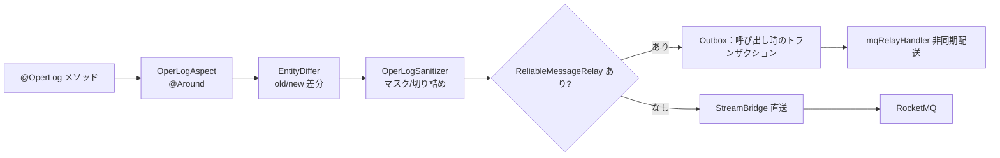

# common-operlog：操作ログの収集・差分・マスキング

`omni-common-operlog` は横断的な要件を解決します。**誰が、いつ、何に対して、何をし、結果どうなったか**を、業務メソッドを汚さずに記録します。注釈で収集点を宣言し、アスペクトが収集し、プロデューサが送信します。

セキュリティ監査ではありません。認証・ログイン監査は Auth の `sys_audit_log` に記録され、**Auth は本モジュールに依存しません**。

> ソースの範囲：Java ファイル 5 個。現在 5 つの業務サービス計 28 ファイルが `@OperLog` を使用（asset 3、base 4、crm 5、procurement 6、srm 10）、Auth は 0。この数は導入箇所を示すもので、実行時の配送成功を証明しません。

## 問題

各書き込みエンドポイントで手作業でログを書くと、漏れ・項目の不統一・機密値のそのまま保存という 3 つの偏りが生じます。アスペクト化で収集と業務を分離し、統一した差分とマスキングで可読性を保ちます。

## 1. 収集チェーン

### 使い方

```java
@OperLog(module = "srm", operType = OperType.UPDATE)
@PutMapping("/{id}")
public R<Void> update(@PathVariable Long id, @RequestBody SupplierUpdateRequest request) { ... }
```

依存を追加するとアスペクトが自動組み込みされます。

### 組み込み条件

```java
@ConditionalOnWebApplication(type = ConditionalOnWebApplication.Type.SERVLET)
@ConditionalOnClass(name = "org.aspectj.lang.ProceedingJoinPoint")
public class OperLogAutoConfiguration {
```

- Servlet アプリであること。
- AspectJ がクラスパスにあること。
- アスペクト入口は `@Around("@annotation(operLog)")`（`OperLogAspect.java:84`）。

### 送信：Outbox 優先

```java
    public void send(OperLogMessage message) {
        try {
            Long tenantId = message.getTenantId();
            if (reliableRelay != null) {
                reliableRelay.send(BINDING_NAME, message, tenantId, message.getEventId());
            } else {
                streamBridge.send(BINDING_NAME, message);
            }
        } catch (Exception e) {
            log.warn("操作日志：MQ 消息发送失败: {}", e.getMessage(), e);
        }
    }
```



### 境界

- プロデューサは送信例外を捕捉して warn を記録し、業務の戻り値を自ら変更しません。ただし、**どの呼び出し方でも業務トランザクションに影響しない、とは保証できません**。未完了のトランザクションに参加していた場合、例外でロールバック専用に設定されることがあり、捕捉しても解除できません。
- 現在の注釈は主に Controller にあり、業務 Service のトランザクション終了後に操作ログの Outbox を書くのが通常です。「業務とログが必ず一緒にコミットされる」と説明してはいけません。業務とメッセージを一体で確定したい場合は、有効な業務トランザクション内から信頼性メッセージ API を呼びます。
- 直送は `ReliableMessageRelay` 未導入時のみ。導入後に Outbox 書き込みが失敗しても直送へ切り替わりません。
- 同一クラス内の自己呼び出しはプロキシを通らず、**アスペクトが発火しません**。
- 本モジュール未導入のサービスで `@OperLog` を書いてもエラーにならず、収集もされません。

### 失敗復旧

- ログ欠落時は、依存、Servlet、AspectJ、プロキシ経由かを確認します。
- 一部だけ欠ける場合は自己呼び出しを疑います。
- Outbox モードで「ログは書けたが保存されない」場合は `sys_mq_message` とリレーを調べ、業務操作を再実行しません。

## 2. 差分：EntityDiffer

### 問題

「サプライヤーを更新した」だけでは足りず、**どの項目が何から何に変わったか**が必要です。

### 意味

- UPDATE/DELETE は先に旧スナップショットを読みます。メソッド後に新しい値を読んで差分を計算するのは UPDATE だけです。DELETE は旧値を保持し新値は null、CREATE は戻り値のエンティティ ID から新しい値の取得を試みます。
- 新旧 JSON が揃う場合に変更項目を抽出します。
- 変更なしなら空の差分を返します。

### 境界

- 旧スナップショットは業務呼び出し前に読みます。`tenantId` を持つエンティティは要求テナントと一致しなければ取得しません。その属性を持たない全体共通エンティティは取得でき、一律にスキップするわけではありません。
- 現在の旧スナップショットの DB 読み取りは対象メソッドの try/finally より前にあり、例外で業務呼び出しが止まる場合があります。後の catch が扱うのは後処理の例外です。ログの失敗は必ず業務に影響しない、と断定しないでください。
- スナップショットは `recordSnapshot` と `entityClass/idExpr` で制御され、全メソッドが DB を読むわけではありません。
- 空差分は「読める変更がない」であり、操作がなかったことではありません。

## 3. マスキング：OperLogSanitizer

### 問題

パラメータ、スナップショット、例外文言には電話番号・メール・ID・トークンが含まれ得て、そのまま保存できません。

### 意味

- 送信前にパラメータ、スナップショット、例外文言を一括サニタイズ。
- 注釈 `excludeFields` で追加除外。
- 長い文字列は実装定数で切り詰め。
- メール/電話番号などは規則でマスク（`OperLogSanitizer.java`）。

### 境界

- マスキングはログ内容のみに影響し、業務の戻り値は変えません。
- ルールはブラックリスト方式で、**すべての機密形態を網羅するとは言えません**。新しい項目型はルール見直しが必要です。
- マスク後の値は不可逆で、ログからデータ復元はできません。

## 4. セキュリティ監査との違い

| | 操作ログ | セキュリティ監査 |
| --- | --- | --- |
| 所有者 | `omni-common-operlog` + Base 消費 | `omni-auth` |
| 契機 | `@OperLog` アスペクト | 認証イベント |
| 保存 | `sys_oper_log` / アーカイブ | `sys_audit_log` |
| Auth の利用 | **なし**（依存も注釈もなし） | あり |

混同すると「なぜログインに操作ログがないのか」という誤判定になります。ログイン記録はセキュリティ監査の読み取り専用投影です。

## 5. 拡張

| やりたいこと | 変更箇所 | やってはいけない |
| --- | --- | --- |
| 操作種別の追加 | `OperType` 列挙 | 業務側で文字列を手書き |
| 収集項目の追加 | `OperLogMessage` とアスペクト | メッセージを迂回して直接 DB 書き込み |
| マスク規則の追加 | `OperLogSanitizer` | 業務側で加工しつつ原値を記録 |
| 除外項目の追加 | 注釈 `excludeFields` | 項目名の偶然の変化に依存 |

## 検証入口

- 収集とテナント分離：Base の辞書/ログテナント境界テスト。
- 差分とマスキング：`EntityDiffer`、`OperLogSanitizer` の単体挙動。
- エンドツーエンド配送は MQ リレー（[common-mqlog](common-mqlog.jp.md)）に属し、本モジュールの単体テストでは証明できません。

次章：[common-job](common-job.jp.md)。
