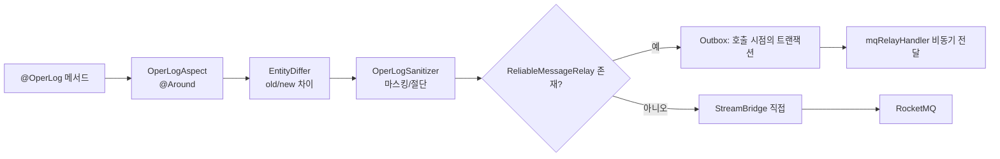

# common-operlog: 운영 로그의 수집·차이·마스킹

`omni-common-operlog`는 하나의 횡단 요구를 해결합니다. **누가, 언제, 무엇에, 무엇을 했고 결과가 어땠는지**를 업무 메서드를 건드리지 않고 기록합니다. 어노테이션으로 수집 지점을 선언하고, aspect가 수집하며, producer가 메시지를 보냅니다.

보안 감사가 아닙니다. 인증·로그인 감사는 Auth의 `sys_audit_log`에 기록되며 **Auth는 이 모듈에 의존하지 않습니다**.

> 소스 범위: Java 파일 5개. 현재 5개 업무 서비스의 28개 파일이 `@OperLog`를 사용합니다(asset 3, base 4, crm 5, procurement 6, srm 10). Auth는 0입니다. 이 수는 도입 위치를 나타내며 실제 실행이나 전달 성공의 증거는 아닙니다.

## 문제

모든 쓰기 엔드포인트에 로그를 직접 작성하면 누락, 필드 불일치, 민감 값 그대로 저장이라는 세 가지 편차가 생깁니다. aspect로 수집과 업무를 분리하고, 통일된 차이·마스킹으로 가독성을 유지합니다.

## 1. 수집 체인

### 사용법

```java
@OperLog(module = "srm", operType = OperType.UPDATE)
@PutMapping("/{id}")
public R<Void> update(@PathVariable Long id, @RequestBody SupplierUpdateRequest request) { ... }
```

의존을 추가하면 aspect가 자동 조립됩니다.

### 조립 조건

```java
@ConditionalOnWebApplication(type = ConditionalOnWebApplication.Type.SERVLET)
@ConditionalOnClass(name = "org.aspectj.lang.ProceedingJoinPoint")
public class OperLogAutoConfiguration {
```

- Servlet 애플리케이션;
- 클래스패스에 AspectJ 존재;
- aspect 진입은 `@Around("@annotation(operLog)")`(`OperLogAspect.java:84`).

### 전송: Outbox 우선

```java
    public void send(OperLogMessage message) {
        try {
            Long tenantId = message.getTenantId();
            if (reliableRelay != null) {
                reliableRelay.send(BINDING_NAME, message, tenantId, message.getEventId());
            } else {
                streamBridge.send(BINDING_NAME, message);
            }
        } catch (Exception e) {
            log.warn("操作日志：MQ 消息发送失败: {}", e.getMessage(), e);
        }
    }
```



### 경계

- producer는 전송 예외를 잡아 warn을 남기고 업무 반환값을 직접 바꾸지 않습니다. 다만 **모든 호출 방식에서 업무 트랜잭션에 영향이 없다는 보장은 아닙니다**. 끝나지 않은 트랜잭션에 참여했다면 예외로 롤백 전용 상태가 될 수 있으며, 예외를 잡아도 그 상태를 되돌릴 수 없습니다.
- 현재 어노테이션은 주로 Controller에 있어 업무 Service의 트랜잭션이 끝난 뒤 운영 로그 Outbox를 쓰는 경우가 일반적입니다. 업무와 로그가 반드시 함께 커밋된다고 설명하면 안 됩니다. 업무와 메시지를 함께 확정하려면 유효한 업무 트랜잭션 안에서 신뢰성 메시지 API를 호출합니다.
- 직접 전송은 `ReliableMessageRelay`가 없을 때만. 도입 후 Outbox 쓰기 실패가 직접 전송으로 바뀌지 않습니다.
- 같은 클래스 내부 호출은 프록시를 거치지 않아 **aspect가 발화하지 않습니다**.
- 모듈을 도입하지 않은 서비스의 `@OperLog`는 오류 없이 아무것도 수집하지 않습니다.

### 실패 복구

- 로그 누락 시 의존, Servlet 여부, AspectJ, 프록시 경유를 확인합니다.
- 일부만 빠지면 내부 자기 호출을 의심합니다.
- Outbox 모드에서 "기록됐지만 저장되지 않음"은 `sys_mq_message`와 릴레이를 확인하고 업무 작업을 재실행하지 않습니다.

## 2. 차이: EntityDiffer

### 문제

"공급사를 수정했다"만으로는 부족하고 **어떤 필드가 무엇에서 무엇으로** 바뀌었는지가 필요합니다.

### 의미

- UPDATE/DELETE는 이전 스냅샷을 먼저 읽습니다. 메서드 뒤에 새 값을 읽고 차이를 계산하는 것은 UPDATE뿐입니다. DELETE는 이전 값을 남기고 새 값은 null이며, CREATE는 반환된 엔티티 ID로 새 값 조회를 시도합니다.
- 두 JSON이 모두 있으면 변경 필드를 추출합니다.
- 변경이 없으면 빈 차이를 반환합니다.

### 경계

- 이전 스냅샷은 업무 호출 전에 읽습니다. `tenantId`가 있는 엔티티는 요청 테넌트와 일치해야 조회하며, 불일치 시 생략합니다. 해당 속성이 없는 전역 엔티티는 조회할 수 있어 무조건 건너뛰는 것이 아닙니다.
- 현재 이전 스냅샷의 DB 조회는 대상 메서드의 try/finally보다 앞에 있어 예외가 업무 호출을 막을 수 있습니다. 뒤의 catch는 후처리 예외를 다룹니다. 모든 로그 실패가 업무에 영향을 주지 않는다고 단정하지 마세요.
- 스냅샷은 `recordSnapshot`과 `entityClass/idExpr`로 제어되며 모든 메서드가 DB를 읽지는 않습니다.
- 빈 차이는 "읽을 변경이 없음"이며 작업이 없었다는 뜻이 아닙니다.

## 3. 마스킹: OperLogSanitizer

### 문제

파라미터, 스냅샷, 예외 문구에는 전화번호·이메일·ID·토큰이 들어갈 수 있어 그대로 저장할 수 없습니다.

### 의미

- 전송 전 파라미터, 스냅샷, 예외 문구를 일괄 정화.
- 어노테이션 `excludeFields`로 추가 제외.
- 긴 문자열은 구현 상수로 절단.
- 이메일/전화번호 등은 규칙으로 마스킹(`OperLogSanitizer.java`).

### 경계

- 마스킹은 로그 내용에만 영향을 주고 업무 반환값은 바꾸지 않습니다.
- 규칙은 블랙리스트 방식이며 **모든 민감 형태를 포괄한다고 주장할 수 없습니다**. 새 필드 유형은 규칙 검토가 필요합니다.
- 마스킹된 값은 되돌릴 수 없어 로그로 데이터 복구를 할 수 없습니다.

## 4. 보안 감사와의 차이

| | 운영 로그 | 보안 감사 |
| --- | --- | --- |
| 소유 | `omni-common-operlog` + Base 소비 | `omni-auth` |
| 트리거 | `@OperLog` aspect | 인증 이벤트 |
| 저장 | `sys_oper_log` / 아카이브 | `sys_audit_log` |
| Auth 사용 | **아니오**(의존·어노테이션 없음) | 예 |

혼동하면 "왜 로그인에 운영 로그가 없나" 같은 오판이 생깁니다. 로그인 기록은 보안 감사의 읽기 전용 투영입니다.

## 5. 확장

| 하고 싶은 일 | 변경 위치 | 하면 안 되는 일 |
| --- | --- | --- |
| 작업 유형 추가 | `OperType` 열거 | 업무 코드에 문자열 직접 작성 |
| 수집 필드 추가 | `OperLogMessage`와 aspect | 메시지를 우회해 DB 직접 쓰기 |
| 마스킹 규칙 추가 | `OperLogSanitizer` | 업무에서 가공하고 원값도 기록 |
| 제외 필드 추가 | 어노테이션 `excludeFields` | 필드명 우연 변화에 의존 |

## 검증 진입

- 수집·테넌트 격리: Base의 사전/로그 테넌트 경계 테스트.
- 차이·마스킹: `EntityDiffer`, `OperLogSanitizer` 단위 동작.
- 종단 전달은 MQ 릴레이([common-mqlog](common-mqlog.kr.md))에 속하며 이 모듈 단위 테스트로 증명할 수 없습니다.

다음: [common-job](common-job.kr.md).
