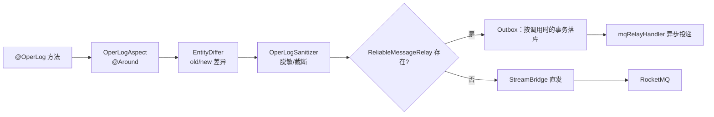

# common-operlog：操作日志的采集、差异与脱敏

`omni-common-operlog` 解决的是一条横切需求：在**不侵入业务方法**的前提下，把谁、在什么时候、对什么、做了什么、结果如何记录下来。它用注解声明采集点，用切面采集，用生产者把消息送出。

它不是安全审计：认证与登录安全审计走 Auth 的 `sys_audit_log`，**Auth 不依赖本模块**。

> 源码范围：模块 5 个 Java 文件；当前 5 个业务服务共 28 个文件使用 `@OperLog`（asset 3、base 4、crm 5、procurement 6、srm 10），Auth 为 0。这些数量说明接入位置，不能代替运行与投递验证。

## 问题

如果每个写接口都手写“记录日志”，会出现三种偏差：有人漏写、字段格式各不同、敏感信息被原样落库。切面化可以把采集与业务解耦，再用统一的脱敏与差异逻辑保证可读性。

## 一、采集链路

### 怎么用

```java
@OperLog(module = "srm", operType = OperType.UPDATE)
@PutMapping("/{id}")
public R<Void> update(@PathVariable Long id, @RequestBody SupplierUpdateRequest request) { ... }
```

服务引入依赖后，切面自动装配。

### 装配条件

```java
@ConditionalOnWebApplication(type = ConditionalOnWebApplication.Type.SERVLET)
@ConditionalOnClass(name = "org.aspectj.lang.ProceedingJoinPoint")
public class OperLogAutoConfiguration {
```

- 必须是 Servlet 应用；
- 类路径必须有 AspectJ；
- 切面入口是 `@Around("@annotation(operLog)")`（`OperLogAspect.java:84`）。

### 发送：优先 Outbox

```java
    public void send(OperLogMessage message) {
        try {
            Long tenantId = message.getTenantId();
            if (reliableRelay != null) {
                reliableRelay.send(BINDING_NAME, message, tenantId, message.getEventId());
            } else {
                streamBridge.send(BINDING_NAME, message);
            }
        } catch (Exception e) {
            log.warn("操作日志：MQ 消息发送失败: {}", e.getMessage(), e);
        }
    }
```



### 边界

- 生产者捕获发送异常并记 warn，不主动改业务返回值；**这不保证任何调用方式都不会影响业务事务**。若发送加入一个尚未结束的事务，异常可能已把该事务标为只能回滚，捕获异常也不能恢复它。
- 当前注解主要放在 Controller 上，业务 Service 的事务通常已经结束，之后才写操作日志 Outbox；不能把它画成“业务与日志必定一起提交”。需要业务与消息原子提交时，应在有效业务事务中直接调用可靠消息接口。
- 只有未接入 `ReliableMessageRelay` 时才走直发；接入后即使 Outbox 写入失败也不会切换到直发。
- 内部自调用（同类方法互调）不经过代理，**不会触发切面**。
- 没有引入本模块的服务上写 `@OperLog` 不会报错，但也不会被采集。

### 失败恢复

- 日志丢失时先确认：服务是否引入 operlog、是否为 Servlet、AspectJ 是否在类路径、方法是否被代理。
- 若只有部分日志缺失，检查是否由同类内部调用触发。
- Outbox 模式下“日志已写但未入库”应查 `sys_mq_message` 与中继，而不是重放业务操作。

## 二、差异：EntityDiffer

### 问题

只记录“更新了供应商”价值有限；排障需要知道**哪个字段从什么变成了什么**。

### 语义

- UPDATE/DELETE 先读旧快照；只有 UPDATE 在方法执行后读新快照并计算差异，DELETE 保留旧值、新值为空；CREATE 则按返回的实体编号尝试读取新值；
- 新旧 JSON 都存在时提取变更字段；
- 无变化时返回空差异。

### 边界

- 旧快照在业务调用前读取。实体有 `tenantId` 时必须与请求租户相符，否则不取快照；没有该属性的全局实体仍可读取，不能误写成“一律跳过”。
- 当前旧快照的数据库读取位于执行目标方法的 try/finally 之前，读取异常可能阻止业务调用；后处理中的异常才由后面的 catch 记录。不要把“日志失败完全不影响业务”当成无条件保证。
- 快照受 `recordSnapshot` 与 `entityClass/idExpr` 选项控制，不是所有方法都会读库。
- 空差异表示“没有可读变更”，不等于操作没有发生。

## 三、脱敏：OperLogSanitizer

### 问题

参数、快照与异常信息里可能包含手机号、邮箱、证件号、令牌等，不能原样进入日志表。

### 语义

- 在发送前统一清洗参数、快照与异常文本；
- 支持按注解 `excludeFields` 追加排除字段；
- 长字符串按实现常量截断，避免单条日志过大；
- 邮箱/手机号等按规则遮盖（见 `OperLogSanitizer.java`）。

### 边界

- 脱敏只影响日志内容，不影响业务返回值。
- 规则是黑名单式遮盖，**不能宣称覆盖所有敏感形态**；新增字段类型要同步评估规则。
- 脱敏后的值不可逆，不能拿日志做数据恢复。

## 四、与安全审计的区别

| | 操作日志 | 安全审计 |
| --- | --- | --- |
| 归属 | `omni-common-operlog` + Base 消费 | `omni-auth` |
| 触发 | `@OperLog` 切面 | 认证事件（登录成功/失败等） |
| 存储 | `sys_oper_log` / 归档表 | `sys_audit_log` |
| Auth 是否使用 | **否**（未依赖、无注解） | 是 |

把两者混为一谈，会导致“为什么登录没有操作日志”这类误判。登录记录是安全审计的只读投影，不是操作日志。

## 五、扩展

| 想做的事 | 改哪里 | 不要做 |
| --- | --- | --- |
| 新增操作类型 | `OperType` 枚举 | 在业务里手写字符串 |
| 新增采集字段 | `OperLogMessage` 与切面 | 绕过消息直接写库 |
| 新增脱敏规则 | `OperLogSanitizer` | 在业务方法里手工打码后仍记原值 |
| 新增排除字段 | 注解 `excludeFields` | 依赖字段名偶然变化 |

## 验证入口

- 采集与租户隔离回归：Base 的字典/日志租户边界测试；
- 差异与脱敏：`EntityDiffer`、`OperLogSanitizer` 的单元行为；
- 端到端投递属于 MQ 中继（见 [common-mqlog](common-mqlog.md)），不能由本模块单测证明。

下一章：[common-job](common-job.md)。
