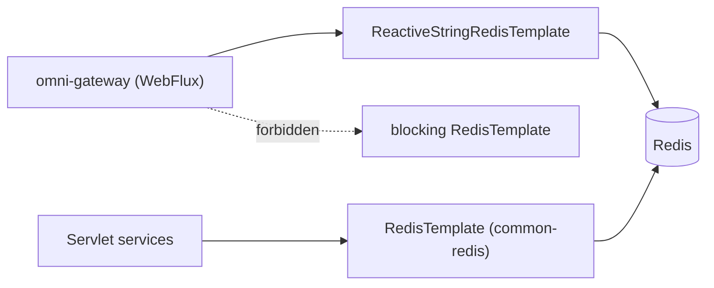

# common-redis-reactive: the boundary of the reactive Redis starter

`omni-common-redis-reactive` is a **starter**, not a utility library. It has no Java source and no auto-configuration class; it does two things: bring in `spring-boot-starter-data-redis-reactive`, and supply a default timeout through `application.yml`.

The actual reactive Redis capability comes from Spring Boot's auto-configuration of `ReactiveRedisTemplate` / `ReactiveStringRedisTemplate`; this project adds no wrapper.

> Evidence boundary: the module contains only `pom.xml` and `src/main/resources/application.yml`, with no `src/main/java` and no `AutoConfiguration.imports`. This article does not invent wrappers that do not exist.

## Problem

The Gateway is a WebFlux service running on the Netty event loop. Calling a blocking Redis client on an event-loop thread pins the thread, collapsing throughput and eventually causing timeout cascades. WebFlux services must therefore use the reactive client and must **not** depend on `omni-common-redis`.

## Module contents

```xml
        <dependency>
            <groupId>org.springframework.boot</groupId>
            <artifactId>spring-boot-starter-data-redis-reactive</artifactId>
        </dependency>
```

```yaml
spring:
  data:
    redis:
      timeout: 5s
```

That is all: one dependency and one default timeout.

## Usage

After adding the dependency, inject the reactive client the standard Spring Boot way:

```java
private final ReactiveStringRedisTemplate redisTemplate;
```

Real caller: `AuthFilter` in `omni-gateway` injects `ReactiveStringRedisTemplate` (`AuthFilter.java:114`) for JWT blacklist checks and similar Redis state.



Both paths may connect to the same Redis, but the clients are **not interchangeable**.

## Boundaries

- **No reactive `RedisUtils`**: the module provides no Java helpers; operations use Spring Data's reactive API directly.
- **No custom serialization convention**: serialization comes from Spring Boot defaults and the caller, unlike `common-redis`, which fixes Key/Value serializers. Align them yourself when sharing keys across services.
- **No degradation or retry wrapper**: connection failures propagate as reactive errors; the caller decides `onErrorResume` and similar strategies.
- **The default 5-second timeout** comes from this yml; it is not a code constant and can be overridden by environment variables or service configuration.
- This project assigns this module to WebFlux and `common-redis` to Servlet services. It does not supply the latter's custom JSON template or `RedisUtils`; that does not prove blocking APIs are absent from underlying dependencies.

## Recovery

- When Redis is unavailable, reactive calls end with an error signal; the Gateway must decide whether to reject the request or fail closed on "blacklist unavailable" — never silently allow.
- If event-loop threads stay occupied, first check for accidental blocking clients or blocking calls rather than raising the timeout.
- Raising the timeout only lengthens the wait; it does not fix a thread-model error.

## Extension

Unified reactive serialization or helper methods would require adding Java code and explicit auto-configuration conditions to this module. The current state is "dependency and defaults only", and tutorials must not claim wrappers exist.

## Choosing between the two

| Service type | Choice | Reason |
| --- | --- | --- |
| Servlet (auth/base/crm/srm/procurement/asset/workflow) | `omni-common-redis` | blocking model matches the thread pool |
| WebFlux (gateway) | `omni-common-redis-reactive` | must not block the event loop |

Previous: [common-redis](common-redis.en.md); next: [common-service](common-service.en.md).
