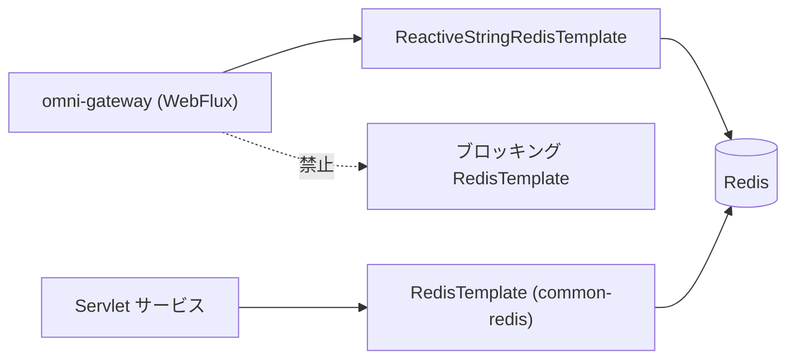

# common-redis-reactive：リアクティブ Redis starter の境界

`omni-common-redis-reactive` は**スターター**であり、ユーティリティ集ではありません。Java ソースも自動設定クラスも持たず、次の 2 つだけを行います。`spring-boot-starter-data-redis-reactive` を取り込み、`application.yml` で既定タイムアウトを提供する。

実際のリアクティブ Redis 能力は Spring Boot の `ReactiveRedisTemplate` / `ReactiveStringRedisTemplate` 自動設定から来ており、本プロジェクトは包み直していません。

> 事実境界：モジュールには `pom.xml` と `src/main/resources/application.yml` のみがあり、`src/main/java` も `AutoConfiguration.imports` もありません。存在しないラッパーを書いてはいけません。

## 問題

Gateway は WebFlux で Netty イベントループ上で動きます。イベントループのスレッドでブロッキング Redis クライアントを呼ぶとスレッドが塞がり、スループットが急落しタイムアウトの連鎖を招きます。WebFlux サービスはリアクティブクライアントを使い、`omni-common-redis` に依存してはいけません。

## モジュールの内容

```xml
        <dependency>
            <groupId>org.springframework.boot</groupId>
            <artifactId>spring-boot-starter-data-redis-reactive</artifactId>
        </dependency>
```

```yaml
spring:
  data:
    redis:
      timeout: 5s
```

これだけです。依存 1 つと既定タイムアウト 1 つ。

## 使い方

依存を追加した後、Spring Boot 標準の方法でリアクティブクライアントを注入します。

```java
private final ReactiveStringRedisTemplate redisTemplate;
```

実際の呼び出し例：`omni-gateway` の `AuthFilter` が `ReactiveStringRedisTemplate` を注入しています（`AuthFilter.java:114`）。JWT ブラックリストなどの Redis 状態に使います。



両経路は同じ Redis に接続できますが、クライアントは**互換ではありません**。

## 境界

- **リアクティブ版 `RedisUtils` はありません**。Java ユーティリティは提供せず、Spring Data のリアクティブ API を直接使います。
- **独自の直列化規約はありません**。Spring Boot 既定と呼び出し側に依存し、`common-redis` のように Key/Value 直列化器を固定しません。key を共有する場合は自前で合わせます。
- **降格・再試行のラッパーはありません**。接続失敗はリアクティブエラーとして伝播し、`onErrorResume` などは呼び出し側が決めます。
- **既定タイムアウト 5 秒**はこの yml 由来で、コード定数ではありません。環境変数やサービス設定で上書きできます。
- 本プロジェクトでは WebFlux に本モジュール、Servlet に `common-redis` を選びます。本モジュールは後者の独自 JSON テンプレートや `RedisUtils` を提供しませんが、基盤の依存にブロッキング API が存在しないという意味ではありません。

## 失敗復旧

- Redis が使えない場合、リアクティブ呼び出しはエラー信号で終わります。Gateway は要求を拒否するか「ブラックリスト利用不可」としてフェイルクローズするかを決め、黙って通してはいけません。
- イベントループのスレッドが長時間占有される場合は、タイムアウトを上げる前に、ブロッキングクライアントやブロッキング呼び出しが混入していないか確認します。
- タイムアウトを上げても待ち時間が伸びるだけで、スレッドモデルの誤りは解決しません。

## 拡張

統一したリアクティブ直列化やユーティリティが必要なら、本モジュールに Java コードと明示的な自動設定条件を追加します。現状は「依存と既定値のみ」であり、教程でラッパーがあると書いてはいけません。

## どちらを選ぶか

| サービスの種類 | 選択 | 理由 |
| --- | --- | --- |
| Servlet（auth/base/crm/srm/procurement/asset/workflow） | `omni-common-redis` | ブロッキングモデルがスレッドプールと一致 |
| WebFlux（gateway） | `omni-common-redis-reactive` | イベントループを塞げない |

前章：[common-redis](common-redis.jp.md)。次章：[common-service](common-service.jp.md)。
