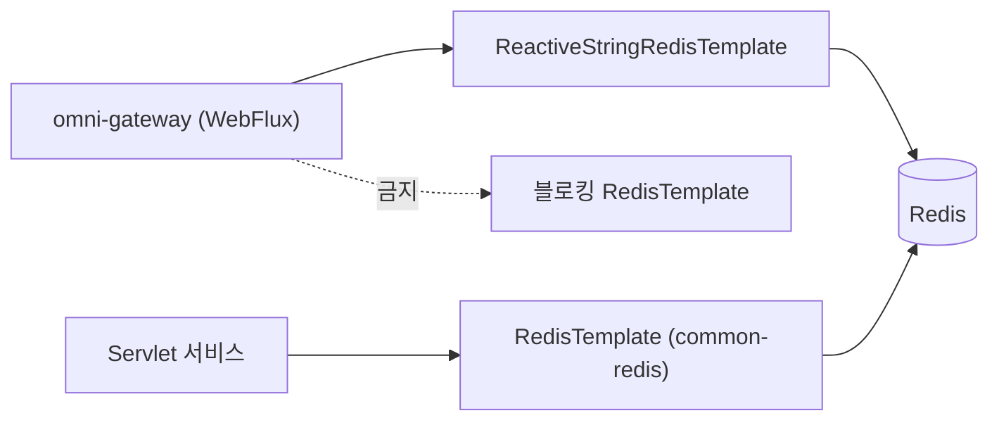

# common-redis-reactive: 반응형 Redis 스타터의 경계

`omni-common-redis-reactive`는 **스타터**이지 유틸리티 모음이 아닙니다. Java 소스도 자동 설정 클래스도 없으며 두 가지만 합니다. `spring-boot-starter-data-redis-reactive`를 가져오고, `application.yml`로 기본 타임아웃을 제공합니다.

실제 반응형 Redis 능력은 Spring Boot의 `ReactiveRedisTemplate` / `ReactiveStringRedisTemplate` 자동 설정에서 오며, 이 프로젝트는 다시 감싸지 않았습니다.

> 사실 경계: 모듈에는 `pom.xml`과 `src/main/resources/application.yml`만 있고 `src/main/java`도 `AutoConfiguration.imports`도 없습니다. 존재하지 않는 래퍼를 쓰면 안 됩니다.

## 문제

Gateway는 Netty 이벤트 루프에서 도는 WebFlux 서비스입니다. 이벤트 루프 스레드에서 블로킹 Redis 클라이언트를 호출하면 스레드가 묶여 처리량이 급락하고 타임아웃 연쇄가 생깁니다. 따라서 WebFlux 서비스는 반응형 클라이언트를 써야 하며 `omni-common-redis`에 의존하면 안 됩니다.

## 모듈 내용

```xml
        <dependency>
            <groupId>org.springframework.boot</groupId>
            <artifactId>spring-boot-starter-data-redis-reactive</artifactId>
        </dependency>
```

```yaml
spring:
  data:
    redis:
      timeout: 5s
```

이것이 전부입니다. 의존 하나와 기본 타임아웃 하나.

## 사용법

의존을 추가한 뒤 Spring Boot 표준 방식으로 반응형 클라이언트를 주입합니다.

```java
private final ReactiveStringRedisTemplate redisTemplate;
```

실제 호출 예: `omni-gateway`의 `AuthFilter`가 `ReactiveStringRedisTemplate`을 주입합니다(`AuthFilter.java:114`). JWT 블랙리스트 등 Redis 상태에 사용합니다.



두 경로는 같은 Redis에 연결할 수 있지만 클라이언트는 **호환되지 않습니다**.

## 경계

- **반응형 `RedisUtils`가 없습니다**. Java 유틸리티를 제공하지 않으며 Spring Data의 반응형 API를 직접 씁니다.
- **자체 직렬화 규약이 없습니다**. Spring Boot 기본값과 호출자에 의존하며, `common-redis`처럼 Key/Value 직렬화기를 고정하지 않습니다. key를 공유하면 직접 맞춰야 합니다.
- **강등·재시도 래퍼가 없습니다**. 연결 실패는 반응형 오류로 전파되고 `onErrorResume` 등은 호출자가 정합니다.
- **기본 타임아웃 5초**는 이 yml에서 오며 코드 상수가 아닙니다. 환경 변수나 서비스 설정으로 덮어쓸 수 있습니다.
- 이 프로젝트는 WebFlux에 이 모듈을, Servlet에는 `common-redis`를 사용합니다. 이 모듈은 후자의 사용자 정의 JSON 템플릿이나 `RedisUtils`를 제공하지 않지만, 하위 의존성에 블로킹 API가 전혀 없다는 뜻은 아닙니다.

## 실패 복구

- Redis를 못 쓰면 반응형 호출은 오류 신호로 끝납니다. Gateway는 요청을 거부할지 "블랙리스트 사용 불가"로 실패 폐쇄할지 정해야 하며 조용히 통과시키면 안 됩니다.
- 이벤트 루프 스레드가 오래 점유되면 타임아웃을 올리기 전에 블로킹 클라이언트나 블로킹 호출이 섞였는지 확인합니다.
- 타임아웃을 올리면 대기만 길어질 뿐 스레드 모델 오류는 해결되지 않습니다.

## 확장

통일된 반응형 직렬화나 유틸리티가 필요하면 이 모듈에 Java 코드와 명시적 자동 설정 조건을 추가합니다. 현재는 "의존과 기본값만"이며 튜토리얼에서 래퍼가 있다고 쓰면 안 됩니다.

## 어느 쪽을 선택할까

| 서비스 유형 | 선택 | 이유 |
| --- | --- | --- |
| Servlet(auth/base/crm/srm/procurement/asset/workflow) | `omni-common-redis` | 블로킹 모델이 스레드 풀과 일치 |
| WebFlux(gateway) | `omni-common-redis-reactive` | 이벤트 루프를 막을 수 없음 |

이전: [common-redis](common-redis.kr.md). 다음: [common-service](common-service.kr.md).
