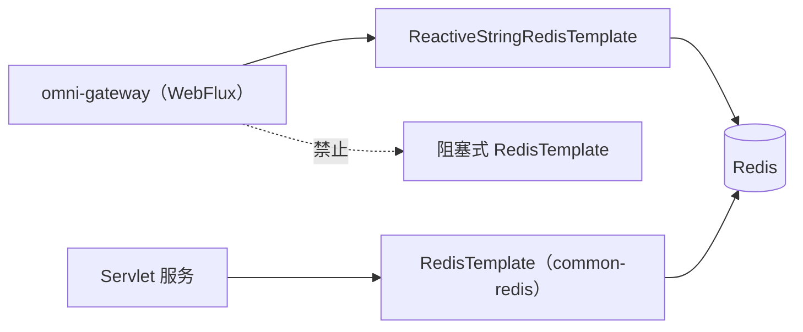

# common-redis-reactive：响应式 Redis starter 的边界

`omni-common-redis-reactive` 是一个**starter**，不是一个工具库。它没有 Java 源码，也没有自动配置类；它做两件事：把 `spring-boot-starter-data-redis-reactive` 带进来，并用一份 `application.yml` 提供默认超时。

真正的响应式 Redis 能力来自 Spring Boot 对 `ReactiveRedisTemplate` / `ReactiveStringRedisTemplate` 的自动配置，本项目没有再包一层。

> 事实边界：模块只有 `pom.xml` 与 `src/main/resources/application.yml`，无 `src/main/java`、无 `AutoConfiguration.imports`。本文不虚构不存在的封装。

## 问题

Gateway 是 WebFlux 服务，运行在 Netty 事件循环上。如果在事件循环线程里调用阻塞式 Redis 客户端，线程会被挂住，吞吐骤降甚至超时雪崩。因此 WebFlux 服务必须使用响应式客户端，并且**不能**依赖 `omni-common-redis`。

## 模块内容

```xml
        <dependency>
            <groupId>org.springframework.boot</groupId>
            <artifactId>spring-boot-starter-data-redis-reactive</artifactId>
        </dependency>
```

```yaml
spring:
  data:
    redis:
      timeout: 5s
```

就这些：一个依赖、一个默认超时。

## 怎么用

引入依赖后，按 Spring Boot 的标准方式注入响应式客户端：

```java
private final ReactiveStringRedisTemplate redisTemplate;
```

真实调用例：`omni-gateway` 的 `AuthFilter` 注入 `ReactiveStringRedisTemplate`（`AuthFilter.java:114`），用于校验 JWT 黑名单等 Redis 状态。



两条路径可以连同一个 Redis，但**不能互相替换客户端**。

## 边界

- **没有响应式版 `RedisUtils`**：本模块不提供任何 Java 工具类，操作直接用 Spring Data 的响应式 API。
- **没有自定义序列化约定**：序列化由 Spring Boot 默认配置与调用方决定，不像 `common-redis` 那样固定 Key/Value 序列化器。跨服务共享 key 时要自行对齐。
- **没有降级或重试封装**：连接失败以响应式错误传播，由调用方决定 `onErrorResume` 等策略。
- **默认超时 5 秒**来自这份 yml；它不是代码常量，环境变量或服务自己的配置可以覆盖。
- 本项目规定 WebFlux 选择此模块，Servlet 选择 `common-redis`。此模块不提供后者的自定义 JSON 模板与 `RedisUtils`；不要据此推断底层依赖中绝对不存在阻塞式 API。

## 失败恢复

- Redis 不可用时，响应式调用会以错误信号结束；Gateway 侧需要决定是拒绝请求还是按“黑名单不可用”失败关闭，不能静默放行。
- 若 Gateway 出现事件循环线程长时间占用，先检查是否有代码误用了阻塞式客户端或阻塞调用，而不是先调大超时。
- 超时值改大只会延长等待，不能解决线程模型错误。

## 扩展

需要统一的响应式序列化或工具方法时，应在本模块新增 Java 代码并明确自动配置条件；当前状态是“只有依赖与默认值”，文章与教程不得声称已有封装。

## 与阻塞模块的选择

| 服务类型 | 选择 | 原因 |
| --- | --- | --- |
| Servlet（auth/base/crm/srm/procurement/asset/workflow） | `omni-common-redis` | 阻塞模型与线程池匹配 |
| WebFlux（gateway） | `omni-common-redis-reactive` | 不能阻塞事件循环 |

上一章：[common-redis](common-redis.md)；下一章：[common-service](common-service.md)。
