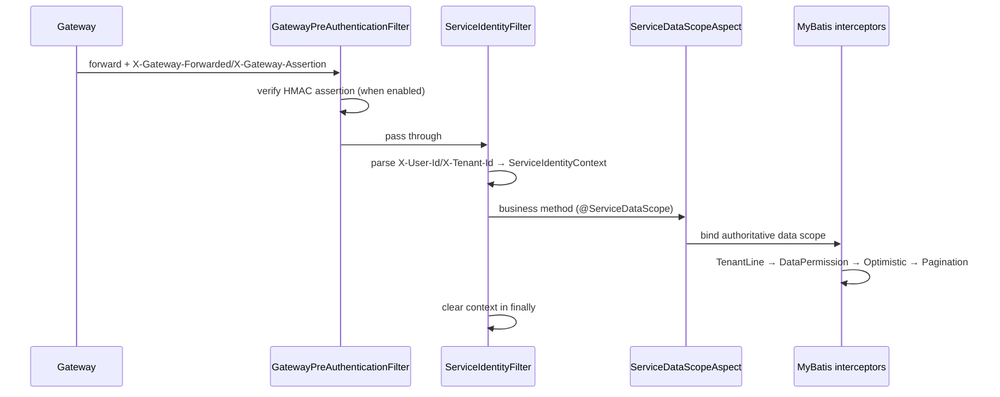

# common-service: identity, tenant and data-permission foundation for Servlet services

`omni-common-service` is the most business-flavored of the ten common modules: it combines the Servlet identity chain, tenant and data-permission interceptors, the data-scope aspect, internal API authentication, XSS configuration caching and startup validation.

It targets **Servlet only**. The Gateway is WebFlux and assembles none of these filters or aspects.

> Evidence boundary: the module has 29 Java files, grouped here into 8 function families. No application was started this round; assembly conclusions follow source conditions.

## 0. What one request goes through



## 1. Service identity chain

### Problem

A service must not trust a client-supplied `X-User-Id`. Identity must be verified and signed by the gateway, then verified again by the service.

### Usage

Business code reads identity via `ServiceIdentityContext.require()` / `requireTenantId()`; the filter assembles automatically.

### Source

```java
        if (pathPolicy.isPublicOrManagement(request.getRequestURI())) {
            filterChain.doFilter(request, response);
            return;
        }
        try {
            Long userId = parsePositive(request.getHeader("X-User-Id"));
            Long tenantId = parsePositive(request.getHeader("X-Tenant-Id"));
            if (userId == null || tenantId == null) {
                response.setStatus(HttpServletResponse.SC_UNAUTHORIZED);
                response.setContentType(MediaType.APPLICATION_JSON_VALUE);
                response.setCharacterEncoding("UTF-8");
                objectMapper.writeValue(response.getWriter(), R.fail(401, "缺少合法的用户或租户身份"));
                return;
            }
            ServiceIdentityContext.set(new ServiceRequestIdentity(
                    userId, tenantId, request.getHeader("X-User-Name")));
            filterChain.doFilter(request, response);
        } finally {
            ServiceIdentityContext.clear();
        }
```

### Two verification layers

| Layer | Mechanism | Failure result |
| --- | --- | --- |
| Gateway assertion (optional) | `X-Gateway-Assertion`, HmacSHA256, 300s TTL, `GATEWAY_ASSERTION_SECRET` ≥ 32 bytes | 403 |
| Identity header parsing | `X-User-Id` / `X-Tenant-Id` must be positive integers | 401 |
| Context read | `ServiceIdentityContext.require()` checks userId/tenantId | BusinessException(403) |

```java
        if (!pathPolicy.isPublicOrManagement(uri)
                && !"true".equals(request.getHeader("X-Gateway-Forwarded"))) {
            response.setStatus(HttpServletResponse.SC_FORBIDDEN);
            response.setContentType(MediaType.APPLICATION_JSON_VALUE);
            response.setCharacterEncoding("UTF-8");
            objectMapper.writeValue(response.getWriter(), R.fail(403,
                    "禁止直接访问 " + properties.getDisplayName() + " 服务"));
            return;
        }
```

### Boundaries and recovery

- `X-Gateway-Forwarded: true` is **not cryptographic proof**; HMAC verification only happens when gateway assertions are enabled. Production business ports still need network boundaries.
- Servlet only; the Gateway has its own WebFlux filters.
- The context is cleared in `finally`; if identities leak across pooled threads, look for bypassed filters or async threads that do not propagate context.

## 2. Persistence policy and interceptor order

### Problem

Tenant isolation and data permission must apply consistently to every SQL statement, in the right order: tenant condition first, then data scope, then optimistic locking and pagination.

### Source

```java
        MybatisPlusInterceptor interceptor = new MybatisPlusInterceptor();
        if (properties.getTenant().isEnabled()) {
            TenantTablePolicy tenantPolicy = requireUnique(tenantPolicyProvider, "TenantTablePolicy");
            interceptor.addInnerInterceptor(new TenantLineInnerInterceptor(new TenantLineHandler() {
                @Override
                public Expression getTenantId() {
                    return new LongValue(ServiceIdentityContext.requireTenantId());
                }

                @Override
                public boolean ignoreTable(String tableName) {
                    return !tenantPolicy.appliesTo(tableName);
                }
            }));
        }
        if (properties.getDataScope().isEnabled()) {
            DataScopeTablePolicy dataScopePolicy = requireUnique(dataScopePolicyProvider, "DataScopeTablePolicy");
            interceptor.addInnerInterceptor(new DataPermissionInterceptor(new MultiDataPermissionHandler() {
                @Override
                public Expression getSqlSegment(Table table, Expression where, String mappedStatementId) {
                    return dataScopePolicy.getSqlSegment(table, where, mappedStatementId);
                }
            }));
        }
        interceptor.addInnerInterceptor(new OptimisticLockerInnerInterceptor());
        interceptor.addInnerInterceptor(new PaginationInnerInterceptor(DbType.MYSQL));
        return interceptor;
```

### Assembly conditions

- `@ConditionalOnClass(MybatisPlusInterceptor.class)`;
- `omni.service.tenant.enabled=true` or `omni.service.data-scope.enabled=true`;
- exactly one `TenantTablePolicy` when tenancy is enabled, and exactly one `DataScopeTablePolicy` when data permission is enabled; otherwise startup fails. A disabled feature does not require its corresponding policy:

```java
        T bean = provider.getIfUnique();
        if (bean == null) {
            throw new IllegalStateException(typeName + " 必须且只能提供一个实现");
        }
```

### Boundaries and recovery

- `TenantLine` only handles tables the policy declares as tenant tables; cross-tenant tables such as `sys_mq_message` must be excluded by the policy, or the relay can no longer scan them.
- This bean **replaces** the default chain from `omni-common-mybatis`; it does not stack.
- A `null` from the data-scope policy means "no extra condition"; whether that is acceptable is decided by the policy and write authorization, not by the interceptor alone.

## 3. Data-scope aspect

### Problem

The same endpoint must show different organizational data under different permission codes; the scope must be resolved from Auth and applied for the method's duration.

### Source

```java
    @Around("@annotation(annotation)")
    public Object bindScope(ProceedingJoinPoint joinPoint, ServiceDataScope annotation) throws Throwable {
        ServiceRequestIdentity identity = ServiceIdentityContext.require();
        try {
            InternalDataScopeDTO scope = dataScopeResolver.resolve(identity, annotation.permissionCode());
            validate(scope, identity, annotation.permissionCode());
            ServiceDataScopeContext.set(scope);
            return joinPoint.proceed();
        } finally {
            ServiceDataScopeContext.clear();
        }
    }
```

### Boundaries and recovery

- `@Order(300)` only sets this aspect's order. Its position relative to transaction and security aspects also depends on their ordering and configuration; it does not mean this aspect always runs after the transaction aspect.
- `validate` checks that the returned userId/tenantId/permissionCode match the current identity and throws 403 otherwise. This is the key defense against a mismatched scope.
- The context is cleared in `finally`; async threads do not inherit it.
- The aspect only binds the **visibility scope** and does not replace per-row write authorization.

## 4. Internal API authentication

### Problem

`/api/internal/**` serves service-to-service calls. It must not rely on user JWT permission codes, but it must not be open either.

### Source

```java
    protected void doFilterInternal(HttpServletRequest request, HttpServletResponse response,
                                    FilterChain filterChain) throws ServletException, IOException {
        String expectedToken = properties.getInternalApi().getToken();
        String token = request.getHeader(HEADER_INTERNAL_TOKEN);
        if (!tokenMatches(token, expectedToken)) {
            log.warn("内部 API 认证失败: service={}, uri={}, token={}", properties.getName(),
                    request.getRequestURI(), token == null ? "missing" : "***");
            writeError(response, HttpServletResponse.SC_UNAUTHORIZED, "内部 API 认证失败");
            return;
        }
        UsernamePasswordAuthenticationToken authentication = new UsernamePasswordAuthenticationToken(
                "internal-service", null, List.of(new SimpleGrantedAuthority("ROLE_INTERNAL_SERVICE")));
        SecurityContextHolder.getContext().setAuthentication(authentication);
        try {
            filterChain.doFilter(request, response);
        } finally {
            SecurityContextHolder.clearContext();
        }
    }
```

### Boundaries

- Filters only paths matched by `pathPolicy.isInternal(uri)`.
- The token comes from `omni.service.internal-api.token`, at least 32 characters and not a default value (see section 7).
- Internal endpoints carry no user-level permission codes; **authorization belongs to the calling business service**.
- It is a different chain from gateway user authentication; neither replaces the other.

## 5. XSS cache and fallback

### Problem

Querying Auth for XSS configuration on every request amplifies the dependency; a local cache alone may never refresh.

### Source

```java
    public XssSettings getXssSettings(Long tenantId) {
        try {
            String enabled = redisTemplate.opsForValue().get("xss:enabled:" + tenantId);
            String rulesJson = redisTemplate.opsForValue().get("xss:rules:" + tenantId);
            if (enabled != null && rulesJson != null) {
                List<XssSettings.XssRule> rules = objectMapper.readValue(
                        rulesJson, new TypeReference<List<XssSettings.XssRule>>() { });
                return XssSettings.builder().enabled(Boolean.parseBoolean(enabled)).rules(rules).build();
            }
        } catch (Exception exception) {
            log.warn("{} XSS 缓存读取或解析失败，将回源 Auth：tenantId={}, message={}",
                    properties.getDisplayName(), tenantId, exception.getMessage());
        }
        try {
            XssSettings settings = settingsResolver.resolve(tenantId);
            if (settings != null) {
                cacheAuthoritative(tenantId, settings);
                return settings;
            }
        } catch (RuntimeException exception) {
            log.error("{} XSS 配置回源失败，启用基线防护：tenantId={}, message={}",
                    properties.getDisplayName(), tenantId, exception.getMessage());
        }
        return settingsFallback.get();
    }
```

### Semantics

| Case | Behavior |
| --- | --- |
| both keys present and parseable | return cache |
| either key missing / parse error | fetch from Auth |
| fetch from Auth succeeds | write cache (30-minute TTL) and return |
| fetch from Auth throws | log error, return local security baseline |

### Boundaries and recovery

- Cache-write failure only logs and does not affect the response.
- The baseline is a safety net, not proof that the authoritative configuration is available; check the fallback error log first.
- Auth's own provider behaves differently (cache errors propagate); do not apply this degradation to Auth.

## 6. Auth internal client

### Assembly conditions

```java
@AutoConfiguration
@ConditionalOnClass(FeignClient.class)
@ConditionalOnExpression("'${omni.service.data-scope.enabled:false}' == 'true' || "
        + "'${omni.service.xss.enabled:false}' == 'true'")
@EnableFeignClients(clients = AuthSecuritySettingsClient.class)
public class ServiceAuthClientAutoConfiguration {
```

It provides `InternalFeignHeadersFactory`, `DataScopeResolver` and `XssSettingsResolver`, each overridable by a service-defined bean.

### Boundaries and recovery

- It assembles only when data-scope or xss is enabled; tenant alone does not create this client.
- Outbound calls must carry the internal token and tenant headers; otherwise Auth's internal filter rejects them.
- A resolution failure must not degrade to "see all data"; it should propagate.

## 7. Startup configuration validation

### Problem

With missing identity configuration, a service may start but silently allow or reject everything at runtime, which is hard to diagnose.

### Source

```java
        if (properties.getInternalApi().isEnabled()
                || properties.getDataScope().isEnabled()
                || properties.getXss().isEnabled()) {
            String token = properties.getInternalApi().getToken();
            requireText(token, "omni.service.internal-api.token");
            if (token.length() < MIN_INTERNAL_TOKEN_LENGTH
                    || FORBIDDEN_TOKENS.contains(token.toLowerCase())) {
                throw new IllegalStateException("omni.service.internal-api.token 必须为至少 32 位的非默认密钥");
            }
        }
```

### Boundaries

- When any feature is enabled, it validates non-empty service name/display name and that management/public/internal paths start with `/`.
- With no feature enabled it returns immediately.
- Passing startup validation does not guarantee runtime identity validity; it only ensures the configuration shape is correct.

## 8. Inbox metrics

### Source

```java
    public static void record(String destination, String result) {
        String key = destination + ':' + result;
        COUNTERS.computeIfAbsent(key, ignored -> Counter.builder("omni.inbox.operations")
                        .description("Business inbox processing outcomes")
                        .tag("destination", destination)
                        .tag("result", result)
                        .register(Metrics.globalRegistry))
                .increment();
    }
```

Consumers call `InboxMetrics.record(destination, result)` after processing; the metric is `omni.inbox.operations`, tagged by destination and result.

### Boundaries

- The metric reflects consumption outcomes, not MQ delivery.
- A missing metric does not mean consumption failed; the consumer may simply not be instrumented.

## Appendix: function families and verification

| Function family | Verification |
| --- | --- |
| Service identity chain | filter tests plus gateway assertion constants |
| Persistence policy | ServicePersistenceAutoConfigurationTest, asset MybatisPlusConfigTest |
| Data-scope aspect | controller tests using `@ServiceDataScope` |
| Internal API auth | InternalApiAuthenticationFilterTest (common/asset/procurement/srm) |
| XSS cache | CachedServiceXssConfigProvider behavior (cache/fallback/baseline) |
| Auth client | ServiceAuthClientAutoConfiguration conditions |
| Startup validation | ServiceConfigurationValidator (startup failure path) |
| Inbox metrics | InboxMetricsTest |

Other chapters for the four modules: [common-mybatis](common-mybatis.en.md), [common-redis](common-redis.en.md), [common-redis-reactive](common-redis-reactive.en.md).
