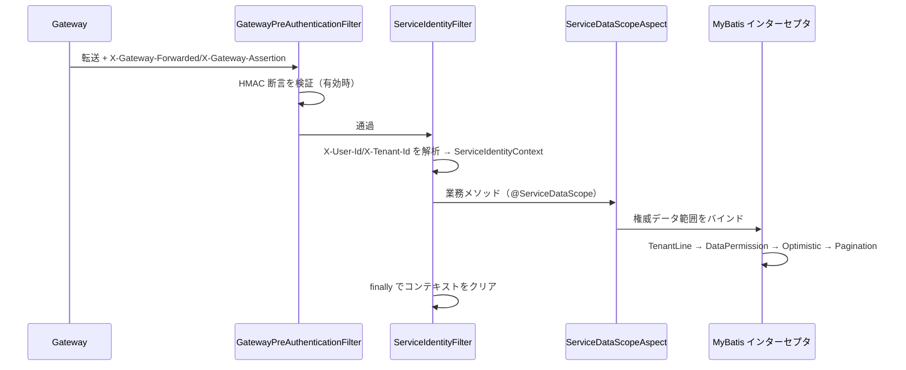

# common-service：Servlet サービスの身元・テナント・データ権限の基盤

`omni-common-service` は 10 個の common モジュールの中で最も業務寄りです。Servlet の身元チェーン、テナントとデータ権限のインターセプタ、データ範囲アスペクト、内部 API 認証、XSS 設定キャッシュ、起動時検証を組み合わせます。

**Servlet 専用**です。Gateway は WebFlux であり、ここのフィルタやアスペクトを組み込みしません。

> 事実境界：29 個の Java ファイルを 8 つの機能族にまとめます。今回はアプリを起動しておらず、組み込み結論はソース条件に基づきます。

## 0. 1 リクエストの流れ



## 1. サービス身元チェーン

### 問題

サービスはクライアント自己申告の `X-User-Id` を信頼できません。身元はゲートウェイが検証・署名し、サービス側でも再検証します。

### 使い方

業務コードは `ServiceIdentityContext.require()` / `requireTenantId()` で現在の身元を読みます。フィルタは自動設定されます。

### 実装原文

```java
        if (pathPolicy.isPublicOrManagement(request.getRequestURI())) {
            filterChain.doFilter(request, response);
            return;
        }
        try {
            Long userId = parsePositive(request.getHeader("X-User-Id"));
            Long tenantId = parsePositive(request.getHeader("X-Tenant-Id"));
            if (userId == null || tenantId == null) {
                response.setStatus(HttpServletResponse.SC_UNAUTHORIZED);
                response.setContentType(MediaType.APPLICATION_JSON_VALUE);
                response.setCharacterEncoding("UTF-8");
                objectMapper.writeValue(response.getWriter(), R.fail(401, "缺少合法的用户或租户身份"));
                return;
            }
            ServiceIdentityContext.set(new ServiceRequestIdentity(
                    userId, tenantId, request.getHeader("X-User-Name")));
            filterChain.doFilter(request, response);
        } finally {
            ServiceIdentityContext.clear();
        }
```

### 2 層の検証

| 層 | 仕組み | 失敗時 |
| --- | --- | --- |
| ゲートウェイ断言（任意） | `X-Gateway-Assertion`、HmacSHA256、TTL 300 秒、`GATEWAY_ASSERTION_SECRET` ≥ 32 バイト | 403 |
| 身元ヘッダ解析 | `X-User-Id` / `X-Tenant-Id` は正の整数 | 401 |
| コンテキスト読み取り | `ServiceIdentityContext.require()` が userId/tenantId を検証 | BusinessException(403) |

```java
        if (!pathPolicy.isPublicOrManagement(uri)
                && !"true".equals(request.getHeader("X-Gateway-Forwarded"))) {
            response.setStatus(HttpServletResponse.SC_FORBIDDEN);
            response.setContentType(MediaType.APPLICATION_JSON_VALUE);
            response.setCharacterEncoding("UTF-8");
            objectMapper.writeValue(response.getWriter(), R.fail(403,
                    "禁止直接访问 " + properties.getDisplayName() + " 服务"));
            return;
        }
```

### 境界と失敗復旧

- `X-Gateway-Forwarded: true` は**暗号学的証明ではありません**。ゲートウェイ断言が有効な場合のみ HMAC 検証を行います。本番の業務ポートはネットワーク境界が必要です。
- Servlet 専用で、Gateway は独自の WebFlux フィルタを持ちます。
- コンテキストは `finally` でクリアします。スレッドプールで身元が混線する場合は、フィルタを迂回する入口や非同期スレッドを確認します。

## 2. 永続化ポリシーとインターセプタ順序

### 問題

テナント分離とデータ権限は全 SQL に一貫して適用され、順序も正しくなければなりません。テナント条件 → データ範囲 → 楽観ロック → ページングです。

### 実装原文

```java
        MybatisPlusInterceptor interceptor = new MybatisPlusInterceptor();
        if (properties.getTenant().isEnabled()) {
            TenantTablePolicy tenantPolicy = requireUnique(tenantPolicyProvider, "TenantTablePolicy");
            interceptor.addInnerInterceptor(new TenantLineInnerInterceptor(new TenantLineHandler() {
                @Override
                public Expression getTenantId() {
                    return new LongValue(ServiceIdentityContext.requireTenantId());
                }

                @Override
                public boolean ignoreTable(String tableName) {
                    return !tenantPolicy.appliesTo(tableName);
                }
            }));
        }
        if (properties.getDataScope().isEnabled()) {
            DataScopeTablePolicy dataScopePolicy = requireUnique(dataScopePolicyProvider, "DataScopeTablePolicy");
            interceptor.addInnerInterceptor(new DataPermissionInterceptor(new MultiDataPermissionHandler() {
                @Override
                public Expression getSqlSegment(Table table, Expression where, String mappedStatementId) {
                    return dataScopePolicy.getSqlSegment(table, where, mappedStatementId);
                }
            }));
        }
        interceptor.addInnerInterceptor(new OptimisticLockerInnerInterceptor());
        interceptor.addInnerInterceptor(new PaginationInnerInterceptor(DbType.MYSQL));
        return interceptor;
```

### 組み込み条件

- `@ConditionalOnClass(MybatisPlusInterceptor.class)`。
- `omni.service.tenant.enabled=true` または `omni.service.data-scope.enabled=true`。
- テナント機能を有効にする場合は `TenantTablePolicy` が、データ権限を有効にする場合は `DataScopeTablePolicy` が**それぞれ 1 つだけ**必要です。満たさないと起動に失敗します。無効な機能のポリシーは不要です。

```java
        T bean = provider.getIfUnique();
        if (bean == null) {
            throw new IllegalStateException(typeName + " 必须且只能提供一个实现");
        }
```

### 境界と失敗復旧

- `TenantLine` はポリシーがテナント表と宣言した表だけを処理します。`sys_mq_message` のような横断表はポリシーで除外しないと、リレーが走査できなくなります。
- この Bean は `omni-common-mybatis` の既定チェーンを**丸ごと置き換え**、重なりません。
- データ範囲ポリシーが `null` を返すと条件を追加しません。許容可否はポリシーと書き込み認可で決まり、インターセプタだけでは判断できません。

## 3. データ範囲アスペクト

### 問題

同じインターフェースでも権限コードによって見える組織が変わります。範囲を Auth から解決し、メソッド実行中に有効にする必要があります。

### 実装原文

```java
    @Around("@annotation(annotation)")
    public Object bindScope(ProceedingJoinPoint joinPoint, ServiceDataScope annotation) throws Throwable {
        ServiceRequestIdentity identity = ServiceIdentityContext.require();
        try {
            InternalDataScopeDTO scope = dataScopeResolver.resolve(identity, annotation.permissionCode());
            validate(scope, identity, annotation.permissionCode());
            ServiceDataScopeContext.set(scope);
            return joinPoint.proceed();
        } finally {
            ServiceDataScopeContext.clear();
        }
    }
```

### 境界と失敗復旧

- `@Order(300)` はこのアスペクトの順序値です。トランザクションやセキュリティとの前後関係は相手の順序値と設定にも依存するため、必ずトランザクションの後に実行されるとは言えません。
- `validate` は返却された userId/tenantId/permissionCode が現在の身元と一致するか検証し、不一致は 403 です。権限サービスが誤った範囲を返すのを防ぐ要です。
- `finally` でコンテキストをクリアし、非同期スレッドは継承しません。
- アスペクトは**可視範囲**をバインドするだけで、書き込みの行単位認可を代替しません。

## 4. 内部 API 認証

### 問題

`/api/internal/**` はサービス間呼び出し用で、ユーザー JWT 権限コードは使えませんが、無防備にもできません。

### 実装原文

```java
    protected void doFilterInternal(HttpServletRequest request, HttpServletResponse response,
                                    FilterChain filterChain) throws ServletException, IOException {
        String expectedToken = properties.getInternalApi().getToken();
        String token = request.getHeader(HEADER_INTERNAL_TOKEN);
        if (!tokenMatches(token, expectedToken)) {
            log.warn("内部 API 认证失败: service={}, uri={}, token={}", properties.getName(),
                    request.getRequestURI(), token == null ? "missing" : "***");
            writeError(response, HttpServletResponse.SC_UNAUTHORIZED, "内部 API 认证失败");
            return;
        }
        UsernamePasswordAuthenticationToken authentication = new UsernamePasswordAuthenticationToken(
                "internal-service", null, List.of(new SimpleGrantedAuthority("ROLE_INTERNAL_SERVICE")));
        SecurityContextHolder.getContext().setAuthentication(authentication);
        try {
            filterChain.doFilter(request, response);
        } finally {
            SecurityContextHolder.clearContext();
        }
    }
```

### 境界

- `pathPolicy.isInternal(uri)` に一致するパスだけをフィルタします。
- トークンは `omni.service.internal-api.token` で、32 文字以上かつ既定値でない必要があります（第 7 節）。
- 内部エンドポイントはユーザー権限コードを持たず、**認可は呼び出し側の業務サービス**が担います。
- ゲートウェイのユーザー認証とは別チェーンで、互いに代替できません。

## 5. XSS キャッシュと Auth からの再取得

### 問題

毎回 Auth に XSS 設定を問い合わせると依存が増え、ローカルキャッシュだけでは更新されない可能性があります。

### 実装原文

```java
    public XssSettings getXssSettings(Long tenantId) {
        try {
            String enabled = redisTemplate.opsForValue().get("xss:enabled:" + tenantId);
            String rulesJson = redisTemplate.opsForValue().get("xss:rules:" + tenantId);
            if (enabled != null && rulesJson != null) {
                List<XssSettings.XssRule> rules = objectMapper.readValue(
                        rulesJson, new TypeReference<List<XssSettings.XssRule>>() { });
                return XssSettings.builder().enabled(Boolean.parseBoolean(enabled)).rules(rules).build();
            }
        } catch (Exception exception) {
            log.warn("{} XSS 缓存读取或解析失败，将回源 Auth：tenantId={}, message={}",
                    properties.getDisplayName(), tenantId, exception.getMessage());
        }
        try {
            XssSettings settings = settingsResolver.resolve(tenantId);
            if (settings != null) {
                cacheAuthoritative(tenantId, settings);
                return settings;
            }
        } catch (RuntimeException exception) {
            log.error("{} XSS 配置回源失败，启用基线防护：tenantId={}, message={}",
                    properties.getDisplayName(), tenantId, exception.getMessage());
        }
        return settingsFallback.get();
    }
```

### 意味

| 状況 | 動作 |
| --- | --- |
| 2 つの key があり解析可能 | キャッシュを返す |
| どちらか欠落 / 解析例外 | Auth から再取得 |
| Auth からの取得に成功 | キャッシュ書き込み（TTL 30 分）して返す |
| Auth からの取得で例外 | error を記録し、ローカル安全ベースラインを返す |

### 境界と失敗復旧

- キャッシュ書き込み失敗は警告のみで、今回の返却に影響しません。
- ベースラインは安全網であり、正本の設定が利用可能という意味ではありません。まず Auth からの取得エラーのログを確認します。
- Auth 自身の Provider は挙動が異なり（キャッシュ例外は伝播）、この降格を Auth に当てはめてはいけません。

## 6. Auth 内部クライアント

### 組み込み条件

```java
@AutoConfiguration
@ConditionalOnClass(FeignClient.class)
@ConditionalOnExpression("'${omni.service.data-scope.enabled:false}' == 'true' || "
        + "'${omni.service.xss.enabled:false}' == 'true'")
@EnableFeignClients(clients = AuthSecuritySettingsClient.class)
public class ServiceAuthClientAutoConfiguration {
```

`InternalFeignHeadersFactory`、`DataScopeResolver`、`XssSettingsResolver` を提供し、いずれもサービス定義 Bean で上書きできます。

### 境界と失敗復旧

- data-scope または xss が有効な場合のみ組み込みされ、tenant だけでは生成されません。
- 送信には内部トークンとテナントヘッダが必要で、無い場合は Auth の内部フィルタが拒否します。
- 解析失敗を「全データが見える」に降格してはいけません。

## 7. 起動時設定検証

### 問題

身元関連設定が欠けたまま起動すると、実行時に黙って全許可または全拒否になり、原因究明が難しくなります。

### 実装原文

```java
        if (properties.getInternalApi().isEnabled()
                || properties.getDataScope().isEnabled()
                || properties.getXss().isEnabled()) {
            String token = properties.getInternalApi().getToken();
            requireText(token, "omni.service.internal-api.token");
            if (token.length() < MIN_INTERNAL_TOKEN_LENGTH
                    || FORBIDDEN_TOKENS.contains(token.toLowerCase())) {
                throw new IllegalStateException("omni.service.internal-api.token 必须为至少 32 位的非默认密钥");
            }
        }
```

### 境界

- いずれかの機能が有効なら、サービス名/表示名の非空、管理/公開/内部パスが `/` で始まることを検証します。
- 全機能が無効なら即座に戻ります。
- 起動検証の通過は実行時の身元が有効という意味ではなく、設定の形が正しいことだけを意味します。

## 8. Inbox メトリクス

### 実装原文

```java
    public static void record(String destination, String result) {
        String key = destination + ':' + result;
        COUNTERS.computeIfAbsent(key, ignored -> Counter.builder("omni.inbox.operations")
                        .description("Business inbox processing outcomes")
                        .tag("destination", destination)
                        .tag("result", result)
                        .register(Metrics.globalRegistry))
                .increment();
    }
```

Consumer は処理後に `InboxMetrics.record(destination, result)` を呼びます。メトリクス名は `omni.inbox.operations`、destination と result でタグ付けします。

### 境界

- メトリクスは消費結果を反映し、MQ 配送成功を証明しません。
- メトリクス欠落は消費失敗を意味せず、未導入の可能性があります。

## 付録：機能族と検証

| 機能族 | 検証入口 |
| --- | --- |
| 身元チェーン | フィルタテストとゲートウェイ断言定数 |
| 永続化ポリシー | ServicePersistenceAutoConfigurationTest、asset MybatisPlusConfigTest |
| データ範囲アスペクト | `@ServiceDataScope` を使う Controller テスト |
| 内部 API 認証 | InternalApiAuthenticationFilterTest（common/asset/procurement/srm） |
| XSS キャッシュ | CachedServiceXssConfigProvider の挙動 |
| Auth クライアント | ServiceAuthClientAutoConfiguration の条件 |
| 起動検証 | ServiceConfigurationValidator（起動失敗経路） |
| Inbox メトリクス | InboxMetricsTest |

4 モジュールの他章：[common-mybatis](common-mybatis.jp.md)、[common-redis](common-redis.jp.md)、[common-redis-reactive](common-redis-reactive.jp.md)。
