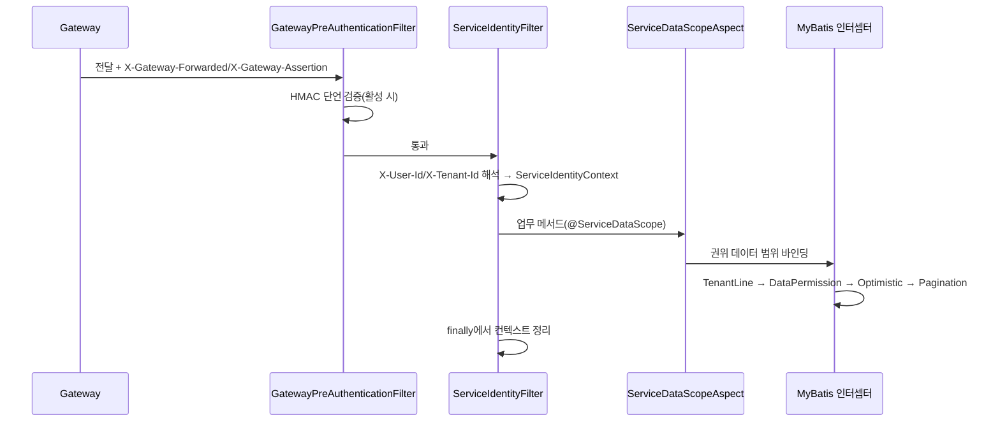

# common-service: Servlet 서비스의 신원·테넌트·데이터 권한 기반

`omni-common-service`는 10개 common 모듈 중 가장 업무에 가깝습니다. Servlet 신원 체인, 테넌트와 데이터 권한 인터셉터, 데이터 범위 aspect, 내부 API 인증, XSS 설정 캐시, 기동 시 검증을 결합합니다.

**Servlet 전용**입니다. Gateway는 WebFlux이며 이 필터나 aspect를 조립하지 않습니다.

> 사실 경계: Java 파일 29개를 8개 기능군으로 묶습니다. 이번 라운드에 애플리케이션을 기동하지 않았고 조립 결론은 소스 조건에 근거합니다.

## 0. 요청 한 번의 흐름



## 1. 서비스 신원 체인

### 문제

서비스는 클라이언트가 스스로 신고한 `X-User-Id`를 신뢰할 수 없습니다. 신원은 게이트웨이가 검증·서명하고, 서비스가 다시 검증해야 합니다.

### 사용법

업무 코드는 `ServiceIdentityContext.require()` / `requireTenantId()`로 현재 신원을 읽고, 필터는 자동 조립됩니다.

### 구현 원문

```java
        if (pathPolicy.isPublicOrManagement(request.getRequestURI())) {
            filterChain.doFilter(request, response);
            return;
        }
        try {
            Long userId = parsePositive(request.getHeader("X-User-Id"));
            Long tenantId = parsePositive(request.getHeader("X-Tenant-Id"));
            if (userId == null || tenantId == null) {
                response.setStatus(HttpServletResponse.SC_UNAUTHORIZED);
                response.setContentType(MediaType.APPLICATION_JSON_VALUE);
                response.setCharacterEncoding("UTF-8");
                objectMapper.writeValue(response.getWriter(), R.fail(401, "缺少合法的用户或租户身份"));
                return;
            }
            ServiceIdentityContext.set(new ServiceRequestIdentity(
                    userId, tenantId, request.getHeader("X-User-Name")));
            filterChain.doFilter(request, response);
        } finally {
            ServiceIdentityContext.clear();
        }
```

### 2계층 검증

| 계층 | 메커니즘 | 실패 결과 |
| --- | --- | --- |
| 게이트웨이 단언(선택) | `X-Gateway-Assertion`, HmacSHA256, TTL 300초, `GATEWAY_ASSERTION_SECRET` ≥ 32바이트 | 403 |
| 신원 헤더 해석 | `X-User-Id` / `X-Tenant-Id`는 양의 정수 | 401 |
| 컨텍스트 읽기 | `ServiceIdentityContext.require()`가 userId/tenantId 검증 | BusinessException(403) |

```java
        if (!pathPolicy.isPublicOrManagement(uri)
                && !"true".equals(request.getHeader("X-Gateway-Forwarded"))) {
            response.setStatus(HttpServletResponse.SC_FORBIDDEN);
            response.setContentType(MediaType.APPLICATION_JSON_VALUE);
            response.setCharacterEncoding("UTF-8");
            objectMapper.writeValue(response.getWriter(), R.fail(403,
                    "禁止直接访问 " + properties.getDisplayName() + " 服务"));
            return;
        }
```

### 경계와 실패 복구

- `X-Gateway-Forwarded: true`는 **암호학적 증명이 아닙니다**. 게이트웨이 단언이 켜졌을 때만 HMAC 검증을 합니다. 운영 업무 포트는 네트워크 경계가 필요합니다.
- Servlet 전용이며 Gateway는 자체 WebFlux 필터를 가집니다.
- 컨텍스트는 `finally`에서 정리합니다. 스레드 풀에서 신원이 섞이면 필터를 우회하는 입구나 비동기 스레드를 확인합니다.

## 2. 영속화 정책과 인터셉터 순서

### 문제

테넌트 격리와 데이터 권한은 모든 SQL에 일관되게 적용되어야 하고, 순서도 테넌트 조건 → 데이터 범위 → 낙관적 잠금 → 페이지네이션이어야 합니다.

### 구현 원문

```java
        MybatisPlusInterceptor interceptor = new MybatisPlusInterceptor();
        if (properties.getTenant().isEnabled()) {
            TenantTablePolicy tenantPolicy = requireUnique(tenantPolicyProvider, "TenantTablePolicy");
            interceptor.addInnerInterceptor(new TenantLineInnerInterceptor(new TenantLineHandler() {
                @Override
                public Expression getTenantId() {
                    return new LongValue(ServiceIdentityContext.requireTenantId());
                }

                @Override
                public boolean ignoreTable(String tableName) {
                    return !tenantPolicy.appliesTo(tableName);
                }
            }));
        }
        if (properties.getDataScope().isEnabled()) {
            DataScopeTablePolicy dataScopePolicy = requireUnique(dataScopePolicyProvider, "DataScopeTablePolicy");
            interceptor.addInnerInterceptor(new DataPermissionInterceptor(new MultiDataPermissionHandler() {
                @Override
                public Expression getSqlSegment(Table table, Expression where, String mappedStatementId) {
                    return dataScopePolicy.getSqlSegment(table, where, mappedStatementId);
                }
            }));
        }
        interceptor.addInnerInterceptor(new OptimisticLockerInnerInterceptor());
        interceptor.addInnerInterceptor(new PaginationInnerInterceptor(DbType.MYSQL));
        return interceptor;
```

### 조립 조건

- `@ConditionalOnClass(MybatisPlusInterceptor.class)`.
- `omni.service.tenant.enabled=true` 또는 `omni.service.data-scope.enabled=true`.
- 테넌트 기능이 켜졌으면 `TenantTablePolicy`, 데이터 권한이 켜졌으면 `DataScopeTablePolicy`가 **각각 하나만** 있어야 하며, 아니면 기동에 실패합니다. 꺼진 기능의 정책은 제공할 필요가 없습니다:

```java
        T bean = provider.getIfUnique();
        if (bean == null) {
            throw new IllegalStateException(typeName + " 必须且只能提供一个实现");
        }
```

### 경계와 실패 복구

- `TenantLine`은 정책이 테넌트 테이블로 선언한 테이블만 처리합니다. `sys_mq_message` 같은 횡단 테이블은 정책에서 제외해야 릴레이가 스캔할 수 있습니다.
- 이 Bean은 `omni-common-mybatis`의 기본 체인을 **전부 대체**하며 겹치지 않습니다.
- 데이터 범위 정책이 `null`을 반환하면 조건을 추가하지 않습니다. 허용 여부는 정책과 쓰기 인가가 결정하며 인터셉터만으로 판단할 수 없습니다.

## 3. 데이터 범위 aspect

### 문제

같은 인터페이스라도 권한 코드에 따라 보이는 조직이 달라집니다. 범위를 Auth에서 해석해 메서드 실행 중에 적용해야 합니다.

### 구현 원문

```java
    @Around("@annotation(annotation)")
    public Object bindScope(ProceedingJoinPoint joinPoint, ServiceDataScope annotation) throws Throwable {
        ServiceRequestIdentity identity = ServiceIdentityContext.require();
        try {
            InternalDataScopeDTO scope = dataScopeResolver.resolve(identity, annotation.permissionCode());
            validate(scope, identity, annotation.permissionCode());
            ServiceDataScopeContext.set(scope);
            return joinPoint.proceed();
        } finally {
            ServiceDataScopeContext.clear();
        }
    }
```

### 경계와 실패 복구

- `@Order(300)`은 이 aspect의 순서 값입니다. 트랜잭션·보안 aspect와의 앞뒤 관계는 상대의 순서 값과 설정에도 달려 있으므로 항상 트랜잭션 뒤에 실행된다고 볼 수 없습니다.
- `validate`는 반환된 userId/tenantId/permissionCode가 현재 신원과 일치하는지 검증하고 불일치 시 403을 던집니다. 권한 서비스가 잘못된 범위를 반환하는 것을 막는 핵심입니다.
- `finally`에서 컨텍스트를 정리하며 비동기 스레드는 상속하지 않습니다.
- aspect는 **가시 범위**만 바인딩하며 쓰기의 행 단위 인가를 대체하지 않습니다.

## 4. 내부 API 인증

### 문제

`/api/internal/**`는 서비스 간 호출용이며 사용자 JWT 권한 코드를 쓸 수 없지만, 무방비로 둘 수도 없습니다.

### 구현 원문

```java
    protected void doFilterInternal(HttpServletRequest request, HttpServletResponse response,
                                    FilterChain filterChain) throws ServletException, IOException {
        String expectedToken = properties.getInternalApi().getToken();
        String token = request.getHeader(HEADER_INTERNAL_TOKEN);
        if (!tokenMatches(token, expectedToken)) {
            log.warn("内部 API 认证失败: service={}, uri={}, token={}", properties.getName(),
                    request.getRequestURI(), token == null ? "missing" : "***");
            writeError(response, HttpServletResponse.SC_UNAUTHORIZED, "内部 API 认证失败");
            return;
        }
        UsernamePasswordAuthenticationToken authentication = new UsernamePasswordAuthenticationToken(
                "internal-service", null, List.of(new SimpleGrantedAuthority("ROLE_INTERNAL_SERVICE")));
        SecurityContextHolder.getContext().setAuthentication(authentication);
        try {
            filterChain.doFilter(request, response);
        } finally {
            SecurityContextHolder.clearContext();
        }
    }
```

### 경계

- `pathPolicy.isInternal(uri)`에 맞는 경로만 필터링합니다.
- 토큰은 `omni.service.internal-api.token`이며 32자 이상, 기본값이 아니어야 합니다(7절).
- 내부 엔드포인트에는 사용자 권한 코드가 없으며 **인가는 호출하는 업무 서비스**가 담당합니다.
- 게이트웨이 사용자 인증과 다른 체인이며 서로 대체할 수 없습니다.

## 5. XSS 캐시와 Auth 재조회

### 문제

매 요청 Auth에 XSS 설정을 물으면 의존이 커지고, 로컬 캐시만 쓰면 갱신되지 않을 수 있습니다.

### 구현 원문

```java
    public XssSettings getXssSettings(Long tenantId) {
        try {
            String enabled = redisTemplate.opsForValue().get("xss:enabled:" + tenantId);
            String rulesJson = redisTemplate.opsForValue().get("xss:rules:" + tenantId);
            if (enabled != null && rulesJson != null) {
                List<XssSettings.XssRule> rules = objectMapper.readValue(
                        rulesJson, new TypeReference<List<XssSettings.XssRule>>() { });
                return XssSettings.builder().enabled(Boolean.parseBoolean(enabled)).rules(rules).build();
            }
        } catch (Exception exception) {
            log.warn("{} XSS 缓存读取或解析失败，将回源 Auth：tenantId={}, message={}",
                    properties.getDisplayName(), tenantId, exception.getMessage());
        }
        try {
            XssSettings settings = settingsResolver.resolve(tenantId);
            if (settings != null) {
                cacheAuthoritative(tenantId, settings);
                return settings;
            }
        } catch (RuntimeException exception) {
            log.error("{} XSS 配置回源失败，启用基线防护：tenantId={}, message={}",
                    properties.getDisplayName(), tenantId, exception.getMessage());
        }
        return settingsFallback.get();
    }
```

### 의미

| 상황 | 동작 |
| --- | --- |
| 두 key가 있고 해석 가능 | 캐시 반환 |
| 둘 중 하나 누락 / 해석 예외 | Auth 재조회 |
| Auth 조회 성공 | 캐시 기록(TTL 30분) 후 반환 |
| Auth 조회 예외 | error 기록 후 로컬 안전 베이스라인 반환 |

### 경계와 실패 복구

- 캐시 기록 실패는 경고만 남기고 이번 응답에 영향을 주지 않습니다.
- 베이스라인은 안전망이며 정본 설정이 사용 가능하다는 뜻이 아닙니다. 먼저 Auth 조회 오류 로그를 봅니다.
- Auth 자체 Provider는 동작이 다르며(캐시 예외 전파) 이 강등을 Auth에 적용하면 안 됩니다.

## 6. Auth 내부 클라이언트

### 조립 조건

```java
@AutoConfiguration
@ConditionalOnClass(FeignClient.class)
@ConditionalOnExpression("'${omni.service.data-scope.enabled:false}' == 'true' || "
        + "'${omni.service.xss.enabled:false}' == 'true'")
@EnableFeignClients(clients = AuthSecuritySettingsClient.class)
public class ServiceAuthClientAutoConfiguration {
```

`InternalFeignHeadersFactory`, `DataScopeResolver`, `XssSettingsResolver`를 제공하며 모두 서비스 Bean으로 덮어쓸 수 있습니다.

### 경계와 실패 복구

- data-scope 또는 xss가 켜졌을 때만 조립되며 tenant만으로는 생성되지 않습니다.
- 송신에는 내부 토큰과 테넌트 헤더가 필요하며 없으면 Auth 내부 필터가 거부합니다.
- 해석 실패를 "모든 데이터가 보임"으로 강등하면 안 됩니다.

## 7. 기동 시 설정 검증

### 문제

신원 관련 설정이 빠진 채 기동하면 런타임에 조용히 전부 허용하거나 전부 거부해 원인 파악이 어렵습니다.

### 구현 원문

```java
        if (properties.getInternalApi().isEnabled()
                || properties.getDataScope().isEnabled()
                || properties.getXss().isEnabled()) {
            String token = properties.getInternalApi().getToken();
            requireText(token, "omni.service.internal-api.token");
            if (token.length() < MIN_INTERNAL_TOKEN_LENGTH
                    || FORBIDDEN_TOKENS.contains(token.toLowerCase())) {
                throw new IllegalStateException("omni.service.internal-api.token 必须为至少 32 位的非默认密钥");
            }
        }
```

### 경계

- 기능이 하나라도 켜지면 서비스명/표시명 비어 있지 않음, 관리/공개/내부 경로가 `/`로 시작함을 검증합니다.
- 모든 기능이 꺼져 있으면 즉시 반환합니다.
- 기동 검증 통과는 런타임 신원이 유효하다는 뜻이 아니라 설정 형태가 올바르다는 뜻입니다.

## 8. Inbox 메트릭

### 구현 원문

```java
    public static void record(String destination, String result) {
        String key = destination + ':' + result;
        COUNTERS.computeIfAbsent(key, ignored -> Counter.builder("omni.inbox.operations")
                        .description("Business inbox processing outcomes")
                        .tag("destination", destination)
                        .tag("result", result)
                        .register(Metrics.globalRegistry))
                .increment();
    }
```

Consumer는 처리 후 `InboxMetrics.record(destination, result)`를 호출합니다. 메트릭 이름은 `omni.inbox.operations`이며 destination과 result로 태그합니다.

### 경계

- 메트릭은 소비 결과를 반영하며 MQ 전달 성공을 증명하지 않습니다.
- 메트릭 부재는 소비 실패가 아니라 미계측일 수 있습니다.

## 부록: 기능군과 검증

| 기능군 | 검증 진입 |
| --- | --- |
| 신원 체인 | 필터 테스트와 게이트웨이 단언 상수 |
| 영속화 정책 | ServicePersistenceAutoConfigurationTest, asset MybatisPlusConfigTest |
| 데이터 범위 aspect | `@ServiceDataScope` 사용 Controller 테스트 |
| 내부 API 인증 | InternalApiAuthenticationFilterTest(common/asset/procurement/srm) |
| XSS 캐시 | CachedServiceXssConfigProvider 동작 |
| Auth 클라이언트 | ServiceAuthClientAutoConfiguration 조건 |
| 기동 검증 | ServiceConfigurationValidator(기동 실패 경로) |
| Inbox 메트릭 | InboxMetricsTest |

네 모듈의 다른 장: [common-mybatis](common-mybatis.kr.md), [common-redis](common-redis.kr.md), [common-redis-reactive](common-redis-reactive.kr.md).
