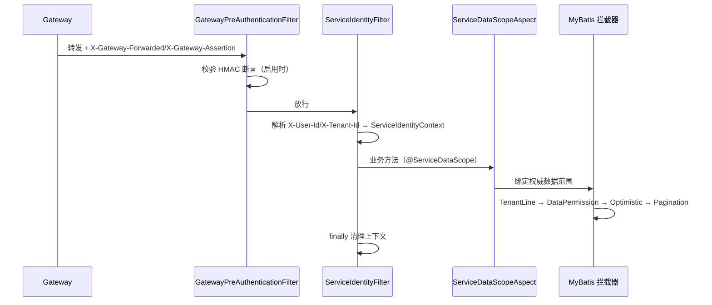

# common-service：Servlet 服务的身份、租户与数据权限底座

`omni-common-service` 是十个 common 模块里最“有业务感”的一个：它把 Servlet 服务的身份链、租户与数据权限拦截器、数据范围切面、内部 API 认证、XSS 配置缓存和启动校验组合在一起。

它只面向 **Servlet**。Gateway 是 WebFlux，不装配这里的任何过滤器或切面。

> 事实边界：模块 29 个 Java 文件，本文归为 8 个功能族。本轮未启动应用，装配结论以源码条件为准。

## 0. 一次请求经过什么



## 1. 服务身份链

### 问题

服务不能相信客户端自报的 `X-User-Id`。身份必须由网关验证并签名，服务侧再校验一次。

### 怎么用

业务代码通过 `ServiceIdentityContext.require()` / `requireTenantId()` 读取当前身份；过滤器自动装配，无需业务代码介入。

### 实现原文

```java
        if (pathPolicy.isPublicOrManagement(request.getRequestURI())) {
            filterChain.doFilter(request, response);
            return;
        }
        try {
            Long userId = parsePositive(request.getHeader("X-User-Id"));
            Long tenantId = parsePositive(request.getHeader("X-Tenant-Id"));
            if (userId == null || tenantId == null) {
                response.setStatus(HttpServletResponse.SC_UNAUTHORIZED);
                response.setContentType(MediaType.APPLICATION_JSON_VALUE);
                response.setCharacterEncoding("UTF-8");
                objectMapper.writeValue(response.getWriter(), R.fail(401, "缺少合法的用户或租户身份"));
                return;
            }
            ServiceIdentityContext.set(new ServiceRequestIdentity(
                    userId, tenantId, request.getHeader("X-User-Name")));
            filterChain.doFilter(request, response);
        } finally {
            ServiceIdentityContext.clear();
        }
```

### 两层校验

| 层 | 机制 | 失败结果 |
| --- | --- | --- |
| 网关断言（可选） | `X-Gateway-Assertion`，HmacSHA256，TTL 300 秒，密钥 `GATEWAY_ASSERTION_SECRET` ≥ 32 字节 | 403 |
| 身份头解析 | `X-User-Id` / `X-Tenant-Id` 必须为正整数 | 401 |
| 上下文读取 | `ServiceIdentityContext.require()` 校验 userId/tenantId | BusinessException(403) |

```java
        if (!pathPolicy.isPublicOrManagement(uri)
                && !"true".equals(request.getHeader("X-Gateway-Forwarded"))) {
            response.setStatus(HttpServletResponse.SC_FORBIDDEN);
            response.setContentType(MediaType.APPLICATION_JSON_VALUE);
            response.setCharacterEncoding("UTF-8");
            objectMapper.writeValue(response.getWriter(), R.fail(403,
                    "禁止直接访问 " + properties.getDisplayName() + " 服务"));
            return;
        }
```

### 边界与失败恢复

- `X-Gateway-Forwarded: true` 本身**不是密码学证明**；启用网关断言时才做 HMAC 校验。生产业务端口仍需网络边界保护。
- 只对 Servlet 生效；Gateway 有自己的 WebFlux 过滤器。
- 上下文在 `finally` 清理；若发现线程池里的请求串了身份，先查是否有绕过过滤器的入口或异步线程未传递上下文。

## 2. 持久化策略与拦截器顺序

### 问题

租户隔离与数据权限必须对所有 SQL 一致生效，且顺序不能错：先加租户条件，再加数据范围，最后才是乐观锁与分页。当前顺序固定为 **TenantLine → DataPermission → OptimisticLocker → Pagination**。

### 实现原文

```java
        MybatisPlusInterceptor interceptor = new MybatisPlusInterceptor();
        if (properties.getTenant().isEnabled()) {
            TenantTablePolicy tenantPolicy = requireUnique(tenantPolicyProvider, "TenantTablePolicy");
            interceptor.addInnerInterceptor(new TenantLineInnerInterceptor(new TenantLineHandler() {
                @Override
                public Expression getTenantId() {
                    return new LongValue(ServiceIdentityContext.requireTenantId());
                }

                @Override
                public boolean ignoreTable(String tableName) {
                    return !tenantPolicy.appliesTo(tableName);
                }
            }));
        }
        if (properties.getDataScope().isEnabled()) {
            DataScopeTablePolicy dataScopePolicy = requireUnique(dataScopePolicyProvider, "DataScopeTablePolicy");
            interceptor.addInnerInterceptor(new DataPermissionInterceptor(new MultiDataPermissionHandler() {
                @Override
                public Expression getSqlSegment(Table table, Expression where, String mappedStatementId) {
                    return dataScopePolicy.getSqlSegment(table, where, mappedStatementId);
                }
            }));
        }
        interceptor.addInnerInterceptor(new OptimisticLockerInnerInterceptor());
        interceptor.addInnerInterceptor(new PaginationInnerInterceptor(DbType.MYSQL));
        return interceptor;
```

### 装配条件

- `@ConditionalOnClass(MybatisPlusInterceptor.class)`；
- `omni.service.tenant.enabled=true` 或 `omni.service.data-scope.enabled=true`；
- 启用租户功能时，`TenantTablePolicy` **必须且只能有一个**实现；启用数据权限时，对 `DataScopeTablePolicy` 提出同样要求，否则启动失败。未启用的功能不要求提供对应策略：

```java
        T bean = provider.getIfUnique();
        if (bean == null) {
            throw new IllegalStateException(typeName + " 必须且只能提供一个实现");
        }
```

### 边界与失败恢复

- `TenantLine` 只处理策略声明为租户表的表；`sys_mq_message` 这类跨租户表必须由策略排除，否则中继会扫不到数据。
- 这个 Bean 会**整体覆盖** `omni-common-mybatis` 的默认链，不会叠加。
- 数据范围策略返回 `null` 表示不加条件（放行）；是否允许放行由策略实现与写授权共同决定，不能只看拦截器。

## 3. 数据范围切面

### 问题

同一个接口在不同权限码下应看到不同单位的数据；范围需要从 Auth 解析并在方法执行期间生效。

### 实现原文

```java
    @Around("@annotation(annotation)")
    public Object bindScope(ProceedingJoinPoint joinPoint, ServiceDataScope annotation) throws Throwable {
        ServiceRequestIdentity identity = ServiceIdentityContext.require();
        try {
            InternalDataScopeDTO scope = dataScopeResolver.resolve(identity, annotation.permissionCode());
            validate(scope, identity, annotation.permissionCode());
            ServiceDataScopeContext.set(scope);
            return joinPoint.proceed();
        } finally {
            ServiceDataScopeContext.clear();
        }
    }
```

### 边界与失败恢复

- `@Order(300)` 只给出本切面的排序值；它与事务、安全切面的先后还取决于其他切面的排序和配置，不能据此认定总是在事务之后执行。
- `validate` 校验返回的 userId/tenantId/permissionCode 与当前身份一致，不一致抛 403；这是防止权限服务返回错范围的关键。
- `finally` 清理上下文；异步线程不会自动继承。
- 切面只绑定“可见范围”，**不替代写操作的逐行授权**。

## 4. 内部 API 认证

### 问题

`/api/internal/**` 供服务间调用，不能走用户的 JWT 权限码，但也不能裸奔。

### 实现原文

```java
    protected void doFilterInternal(HttpServletRequest request, HttpServletResponse response,
                                    FilterChain filterChain) throws ServletException, IOException {
        String expectedToken = properties.getInternalApi().getToken();
        String token = request.getHeader(HEADER_INTERNAL_TOKEN);
        if (!tokenMatches(token, expectedToken)) {
            log.warn("内部 API 认证失败: service={}, uri={}, token={}", properties.getName(),
                    request.getRequestURI(), token == null ? "missing" : "***");
            writeError(response, HttpServletResponse.SC_UNAUTHORIZED, "内部 API 认证失败");
            return;
        }
        UsernamePasswordAuthenticationToken authentication = new UsernamePasswordAuthenticationToken(
                "internal-service", null, List.of(new SimpleGrantedAuthority("ROLE_INTERNAL_SERVICE")));
        SecurityContextHolder.getContext().setAuthentication(authentication);
        try {
            filterChain.doFilter(request, response);
        } finally {
            SecurityContextHolder.clearContext();
        }
    }
```

### 边界

- 只过滤 `pathPolicy.isInternal(uri)` 命中的路径。
- 令牌来自 `omni.service.internal-api.token`，至少 32 位且不能是默认值（见第 7 节）。
- 内部端点不做用户级权限码；**授权由调用方业务服务负责**。
- 与网关用户认证是两条链，不能互相替代。

## 5. XSS 缓存与回源

### 问题

每个服务都去 Auth 查 XSS 配置会放大依赖；只用本地缓存又可能长期不更新。

### 实现原文

```java
    public XssSettings getXssSettings(Long tenantId) {
        try {
            String enabled = redisTemplate.opsForValue().get("xss:enabled:" + tenantId);
            String rulesJson = redisTemplate.opsForValue().get("xss:rules:" + tenantId);
            if (enabled != null && rulesJson != null) {
                List<XssSettings.XssRule> rules = objectMapper.readValue(
                        rulesJson, new TypeReference<List<XssSettings.XssRule>>() { });
                return XssSettings.builder().enabled(Boolean.parseBoolean(enabled)).rules(rules).build();
            }
        } catch (Exception exception) {
            log.warn("{} XSS 缓存读取或解析失败，将回源 Auth：tenantId={}, message={}",
                    properties.getDisplayName(), tenantId, exception.getMessage());
        }
        try {
            XssSettings settings = settingsResolver.resolve(tenantId);
            if (settings != null) {
                cacheAuthoritative(tenantId, settings);
                return settings;
            }
        } catch (RuntimeException exception) {
            log.error("{} XSS 配置回源失败，启用基线防护：tenantId={}, message={}",
                    properties.getDisplayName(), tenantId, exception.getMessage());
        }
        return settingsFallback.get();
    }
```

### 语义

| 情况 | 行为 |
| --- | --- |
| 两键都存在且可解析 | 直接返回缓存 |
| 任一键缺失 / 解析异常 | 回源 Auth |
| 回源成功 | 写缓存（TTL 30 分钟）并返回 |
| 回源抛异常 | 记录 error，返回本地安全基线 |

### 边界与失败恢复

- 缓存写入失败只告警，不影响本次返回。
- 基线是“安全兜底”，不代表权威配置可用；排查时先看回源错误日志。
- Auth 自身的 Provider 策略不同（缓存异常直接传播），不能把这里的降级套到 Auth。

## 6. Auth 内部客户端

### 装配条件

```java
@AutoConfiguration
@ConditionalOnClass(FeignClient.class)
@ConditionalOnExpression("'${omni.service.data-scope.enabled:false}' == 'true' || "
        + "'${omni.service.xss.enabled:false}' == 'true'")
@EnableFeignClients(clients = AuthSecuritySettingsClient.class)
public class ServiceAuthClientAutoConfiguration {
```

默认提供 `InternalFeignHeadersFactory`、`DataScopeResolver`、`XssSettingsResolver`，均可被服务自定义 Bean 覆盖。

### 边界与失败恢复

- 只有启用 data-scope 或 xss 时才装配；仅启用租户不会创建这个客户端。
- 出站请求必须带内部令牌与租户头；缺少时 Auth 的内部 Filter 会拒绝。
- 解析失败不能降级为“看见全部数据”，应向上抛错。

## 7. 启动配置校验

### 问题

身份相关配置缺失时，服务即便启动也会在运行期静默放行或全部拒绝，难以定位。

### 实现原文

```java
        if (properties.getInternalApi().isEnabled()
                || properties.getDataScope().isEnabled()
                || properties.getXss().isEnabled()) {
            String token = properties.getInternalApi().getToken();
            requireText(token, "omni.service.internal-api.token");
            if (token.length() < MIN_INTERNAL_TOKEN_LENGTH
                    || FORBIDDEN_TOKENS.contains(token.toLowerCase())) {
                throw new IllegalStateException("omni.service.internal-api.token 必须为至少 32 位的非默认密钥");
            }
        }
```

### 边界

- 任一特性启用时校验：服务名/显示名非空，管理/公开/内部路径均以 `/` 开头。
- 未启用任何特性时直接返回，不做校验。
- 启动校验通过不代表运行期身份一定有效，只保证配置形态正确。

## 8. Inbox 指标

### 实现原文

```java
    public static void record(String destination, String result) {
        String key = destination + ':' + result;
        COUNTERS.computeIfAbsent(key, ignored -> Counter.builder("omni.inbox.operations")
                        .description("Business inbox processing outcomes")
                        .tag("destination", destination)
                        .tag("result", result)
                        .register(Metrics.globalRegistry))
                .increment();
    }
```

Consumer 处理完成后调用 `InboxMetrics.record(destination, result)`，指标名 `omni.inbox.operations`，按 destination 与 result 打标签。

### 边界

- 指标只反映消费结果，不证明 MQ 投递成功。
- 指标缺失不代表消费失败，可能只是该消费者未接入。

## 附：功能族与验证入口

| 功能族 | 验证入口 |
| --- | --- |
| 服务身份链 | 各服务 InternalApiAuthFilterTest 之外的过滤器测试；Gate 断言常量 |
| 持久化策略 | ServicePersistenceAutoConfigurationTest、asset MybatisPlusConfigTest |
| 数据范围切面 | 使用 `@ServiceDataScope` 的 Controller 测试 |
| 内部 API 认证 | InternalApiAuthenticationFilterTest（common/asset/procurement/srm） |
| XSS 缓存 | CachedServiceXssConfigProvider 行为（缓存/回源/基线） |
| Auth 客户端 | ServiceAuthClientAutoConfiguration 装配条件 |
| 启动校验 | ServiceConfigurationValidator（启动失败路径） |
| Inbox 指标 | InboxMetricsTest |

四个模块的其余章节：[common-mybatis](common-mybatis.md)、[common-redis](common-redis.md)、[common-redis-reactive](common-redis-reactive.md)。
