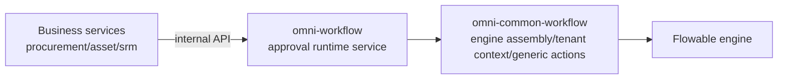

# common-workflow: the shared support library for the approval runtime service

`omni-common-workflow` is a **library**, not a standalone service. It provides the approval runtime service `omni-workflow` with Flowable engine assembly, tenant context, generic approval actions and two extension points.

Business services (procurement, asset, SRM) **do not depend on it**: they call `omni-workflow` through `/api/internal/workflow` and never embed Flowable themselves.

> Source scope: 8 Java files. For the object model, state machines and action boundaries see [workflow principles](workflow-principles.en.md). This article describes the library; source presence does not prove runtime behavior.

## 0. Three layers



| Layer | Responsible for | Not responsible for |
| --- | --- | --- |
| Business services | business records, business state, authorization | embedding Flowable |
| `omni-workflow` | tenant/assignee guards, completion events, to-do sync, model management | low-level Flowable action details |
| `omni-common-workflow` | engine config, ThreadLocal, generic actions, extension points | tenant and operator validation |

## 1. Flowable auto-configuration

### Assembly conditions

```java
@ConditionalOnClass(SpringProcessEngineConfiguration.class)
public class FlowableAutoConfiguration {
```

It assembles only when the Flowable engine is on the classpath. Beans provided:

| Bean | Purpose | Override |
| --- | --- | --- |
| `EngineConfigurationConfigurer` | engine configuration | additional customizers do not automatically replace the default |
| `TenantInfoFilter` | tenant ThreadLocal filter | `@ConditionalOnMissingBean` |
| `ApprovalService` | generic approval actions | `@ConditionalOnMissingBean` |
| `WorkflowNotificationService` | notification extension point | `@ConditionalOnMissingBean` |

### Source

```java
    @Bean
    @ConditionalOnMissingBean
    public ApprovalService approvalService(TaskService taskService, RuntimeService runtimeService) {
        return new ApprovalServiceImpl(taskService, runtimeService);
    }
```

```java
    @Bean
    @ConditionalOnMissingBean
    public WorkflowNotificationService workflowNotificationService() {
        return new NoOpNotificationService();
    }
```

### Boundaries

- Approval, notification and tenant-filter beans use `@ConditionalOnMissingBean` and can be replaced by corresponding beans. The engine customizer has no such condition: another bean of the same type does not automatically disable it. Check the combined effects and execution order of multiple customizers explicitly.
- `omni-common-workflow` does not depend on `omni-workflow`; the dependency is the other way round.
- Flowable tables and runtime belong to the approval service, not to business databases.

## 2. Tenant context

### Problem

Flowable queries and deployments need the tenant ID, but the engine API is unaware of the web request.

### Source

```java
    protected void doFilterInternal(HttpServletRequest request,
                                    HttpServletResponse response,
                                    FilterChain filterChain)
            throws ServletException, IOException {
        String tenantId = request.getHeader(HEADER_TENANT_ID);
        if (tenantId != null && !tenantId.isBlank()) {
            TenantInfoHolder.setTenantId(tenantId);
            log.debug("租户信息设置: tenantId={}, URI={}", tenantId, request.getRequestURI());
        }
        try {
            filterChain.doFilter(request, response);
        } finally {
            TenantInfoHolder.clear();
        }
    }
```

### Boundaries and recovery

- The tenant header must be guaranteed by the trusted identity chain; this filter only propagates it.
- **ThreadLocal must be cleared in finally**, otherwise the next request on a pooled thread inherits the previous tenant.
- Servlet request chain only; async threads and scheduled jobs do not inherit it and must pass the tenant explicitly.
- Without a tenant header, this filter neither sets context nor rejects the request itself. Authentication, required tenant values and task ownership are checked by the outer entry and runtime service. This propagation helper is not a security fallback; extensions must complete those checks before entering the engine too.

## 3. Generic approval service

### What it provides

`ApprovalService` wraps four Flowable actions:

- `complete(taskId, approved, comment, variables)`
- `addSigner(taskId, newUserId)`
- `removeSigner(taskId, targetUserId)`
- `delegate(taskId, targetUserId)`

### What it does not provide

The signatures contain **no tenantId and no operator userId**. It therefore does not:

- verify the task belongs to the current tenant;
- verify the current user is the assignee;
- publish completion events;
- synchronize to-dos.

Those live in `WorkflowApprovalServiceImpl` in `omni-workflow`. Treating the library as a complete approval service would bypass security checks.

### Real semantics of delegate

```java
    @Override
    public void delegate(String taskId, String targetUserId) {
        Task task = taskService.createTaskQuery().taskId(taskId).singleResult();
        if (task == null) {
            throw new IllegalArgumentException("任务不存在: " + taskId);
        }

        taskService.setAssignee(taskId, targetUserId);
        log.info("委托成功: taskId={}, targetUserId={}", taskId, targetUserId);
    }
```

This is **direct reassignment**: the method does not create a `DELEGATED` state, deliberately save the old assignee as owner, or automatically return the task after completion. It does not use Flowable's `delegateTask` / `resolveTask`; this does not mean engine history is deleted.

### Failure recovery

- A missing task throws `IllegalArgumentException`; the service layer normally validates presence and assignee first.
- Add/remove signer only works on multi-instance activities; plain nodes have no branch.
- Threshold recalculation and `MI_END` semantics are covered in [workflow principles](workflow-principles.en.md).

## 4. Candidate and notification extension points

### UserGroupLookup

`UserGroupLookup` is the user-group lookup used by candidate resolution; `RbacUserGroupLookup` in `omni-workflow` implements it, and the candidate listener resolves role members through it.

### WorkflowNotificationService

The interface exists and the default implementation is `NoOpNotificationService`: **it sends nothing**. There is currently no real notification implementation in the repository.

Therefore:

- articles must not claim "approval sends notifications";
- a real implementation must provide the interface as a bean;
- the interface proves extensibility, not implementation.

## 5. Extension

| Goal | How | Do not |
| --- | --- | --- |
| Custom approval action | implement/override `ApprovalService` | call Flowable directly from business services |
| Add notifications | implement `WorkflowNotificationService` | treat NoOp as sent |
| Custom user-group source | implement `UserGroupLookup` | hard-code SQL in the listener |
| Tune engine config | provide `EngineConfigurationConfigurer` | change library defaults for everyone |

## Verification

- conditions and bean overrides of `FlowableAutoConfiguration`;
- cleanup behavior of `TenantInfoFilter`;
- countersign/delegate unit tests of `ApprovalServiceImpl`;
- runtime approval chains belong to `omni-workflow` Fw* integration tests and must be accepted against their runtime records and reports, not this source description alone.

Previous: [common-mqlog](common-mqlog.en.md); full workflow principles: [workflow-principles](workflow-principles.en.md).
