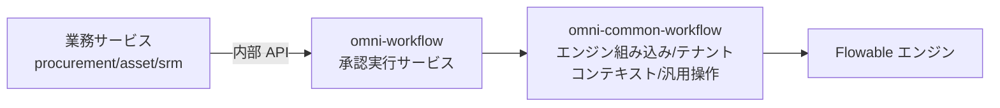

# common-workflow：承認実行サービスの共通サポートライブラリ

`omni-common-workflow` は**ライブラリ**であり、独立サービスではありません。承認実行サービス `omni-workflow` に Flowable エンジンの組み込み、テナントコンテキスト、汎用承認操作、2 つの拡張点を提供します。

業務サービス（procurement / asset / srm）は**これに依存しません**。`/api/internal/workflow` 経由で `omni-workflow` を呼び、Flowable を埋め込みません。

> ソースの範囲：Java ファイル 8 個。オブジェクトモデルと状態機械は[ワークフロー原理](workflow-principles.jp.md)を参照してください。本稿はライブラリの役割を扱い、ソースの存在だけで実行時の挙動を証明するものではありません。

## 0. 3 つの層



| 層 | 担当 | 担当しない |
| --- | --- | --- |
| 業務サービス | 業務レコード、業務状態、認可 | Flowable の埋め込み |
| `omni-workflow` | テナント/処理者ガード、完了イベント、TODO 同期、モデル管理 | 汎用 Flowable 操作の詳細 |
| `omni-common-workflow` | エンジン設定、ThreadLocal、汎用操作、拡張点 | テナントと操作者の検証 |

## 1. Flowable 自動設定

### 組み込み条件

```java
@ConditionalOnClass(SpringProcessEngineConfiguration.class)
public class FlowableAutoConfiguration {
```

Flowable エンジンがクラスパスにある場合のみ組み込みします。提供 Bean：

| Bean | 役割 | 上書き |
| --- | --- | --- |
| `EngineConfigurationConfigurer` | エンジン設定 | 追加のカスタマイザーは既定のものを自動置換しない |
| `TenantInfoFilter` | テナント ThreadLocal フィルタ | `@ConditionalOnMissingBean` |
| `ApprovalService` | 汎用承認操作 | `@ConditionalOnMissingBean` |
| `WorkflowNotificationService` | 通知拡張点 | `@ConditionalOnMissingBean` |

### 実装原文

```java
    @Bean
    @ConditionalOnMissingBean
    public ApprovalService approvalService(TaskService taskService, RuntimeService runtimeService) {
        return new ApprovalServiceImpl(taskService, runtimeService);
    }
```

```java
    @Bean
    @ConditionalOnMissingBean
    public WorkflowNotificationService workflowNotificationService() {
        return new NoOpNotificationService();
    }
```

### 境界

- 承認・通知・テナントフィルタには `@ConditionalOnMissingBean` があり、対応する Bean で置き換えられます。エンジン設定のカスタマイザーにはこの条件がなく、同型の Bean を追加しても既定設定は自動的に無効になりません。複数ある場合は効果と実行順を確認します。
- `omni-common-workflow` は `omni-workflow` に依存せず、依存は逆方向です。
- Flowable のテーブルとランタイムは承認実行サービスに属し、業務 DB には作りません。

## 2. テナントコンテキスト

### 問題

Flowable の照会とデプロイにはテナント ID が必要ですが、エンジン API は Web リクエストを知りません。

### 実装原文

```java
    protected void doFilterInternal(HttpServletRequest request,
                                    HttpServletResponse response,
                                    FilterChain filterChain)
            throws ServletException, IOException {
        String tenantId = request.getHeader(HEADER_TENANT_ID);
        if (tenantId != null && !tenantId.isBlank()) {
            TenantInfoHolder.setTenantId(tenantId);
            log.debug("租户信息设置: tenantId={}, URI={}", tenantId, request.getRequestURI());
        }
        try {
            filterChain.doFilter(request, response);
        } finally {
            TenantInfoHolder.clear();
        }
    }
```

### 境界と失敗復旧

- テナントヘッダは信頼できる身元チェーンが保証し、本フィルタは伝達のみ行います。
- **finally で必ず ThreadLocal をクリア**します。しないとスレッドプールの次リクエストが前のテナントを継承します。
- Servlet リクエスト経路のみ。非同期スレッドと定期タスクは継承せず、明示的にテナントを渡します。
- テナントヘッダが無い場合、このフィルタはコンテキストを設定せず、自ら要求を拒否することもありません。認証、必須テナント値、タスクの所属は外側の入口と実行サービスが検証します。伝達用の道具を安全の最後の砦と見なさず、拡張時もエンジンに入る前に検証してください。

## 3. 汎用承認サービス

### 提供するもの

`ApprovalService` は 4 種類の Flowable 操作を包みます。

- `complete(taskId, approved, comment, variables)`
- `addSigner(taskId, newUserId)`
- `removeSigner(taskId, targetUserId)`
- `delegate(taskId, targetUserId)`

### 提供しないもの

シグネチャに **tenantId も操作者 userId もありません**。したがって次は行いません。

- タスクが現在のテナントに属するかの検証。
- 現在のユーザーが処理者かの検証。
- 完了イベントの発行。
- TODO の同期。

これらは `omni-workflow` の `WorkflowApprovalServiceImpl` が担当します。ライブラリを「完全な承認サービス」と見なすと安全検証を迂回します。

### 委任の実際の意味

```java
    @Override
    public void delegate(String taskId, String targetUserId) {
        Task task = taskService.createTaskQuery().taskId(taskId).singleResult();
        if (task == null) {
            throw new IllegalArgumentException("任务不存在: " + taskId);
        }

        taskService.setAssignee(taskId, targetUserId);
        log.info("委托成功: taskId={}, targetUserId={}", taskId, targetUserId);
    }
```

**処理者の直接の引き継ぎ**です。このメソッドは `DELEGATED` 状態を作らず、元の処理者を owner として保存する処理や、完了後の自動返却も行いません。Flowable の `delegateTask` / `resolveTask` は使いませんが、エンジンの履歴まで削除する意味ではありません。

### 失敗復旧

- タスク不在は `IllegalArgumentException`。サービス層が先に存在と処理者を検証するため通常は到達しません。
- 承認者の追加・削除は多インスタンス活動でのみ有効で、通常ノードには対応する分岐がありません。
- しきい値再計算と `MI_END` は[ワークフロー原理](workflow-principles.jp.md)を参照。

## 4. 候補者と通知の拡張点

### UserGroupLookup

`UserGroupLookup` は候補者解決に必要なユーザーグループ照会で、`omni-workflow` の `RbacUserGroupLookup` が実装します。候補者リスナーはこれを通じてロールメンバーを解決します。

### WorkflowNotificationService

インターフェースは存在し、既定実装は `NoOpNotificationService` で、**何も送信しません**。現在、実際の通知実装はリポジトリにありません。

したがって：

- 「承認すると通知が送られる」と書いてはいけません。
- 通知が必要なら利用側がインターフェースを実装し Bean 登録します。
- インターフェースの存在は拡張可能性を示すだけで、実装済みを意味しません。

## 5. 拡張

| やりたいこと | 方法 | やってはいけない |
| --- | --- | --- |
| 承認操作のカスタム | `ApprovalService` を実装/上書き | 業務サービスから Flowable を直接呼ぶ |
| 通知の追加 | `WorkflowNotificationService` を実装 | NoOp を送信済みと扱う |
| ユーザーグループ源の変更 | `UserGroupLookup` を実装 | リスナーに SQL を直書き |
| エンジン設定の調整 | `EngineConfigurationConfigurer` を提供 | ライブラリ既定を全サービスに変える |

## 検証入口

- `FlowableAutoConfiguration` の条件と Bean 上書き。
- `TenantInfoFilter` のクリア挙動。
- `ApprovalServiceImpl` の複数人承認・引き継ぎの単体テスト。
- 実行時の承認経路は `omni-workflow` の Fw* 統合テストに属し、実行記録と報告で確認します。本稿のソース説明だけでは代用できません。

前章：[common-mqlog](common-mqlog.jp.md)。完全な原理は[workflow-principles](workflow-principles.jp.md)。
