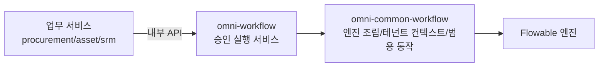

# common-workflow: 승인 실행 서비스의 공용 지원 라이브러리

`omni-common-workflow`는 **라이브러리**이며 독립 서비스가 아닙니다. 승인 실행 서비스 `omni-workflow`에 Flowable 엔진 조립, 테넌트 컨텍스트, 범용 승인 동작, 두 가지 확장점을 제공합니다.

업무 서비스(procurement/asset/srm)는 **여기에 의존하지 않습니다**. `/api/internal/workflow`로 `omni-workflow`를 호출하며 Flowable을 내장하지 않습니다.

> 소스 범위: Java 파일 8개. 객체 모델과 상태기는 [워크플로 원리](workflow-principles.kr.md)를 참고하십시오. 이 글은 라이브러리의 역할을 설명하며 소스 존재만으로 실제 실행을 증명하지 않습니다.

## 0. 세 계층



| 계층 | 담당 | 담당하지 않음 |
| --- | --- | --- |
| 업무 서비스 | 업무 레코드, 업무 상태, 인가 | Flowable 내장 |
| `omni-workflow` | 테넌트/처리자 가드, 완료 이벤트, 할 일 동기화, 모델 관리 | 범용 Flowable 동작 세부 |
| `omni-common-workflow` | 엔진 설정, ThreadLocal, 범용 동작, 확장점 | 테넌트·조작자 검증 |

## 1. Flowable 자동 설정

### 조립 조건

```java
@ConditionalOnClass(SpringProcessEngineConfiguration.class)
public class FlowableAutoConfiguration {
```

Flowable 엔진이 클래스패스에 있을 때만 조립합니다. 제공 Bean:

| Bean | 역할 | 재정의 |
| --- | --- | --- |
| `EngineConfigurationConfigurer` | 엔진 설정 | 추가 커스터마이저가 기본 것을 자동 대체하지 않음 |
| `TenantInfoFilter` | 테넌트 ThreadLocal 필터 | `@ConditionalOnMissingBean` |
| `ApprovalService` | 범용 승인 동작 | `@ConditionalOnMissingBean` |
| `WorkflowNotificationService` | 알림 확장점 | `@ConditionalOnMissingBean` |

### 구현 원문

```java
    @Bean
    @ConditionalOnMissingBean
    public ApprovalService approvalService(TaskService taskService, RuntimeService runtimeService) {
        return new ApprovalServiceImpl(taskService, runtimeService);
    }
```

```java
    @Bean
    @ConditionalOnMissingBean
    public WorkflowNotificationService workflowNotificationService() {
        return new NoOpNotificationService();
    }
```

### 경계

- 승인·알림·테넌트 필터 Bean은 `@ConditionalOnMissingBean`으로 대응 Bean을 제공해 대체할 수 있습니다. 엔진 커스터마이저에는 이 조건이 없어 같은 타입의 Bean을 추가해도 기본 설정이 자동 비활성화되지 않습니다. 여러 커스터마이저의 효과와 실행 순서를 확인해야 합니다.
- `omni-common-workflow`는 `omni-workflow`에 의존하지 않으며 의존은 반대 방향입니다.
- Flowable 테이블과 런타임은 승인 실행 서비스에 속하며 업무 DB에 만들지 않습니다.

## 2. 테넌트 컨텍스트

### 문제

Flowable 조회와 배포에는 테넌트 ID가 필요하지만 엔진 API는 웹 요청을 모릅니다.

### 구현 원문

```java
    protected void doFilterInternal(HttpServletRequest request,
                                    HttpServletResponse response,
                                    FilterChain filterChain)
            throws ServletException, IOException {
        String tenantId = request.getHeader(HEADER_TENANT_ID);
        if (tenantId != null && !tenantId.isBlank()) {
            TenantInfoHolder.setTenantId(tenantId);
            log.debug("租户信息设置: tenantId={}, URI={}", tenantId, request.getRequestURI());
        }
        try {
            filterChain.doFilter(request, response);
        } finally {
            TenantInfoHolder.clear();
        }
    }
```

### 경계와 실패 복구

- 테넌트 헤더는 신뢰 가능한 신원 체인이 보장하며 이 필터는 전달만 합니다.
- **finally에서 ThreadLocal을 반드시 정리**해야 다음 요청이 이전 테넌트를 물려받지 않습니다.
- Servlet 요청 경로 전용이며 비동기 스레드·예약 작업은 상속하지 않아 명시적으로 전달해야 합니다.
- 테넌트 헤더가 없으면 이 필터는 컨텍스트를 설정하지 않으며 요청을 직접 거부하지도 않습니다. 인증, 필수 테넌트 값과 태스크 소유권은 바깥 진입점과 실행 서비스가 검사합니다. 전달 도구를 보안의 최종 방어선으로 보지 말고 확장 코드도 엔진 진입 전에 검사해야 합니다.

## 3. 범용 승인 서비스

### 제공하는 것

`ApprovalService`는 네 가지 Flowable 동작을 감쌉니다.

- `complete(taskId, approved, comment, variables)`
- `addSigner(taskId, newUserId)`
- `removeSigner(taskId, targetUserId)`
- `delegate(taskId, targetUserId)`

### 제공하지 않는 것

시그니처에 **tenantId도 조작자 userId도 없습니다**. 따라서 다음을 하지 않습니다.

- 태스크가 현재 테넌트에 속하는지 검증;
- 현재 사용자가 처리자인지 검증;
- 완료 이벤트 발행;
- 할 일 동기화.

이들은 `omni-workflow`의 `WorkflowApprovalServiceImpl`이 담당합니다. 라이브러리를 "완전한 승인 서비스"로 보면 보안 검증을 우회합니다.

### 위임의 실제 의미

```java
    @Override
    public void delegate(String taskId, String targetUserId) {
        Task task = taskService.createTaskQuery().taskId(taskId).singleResult();
        if (task == null) {
            throw new IllegalArgumentException("任务不存在: " + taskId);
        }

        taskService.setAssignee(taskId, targetUserId);
        log.info("委托成功: taskId={}, targetUserId={}", taskId, targetUserId);
    }
```

**처리자를 직접 넘기는 것**입니다. 이 메서드는 `DELEGATED` 상태를 만들거나 원 처리자를 owner로 저장하지 않으며 완료 뒤 자동 반환도 하지 않습니다. Flowable의 `delegateTask`/`resolveTask`를 사용하지 않지만 엔진 이력까지 삭제한다는 뜻은 아닙니다.

### 실패 복구

- 태스크 부재는 `IllegalArgumentException`. 서비스 계층이 먼저 존재·처리자를 검증하므로 보통 도달하지 않습니다.
- 승인자 추가·제거는 다중 인스턴스 활동에서만 유효하며 일반 노드에는 해당 분기가 없습니다.
- 임계값 재계산과 `MI_END`는 [워크플로 원리](workflow-principles.kr.md)를 참고하십시오.

## 4. 후보자와 알림 확장점

### UserGroupLookup

`UserGroupLookup`은 후보자 해석에 필요한 사용자 그룹 조회이며 `omni-workflow`의 `RbacUserGroupLookup`이 구현합니다. 후보자 리스너가 이를 통해 역할 멤버를 해석합니다.

### WorkflowNotificationService

인터페이스는 존재하고 기본 구현은 `NoOpNotificationService`로 **아무것도 보내지 않습니다**. 현재 저장소에 실제 알림 구현이 없습니다.

따라서:

- "승인하면 알림이 간다"고 쓰면 안 됩니다.
- 알림이 필요하면 사용 측이 인터페이스를 구현해 Bean으로 등록합니다.
- 인터페이스 존재는 확장 가능성을 뜻할 뿐 구현 완료를 뜻하지 않습니다.

## 5. 확장

| 하고 싶은 일 | 방법 | 하면 안 되는 일 |
| --- | --- | --- |
| 승인 동작 사용자 정의 | `ApprovalService` 구현/재정의 | 업무 서비스에서 Flowable 직접 호출 |
| 알림 추가 | `WorkflowNotificationService` 구현 | NoOp를 전송됨으로 취급 |
| 사용자 그룹 소스 변경 | `UserGroupLookup` 구현 | 리스너에 SQL 하드코딩 |
| 엔진 설정 조정 | `EngineConfigurationConfigurer` 제공 | 라이브러리 기본을 전체 서비스에 변경 |

## 검증 진입

- `FlowableAutoConfiguration` 조건과 Bean 재정의.
- `TenantInfoFilter` 정리 동작.
- `ApprovalServiceImpl`의 다중 승인·처리자 전달 단위 테스트.
- 실제 승인 경로는 `omni-workflow`의 Fw* 통합 테스트에 속하며 실행 기록과 보고서로 확인해야 합니다. 이 글의 소스 설명만으로 대체할 수 없습니다.

이전: [common-mqlog](common-mqlog.kr.md). 전체 원리: [workflow-principles](workflow-principles.kr.md).
