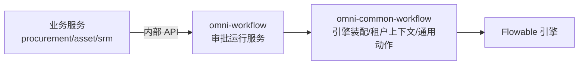

# common-workflow：审批运行服务的公共支撑库

`omni-common-workflow` 是**库**，不是独立服务。它给审批运行服务 `omni-workflow` 提供 Flowable 引擎装配、租户上下文、通用审批动作和两个扩展点。

业务服务（采购、资产、SRM）**不依赖它**：它们通过 `/api/internal/workflow` 调用 `omni-workflow`，自身不嵌入 Flowable。

> 源码范围：模块 8 个 Java 文件。工作流的对象模型、状态机与动作边界见 [工作流原理](workflow-principles.md)，本文只讲这个库提供了什么，不用源码存在代替运行验证。

## 0. 三个层次



| 层 | 负责 | 不负责 |
| --- | --- | --- |
| 业务服务 | 业务单据、业务状态、授权 | 不嵌入 Flowable |
| `omni-workflow` | 租户/处理人守卫、完成事件、待办同步、模型管理 | 不实现通用 Flowable 动作细节 |
| `omni-common-workflow` | 引擎配置、ThreadLocal、通用动作、扩展点 | 不做租户与操作人校验 |

## 一、Flowable 自动配置

### 装配条件

```java
@ConditionalOnClass(SpringProcessEngineConfiguration.class)
public class FlowableAutoConfiguration {
```

只有类路径存在 Flowable 引擎时才装配。提供的 Bean：

| Bean | 作用 | 覆盖方式 |
| --- | --- | --- |
| `EngineConfigurationConfigurer` | 引擎配置 | 可另加定制器，但不会自动替换默认定制器 |
| `TenantInfoFilter` | 租户 ThreadLocal 过滤器 | `@ConditionalOnMissingBean` |
| `ApprovalService` | 通用审批动作 | `@ConditionalOnMissingBean` |
| `WorkflowNotificationService` | 通知扩展点 | `@ConditionalOnMissingBean` |

### 实现原文

```java
    @Bean
    @ConditionalOnMissingBean
    public ApprovalService approvalService(TaskService taskService, RuntimeService runtimeService) {
        return new ApprovalServiceImpl(taskService, runtimeService);
    }
```

```java
    @Bean
    @ConditionalOnMissingBean
    public WorkflowNotificationService workflowNotificationService() {
        return new NoOpNotificationService();
    }
```

### 边界

- 审批、通知和租户过滤器有 `@ConditionalOnMissingBean`，可提供对应 Bean 替换。引擎定制器没有此条件，另加同类型 Bean 不会自动禁用默认配置；多个定制器的效果与执行顺序需要明确核对。
- `omni-common-workflow` 不依赖 `omni-workflow`；反过来 `omni-workflow` 依赖它。
- Flowable 表与运行时只属于审批运行服务，不在业务库中创建。

## 二、租户上下文

### 问题

Flowable 的查询与部署需要租户 ID，但引擎 API 不感知 Web 请求。

### 实现原文

```java
    protected void doFilterInternal(HttpServletRequest request,
                                    HttpServletResponse response,
                                    FilterChain filterChain)
            throws ServletException, IOException {
        String tenantId = request.getHeader(HEADER_TENANT_ID);
        if (tenantId != null && !tenantId.isBlank()) {
            TenantInfoHolder.setTenantId(tenantId);
            log.debug("租户信息设置: tenantId={}, URI={}", tenantId, request.getRequestURI());
        }
        try {
            filterChain.doFilter(request, response);
        } finally {
            TenantInfoHolder.clear();
        }
    }
```

### 边界与失败恢复

- 租户头必须由可信身份链保证；本过滤器只负责传递。
- **finally 必须清理 ThreadLocal**，否则线程池中的下一个请求会继承上一个租户。
- 只适用于 Servlet 请求链路；异步线程与定时任务不继承，需要显式传入租户。
- 没有租户头时，本过滤器不设置上下文，也不会自行拒绝请求。认证、必填租户和任务归属由外层入口及运行服务校验，不能把这个传递工具当成安全兜底；扩展调用也必须在进入引擎前完成这些检查。

## 三、通用审批服务

### 提供什么

`ApprovalService` 封装四类 Flowable 动作：

- `complete(taskId, approved, comment, variables)`
- `addSigner(taskId, newUserId)`
- `removeSigner(taskId, targetUserId)`
- `delegate(taskId, targetUserId)`

### 不提供什么

签名里**没有 tenantId、没有操作人 userId**。因此它不负责：

- 校验任务属于当前租户；
- 校验当前用户是处理人；
- 发布完成事件；
- 同步待办。

这些都在 `omni-workflow` 的 `WorkflowApprovalServiceImpl` 中完成。把库当“完整审批服务”会绕过安全校验。

### 委派的真实语义

```java
    @Override
    public void delegate(String taskId, String targetUserId) {
        Task task = taskService.createTaskQuery().taskId(taskId).singleResult();
        if (task == null) {
            throw new IllegalArgumentException("任务不存在: " + taskId);
        }

        taskService.setAssignee(taskId, targetUserId);
        log.info("委托成功: taskId={}, targetUserId={}", taskId, targetUserId);
    }
```

这是**直接转交处理人**：本方法不创建 `DELEGATED` 状态、不主动把原处理人保存为 owner、办完不自动回还。它没有使用 Flowable 的 `delegateTask` / `resolveTask`；这不代表引擎历史记录也被删除。

### 失败恢复

- 任务不存在抛 `IllegalArgumentException`；服务层会先做存在性与处理人校验，通常不会走到这里。
- 加减签只对多实例活动有效，普通节点没有对应分支。
- 会签阈值重算与 `MI_END` 语义见 [工作流原理](workflow-principles.md)。

## 四、候选与通知扩展点

### UserGroupLookup

`UserGroupLookup` 是候选人解析所需的用户组查询接口；`omni-workflow` 的 `RbacUserGroupLookup` 提供实现，候选人监听器通过它解析角色成员。

### WorkflowNotificationService

接口存在，默认实现是 `NoOpNotificationService`：**不发送任何通知**。当前仓库没有真实通知实现。

因此：

- 文章不能写“审批通过会发送通知”；
- 需要通知时，应由使用方实现该接口并注册 Bean；
- 接口存在只说明“可扩展”，不说明“已实现”。

## 五、扩展

| 想做的事 | 做法 | 不要做 |
| --- | --- | --- |
| 自定义审批动作 | 实现/覆盖 `ApprovalService` | 在业务服务里直接调 Flowable |
| 接入通知 | 实现 `WorkflowNotificationService` | 把 NoOp 当已发送 |
| 自定义用户组来源 | 实现 `UserGroupLookup` | 在监听器里写死 SQL |
| 调整引擎配置 | 提供 `EngineConfigurationConfigurer` | 改库里的默认行为影响所有服务 |

## 验证入口

- `FlowableAutoConfiguration` 的条件与 Bean 覆盖；
- `TenantInfoFilter` 的清理行为；
- `ApprovalServiceImpl` 的会签/委派单元测试；
- 运行态审批链路属于 `omni-workflow` 的 Fw* 集成测试，应以对应运行记录与报告验收，不能用本篇源码说明代替。

上一章：[common-mqlog](common-mqlog.md)；工作流完整原理见 [workflow-principles](workflow-principles.md)。
