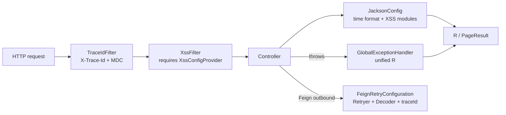

# common: runtime configuration shared by Servlet services

`omni-common` is the **runtime** module. Through 7 `AutoConfiguration.imports` entries it gives Servlet services a unified JSON time format, exception mapping, trace id, Feign retry, CORS, XSS and OTLP export.

Depending on the module and having a capability take effect are two different things: every auto-configuration has its own conditions (class presence, a provider bean, a property value). This article states the conditions and the post-failure behavior for each.

> Evidence boundary: the conclusions below come from current source conditions; no application was started this round, and no bean's runtime assembly was verified.
>
> Applicability: **Servlet only**. The Gateway is WebFlux and does not assemble `WebMvcConfig` or `GlobalExceptionHandler`; its time format, error envelope and filter behavior cannot be inferred from this chapter.

## The seven auto-configurations

Current content of `omni-common/src/main/resources/META-INF/spring/org.springframework.boot.autoconfigure.AutoConfiguration.imports`:

```text
com.omni.common.config.FeignRetryConfiguration
com.omni.common.config.JacksonConfig
com.omni.common.config.WebMvcConfig
com.omni.common.result.GlobalExceptionHandler
com.omni.common.security.xss.XssAutoConfiguration
com.omni.common.web.TraceIdAutoConfiguration
com.omni.common.observability.OtlpTracingExporterAutoConfiguration
```



## JSON and time format

### Problem

Frontend and backend agree on `yyyy-MM-dd HH:mm:ss`, but Jackson defaults to ISO-8601. The project also has both Jackson 2 (`com.fasterxml`) and Jackson 3 (`tools.jackson`); configuring only one leaves some endpoints formatted differently.

### Usage

No configuration needed: with `omni-common`, `LocalDateTime` / `LocalDate` serialization and deserialization use the agreed format.

### Source

```java
    @Bean
    public ObjectMapper objectMapper() {
        JavaTimeModule javaTimeModule = new JavaTimeModule();
        javaTimeModule.addSerializer(LocalDateTime.class,
                new LocalDateTimeSerializer(DATE_TIME_FORMATTER));
        javaTimeModule.addDeserializer(LocalDateTime.class,
                new LocalDateTimeDeserializer(DATE_TIME_FORMATTER));
        javaTimeModule.addSerializer(LocalDate.class,
                new LocalDateSerializer(DATE_FORMATTER));
        javaTimeModule.addDeserializer(LocalDate.class,
                new LocalDateDeserializer(DATE_FORMATTER));
```

The constant is at `JacksonConfig.java:36`: `DATE_TIME_PATTERN = "yyyy-MM-dd HH:mm:ss"`. The class also registers the same format for Jackson 3 via `SimpleModule` and implements `extendMessageConverters` so MVC converters share the configuration.

### Boundaries and recovery

- **Servlet only**; the WebFlux gateway configures codecs differently.
- A mismatched time format in the request body fails deserialization. The current handler has no dedicated `HttpMessageNotReadableException` branch, so it may reach the fallback 500. Parameter binding and field validation have their own 400 branches; not every format error produces the same response.
- If one endpoint has an unexpected format, check whether it uses another `ObjectMapper` or a custom converter.

### Extension

A new type format must be registered in both the Jackson 2 and Jackson 3 paths, otherwise different conversion entry points diverge.

## Global exception mapping

### Problem

Business exceptions, validation failures, 403, 404, 405 and 415 must become the same `R` envelope; otherwise the frontend branches on exception types.

### Usage

Services write no try/catch: throw `BusinessException` or let validation exceptions bubble, and the global advice converts them.

### Source

```java
    @ExceptionHandler(BusinessException.class)
    public R<Void> handleBusinessException(BusinessException e) {
        log.warn("业务异常: {}", e.getMessage());
        return R.fail(e.getCode(), e.getMessage());
    }
```

```java
    @ExceptionHandler({AccessDeniedException.class, AuthorizationDeniedException.class})
    @ResponseStatus(HttpStatus.FORBIDDEN)
    public R<Void> handleAccessDeniedException(Exception e) {
        log.warn("权限不足: {}", e.getMessage());
        return R.fail(403, "权限不足，拒绝访问");
    }
```

Current coverage: business exception (keeps its code), `MethodArgumentNotValidException` / `BindException` (400 field errors), `AccessDeniedException` / `AuthorizationDeniedException` (403), missing parameter (400), `NoResourceFoundException` (404), type mismatch (400), 415, 405, and a fallback `Exception` (generic 500).

### Boundaries and recovery

- Validation, binding, missing parameters and type mismatches return HTTP 400; access denial returns 403, missing resources 404, unsupported methods/media types 405/415, and fallback exceptions 500. These branches set the status through `@ResponseStatus`. The `BusinessException` branch keeps the business code without setting another HTTP status, so it normally remains HTTP 200. Check both the HTTP status and `R.code`.
- The fallback logs and returns a generic message without a stack trace.
- If a service has its own `@RestControllerAdvice`, precedence decides which wins; do not assume the global handler always does.

### Extension

Add new exception mappings here; service-specific advice is acceptable but must keep the `R` envelope.

## Trace id

### Problem

The trace id generated by the gateway must appear in logs, response headers and downstream Feign calls; otherwise cross-service troubleshooting relies on guessed timestamps.

### Source

```java
    protected void doFilterInternal(HttpServletRequest request, HttpServletResponse response,
                                    FilterChain filterChain)
            throws ServletException, IOException {
        String traceId = resolveTraceId(request.getHeader(TRACE_HEADER));
        response.setHeader(TRACE_HEADER, traceId);
        MDC.put(MDC_KEY, traceId);
        try {
            filterChain.doFilter(request, response);
        } finally {
            MDC.remove(MDC_KEY);
        }
    }
```

The source priority:

```java
    private String resolveTraceId(String incoming) {
        Tracer tracer = tracerSupplier.get();
        Span currentSpan = tracer == null ? null : tracer.currentSpan();
        if (currentSpan != null && currentSpan.context() != null) {
            return currentSpan.context().traceId();
        }
        return incoming != null && SAFE_TRACE_ID.matcher(incoming).matches()
                ? incoming : UUID.randomUUID().toString().replace("-", "");
    }
```

1. If a span exists → use the W3C traceId;
2. Otherwise, if `X-Trace-Id` matches the safe pattern → reuse it;
3. Otherwise generate a 32-character UUID without dashes.

### Boundaries and recovery

- **MDC must be cleared in finally**; otherwise the next request on a pooled thread inherits the previous trace id.
- Only headers matching `SAFE_TRACE_ID` are accepted, preventing log injection.
- Downstream propagation is done by the Feign interceptor reading MDC; a plain `RestTemplate` call does not carry it.

### Extension

New protocol headers require changes in both resolution and the Feign interceptor; do not change only the response header.

## Feign retry and codec

### Problem

OpenFeign defaults to `Retryer.NEVER_RETRY`; the Nacos client's cold-start delay on first service-list fetch would fail the first call. Internal error responses also need unified decoding and logging.

### Source

```java
    @Bean
    @ConditionalOnMissingBean(Retryer.class)
    public Retryer feignRetryer() {
        return new Retryer.Default(100, 1000, 5);
    }
```

```java
    @Bean
    @ConditionalOnClass(ObjectMapper.class)
    @ConditionalOnMissingBean(Decoder.class)
    public Decoder feignDecoder(ObjectMapper objectMapper) {
        return new JacksonFeignDecoder(objectMapper);
    }
```

```java
    @Bean
    public RequestInterceptor traceIdFeignRequestInterceptor() {
        return template -> {
            String traceId = MDC.get(TraceIdFilter.MDC_KEY);
            if (traceId != null && !traceId.isBlank()) {
                template.header(TraceIdFilter.TRACE_HEADER, traceId);
            }
        };
    }
```

### Semantics and boundaries

- Retry: initial 100ms, max 1000ms, at most 5 attempts; any custom `Retryer` bean overrides it.
- The decoder reuses the shared `ObjectMapper`, so time format and XSS string handling are consistent.
- The interceptor adds `X-Trace-Id` **only when MDC has a value**.
- **Retry does not imply idempotency**: write operations must still rely on a business `requestId`; "we have retries" is not permission to resubmit.

### Extension and recovery

Custom `Decoder` / `Retryer` beans override the defaults; do not hide idempotency problems by raising retry counts. Decode failures log traceId, status and target type, which distinguishes contract mismatch from network issues.

## CORS configuration

### Problem

A separated frontend needs cross-origin access; development defaults and production tightening must be configurable.

### Source

```java
        var mapping = registry.addMapping("/**")
                .allowedMethods("GET", "POST", "PUT", "DELETE", "OPTIONS")
                .allowedHeaders("*")
                .allowCredentials(true)
                .maxAge(3600);
```

Origins come from `omni.cors.allowed-origins`, default `*`; when `*`, the code uses `allowedOriginPatterns("*")`, otherwise it splits on commas.

### Boundaries and recovery

- The default `*` is a development convenience, not a security policy; production should narrow it via configuration.
- With `allowCredentials(true)`, a bare `*` origin is not allowed — the code uses `allowedOriginPatterns` to work around it, but domains should still be explicit.
- Cross-origin failures usually mean the preflight was rejected; check response headers and configuration before suspecting the controller.

### Extension

Add methods or headers here; do not register CORS again inside business services.

## XSS runtime protection

### Problem

Servlet parameters and JSON request-body strings must both be sanitized, with per-tenant switches and rules, across both Jackson 2 and Jackson 3 deserialization entry points.

### Usage

A service implements `XssConfigProvider` (see [common-core](common-core.en.md#xss-configuration-spi)); the filter and both Jackson modules assemble automatically.

### Source

```java
    @Bean
    @ConditionalOnBean(XssConfigProvider.class)
    public FilterRegistrationBean<XssFilter> xssFilterRegistration(XssConfigProvider xssConfigProvider) {
        FilterRegistrationBean<XssFilter> registration = new FilterRegistrationBean<>();
        registration.setFilter(new XssFilter(xssConfigProvider));
        registration.addUrlPatterns("/*");
        registration.setOrder(Ordered.HIGHEST_PRECEDENCE + 10);
        registration.setName("xssFilter");
        return registration;
    }
```

The filter reads rules per tenant and passes through when disabled or empty; when enabled it sets a ThreadLocal and clears it in finally:

```java
        XssSettings settings = xssConfigProvider.getXssSettings(tenantId);
        if (settings == null || !settings.isEnabled()
                || settings.getRules() == null || settings.getRules().isEmpty()) {
            filterChain.doFilter(request, response);
            return;
        }

        // 设置 ThreadLocal 供 XssStringDeserializer 使用
        XssRuleHolder.set(settings.getRules());
        try {
            // 包装请求以净化查询参数
            XssHttpServletRequestWrapper wrappedRequest =
                    new XssHttpServletRequestWrapper(request, settings.getRules());
            filterChain.doFilter(wrappedRequest, response);
        } finally {
            // 防止 ThreadLocal 内存泄漏
            XssRuleHolder.clear();
        }
```

### Boundaries and recovery

Assembly requires all of:

1. `@ConditionalOnWebApplication(SERVLET)`;
2. an `XssConfigProvider` bean in the container;
3. the Jackson 2 module assembles when `com.fasterxml.jackson.databind.ObjectMapper` is present, and the Jackson 3 module when `tools.jackson.databind.json.JsonMapper` is present.

- **No provider means no filter**; this is the first suspect when a service shows no sanitization.
- Servlet only; the WebFlux gateway is out of scope.
- Sanitization depends on the switch and effective rules; do not claim all input is handled.
- Invalid regexes in rules are validated by the provider/admin side; runtime exceptions are not swallowed by the filter.

### Extension

New rule types change `XssSanitizer`; new deserialization entry points must cover both Jackson 2 and Jackson 3, otherwise parameters are sanitized but JSON is not.

## OTLP trace export

### Problem

Spans must be exported to an OTLP HTTP endpoint without overriding an exporter configured by the deployment.

### Source

```java
@AutoConfiguration(before = {OpenTelemetryTracingAutoConfiguration.class, OtlpTracingAutoConfiguration.class})
@ConditionalOnClass(OtlpHttpSpanExporter.class)
@EnableConfigurationProperties(OtlpTracingProperties.class)
public class OtlpTracingExporterAutoConfiguration {

    /** 创建与 Spring Boot 官方属性保持一致的 HTTP OTLP exporter。 */
    @Bean
    @ConditionalOnMissingBean({OtlpHttpSpanExporter.class, OtlpGrpcSpanExporter.class})
    @ConditionalOnProperty(prefix = "management.tracing.export.otlp", name = "enabled",
            havingValue = "true", matchIfMissing = true)
    @ConditionalOnProperty(prefix = "management.opentelemetry.tracing.export.otlp", name = "transport",
            havingValue = "http", matchIfMissing = true)
    public OtlpHttpSpanExporter omniOtlpHttpSpanExporter(
```

### Conditions and boundaries

- `OtlpHttpSpanExporter` is on the classpath;
- no existing HTTP or gRPC exporter bean;
- `management.tracing.export.otlp.enabled` is `true`, **true when missing**;
- `management.opentelemetry.tracing.export.otlp.transport` is `http`, **http when missing**.

In other words: **with the dependency present and nothing explicitly disabled, an HTTP exporter is created by default**. It is not opt-in. It is skipped when explicitly disabled, when transport is not http, or when another exporter bean exists.

### Recovery

When conditions do not hold, nothing fails; the bean simply does not exist. If spans are not exported, first check for a competing exporter bean and for environment overrides, then endpoint connectivity. Retry behavior for an unreachable endpoint belongs to the exporter itself and is not verified here.

### Extension

To switch to gRPC, provide a gRPC exporter bean or adjust the conditions; do not create two exporters in one service.

## Appendix: choosing by need

| What you want | Use | Note |
| --- | --- | --- |
| Unified response/pagination | core `R` / `PageResult` | do not build another envelope |
| Throw a business error | core `BusinessException` | HTTP mapping lives in common |
| Send a reliable message | core `ReliableMessageRelay` + mqlog | explicit tenantId |
| Write a user job | core `UserJobHandler` | Bean name = type_code |
| Record an operation log | core `@OperLog` + operlog aspect | Auth does not use it |
| Sanitize input | core SPI + common XSS runtime | requires a provider bean |
| Provision a tenant module | core tenant contract | use Auth's formal retry entry, which creates a new requestId |
| Query internal users/scopes | core internal DTOs | must carry internal token |

The other eight of the ten common modules are covered in later chapters; this chapter covers only `omni-common-core` and `omni-common`.
