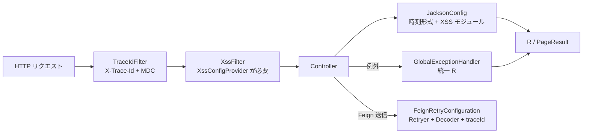

# common：Servlet サービスが共有する実行時設定

`omni-common` は**実行時**モジュールです。7 件の `AutoConfiguration.imports` により、Servlet サービスへ JSON 時刻形式、例外マッピング、追跡 ID、Feign 再試行、CORS、XSS、OTLP エクスポートを統一して組み込みます。

依存の導入と能力の有効化は別であり、各自動設定に条件（クラスの有無、Provider Bean、プロパティ値）があります。本稿は条件と失敗時の挙動を項目ごとに示します。

> 事実境界：以下の結論は現行ソースの条件に基づきます。今回はアプリを起動せず、実行時の Bean 組み込みも検証していません。
>
> 適用境界：**Servlet のみ**。Gateway は WebFlux であり、`WebMvcConfig` と `GlobalExceptionHandler` を組み込みしません。時刻形式・例外封筒・フィルタ挙動をそのまま当てはめてはいけません。

## 7 つの自動設定

`omni-common/src/main/resources/META-INF/spring/org.springframework.boot.autoconfigure.AutoConfiguration.imports` の現行内容です。

```text
com.omni.common.config.FeignRetryConfiguration
com.omni.common.config.JacksonConfig
com.omni.common.config.WebMvcConfig
com.omni.common.result.GlobalExceptionHandler
com.omni.common.security.xss.XssAutoConfiguration
com.omni.common.web.TraceIdAutoConfiguration
com.omni.common.observability.OtlpTracingExporterAutoConfiguration
```



## JSON と時刻形式

### 問題

フロントとバックエンドは `yyyy-MM-dd HH:mm:ss` に合意していますが、Jackson の既定は ISO-8601 です。さらに Jackson 2（`com.fasterxml`）と Jackson 3（`tools.jackson`）が併存し、片方だけ設定すると一部の API だけ形式が異なります。

### 使い方

追加設定は不要です。`omni-common` を導入すると `LocalDateTime` / `LocalDate` の直列化・逆直列化が合意形式になります。

### 実装原文

```java
    @Bean
    public ObjectMapper objectMapper() {
        JavaTimeModule javaTimeModule = new JavaTimeModule();
        javaTimeModule.addSerializer(LocalDateTime.class,
                new LocalDateTimeSerializer(DATE_TIME_FORMATTER));
        javaTimeModule.addDeserializer(LocalDateTime.class,
                new LocalDateTimeDeserializer(DATE_TIME_FORMATTER));
        javaTimeModule.addSerializer(LocalDate.class,
                new LocalDateSerializer(DATE_FORMATTER));
        javaTimeModule.addDeserializer(LocalDate.class,
                new LocalDateDeserializer(DATE_FORMATTER));
```

定数は `JacksonConfig.java:36` の `DATE_TIME_PATTERN = "yyyy-MM-dd HH:mm:ss"` です。クラスは Jackson 3 にも同じ形式を `SimpleModule` で登録し、`extendMessageConverters` で MVC 変換器を統一します。

### 境界と復旧

- **Servlet のみ**。WebFlux ゲートウェイのコーデック設定は異なります。
- リクエスト本文の時刻形式が不一致だと逆直列化に失敗します。現行ハンドラには `HttpMessageNotReadableException` 専用の分岐がなく、フォールバックの 500 になる可能性があります。パラメータのバインドやフィールド検証にはそれぞれ 400 の分岐があり、形式エラーを一律に扱えません。
- 特定の API だけ形式が違う場合、別の `ObjectMapper` や独自変換器を使っていないか確認します。

### 拡張

新しい型の形式は Jackson 2 と Jackson 3 の両経路に登録します。片方だけだと変換入口によって結果が変わります。

## グローバル例外マッピング

### 問題

業務例外、検証失敗、403、404、405、415 を同じ `R` 封筒にする必要があります。

### 使い方

サービスは try/catch を書かず、`BusinessException` を投げるか検証例外を伝播させます。

### 実装原文

```java
    @ExceptionHandler(BusinessException.class)
    public R<Void> handleBusinessException(BusinessException e) {
        log.warn("业务异常: {}", e.getMessage());
        return R.fail(e.getCode(), e.getMessage());
    }
```

```java
    @ExceptionHandler({AccessDeniedException.class, AuthorizationDeniedException.class})
    @ResponseStatus(HttpStatus.FORBIDDEN)
    public R<Void> handleAccessDeniedException(Exception e) {
        log.warn("权限不足: {}", e.getMessage());
        return R.fail(403, "权限不足，拒绝访问");
    }
```

現在の対象：業務例外（コード保持）、`MethodArgumentNotValidException` / `BindException`（400）、`AccessDeniedException` / `AuthorizationDeniedException`（403）、必須パラメータ欠落（400）、`NoResourceFoundException`（404）、型不一致（400）、415、405、およびフォールバック `Exception`（汎用 500）。

### 境界と復旧

- 検証・バインド・必須パラメータ欠落・型不一致は HTTP 400、権限拒否は 403、リソース欠落は 404、未対応メソッド/メディア型は 405/415、フォールバック例外は 500 を返します。これらは `@ResponseStatus` で指定します。`BusinessException` は業務コードを保持し、別の HTTP 状態を指定しないため通常は HTTP 200 のままです。HTTP 状態と `R.code` の両方を確認します。
- フォールバックはログを残し、スタックトレースを含まない汎用文言を返します。
- サービス独自の `@RestControllerAdvice` がある場合、優先順位で勝敗が決まります。グローバルが常に勝つと仮定してはいけません。

### 拡張

新しい例外マッピングはここに追加します。サービス固有の advice は `R` 封筒を維持します。

## 追跡 ID

### 問題

ゲートウェイが生成した traceId がログ・レスポンスヘッダ・下流 Feign に一貫して現れる必要があります。

### 実装原文

```java
    protected void doFilterInternal(HttpServletRequest request, HttpServletResponse response,
                                    FilterChain filterChain)
            throws ServletException, IOException {
        String traceId = resolveTraceId(request.getHeader(TRACE_HEADER));
        response.setHeader(TRACE_HEADER, traceId);
        MDC.put(MDC_KEY, traceId);
        try {
            filterChain.doFilter(request, response);
        } finally {
            MDC.remove(MDC_KEY);
        }
    }
```

```java
    private String resolveTraceId(String incoming) {
        Tracer tracer = tracerSupplier.get();
        Span currentSpan = tracer == null ? null : tracer.currentSpan();
        if (currentSpan != null && currentSpan.context() != null) {
            return currentSpan.context().traceId();
        }
        return incoming != null && SAFE_TRACE_ID.matcher(incoming).matches()
                ? incoming : UUID.randomUUID().toString().replace("-", "");
    }
```

1. 現在の span があれば W3C traceId を使用。
2. なければ `X-Trace-Id` が安全パターンに一致すれば再利用。
3. それもなければハイフンなし 32 文字 UUID を生成。

### 境界と復旧

- **finally で MDC を必ず削除**します。削除しないとスレッドプールの次リクエストが前の traceId を継承します。
- 安全パターンに一致するヘッダのみ受理し、ログインジェクションを防ぎます。
- 下流伝播は Feign インターセプタが MDC を読んで行います。素の `RestTemplate` は自動では付きません。

### 拡張

新しいプロトコルヘッダは resolve と Feign インターセプタの両方を変更します。レスポンスヘッダだけ変えてはいけません。

## Feign 再試行とコーデック

### 問題

OpenFeign の既定は `Retryer.NEVER_RETRY` で、Nacos の初回サービス一覧取得の遅延により最初の呼び出しが失敗します。内部 API のエラー応答も統一的に復号・記録する必要があります。

### 実装原文

```java
    @Bean
    @ConditionalOnMissingBean(Retryer.class)
    public Retryer feignRetryer() {
        return new Retryer.Default(100, 1000, 5);
    }
```

```java
    @Bean
    @ConditionalOnClass(ObjectMapper.class)
    @ConditionalOnMissingBean(Decoder.class)
    public Decoder feignDecoder(ObjectMapper objectMapper) {
        return new JacksonFeignDecoder(objectMapper);
    }
```

```java
    @Bean
    public RequestInterceptor traceIdFeignRequestInterceptor() {
        return template -> {
            String traceId = MDC.get(TraceIdFilter.MDC_KEY);
            if (traceId != null && !traceId.isBlank()) {
                template.header(TraceIdFilter.TRACE_HEADER, traceId);
            }
        };
    }
```

### 意味と境界

- 再試行は初期 100ms、最大 1000ms、最大 5 回です。独自 `Retryer` Bean が上書きします。
- デコーダは共通 `ObjectMapper` を再利用するため、時刻形式と XSS 文字列処理が一致します。
- インターセプタは **MDC に値がある場合のみ** `X-Trace-Id` を付けます。
- **再試行は冪等性を保証しません**。書き込みは業務 `requestId` で担保し、「再試行があるから」といって再送してはいけません。

### 拡張と復旧

独自 `Decoder` / `Retryer` は既定を上書きします。冪等問題を再試行回数で隠してはいけません。復号失敗のログには traceId、status、対象型が含まれます。

## CORS 設定

### 問題

フロント分離ではクロスオリジン許可が必要で、開発既定と本番の絞り込みを設定可能にする必要があります。

### 実装原文

```java
        var mapping = registry.addMapping("/**")
                .allowedMethods("GET", "POST", "PUT", "DELETE", "OPTIONS")
                .allowedHeaders("*")
                .allowCredentials(true)
                .maxAge(3600);
```

オリジンは `omni.cors.allowed-origins`（既定 `*`）で制御し、`*` の場合は `allowedOriginPatterns("*")`、それ以外はカンマ区切りです。

### 境界と復旧

- 既定 `*` は開発便利用であり、セキュリティ方針ではありません。本番は設定で絞ります。
- `allowCredentials(true)` では裸の `*` は許可されません。コードは `allowedOriginPatterns` で回避していますが、ドメインは明示すべきです。
- クロスオリジン失敗はプリフライト拒否が典型です。Controller を疑う前に応答ヘッダと設定を確認します。

### 拡張

メソッドやヘッダの追加はここで行い、業務サービスで CORS を再登録しません。

## XSS 実行時防御

### 問題

Servlet パラメータと JSON リクエスト本文の文字列を同時に浄化し、テナントごとにスイッチとルールを読む必要があります。Jackson 2/3 の両逆直列化入口が対象です。

### 使い方

サービスが `XssConfigProvider` を実装すれば（[common-core](common-core.jp.md#xss-設定-spi)）、フィルタと 2 つの Jackson モジュールが自動設定されます。

### 実装原文

```java
    @Bean
    @ConditionalOnBean(XssConfigProvider.class)
    public FilterRegistrationBean<XssFilter> xssFilterRegistration(XssConfigProvider xssConfigProvider) {
        FilterRegistrationBean<XssFilter> registration = new FilterRegistrationBean<>();
        registration.setFilter(new XssFilter(xssConfigProvider));
        registration.addUrlPatterns("/*");
        registration.setOrder(Ordered.HIGHEST_PRECEDENCE + 10);
        registration.setName("xssFilter");
        return registration;
    }
```

```java
        XssSettings settings = xssConfigProvider.getXssSettings(tenantId);
        if (settings == null || !settings.isEnabled()
                || settings.getRules() == null || settings.getRules().isEmpty()) {
            filterChain.doFilter(request, response);
            return;
        }

        // 设置 ThreadLocal 供 XssStringDeserializer 使用
        XssRuleHolder.set(settings.getRules());
        try {
            // 包装请求以净化查询参数
            XssHttpServletRequestWrapper wrappedRequest =
                    new XssHttpServletRequestWrapper(request, settings.getRules());
            filterChain.doFilter(wrappedRequest, response);
        } finally {
            // 防止 ThreadLocal 内存泄漏
            XssRuleHolder.clear();
        }
```

### 境界と復旧

組み込み条件（すべて満たす必要あり）：

1. `@ConditionalOnWebApplication(SERVLET)`。
2. コンテナに `XssConfigProvider` Bean がある。
3. Jackson 2 は `com.fasterxml.jackson.databind.ObjectMapper`、Jackson 3 は `tools.jackson.databind.json.JsonMapper` の存在でそれぞれ組み込み。

- **Provider が無ければフィルタも無い**。浄化されないサービスの第一容疑です。
- Servlet のみで、WebFlux ゲートウェイは対象外です。
- 浄化はスイッチと有効ルールに依存し、全入力が処理されると主張できません。
- ルールの不正正規表現は provider/管理側が検証し、実行時例外をフィルタが握り潰すことはありません。

### 拡張

新しいルール種別は `XssSanitizer` を変更します。新しい逆直列化入口は Jackson 2/3 の両方を対象にします。

## OTLP トレースエクスポート

### 問題

span を OTLP HTTP 端点へエクスポートしつつ、デプロイ側の既存 exporter 設定を上書きしない必要があります。

### 実装原文

```java
@AutoConfiguration(before = {OpenTelemetryTracingAutoConfiguration.class, OtlpTracingAutoConfiguration.class})
@ConditionalOnClass(OtlpHttpSpanExporter.class)
@EnableConfigurationProperties(OtlpTracingProperties.class)
public class OtlpTracingExporterAutoConfiguration {

    /** 创建与 Spring Boot 官方属性保持一致的 HTTP OTLP exporter。 */
    @Bean
    @ConditionalOnMissingBean({OtlpHttpSpanExporter.class, OtlpGrpcSpanExporter.class})
    @ConditionalOnProperty(prefix = "management.tracing.export.otlp", name = "enabled",
            havingValue = "true", matchIfMissing = true)
    @ConditionalOnProperty(prefix = "management.opentelemetry.tracing.export.otlp", name = "transport",
            havingValue = "http", matchIfMissing = true)
    public OtlpHttpSpanExporter omniOtlpHttpSpanExporter(
```

### 条件と境界

- クラスパスに `OtlpHttpSpanExporter` がある。
- 既存の HTTP/gRPC exporter Bean が無い。
- `management.tracing.export.otlp.enabled` が `true`（**未設定なら true**）。
- `management.opentelemetry.tracing.export.otlp.transport` が `http`（**未設定なら http**）。

つまり、**依存があり明示的に無効化していなければ既定で HTTP exporter を生成**します。明示有効化が必要ではありません。明示無効、transport が http 以外、または他の exporter Bean がある場合のみ生成しません。

### 復旧

条件不成立でもエラーにはならず、Bean が存在しないだけです。span が出ない場合は、競合する exporter Bean、環境変数による上書き、エンドポイント到達性の順に確認します。到達不能時の再試行は exporter 自身の挙動で、本プロジェクトでは未検証です。

### 拡張

gRPC へ切り替える場合は gRPC exporter Bean を提供するか条件を調整します。1 サービスに 2 つの exporter を作らないでください。

## 付録：用途別の選択

| やりたいこと | 使うもの | 注意 |
| --- | --- | --- |
| 統一レスポンス/ページング | core `R` / `PageResult` | 独自封筒を作らない |
| 業務エラー | core `BusinessException` | HTTP マッピングは common |
| 信頼性のあるメッセージ | core `ReliableMessageRelay` + mqlog | tenantId を明示 |
| ユーザータスク | core `UserJobHandler` | Bean 名 = type_code |
| 操作ログ | core `@OperLog` + operlog | Auth は使わない |
| 入力浄化 | core SPI + common XSS | Provider Bean が必要 |
| テナントモジュール開通 | core テナント契約 | Auth の正式な再試行入口が新しい requestId を生成 |
| 内部ユーザー/範囲照会 | core 内部 DTO | 内部トークン必須 |

10 個の common モジュールのうち残り 8 個は後続章で扱います。本章は `omni-common-core` と `omni-common` のみです。
