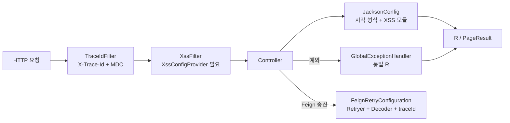

# common: Servlet 서비스가 공유하는 런타임 설정

`omni-common`은 **런타임** 모듈입니다. 7건의 `AutoConfiguration.imports`로 Servlet 서비스에 JSON 시각 형식, 예외 매핑, 추적 ID, Feign 재시도, CORS, XSS, OTLP 내보내기를 통일해 넣습니다.

의존 도입과 능력 활성화는 다릅니다. 각 자동 설정에는 조건(클래스 존재, Provider Bean, 속성 값)이 있습니다. 이 글은 항목별로 조건과 실패 후 동작을 설명합니다.

> 사실 경계: 아래 결론은 현재 소스 조건에 근거합니다. 이번 라운드에 애플리케이션을 기동하지 않았고 실행 시 Bean 조립도 검증하지 않았습니다.
>
> 적용 경계: **Servlet 전용**. Gateway는 WebFlux이며 `WebMvcConfig`와 `GlobalExceptionHandler`를 조립하지 않습니다. 시각 형식·예외 봉투·필터 동작을 그대로 적용하면 안 됩니다.

## 일곱 가지 자동 설정

`omni-common/src/main/resources/META-INF/spring/org.springframework.boot.autoconfigure.AutoConfiguration.imports`의 현재 내용입니다.

```text
com.omni.common.config.FeignRetryConfiguration
com.omni.common.config.JacksonConfig
com.omni.common.config.WebMvcConfig
com.omni.common.result.GlobalExceptionHandler
com.omni.common.security.xss.XssAutoConfiguration
com.omni.common.web.TraceIdAutoConfiguration
com.omni.common.observability.OtlpTracingExporterAutoConfiguration
```



## JSON과 시각 형식

### 문제

프론트와 백엔드는 `yyyy-MM-dd HH:mm:ss`에 합의했지만 Jackson 기본값은 ISO-8601입니다. 또한 Jackson 2(`com.fasterxml`)와 Jackson 3(`tools.jackson`)가 공존해 한쪽만 설정하면 일부 인터페이스만 형식이 달라집니다.

### 사용법

추가 설정이 필요 없습니다. `omni-common`을 도입하면 `LocalDateTime` / `LocalDate` 직렬화·역직렬화가 합의 형식을 사용합니다.

### 구현 원문

```java
    @Bean
    public ObjectMapper objectMapper() {
        JavaTimeModule javaTimeModule = new JavaTimeModule();
        javaTimeModule.addSerializer(LocalDateTime.class,
                new LocalDateTimeSerializer(DATE_TIME_FORMATTER));
        javaTimeModule.addDeserializer(LocalDateTime.class,
                new LocalDateTimeDeserializer(DATE_TIME_FORMATTER));
        javaTimeModule.addSerializer(LocalDate.class,
                new LocalDateSerializer(DATE_FORMATTER));
        javaTimeModule.addDeserializer(LocalDate.class,
                new LocalDateDeserializer(DATE_FORMATTER));
```

상수는 `JacksonConfig.java:36`의 `DATE_TIME_PATTERN = "yyyy-MM-dd HH:mm:ss"`입니다. 클래스는 Jackson 3에도 같은 형식을 `SimpleModule`로 등록하고 `extendMessageConverters`로 MVC 변환기를 통일합니다.

### 경계와 복구

- **Servlet 전용**이며 WebFlux 게이트웨이의 코덱 설정은 다릅니다.
- 요청 본문의 시각 형식이 맞지 않으면 역직렬화가 실패합니다. 현재 핸들러에는 `HttpMessageNotReadableException` 전용 분기가 없어 폴백 500으로 이어질 수 있습니다. 파라미터 바인딩과 필드 검증에는 각각 400 분기가 있으므로 모든 형식 오류를 같은 응답으로 보아서는 안 됩니다.
- 특정 인터페이스만 형식이 다르면 다른 `ObjectMapper`나 사용자 정의 변환기를 쓰는지 확인합니다.

### 확장

새 타입 형식은 Jackson 2와 Jackson 3 두 경로에 모두 등록합니다. 한쪽만 하면 변환 진입점에 따라 결과가 달라집니다.

## 전역 예외 매핑

### 문제

업무 예외, 검증 실패, 403, 404, 405, 415를 같은 `R` 봉투로 만들어야 합니다.

### 사용법

서비스는 try/catch를 쓰지 않고 `BusinessException`을 던지거나 검증 예외를 전파합니다.

### 구현 원문

```java
    @ExceptionHandler(BusinessException.class)
    public R<Void> handleBusinessException(BusinessException e) {
        log.warn("业务异常: {}", e.getMessage());
        return R.fail(e.getCode(), e.getMessage());
    }
```

```java
    @ExceptionHandler({AccessDeniedException.class, AuthorizationDeniedException.class})
    @ResponseStatus(HttpStatus.FORBIDDEN)
    public R<Void> handleAccessDeniedException(Exception e) {
        log.warn("权限不足: {}", e.getMessage());
        return R.fail(403, "权限不足，拒绝访问");
    }
```

현재 대상: 업무 예외(코드 유지), `MethodArgumentNotValidException` / `BindException`(400), `AccessDeniedException` / `AuthorizationDeniedException`(403), 필수 파라미터 누락(400), `NoResourceFoundException`(404), 타입 불일치(400), 415, 405, 그리고 폴백 `Exception`(일반 500).

### 경계와 복구

- 검증·바인딩·필수 파라미터 누락·타입 불일치는 HTTP 400, 권한 거부는 403, 리소스 누락은 404, 지원하지 않는 메서드/미디어 타입은 405/415, 폴백 예외는 500을 반환합니다. 이 분기들은 `@ResponseStatus`로 상태를 지정합니다. `BusinessException`은 업무 코드를 유지하며 별도 HTTP 상태를 지정하지 않아 보통 HTTP 200으로 남습니다. HTTP 상태와 `R.code`를 모두 확인하세요.
- 폴백은 로그를 남기고 스택 트레이스 없는 일반 문구를 반환합니다.
- 서비스 자체 `@RestControllerAdvice`가 있으면 우선순위로 승부가 갈립니다. 전역이 항상 이긴다고 가정하면 안 됩니다.

### 확장

새 예외 매핑은 여기에 추가합니다. 서비스 고유 advice는 `R` 봉투를 유지합니다.

## 추적 ID

### 문제

게이트웨이가 만든 traceId가 로그·응답 헤더·하위 Feign 호출에 일관되게 나타나야 합니다.

### 구현 원문

```java
    protected void doFilterInternal(HttpServletRequest request, HttpServletResponse response,
                                    FilterChain filterChain)
            throws ServletException, IOException {
        String traceId = resolveTraceId(request.getHeader(TRACE_HEADER));
        response.setHeader(TRACE_HEADER, traceId);
        MDC.put(MDC_KEY, traceId);
        try {
            filterChain.doFilter(request, response);
        } finally {
            MDC.remove(MDC_KEY);
        }
    }
```

```java
    private String resolveTraceId(String incoming) {
        Tracer tracer = tracerSupplier.get();
        Span currentSpan = tracer == null ? null : tracer.currentSpan();
        if (currentSpan != null && currentSpan.context() != null) {
            return currentSpan.context().traceId();
        }
        return incoming != null && SAFE_TRACE_ID.matcher(incoming).matches()
                ? incoming : UUID.randomUUID().toString().replace("-", "");
    }
```

1. 현재 span이 있으면 W3C traceId 사용.
2. 없으면 `X-Trace-Id`가 안전 패턴과 일치할 때 재사용.
3. 아니면 하이픈 없는 32자 UUID 생성.

### 경계와 복구

- **finally에서 MDC를 반드시 제거**합니다. 제거하지 않으면 스레드 풀의 다음 요청이 이전 traceId를 물려받습니다.
- 안전 패턴과 일치하는 헤더만 받아 로그 인젝션을 막습니다.
- 하위 전파는 Feign 인터셉터가 MDC를 읽어 수행합니다. 순수 `RestTemplate` 호출은 자동으로 붙지 않습니다.

### 확장

새 프로토콜 헤더는 resolve와 Feign 인터셉터를 모두 변경합니다. 응답 헤더만 바꾸면 안 됩니다.

## Feign 재시도와 코덱

### 문제

OpenFeign 기본값은 `Retryer.NEVER_RETRY`이며, Nacos의 첫 서비스 목록 조회 지연으로 첫 호출이 실패합니다. 내부 인터페이스 오류 응답도 통일해 복호화·기록해야 합니다.

### 구현 원문

```java
    @Bean
    @ConditionalOnMissingBean(Retryer.class)
    public Retryer feignRetryer() {
        return new Retryer.Default(100, 1000, 5);
    }
```

```java
    @Bean
    @ConditionalOnClass(ObjectMapper.class)
    @ConditionalOnMissingBean(Decoder.class)
    public Decoder feignDecoder(ObjectMapper objectMapper) {
        return new JacksonFeignDecoder(objectMapper);
    }
```

```java
    @Bean
    public RequestInterceptor traceIdFeignRequestInterceptor() {
        return template -> {
            String traceId = MDC.get(TraceIdFilter.MDC_KEY);
            if (traceId != null && !traceId.isBlank()) {
                template.header(TraceIdFilter.TRACE_HEADER, traceId);
            }
        };
    }
```

### 의미와 경계

- 재시도는 초기 100ms, 최대 1000ms, 최대 5회입니다. 사용자 정의 `Retryer` Bean이 덮어씁니다.
- 디코더는 공용 `ObjectMapper`를 재사용하므로 시각 형식과 XSS 문자열 처리가 일치합니다.
- 인터셉터는 **MDC에 값이 있을 때만** `X-Trace-Id`를 붙입니다.
- **재시도는 멱등성을 보장하지 않습니다**. 쓰기는 업무 `requestId`로 보완하며 "재시도가 있으니" 재전송해서는 안 됩니다.

### 확장과 복구

사용자 정의 `Decoder` / `Retryer`가 기본을 덮어씁니다. 멱등 문제를 재시도 횟수로 숨기면 안 됩니다. 복호화 실패 로그에는 traceId, status, 대상 타입이 포함됩니다.

## CORS 설정

### 문제

프론트 분리 환경에서는 교차 출처 허용이 필요하고, 개발 기본값과 운영 축소를 설정 가능하게 해야 합니다.

### 구현 원문

```java
        var mapping = registry.addMapping("/**")
                .allowedMethods("GET", "POST", "PUT", "DELETE", "OPTIONS")
                .allowedHeaders("*")
                .allowCredentials(true)
                .maxAge(3600);
```

출처는 `omni.cors.allowed-origins`(기본 `*`)로 제어하며, `*`이면 `allowedOriginPatterns("*")`, 아니면 쉼표로 분리합니다.

### 경계와 복구

- 기본 `*`는 개발 편의 값이며 보안 정책이 아닙니다. 운영에서는 설정으로 좁힙니다.
- `allowCredentials(true)`에서는 순수 `*`가 허용되지 않습니다. 코드는 `allowedOriginPatterns`로 우회하지만 도메인은 명시해야 합니다.
- 교차 출처 실패는 대개 프리플라이트 거부입니다. Controller를 의심하기 전에 응답 헤더와 설정을 확인합니다.

### 확장

메서드나 헤더 추가는 여기서 하고, 업무 서비스에서 CORS를 다시 등록하지 않습니다.

## XSS 런타임 방어

### 문제

Servlet 파라미터와 JSON 요청 본문 문자열을 동시에 정화하고, 테넌트별 스위치와 규칙을 읽어야 합니다. Jackson 2/3 두 역직렬화 진입점이 대상입니다.

### 사용법

서비스가 `XssConfigProvider`를 구현하면([common-core](common-core.kr.md#xss-설정-spi)) 필터와 두 Jackson 모듈이 자동 조립됩니다.

### 구현 원문

```java
    @Bean
    @ConditionalOnBean(XssConfigProvider.class)
    public FilterRegistrationBean<XssFilter> xssFilterRegistration(XssConfigProvider xssConfigProvider) {
        FilterRegistrationBean<XssFilter> registration = new FilterRegistrationBean<>();
        registration.setFilter(new XssFilter(xssConfigProvider));
        registration.addUrlPatterns("/*");
        registration.setOrder(Ordered.HIGHEST_PRECEDENCE + 10);
        registration.setName("xssFilter");
        return registration;
    }
```

```java
        XssSettings settings = xssConfigProvider.getXssSettings(tenantId);
        if (settings == null || !settings.isEnabled()
                || settings.getRules() == null || settings.getRules().isEmpty()) {
            filterChain.doFilter(request, response);
            return;
        }

        // 设置 ThreadLocal 供 XssStringDeserializer 使用
        XssRuleHolder.set(settings.getRules());
        try {
            // 包装请求以净化查询参数
            XssHttpServletRequestWrapper wrappedRequest =
                    new XssHttpServletRequestWrapper(request, settings.getRules());
            filterChain.doFilter(wrappedRequest, response);
        } finally {
            // 防止 ThreadLocal 内存泄漏
            XssRuleHolder.clear();
        }
```

### 경계와 복구

조립 조건(모두 충족해야 함):

1. `@ConditionalOnWebApplication(SERVLET)`.
2. 컨테이너에 `XssConfigProvider` Bean 존재.
3. Jackson 2는 `com.fasterxml.jackson.databind.ObjectMapper`, Jackson 3는 `tools.jackson.databind.json.JsonMapper` 존재 여부로 각각 조립.

- **Provider가 없으면 필터도 없습니다**. 정화가 안 되는 서비스의 첫 용의자입니다.
- Servlet 전용이며 WebFlux 게이트웨이는 대상이 아닙니다.
- 정화는 스위치와 유효 규칙에 의존하며 모든 입력이 처리된다고 주장할 수 없습니다.
- 규칙의 잘못된 정규식은 provider/관리 측이 검증하며 필터가 런타임 예외를 삼키지 않습니다.

### 확장

새 규칙 유형은 `XssSanitizer`를 바꿉니다. 새 역직렬화 진입점은 Jackson 2/3를 모두 대상으로 합니다.

## OTLP 추적 내보내기

### 문제

span을 OTLP HTTP 엔드포인트로 내보내되 배포 측의 기존 exporter 설정을 덮어쓰지 않아야 합니다.

### 구현 원문

```java
@AutoConfiguration(before = {OpenTelemetryTracingAutoConfiguration.class, OtlpTracingAutoConfiguration.class})
@ConditionalOnClass(OtlpHttpSpanExporter.class)
@EnableConfigurationProperties(OtlpTracingProperties.class)
public class OtlpTracingExporterAutoConfiguration {

    /** 创建与 Spring Boot 官方属性保持一致的 HTTP OTLP exporter。 */
    @Bean
    @ConditionalOnMissingBean({OtlpHttpSpanExporter.class, OtlpGrpcSpanExporter.class})
    @ConditionalOnProperty(prefix = "management.tracing.export.otlp", name = "enabled",
            havingValue = "true", matchIfMissing = true)
    @ConditionalOnProperty(prefix = "management.opentelemetry.tracing.export.otlp", name = "transport",
            havingValue = "http", matchIfMissing = true)
    public OtlpHttpSpanExporter omniOtlpHttpSpanExporter(
```

### 조건과 경계

- 클래스패스에 `OtlpHttpSpanExporter` 존재.
- 기존 HTTP/gRPC exporter Bean 없음.
- `management.tracing.export.otlp.enabled`가 `true`(**미설정 시 true**).
- `management.opentelemetry.tracing.export.otlp.transport`가 `http`(**미설정 시 http**).

즉 **의존이 있고 명시적으로 끄지 않았다면 기본으로 HTTP exporter를 생성**합니다. 명시적 활성화가 필요하지 않습니다. 명시적 비활성, transport가 http가 아님, 또는 다른 exporter Bean이 있을 때만 생성하지 않습니다.

### 복구

조건이 성립하지 않아도 오류는 없고 Bean이 없을 뿐입니다. span이 보이지 않으면 경쟁 exporter Bean, 환경 변수 덮어쓰기, 엔드포인트 도달성 순으로 확인합니다. 도달 불가 시 재시도는 exporter 자체 동작이며 본 프로젝트에서 검증하지 않았습니다.

### 확장

gRPC로 바꾸려면 gRPC exporter Bean을 제공하거나 조건을 조정합니다. 한 서비스에 두 exporter를 만들지 않습니다.

## 부록: 용도별 선택

| 하고 싶은 일 | 사용 | 주의 |
| --- | --- | --- |
| 통일 응답/페이지네이션 | core `R` / `PageResult` | 별도 봉투를 만들지 않음 |
| 업무 오류 | core `BusinessException` | HTTP 매핑은 common |
| 신뢰성 메시지 | core `ReliableMessageRelay` + mqlog | tenantId 명시 |
| 사용자 작업 | core `UserJobHandler` | Bean 이름 = type_code |
| 운영 로그 | core `@OperLog` + operlog | Auth는 사용 안 함 |
| 입력 정화 | core SPI + common XSS | Provider Bean 필요 |
| 테넌트 모듈 개통 | core 테넌트 계약 | Auth 정식 재시도 진입점이 새 requestId 생성 |
| 내부 사용자/범위 조회 | core 내부 DTO | 내부 토큰 필수 |

10개 common 모듈 중 나머지 8개는 후속 장에서 다룹니다. 이 장은 `omni-common-core`와 `omni-common`만 다룹니다.
