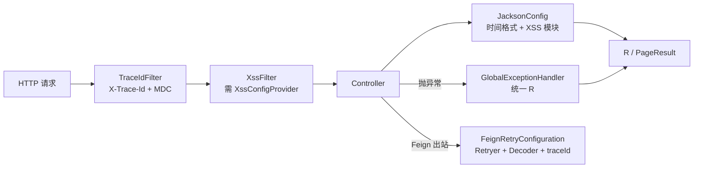

# common：Servlet 服务共享的运行时配置

`omni-common` 是**运行时**模块。它通过 7 条 `AutoConfiguration.imports` 给 Servlet 服务统一装上 JSON 时间格式、异常映射、追踪号、Feign 重试、CORS、XSS 和 OTLP 导出。

引入依赖与能力生效是两件事：每条自动配置都有自己的条件（类是否存在、是否有某个 Provider Bean、属性是否为某值）。本文逐项写清条件与失败后的表现。

> 事实边界：以下结论来自当前源码条件；本轮未启动应用，未验证任何一个 Bean 在真实运行时的装配结果。
>
> 适用边界：**只面向 Servlet**。Gateway 是 WebFlux，不装配 `WebMvcConfig` 与 `GlobalExceptionHandler`，时间格式、异常信封与过滤器行为都不能直接套用。

## 七条自动配置

`omni-common/src/main/resources/META-INF/spring/org.springframework.boot.autoconfigure.AutoConfiguration.imports` 当前内容：

```text
com.omni.common.config.FeignRetryConfiguration
com.omni.common.config.JacksonConfig
com.omni.common.config.WebMvcConfig
com.omni.common.result.GlobalExceptionHandler
com.omni.common.security.xss.XssAutoConfiguration
com.omni.common.web.TraceIdAutoConfiguration
com.omni.common.observability.OtlpTracingExporterAutoConfiguration
```



## JSON 与时间格式

### 问题

前后端约定 `yyyy-MM-dd HH:mm:ss`，但 Jackson 默认输出 ISO-8601；同时项目里存在 Jackson 2（`com.fasterxml`）与 Jackson 3（`tools.jackson`）两套 API，只配一套会出现“部分接口格式对、部分不对”。

### 怎么用

服务无需写任何配置：引入 `omni-common` 后，`LocalDateTime` / `LocalDate` 的序列化与反序列化自动使用约定格式。

### 实现原文

```java
    @Bean
    public ObjectMapper objectMapper() {
        JavaTimeModule javaTimeModule = new JavaTimeModule();
        javaTimeModule.addSerializer(LocalDateTime.class,
                new LocalDateTimeSerializer(DATE_TIME_FORMATTER));
        javaTimeModule.addDeserializer(LocalDateTime.class,
                new LocalDateTimeDeserializer(DATE_TIME_FORMATTER));
        javaTimeModule.addSerializer(LocalDate.class,
                new LocalDateSerializer(DATE_FORMATTER));
        javaTimeModule.addDeserializer(LocalDate.class,
                new LocalDateDeserializer(DATE_FORMATTER));
```

格式常量在 `JacksonConfig.java:36`：`DATE_TIME_PATTERN = "yyyy-MM-dd HH:mm:ss"`。类同时以 `SimpleModule` 为 Jackson 3 注册同一格式，并实现 `extendMessageConverters` 让 MVC 消息转换器使用统一配置。

### 边界与失败恢复

- **只对 Servlet 生效**；WebFlux 网关的编解码配置不同。
- 请求体时间格式不匹配会导致反序列化失败。当前处理器没有为 `HttpMessageNotReadableException` 单设分支，可能进入兜底 500；参数绑定与字段校验则有各自的 400 分支，不能把所有格式错误都当成同一种响应。
- 若某个接口时间格式异常，先确认它是否走了另一个 `ObjectMapper` 或自定义转换器。

### 扩展

新增类型格式要在 Jackson 2 与 Jackson 3 两条注册路径各加一次，否则不同转换入口会出现不一致。

## 全局异常映射

### 问题

业务异常、参数校验、403、404、405、415 需要统一成 `R` 信封，否则前端要按异常类型分支。

### 怎么用

服务不写 try/catch：抛出 `BusinessException` 或让校验异常冒泡，由全局 advice 转换。

### 实现原文

```java
    @ExceptionHandler(BusinessException.class)
    public R<Void> handleBusinessException(BusinessException e) {
        log.warn("业务异常: {}", e.getMessage());
        return R.fail(e.getCode(), e.getMessage());
    }
```

```java
    @ExceptionHandler({AccessDeniedException.class, AuthorizationDeniedException.class})
    @ResponseStatus(HttpStatus.FORBIDDEN)
    public R<Void> handleAccessDeniedException(Exception e) {
        log.warn("权限不足: {}", e.getMessage());
        return R.fail(403, "权限不足，拒绝访问");
    }
```

当前处理器覆盖：业务异常（保留业务码）、`MethodArgumentNotValidException` / `BindException`（400 字段错误）、`AccessDeniedException` / `AuthorizationDeniedException`（403）、缺参（400）、`NoResourceFoundException`（404）、类型不匹配（400）、415、405，以及兜底 `Exception`（通用 500）。

### 边界与失败恢复

- 当前校验/绑定/缺参/类型不匹配返回 HTTP 400，权限拒绝为 403，资源不存在为 404，不支持的方法/媒体类型为 405/415，兜底异常为 500；这些分支通过 `@ResponseStatus` 设置状态。`BusinessException` 分支保留业务码，未另设 HTTP 状态，通常仍为 HTTP 200，因此要同时检查 HTTP 状态与 `R.code`。
- 兜底分支记录日志并返回通用文案，不泄露堆栈。
- 如果某服务有自己的 `@RestControllerAdvice`，两者谁生效取决于优先级；不要假设全局处理器一定赢。

### 扩展

新增异常类型映射优先加在这里；服务特有异常可在服务内 advice 处理，但要保持 `R` 信封一致。

## 链路追踪号

### 问题

网关生成的 traceId 需要同时出现在日志、响应头和下游 Feign 调用里，否则跨服务排查只能靠时间猜。

### 实现原文

```java
    protected void doFilterInternal(HttpServletRequest request, HttpServletResponse response,
                                    FilterChain filterChain)
            throws ServletException, IOException {
        String traceId = resolveTraceId(request.getHeader(TRACE_HEADER));
        response.setHeader(TRACE_HEADER, traceId);
        MDC.put(MDC_KEY, traceId);
        try {
            filterChain.doFilter(request, response);
        } finally {
            MDC.remove(MDC_KEY);
        }
    }
```

追踪号的来源优先级：

```java
    private String resolveTraceId(String incoming) {
        Tracer tracer = tracerSupplier.get();
        Span currentSpan = tracer == null ? null : tracer.currentSpan();
        if (currentSpan != null && currentSpan.context() != null) {
            return currentSpan.context().traceId();
        }
        return incoming != null && SAFE_TRACE_ID.matcher(incoming).matches()
                ? incoming : UUID.randomUUID().toString().replace("-", "");
    }
```

1. 有当前 span → 用 W3C traceId；
2. 否则若请求头 `X-Trace-Id` 匹配安全格式 → 复用；
3. 否则生成 32 位无连字符 UUID。

### 边界与失败恢复

- **finally 必须清理 MDC**，否则线程池里的下一个请求会继承上一个 traceId。
- 只接受匹配 `SAFE_TRACE_ID` 的请求头，避免日志注入。
- 下游传播由 Feign 拦截器读取 MDC 完成；直接 `RestTemplate` 调用不会自动带。

### 扩展

新增协议头要同时改 resolve 与 Feign 拦截器；不要只改响应头。

## Feign 重试与编解码

### 问题

OpenFeign 默认 `Retryer.NEVER_RETRY`，Nacos 客户端首次拉取服务列表的冷启动延迟会让第一次调用直接失败；内部接口的错误响应也需要统一解码与日志。

### 实现原文

```java
    @Bean
    @ConditionalOnMissingBean(Retryer.class)
    public Retryer feignRetryer() {
        return new Retryer.Default(100, 1000, 5);
    }
```

```java
    @Bean
    @ConditionalOnClass(ObjectMapper.class)
    @ConditionalOnMissingBean(Decoder.class)
    public Decoder feignDecoder(ObjectMapper objectMapper) {
        return new JacksonFeignDecoder(objectMapper);
    }
```

```java
    @Bean
    public RequestInterceptor traceIdFeignRequestInterceptor() {
        return template -> {
            String traceId = MDC.get(TraceIdFilter.MDC_KEY);
            if (traceId != null && !traceId.isBlank()) {
                template.header(TraceIdFilter.TRACE_HEADER, traceId);
            }
        };
    }
```

### 语义与边界

- 重试参数：初始 100ms、最大 1000ms、最多 5 次；全部可被自定义 `Retryer` Bean 覆盖。
- 解码器复用公共 `ObjectMapper`，因此时间格式与 XSS 字符串处理一致。
- 拦截器**只在 MDC 有值时**加 `X-Trace-Id`。
- **重试不保证幂等**：写操作必须靠业务 `requestId` 兜底，不能因为“有重试”就允许重复提交。

### 扩展与失败恢复

自定义 `Decoder` / `Retryer` 会覆盖默认 Bean；不要通过加重试次数掩盖幂等问题。解码失败时日志带 traceId、status 与目标类型，可据此定位是契约不一致还是网络问题。

## CORS 配置

### 问题

前后端分离时浏览器需要跨域放行；开发默认与生产收窄必须可配置。

### 实现原文

```java
        var mapping = registry.addMapping("/**")
                .allowedMethods("GET", "POST", "PUT", "DELETE", "OPTIONS")
                .allowedHeaders("*")
                .allowCredentials(true)
                .maxAge(3600);
```

来源由 `omni.cors.allowed-origins` 控制，默认 `*`；为 `*` 时使用 `allowedOriginPatterns("*")`，否则按逗号拆分。

### 边界与失败恢复

- 默认 `*` 是开发便利值，不是安全策略；生产应通过配置收窄。
- 允许携带凭证（`allowCredentials(true)`）时，来源不能用裸 `*`——代码用 `allowedOriginPatterns` 规避了这一限制，但仍应显式配置域名。
- 跨域失败通常是浏览器预检被拒，先看响应头与配置，不要先怀疑 Controller。

### 扩展

新增方法或头要改这里；不要在业务服务里重复注册 CORS。

## XSS 运行时防护

### 问题

需要同时净化 Servlet 参数与 JSON 请求体里的字符串，并按租户读取开关与规则；项目同时存在 Jackson 2 与 Jackson 3 两套反序列化入口。

### 怎么用

服务实现 `XssConfigProvider`（见 [common-core](common-core.md#xss-配置-spi)）后，过滤器与两个 Jackson 模块自动装配，无需额外代码。

### 实现原文

```java
    @Bean
    @ConditionalOnBean(XssConfigProvider.class)
    public FilterRegistrationBean<XssFilter> xssFilterRegistration(XssConfigProvider xssConfigProvider) {
        FilterRegistrationBean<XssFilter> registration = new FilterRegistrationBean<>();
        registration.setFilter(new XssFilter(xssConfigProvider));
        registration.addUrlPatterns("/*");
        registration.setOrder(Ordered.HIGHEST_PRECEDENCE + 10);
        registration.setName("xssFilter");
        return registration;
    }
```

过滤器按租户取规则，关闭或规则为空时直接放行；启用时设置 ThreadLocal 并在 finally 清理：

```java
        XssSettings settings = xssConfigProvider.getXssSettings(tenantId);
        if (settings == null || !settings.isEnabled()
                || settings.getRules() == null || settings.getRules().isEmpty()) {
            filterChain.doFilter(request, response);
            return;
        }

        // 设置 ThreadLocal 供 XssStringDeserializer 使用
        XssRuleHolder.set(settings.getRules());
        try {
            // 包装请求以净化查询参数
            XssHttpServletRequestWrapper wrappedRequest =
                    new XssHttpServletRequestWrapper(request, settings.getRules());
            filterChain.doFilter(wrappedRequest, response);
        } finally {
            // 防止 ThreadLocal 内存泄漏
            XssRuleHolder.clear();
        }
```

### 边界与失败恢复

装配条件（全部满足才生效）：

1. `@ConditionalOnWebApplication(SERVLET)`；
2. 容器里有 `XssConfigProvider` Bean；
3. Jackson 2 模块按 `com.fasterxml.jackson.databind.ObjectMapper` 是否存在装配，Jackson 3 模块按 `tools.jackson.databind.json.JsonMapper` 是否存在装配。

- **没有 Provider 就没有过滤器**；这是“某服务不净化”的第一嫌疑。
- 只覆盖 Servlet；WebFlux 网关不适用。
- 净化取决于开关与有效规则，不能宣称所有输入都被处理。
- 规则里的非法正则由 provider/管理端负责校验；运行期异常不会被过滤器吞掉。

### 扩展

新增规则类型改 `XssSanitizer`；新增序列化入口要同时覆盖 Jackson 2 与 Jackson 3，否则会出现“参数净化了、JSON 没净化”。

## OTLP 追踪导出

### 问题

需要把 span 导出到 OTLP HTTP 端点，同时不覆盖部署侧已有的 exporter 配置。

### 实现原文

```java
@AutoConfiguration(before = {OpenTelemetryTracingAutoConfiguration.class, OtlpTracingAutoConfiguration.class})
@ConditionalOnClass(OtlpHttpSpanExporter.class)
@EnableConfigurationProperties(OtlpTracingProperties.class)
public class OtlpTracingExporterAutoConfiguration {

    /** 创建与 Spring Boot 官方属性保持一致的 HTTP OTLP exporter。 */
    @Bean
    @ConditionalOnMissingBean({OtlpHttpSpanExporter.class, OtlpGrpcSpanExporter.class})
    @ConditionalOnProperty(prefix = "management.tracing.export.otlp", name = "enabled",
            havingValue = "true", matchIfMissing = true)
    @ConditionalOnProperty(prefix = "management.opentelemetry.tracing.export.otlp", name = "transport",
            havingValue = "http", matchIfMissing = true)
    public OtlpHttpSpanExporter omniOtlpHttpSpanExporter(
```

### 条件与边界

- 类路径上存在 `OtlpHttpSpanExporter`；
- 没有现成的 HTTP 或 gRPC exporter Bean；
- `management.tracing.export.otlp.enabled` 为 `true`，**缺省视为 true**；
- `management.opentelemetry.tracing.export.otlp.transport` 为 `http`，**缺省视为 http**。

也就是说：**引入依赖且未显式关闭时，默认会创建 HTTP exporter**；不是“必须显式开启”。显式关闭、`transport` 改为非 http，或已有其他 exporter Bean 时才不创建。

### 失败恢复

条件不满足时不会报错，只是没有这个 Bean。若看不到 span 导出，先检查是否有其他 exporter Bean 抢先、属性是否被环境变量覆盖，再看 OTLP 端点连通性。端点不可达时的重试行为属于 exporter 自身，本项目未验证。

### 扩展

改用 gRPC 应提供 gRPC exporter Bean 或调整条件；不要在同一服务里同时创建两个 exporter。

## 附：按需求选模块

| 你想做的事 | 用哪个 | 注意 |
| --- | --- | --- |
| 统一返回/分页 | core `R` / `PageResult` | 不要自建信封 |
| 抛业务错误 | core `BusinessException` | HTTP 映射在 common |
| 发可靠消息 | core `ReliableMessageRelay` + mqlog 实现 | 显式 tenantId |
| 写用户任务 | core `UserJobHandler` | Bean 名 = type_code |
| 打操作日志 | core `@OperLog` + operlog 切面 | Auth 不使用 |
| 净化输入 | core SPI + common XSS 运行时 | 需 Provider Bean |
| 新租户开通模块 | core 租户契约 | 失败走 Auth 正式重试入口，由它生成新 requestId |
| 查内部用户/范围 | core 内部 DTO | 必须带内部令牌 |

十个 common 模块中的其余八个见后续章节；本章只覆盖 `omni-common-core` 与 `omni-common`。
