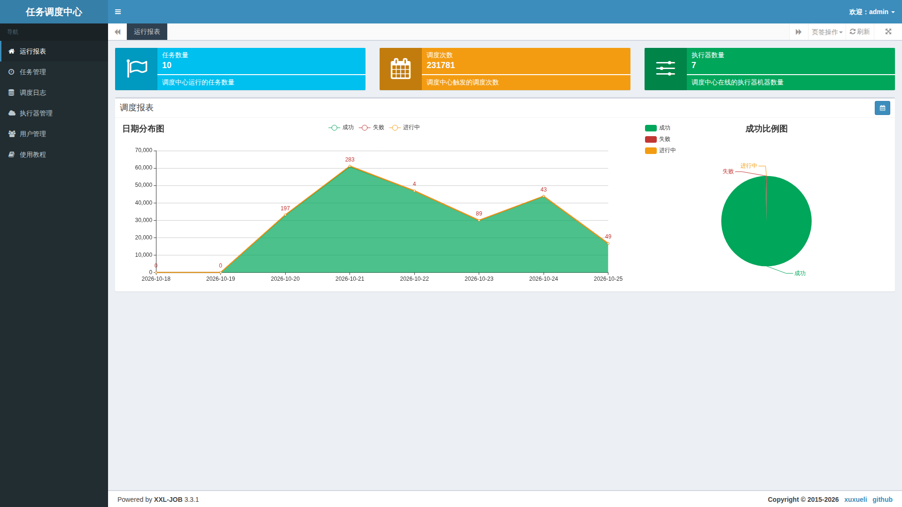
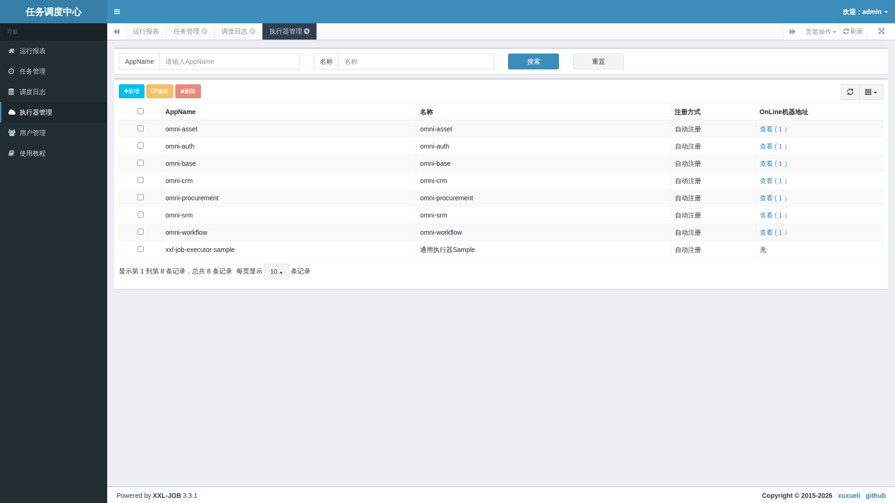
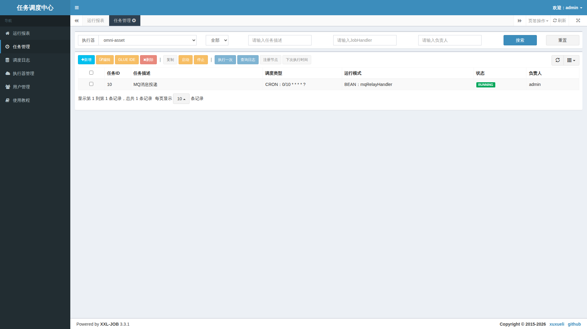
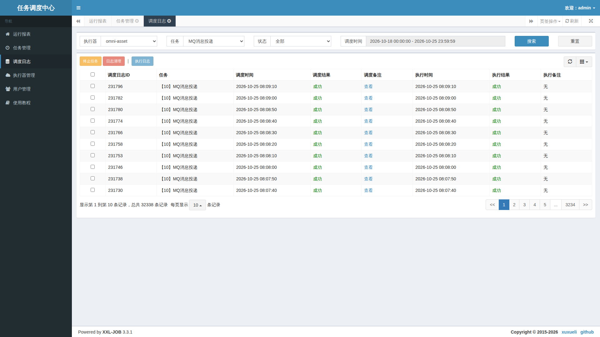

# 5. Reading the real XXL-JOB Admin screens

This operation article requires no code. The screenshots show the existing local XXL-JOB Admin 3.3.1, captured read-only after login with its dedicated local management configuration. Its native UI is Chinese. Other language articles retain that real UI and explain the fields rather than fabricating localization.

Administrators use the local XXL-JOB entry on standard port 18080 and the scheduling credentials in the private environment configuration. This login is separate from Workspace login. Do not put passwords in documentation. Personal reminders belong in the Workspace described next.

## Dashboard: establish scope first

The three cards summarize job scale, accumulated dispatches and online executor machines. The charts show successful, failed and running records over the selected date range; use the calendar to change it.

These are local values at capture time. A dispatch count is not a count of distinct business actions or proof that every action is correct. Keep historical failures. If one day has more failures, use its corresponding logs to investigate.

## Executors: confirm the destination

AppName identifies a service. The online-machine column shows registered addresses. The business groups have online nodes in this image, while the sample group has none; the unused sample is not proof of a business-service failure. Select the group actually used by your deployment.

With no online address, check service startup, registration and networking. With an address but failed execution, inspect connectivity, the handler name and logs. Do not delete a group merely to “refresh” it.

## Jobs: timetable, entry point and switch

Select an executor, then read the description, schedule type, execution mode and status. This MQ relay is scheduled every ten seconds in that service. RUNNING describes the scheduling switch; it does not guarantee every business execution succeeds.

Run once performs real work, Stop affects future scheduled runs, and Delete removes a center entry. The capture only identified these controls and did not perform those writes. Manage personal jobs in Workspace to avoid making project and center records inconsistent.

## Logs: why there are two results

Filter by executor, job and time, then identify a specific log ID. The dispatch result concerns assignment; the execution result concerns the later report. Both visible columns show success here. That supports these records only, not every historical job or the complete MQ consumption chain.

For failed dispatch, inspect nodes, networking and the dispatch remark. For successful dispatch but failed execution, open the execution log. For a long-running record, check duration, timeout and callback delivery. Native displayed times follow the service's own time-zone settings; align time zones when correlating systems.

Terminate and log cleanup are real management actions too. Before retrying a timeout, check whether business work already committed; do not keep retrying until the page turns green.

Next, return to the [ordinary user's Workspace](distributed-jobs-usage.en.md) to manage a personal reminder.
