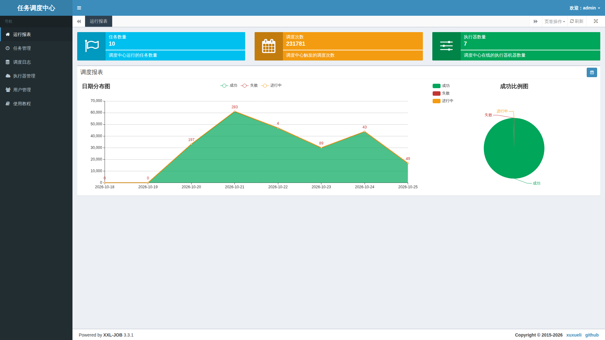
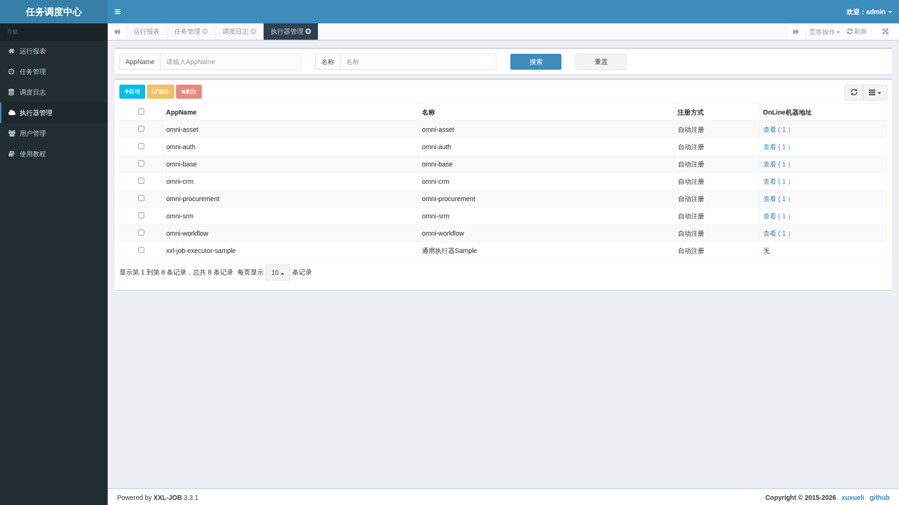
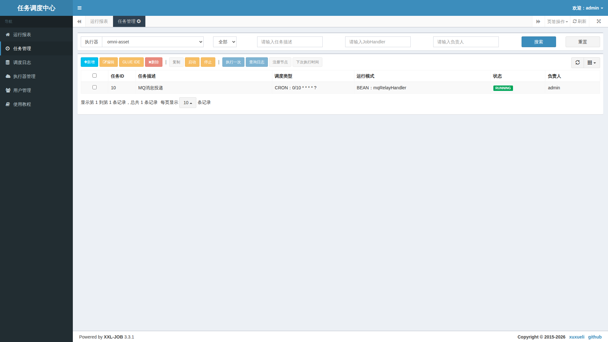
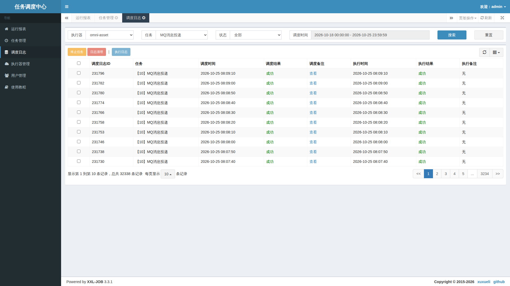

# 5. 実際の XXL-JOB 管理画面を読む

コードを使わない操作説明です。同一ローカル環境の XXL-JOB Admin 3.3.1 に専用管理設定でログインし、読み取りだけで撮影しました。ネイティブ画面は中国語です。他言語の本文でも実画面を保持して項目を説明し、翻訳済み画面を偽造しません。

管理者は標準ポート 18080 のローカル入口から、非公開の環境設定にあるスケジューリング管理アカウントで入ります。ワークスペースの業務ログインとは別です。パスワードを文書へ書かず、一般ユーザーの個人通知は次のワークスペースで管理します。

## 運行レポート：まず対象と範囲を把握する

上部カードはジョブの規模、累計割り当て、オンライン実行器数を示します。下部の曲線と比率は選択期間の成功、失敗、進行中を表し、カレンダーで期間を変えます。

数字は撮影時のローカル値です。累計回数は異なる業務の件数でも、すべての業務が正しい証拠でもありません。履歴の失敗を見栄えのために消さず、失敗が増えた日のログを調べます。

## 実行器管理：割り当て先を確認する

AppName はサービスを区別し、オンライン列は登録先を示します。業務グループにはノードがあり、サンプルにはありませんが、未使用サンプルは業務障害の証拠ではありません。実際の配置で使うグループを選びます。

アドレスがなければ起動、登録、ネットワークを確認します。アドレスがあって失敗するなら接続、handler 名、ログへ進みます。「更新するため」にグループを消さないでください。

## ジョブ管理：時間、入口、スイッチ

実行器を選び、説明、調度種別、実行モード、状態を読みます。画像の MQ 中継はそのサービスで十秒ごとに予定されます。RUNNING は定期起動のスイッチで、毎回の業務成功を保証しません。

「执行一次」は実処理を起動し、「停止」は今後の周期に影響し、「删除」は遠隔項目を消します。今回はボタンの識別のみで書き込みはしていません。個人ジョブはワークスペースで扱い、両側の記録を不整合にしないようにします。

## スケジューリングログ：二つの成功は別の段階

実行器、ジョブ、期間で絞り、ログ ID を確認します。割り当て結果は割り当て段階、実行結果は処理後の報告です。画像の成功は見えている記録の報告を示すだけで、全履歴や MQ の消費完了を証明しません。

割り当て失敗ならノード、通信、割り当ての備考を確認します。割り当て成功・実行失敗なら該当実行ログを開きます。長く進行中なら処理時間、タイムアウト、結果の返送を調べます。表示時刻はネイティブサービスのタイムゾーン設定なので、他システムとの照合時は時差をそろえます。

終了とログクリーンアップも実際の管理操作です。タイムアウト後は業務が既にコミットしていないかを確認し、緑になるまで再実行しないでください。

次は[一般ユーザーのワークスペース](distributed-jobs-usage.jp.md)です。
