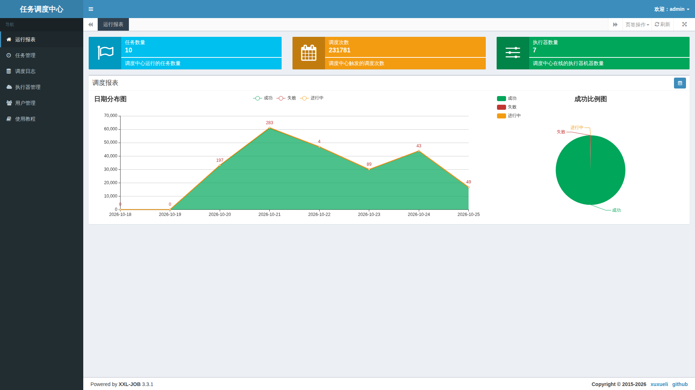
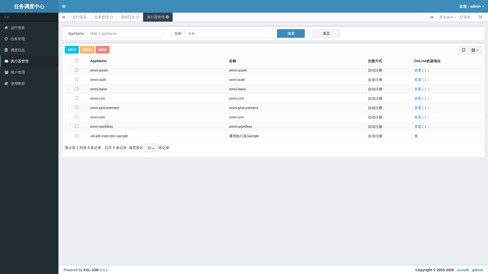
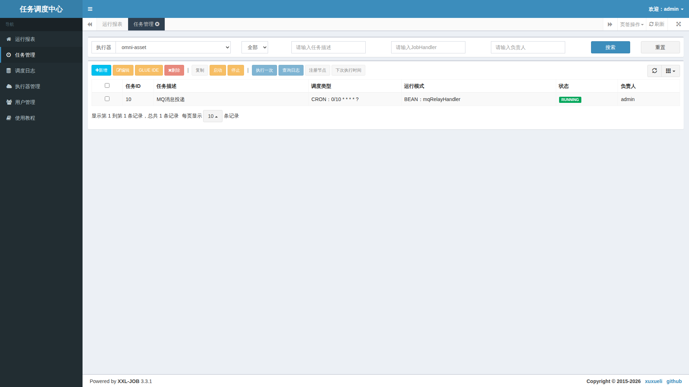
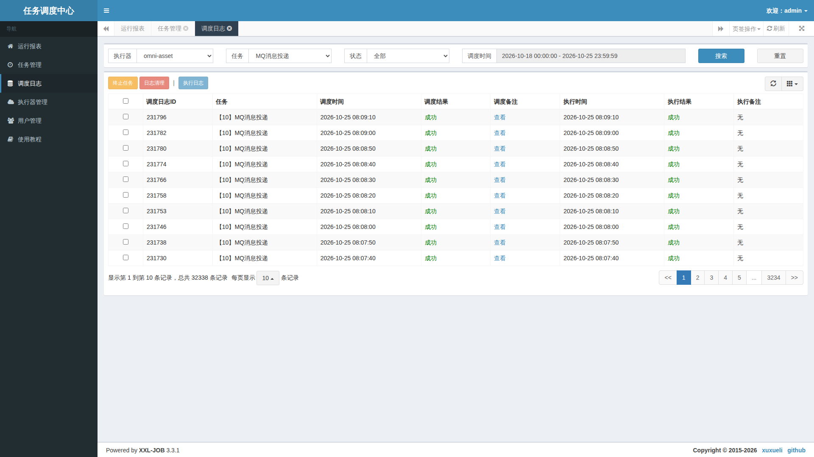

# 5. 실제 XXL-JOB Admin 화면 읽기

코드가 없는 사용 안내입니다. 같은 로컬 환경의 XXL-JOB Admin 3.3.1에 전용 관리 설정으로 로그인한 뒤 읽기만 하며 촬영했습니다. 기본 UI는 중국어입니다. 다른 언어의 글에서도 실제 화면을 유지하며 항목을 설명하고 번역된 화면을 꾸며내지 않습니다.

관리자는 표준 포트 18080의 로컬 XXL-JOB 진입점과 비공개 환경 설정의 스케줄링 계정을 사용합니다. 워크스페이스의 업무 로그인과 별개입니다. 비밀번호를 문서에 적지 말고, 일반 사용자의 개인 알림은 다음 워크스페이스 안내를 따릅니다.

## 실행 보고서: 범위부터 이해하기

위 카드들은 작업 규모, 누적 배정, 온라인 실행기 수를 보여 줍니다. 아래 그래프와 비율은 선택한 기간의 성공, 실패, 진행 중 상태이며 달력에서 기간을 바꿉니다.

숫자는 촬영 시점의 로컬 값입니다. 배정 횟수는 서로 다른 업무의 수나 전체 업무 정확성의 증거가 아닙니다. 보기 좋게 만들려고 과거 실패를 지우지 말고, 실패가 늘어난 날의 로그를 찾아보세요.

## 실행기 관리: 배정할 대상 확인

AppName으로 서비스를 구분하고 온라인 열로 등록 주소를 확인합니다. 이미지에서 업무 그룹에는 노드가 있지만 샘플 그룹에는 없습니다. 사용하지 않는 샘플이 비어 있다고 업무 서비스 장애는 아닙니다. 실제 배포에서 쓰는 그룹을 고릅니다.

주소가 없다면 서비스 기동, 등록, 네트워크를 확인합니다. 주소가 있는데 실패한다면 연결, handler 이름, 로그로 넘어갑니다. 새로고침하려는 목적으로 그룹을 삭제하지 마세요.

## 작업 관리: 시간표, 진입점, 스위치

실행기를 고른 뒤 설명, 스케줄 종류, 실행 모드, 상태를 봅니다. 이 MQ 중계는 해당 서비스에서 10초 간격으로 예약됩니다. RUNNING은 스케줄 스위치이며 매번 업무가 성공한다는 보장은 아닙니다.

한 번 실행은 실제 업무를 수행하고, 중지는 이후 주기에 영향을 주며, 삭제는 센터 항목을 없앱니다. 이번 촬영에서는 버튼을 확인했을 뿐 이런 쓰기는 하지 않았습니다. 개인 작업은 워크스페이스에서 관리해 양쪽 기록의 불일치를 피합니다.

## 스케줄링 로그: 두 성공 열의 차이

실행기, 작업, 기간으로 필터링하고 로그 ID를 확인합니다. 배정 결과는 전달 단계, 실행 결과는 처리 후 보고 단계입니다. 화면의 성공은 보이는 기록의 보고를 뜻할 뿐 전체 이력이나 MQ 소비 완료까지 증명하지는 않습니다.

배정 실패는 노드, 통신, 배정 비고를 확인합니다. 배정 성공·실행 실패라면 해당 실행 로그를 엽니다. 오래 진행 중이면 처리 시간, 제한 시간, 콜백을 봅니다. 표시 시간은 기본 서비스의 시간대 설정이므로 시스템 간 대조 전에 시간대를 맞춥니다.

종료와 로그 정리도 실제 관리 동작입니다. 시간 초과 후 재시도 전에 업무가 이미 커밋되었는지 확인하고, 초록색이 될 때까지 반복하지 마세요.

다음은 [일반 사용자의 워크스페이스](distributed-jobs-usage.kr.md)입니다.
