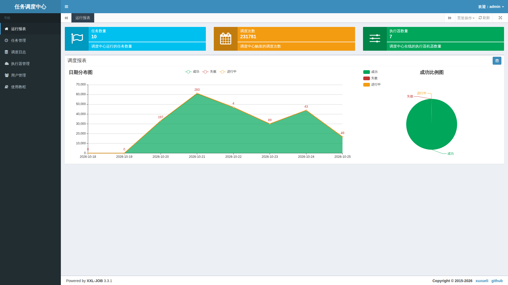
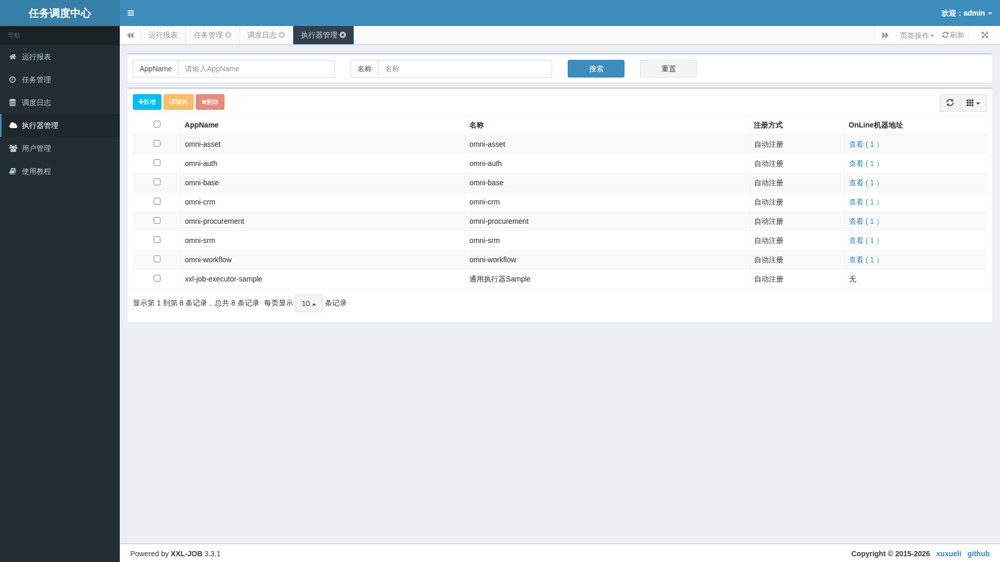
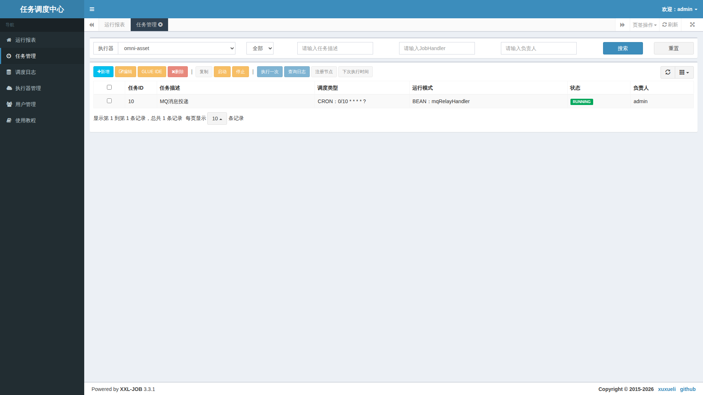
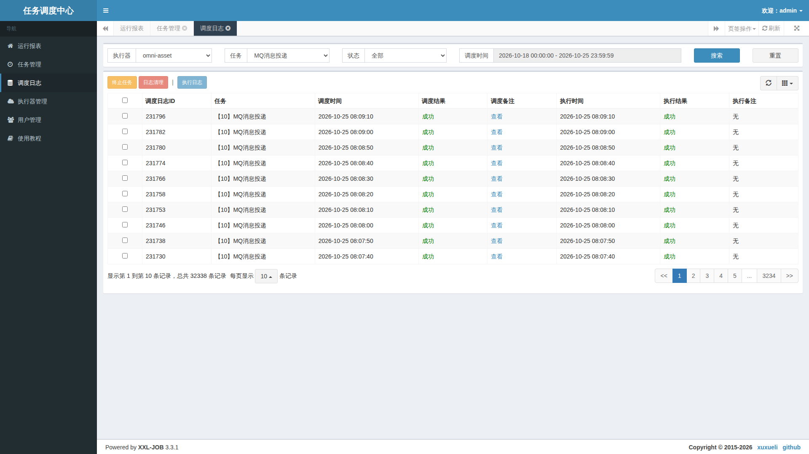

# 5. 对着真实网页认识 XXL-JOB 调度中心

本页是操作说明，不需要代码。截图来自同一套本地应用实际运行的 XXL-JOB Admin 3.3.1，使用本地专用管理配置登录后只读采集。原生界面为中文，其他语言教程也保留这份真实界面并解释字段，没有伪造本地化页面。

管理员从本地标准端口 18080 的 XXL-JOB 入口进入，使用私有环境配置中的调度账号。它与工作台业务登录不同，不要把密码写进教程。普通用户管理个人提醒，应使用下一篇的工作台入口。

## 先看运行报表：了解范围，不急着下结论

上面三张卡片帮助快速了解任务规模、累计调度量和在线执行器数量。下方日期曲线和比例图按选定时间范围呈现成功、失败与进行中情况，日历按钮用于选择范围。

截图中的数字只是采集时的本地数据。累计调度次数不等于不同业务数量，也不证明所有业务都正确；历史失败仍应保留，不能为了图好看清理掉。发现某天失败增加，再去对应日志查看具体原因。

## 执行器管理：先确认派单目标

AppName 区分服务；在线机器列说明目前有哪些注册地址。图中各业务服务有在线节点，示例执行器没有节点，这不等于业务服务故障。先选对本项目实际使用的组，再判断是否缺节点。

没有在线地址时，先查服务是否启动、执行器注册和网络；有地址却执行失败，则继续查连接、处理器名称和具体日志。不要在这里随意删除组来“刷新”。

## 任务管理：读懂时间、入口和开关

先选执行器，再看任务描述、调度类型、运行模式与状态。图中 MQ 消息投递每十秒安排一次，交给该服务里的消息中继处理器。运行状态表示调度开关，不保证每次业务执行成功。

“执行一次”会产生真实执行，“停止”影响后续周期，“删除”会移除调度条目。这里为帮助识别按钮，没有进行这些写操作。个人任务优先在工作台维护；绕到原生页面修改可能造成项目记录与调度记录不一致。

## 调度日志：两列成功分别说明什么

先按执行器、任务和时间范围筛选，再核对具体日志 ID。调度结果说明派发阶段；执行结果说明执行后回报的阶段。图中的两列都显示成功，仅证明这些可见记录报告成功，不代表所有历史记录或整个 MQ 消费链成功。

调度失败先看节点、网络和调度备注；调度成功而执行失败，打开相应执行日志继续查。长期进行中则核对耗时、超时与回调。页面显示时间采用原生服务的时区口径，跨系统关联时先校准时区。

“终止任务”和“日志清理”也是真实管理动作，不是查看按钮。遇到超时先确认业务有没有已经提交，不能立即重试直到变绿。

下一篇回到[普通用户的工作台](distributed-jobs-usage.md)，学习怎样维护自己的提醒。
