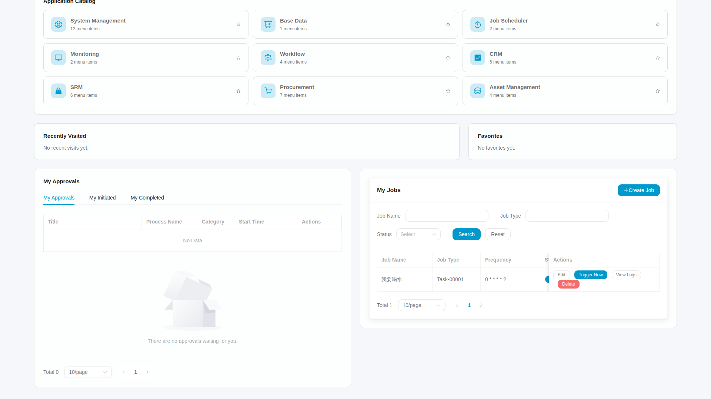
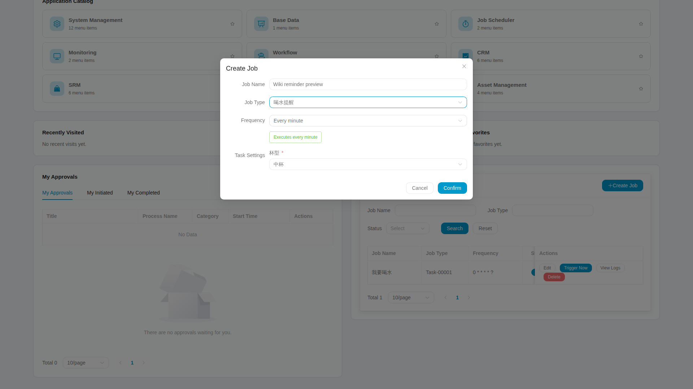

# 6. Managing My Jobs in the unified Workspace

A personal job is work you schedule for yourself in the current tenant. After login, select My Workspace on the home page. It opens in a new browser tab and leaves the Wiki home tab available. Applications, approvals and My Jobs now share one cockpit; My Jobs is no longer a separate navigation page.

## Step 1: find the task panel

Use the task summary card or scroll down to My Jobs. Statistics, filters, records and controls represent the current account's actual jobs, not a platform-wide total. Applications open independent tabs whose navigation and search focus on that module.

This original capture reads an existing job using a registered local test identity; it did not create or execute a job during capture. The panels share one page. The task table scrolls horizontally inside its panel, so columns outside this viewport need scrolling rather than assumptions about their values. The job name is real business data.

Job types are a shared system catalog, while personal jobs and their logs have ownership restrictions. If a type is missing, check whether it is enabled and its handler is deployed. Editing page data or scheduling arguments is not a way to access another user's work.

## Step 2: create a reminder

Select Create Job, enter a recognizable name, choose a type and complete that type's fields. A water reminder offers a cup-size choice; other forms depend on their actual type definitions.

The example has a name, a water-reminder type and a cup-size choice. Every minute is selected and the text below explains that interval. This is an unsubmitted form preview, not evidence of successful creation or execution. It uses a dedicated local test identity. The Chinese type and cup-size values are actual shared configuration data; the form controls follow the selected interface language.

Choose a schedule based on when you need the reminder and check its expected times. Avoid leaving a very frequent schedule running merely for a trial. Normal creation enables the job immediately, so confirm the interval before submitting.

A successful submission should add a row. If registration fails, retain the message and job identifiers so the administrator can determine whether a remote job was created. Repeated submission can create duplicates.

## Step 3: edit, pause and run once

You can edit the name, schedule and arguments. If only the name changes, native Admin may retain the old description; identify the association by job ID.

Pause stops future scheduled dispatches but does not prohibit a manual run. Select Trigger Now to request one deliberate execution. After an accepted response, open the logs and verify a new time, result and reminder text.

If a record appears after pausing, check whether it was already dispatched or manually triggered. After resuming, confirm a genuine scheduled run: a manual success is not proof of Cron execution.

## Step 4: read logs before deciding what to do

A successful row reports that run's handler result. For failure, read the sanitized error. If no new row appears, refresh and confirm the job and time range, then compare the native scheduling log. Parsing or log-storage failures may leave no personal log.

Notifications and the latest execution time help find results, but old screenshots, old records and an accepted trigger cannot prove this new run. This guide does not promise an operating-system desktop notification every time.

## Step 5: delete work you no longer need

Confirm the purpose and ownership, delete, and refresh the list. The operation also handles its associated center entry; do not delete only one side through native Admin. If deletion fails or its outcome is unknown, retain the association for reconciliation rather than hiding it with a direct database change.

Finish with [recovery and extension](distributed-jobs-recovery.en.md). Screenshots explain the real UI; completion of a particular create, run or delete still needs that operation's evidence.
