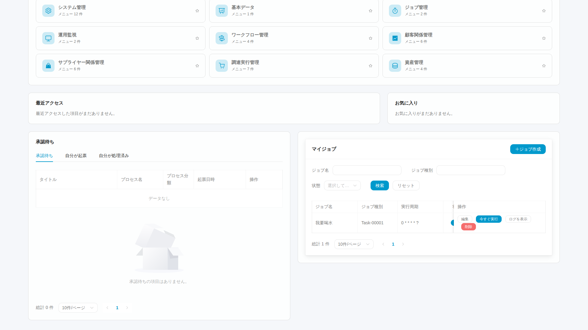
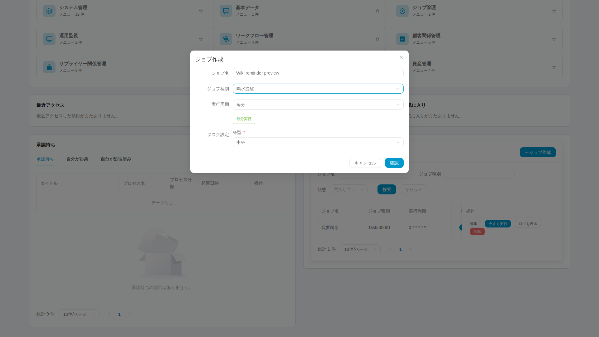

# 6. 統合ワークスペースでマイジョブを管理する

個人ジョブは現在のテナントで自分に設定する仕事です。ログイン後、ホームの「マイワークスペース」を選ぶと新しいブラウザタブで開き、元の Wiki タブは残ります。アプリ、承認、マイジョブは一つのコックピットにまとまり、マイジョブは独立したナビゲーションページではありません。

## 一：タスク領域を見つける

タスクの集計カードから移動するか、下へスクロールします。集計、絞り込み、一覧、操作は現在のアカウントの実際のタスクを対象とし、全体件数ではありません。アプリは別タブで開き、そのページのメニューと検索は現在のモジュールに限定されます。

登録済みのローカルテスト ID で既存タスクを読み取った原画像で、撮影時に作成や実行はしていません。両パネルは同じページです。タスク表は内部で横スクロールでき、見えていない列はスクロールして確認します。画面外の状態値を推測しないでください。タスク名は実際の業務データです。

種別は共通のシステム一覧ですが、個人ジョブと履歴には帰属制限があります。種別がない場合は有効化と処理器の配置を確認し、画面や実行引数を変更して他人の仕事を使わないでください。

## 二：通知を作成する

作成ボタンを押し、識別できる名前、種別、その種別の入力を設定します。水分補給ならカップの種類などが表示され、他の種別は実際のフォーム定義に従います。

例では名前、水分補給の種別、カップの種類を入力しています。周期は「毎分」で、その下に実行間隔の説明が出ます。未送信のフォームであり、作成や実行に成功した証拠ではありません。ローカル専用テスト ID で撮影しました。種別とカップの中国語は共通設定の実データで、フォームの操作表示は選択した言語です。

必要な時間から周期を決め、実行予定を確認します。試用のためだけに過密な周期を残さないでください。通常の作成直後は有効なので、送信前に周期を確認します。

成功したら一覧に新しい行が現れます。登録失敗なら通知文と識別情報を保ち、管理者が遠隔側の作成有無を確認します。繰り返し送信すると重複する可能性があります。

## 三：編集、一時停止、一回実行

名前、周期、引数を編集できます。名前だけを変えた場合はネイティブ Admin の説明が旧名のままのことがあり、関連は番号で確認します。

一時停止は今後の周期割り当てを止めますが、手動実行は禁止しません。「今すぐ実行」で一回の実行を依頼して受理されたら、実行履歴で新しい時刻、結果、通知内容を確認します。

停止後に記録が一つ増えた場合は、既に割り当て済みか手動実行かを調べます。再開後は実際の周期実行を確認し、手動成功で Cron 成功を代用しません。

## 四：ログを読んでから判断する

成功行はその回の処理器の報告です。失敗は機密を除いたエラーを読みます。新しい行がなければ更新し、対象と期間を確かめ、管理者にネイティブログとの照合を依頼します。解析や保存の失敗では個人ログがない場合があります。

通知と最終実行時刻は結果発見の助けですが、古い画像や履歴、実行受理の通知だけでは今回の成功を証明できません。毎回 OS のデスクトップ通知が出る保証でもありません。

## 五：不要になったら削除する

用途と帰属を確認して削除し、一覧を更新します。対応する遠隔記録も扱うため、ネイティブ Admin で片側だけ削除しないでください。失敗や結果不明の場合は関連を保持して照合し、直接 DB を変えて隠しません。

最後に[復旧と拡張](distributed-jobs-recovery.jp.md)を読みます。画像は実画面の説明であり、個別の作成、実行、削除の完了には該当操作の記録が必要です。
