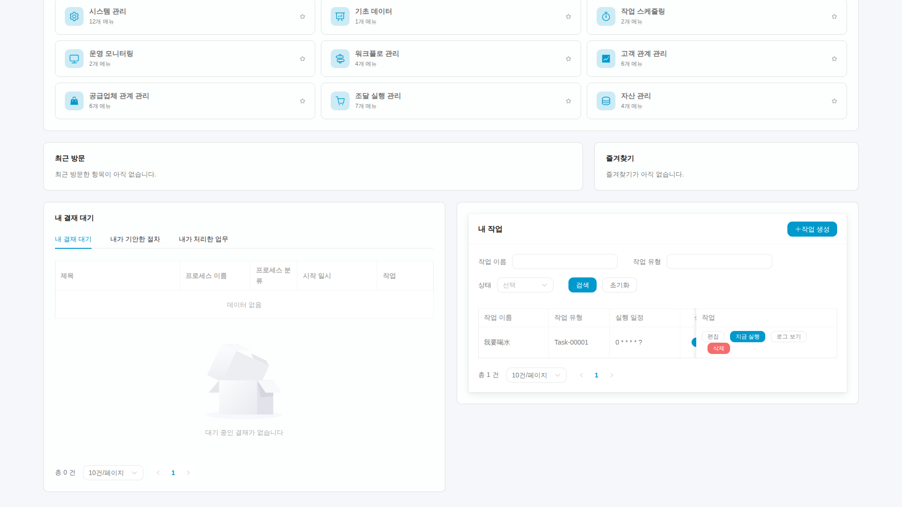
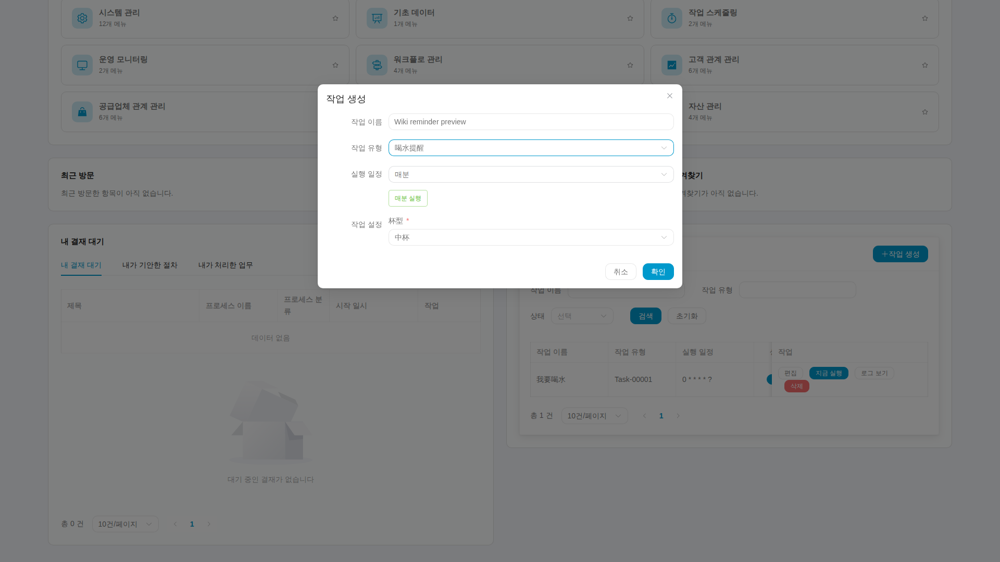

# 6. 통합 워크스페이스에서 내 작업 관리하기

개인 작업은 현재 테넌트에서 자신에게 예약하는 일입니다. 로그인한 뒤 홈페이지의 내 워크스페이스를 누르면 새 브라우저 탭에서 열리고 기존 Wiki 탭은 유지됩니다. 앱, 승인, 내 작업은 하나의 조종석에 모이며 내 작업은 별도 탐색 페이지가 아닙니다.

## 첫째: 작업 영역 찾기

작업 요약 카드로 이동하거나 아래로 스크롤합니다. 통계, 필터, 목록, 조작은 현재 계정의 실제 작업을 대상으로 하며 플랫폼 전체 합계가 아닙니다. 앱은 별도 탭에서 열리고 해당 페이지의 메뉴와 검색은 현재 모듈로 제한됩니다.

등록된 로컬 테스트 계정으로 기존 작업을 읽은 원본이며 촬영 중 새로 만들거나 실행하지 않았습니다. 두 패널은 한 페이지에 있습니다. 작업 표는 내부 가로 스크롤을 지원하므로 보이지 않는 열은 스크롤해 확인하고 화면 밖의 상태를 추측하지 않습니다. 작업 이름은 실제 업무 데이터입니다.

작업 종류는 공유 시스템 목록이지만 개인 작업과 로그에는 소유권 제한이 있습니다. 종류가 안 보이면 활성화 여부와 처리기 배포를 확인합니다. 페이지나 스케줄 인수를 바꿔 다른 사람의 작업을 이용하면 안 됩니다.

## 둘째: 알림 만들기

작업 만들기를 누르고 알아보기 쉬운 이름, 종류, 그 종류의 필수 입력을 채웁니다. 물 마시기 알림은 컵 크기 등을 선택하며 다른 종류는 실제 양식 정의에 따릅니다.

예시에서는 이름, 물 마시기 유형, 컵 크기를 입력했습니다. 실행 일정은 매분이며 아래에 주기 설명이 나옵니다. 아직 제출하지 않은 양식으로 생성·실행 성공 증거가 아닙니다. 로컬 전용 테스트 계정으로 촬영했습니다. 중국어 유형과 컵 값은 실제 공유 설정 데이터이며 양식 조작 문구는 선택한 언어를 따릅니다.

언제 알림이 필요한지 생각한 다음 주기와 예상 시간을 확인합니다. 시험 삼아 만든 지나치게 잦은 주기를 계속 두지 마세요. 정상 생성 직후에는 활성화되므로 제출 전에 주기를 확인합니다.

성공하면 새 행이 보여야 합니다. 등록 실패라면 안내와 식별 정보를 보존해 관리자가 원격 생성 여부를 확인하게 합니다. 반복 제출은 중복 작업을 만들 수 있습니다.

## 셋째: 수정, 일시 중지, 한 번 실행

이름, 주기, 인수를 수정할 수 있습니다. 이름만 바꾸면 기본 Admin의 설명에는 이전 이름이 남을 수 있으므로 연결은 작업 번호로 확인합니다.

일시 중지는 이후 예약 배정을 멈추지만 수동 실행을 금지하지 않습니다. 지금 실행을 눌러 한 번의 실행을 요청하고 접수되면 실행 기록에서 새로운 시각, 결과, 알림 내용을 확인하세요.

중지 후 기록이 하나 늘었다면 이미 배정되었거나 수동 실행된 것인지 먼저 확인합니다. 재개 뒤에는 실제 예약 실행을 확인해야 하며 수동 성공으로 Cron 성공을 대신하지 않습니다.

## 넷째: 로그를 읽고 다음 행동 결정

성공 행은 해당 회차 처리기의 결과 보고입니다. 실패 시 민감 정보를 제거한 오류를 읽습니다. 새 행이 없으면 새로고침하고 작업과 기간을 확인한 뒤 관리자에게 기본 로그와 대조하도록 합니다. 인수 해석이나 로그 저장 실패에는 개인 로그가 없을 수 있습니다.

알림과 최종 실행 시간은 결과를 찾는 데 도움이 되지만 과거 이미지, 과거 기록, 요청 접수 메시지는 이번 실행의 증거가 아닙니다. 매번 운영체제 데스크톱 알림을 보장하는 설명도 아닙니다.

## 다섯째: 필요 없어지면 삭제하기

용도와 소유권을 확인하고 삭제한 뒤 목록을 새로고침합니다. 대응하는 센터 항목도 처리하므로 기본 Admin에서 한쪽만 지우지 마세요. 실패하거나 결과가 불명확하면 연결을 유지해 대조하고 직접 DB를 고쳐 숨기지 않습니다.

마지막으로 [복구와 확장](distributed-jobs-recovery.kr.md)을 읽습니다. 이미지는 실제 UI 설명이며 개별 생성, 실행, 삭제 완료는 해당 동작의 기록으로 확인합니다.
