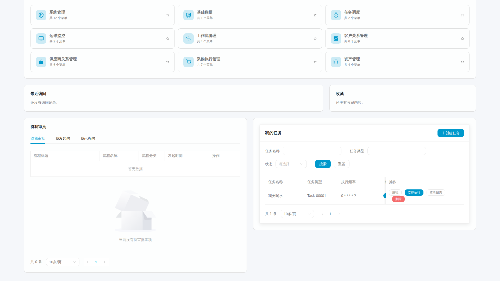
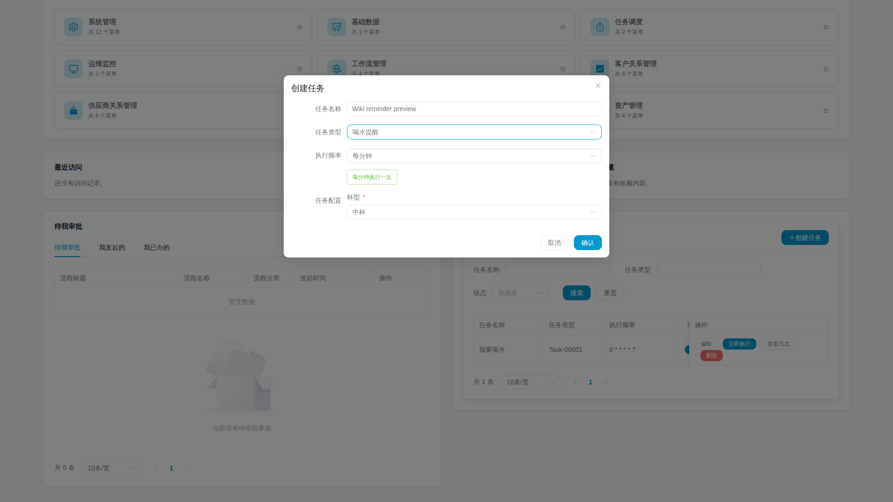

# 6. 在统一工作台管理我的任务

个人任务是你在当前租户下安排给自己的工作。先登录，在首页点击“我的工作台”，浏览器会打开新页签，原 Wiki 首页保留。工作台将应用、待我审批与我的任务放在同一个驾驶舱中；“我的任务”不再是独立的导航页面。

## 第一步：找到任务区

在工作台的任务概览卡片进入任务区，或直接向下滚动。这里的统计、筛选、列表和操作来自当前账号的实际任务，不是全平台任务总数。切换应用会打开独立业务页签，独立业务页只搜索和展示当前模块。

这张原图读取本地登记测试身份的已有任务，没有在拍摄时新建或执行任务。审批与任务在同页并排，任务表格支持区域内横向滚动；截图未展示的列需要滚动查看，不能从裁在视口外的状态推断结果。任务名称是实际业务数据。

任务类型列表是系统共享目录；个人任务与执行记录则有自己的归属限制。看不到某种任务时，先确认类型是否启用、处理器是否已部署；不要通过修改网页或调度参数去借用别人的任务。

## 第二步：新建一项提醒

点击“创建任务”，填写易识别的名称，选择任务类型，再填写该类型要求的参数。喝水提醒会提供杯型等输入，其他类型以实际表单为准。

图中先填了示例名称，再选择喝水提醒和杯型；执行频率选为每分钟，下方会给出周期说明。这是尚未提交的表单预览，不是创建成功或执行成功的证据。图片读取本地专用测试身份，任务类型和杯型是系统中的实际配置。

选择执行周期时先想清楚什么时候需要提醒，再核对预计时间。不要为了试用给长期任务设置过密周期。正常创建后任务会立即处于启用状态，因此提交前确认周期合适。

提交成功后，列表应该出现新记录。若提示调度注册失败，先保留提示和任务线索，由管理员核对远端是否已经创建；不要连续重复提交制造多份提醒。

## 第三步：编辑、暂停与执行一次

编辑可以修改名称、周期和参数。仅改名称时，原生调度中心的任务描述可能保留旧名称，关联仍以任务编号为准。

暂停会停止后续周期调度，但不会禁止手动执行。点击“立即执行”发起明确需要的一次运行；返回受理成功后，继续打开执行记录，核对新的时间、结果和提醒内容。

如果刚暂停仍出现一条记录，先判断是不是已经派发的任务或手动触发，不要直接认为暂停无效。恢复后再检查后续周期，不能用手动成功来证明定时调度成功。

## 第四步：读日志，再决定下一步

成功记录说明这次处理器报告成功；失败记录需要看脱敏后的错误。找不到新日志时先刷新并确认任务和时间范围，再请管理员对照原生调度日志；参数解析或日志落库失败可能没有个人日志。

任务通知与最近执行时间便于发现结果，但截图、旧记录和“触发成功”提示，都不能代替这一次的日志。这里的操作说明不承诺每次都发桌面系统通知。

## 第五步：不需要了再删除

确认任务用途和归属后删除，再刷新列表。删除会处理对应的调度记录，不要只在原生 Admin 删除一边。若出现结果未知或删除失败，保留关联给管理员核对，禁止直接改库把任务藏起来。

最后读[失败恢复与扩展](distributed-jobs-recovery.md)。截图用于说明实际界面；是否完成某次新建、执行或删除，仍以相应操作记录为准。
