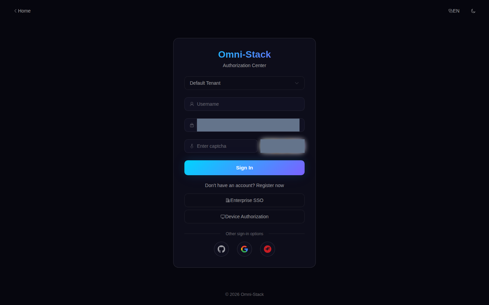
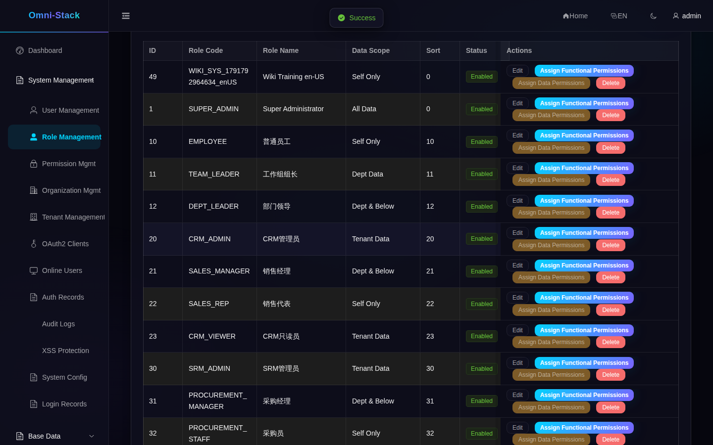
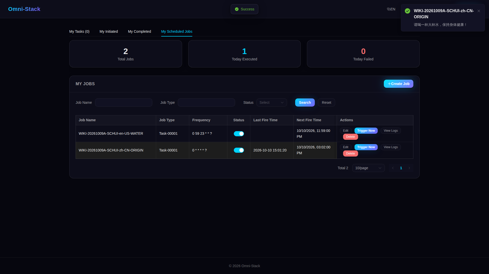
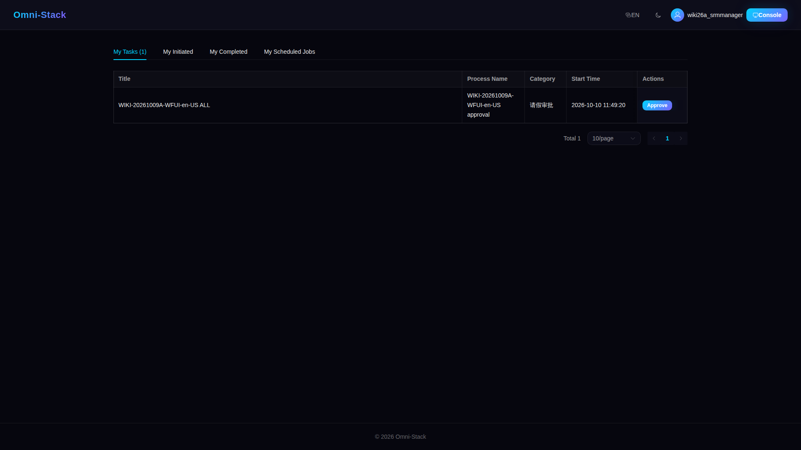
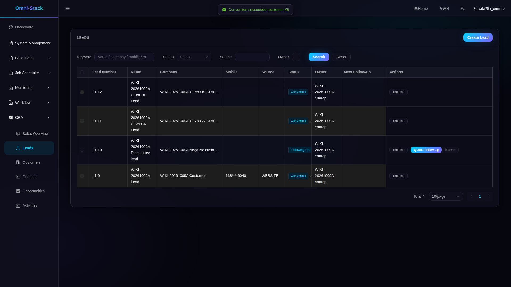
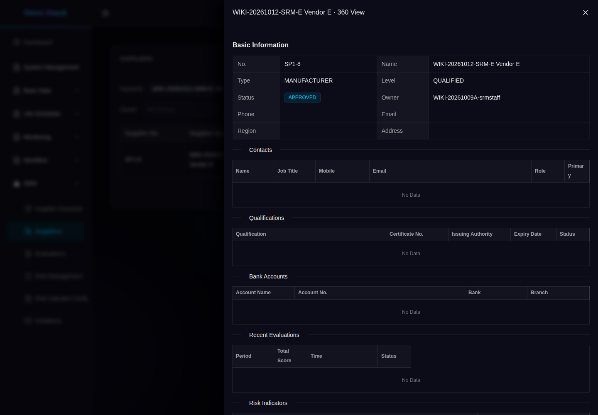
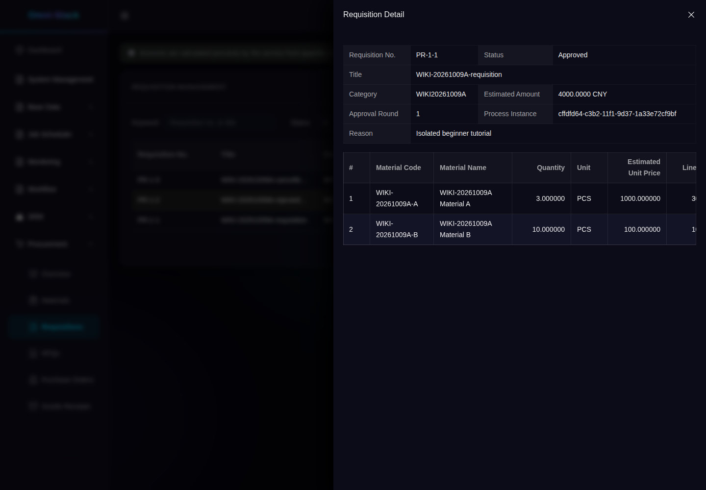
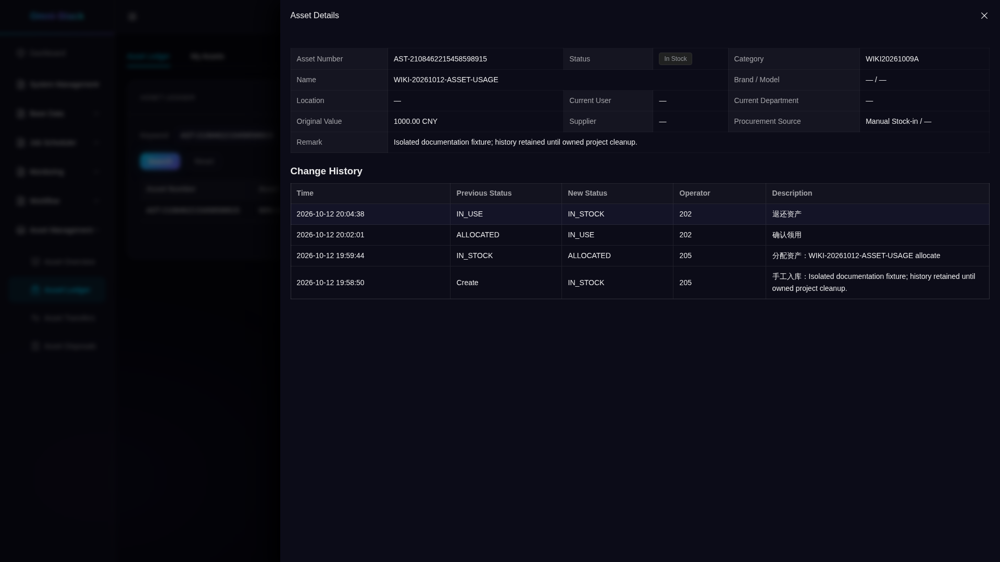

# Feature tour and real interface entry points

Use this page to recognize the project, then follow the guides. These original screenshots are registered from the isolated Docker environment. They show the captured pages; they do not prove that your environment contains the same records or that all three social logins have passed. Do not reuse historical business IDs.

Start with the [learning path](index.en.md) and [first start](../guides/quick-start.en.md). Presets select modules; tenants, functional permissions and data scope determine what the current identity can access.

<!-- omni:modules:auth -->
## Authentication and tenants

Identify the login, tenant and CAPTCHA entry points. A human enters real CAPTCHAs.

[Steps, expected results and failures](../guides/authentication.en.md)

<!-- omni:modules:end -->

<!-- omni:modules:platform -->
## System, security and audit

Manage users, roles, organizations, menus, dictionaries and security policy; verify audit and permission denials.

[Steps, expected results and failures](../guides/system-security-audit.en.md)

<!-- omni:modules:end -->

<!-- omni:modules:xxl-job -->
## Personal and system jobs

Job types determine routing; personal jobs enforce ownership. Verify creation, scheduling, pausing and failure separately.

[Steps, expected results and failures](../guides/scheduling.en.md)

<!-- omni:modules:end -->

<!-- omni:modules:workflow -->
## Workflow and approval

Validate models and candidates before publishing and submitting business records; compare countersign, delegation, rejection and withdrawal.

[Steps, expected results and failures](../guides/workflow-approval.en.md)

<!-- omni:modules:end -->

<!-- omni:modules:crm -->
## CRM sales

Follow leads through customers, contacts, opportunities and activities; verify conversion and wins under role and data scope.

[Steps, expected results and failures](../guides/crm-flow.en.md)

<!-- omni:modules:end -->

<!-- omni:modules:srm -->
## SRM suppliers

Invitations and portal associations, admission, evaluation, risk, suspension and elimination each have prerequisites.

[Steps, expected results and failures](../guides/srm-flow.en.md)

<!-- omni:modules:end -->

<!-- omni:modules:procurement -->
## Procurement collaboration

Prepare data in order: requisition, approval, RFQ, supplier quotes, award, order and goods receipt.

[Steps, expected results and failures](../guides/procurement-flow.en.md)

<!-- omni:modules:end -->

<!-- omni:modules:asset -->
## Asset lifecycle

Accepted asset-managed receipts create cards. Personal use and management have different scopes; transfers and disposal require approval.

[Steps, expected results and failures](../guides/asset-flow.en.md)

<!-- omni:modules:end -->

## Images and reproducibility boundaries

Each language uses screenshots from its own locale directory. Business names, protocol states and server diagnostics may retain their original values. Cropping, wrapping and visible-field limits are documented in the evidence referenced by the [screenshot manifest](../../omni-frontend/e2e-docs/screenshot-manifest.yaml). Page captures, API checks and translation review are separate records.

For source explanations, follow [debugging paths](source-debugging.en.md); distinguish seeds and demonstration records using the [data guide](data-and-fixtures.en.md). The [historical interface reference](interface-reference.en.md) preserves earlier layouts and provenance. Follow the relevant guide and source for current operations.
