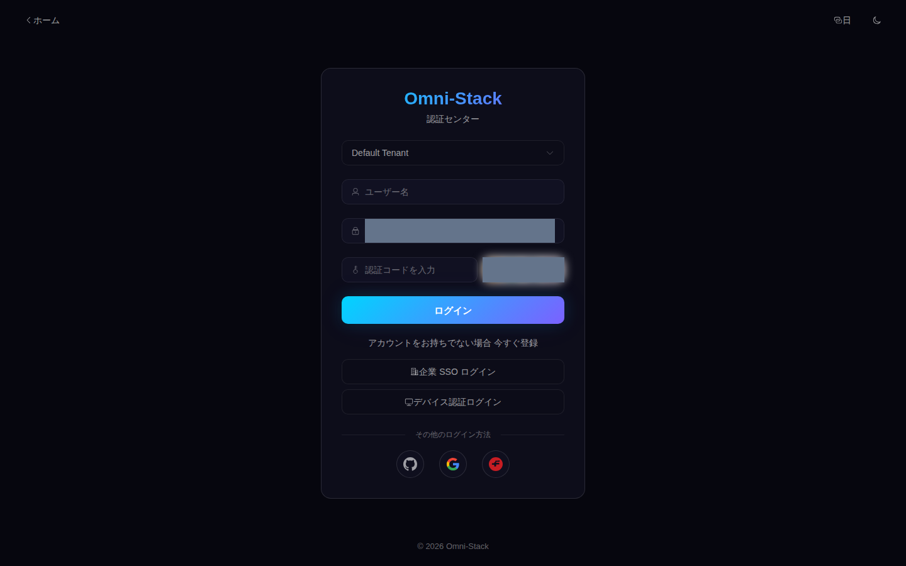
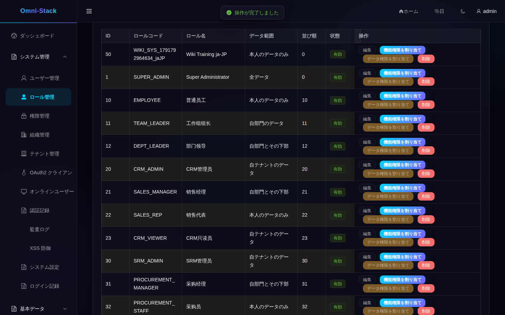
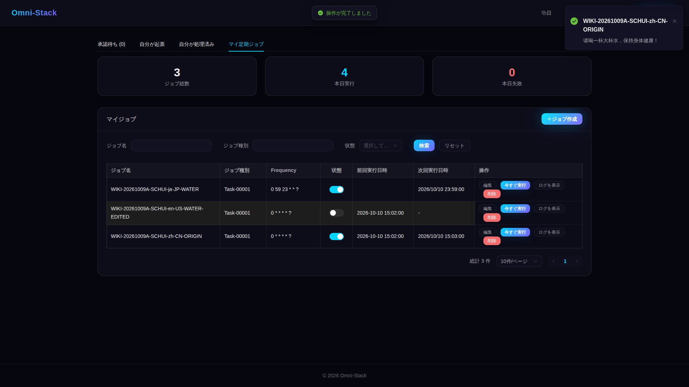
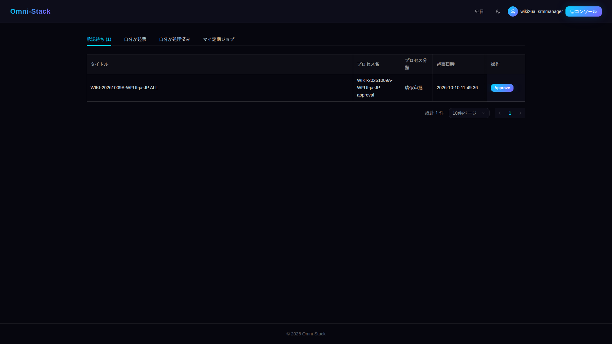
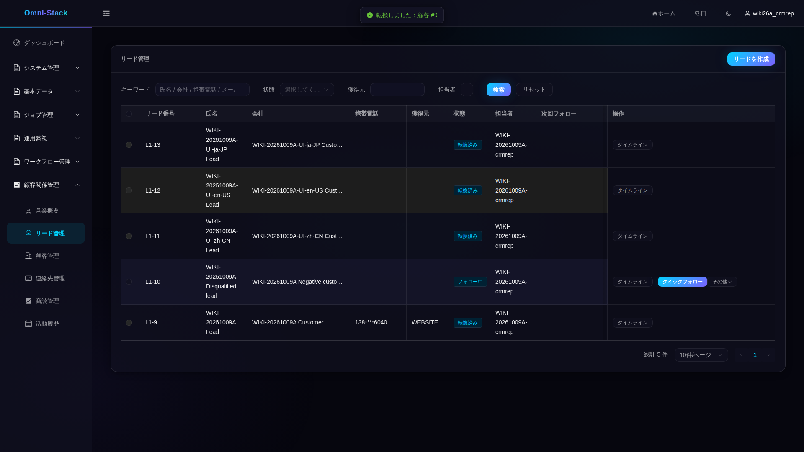
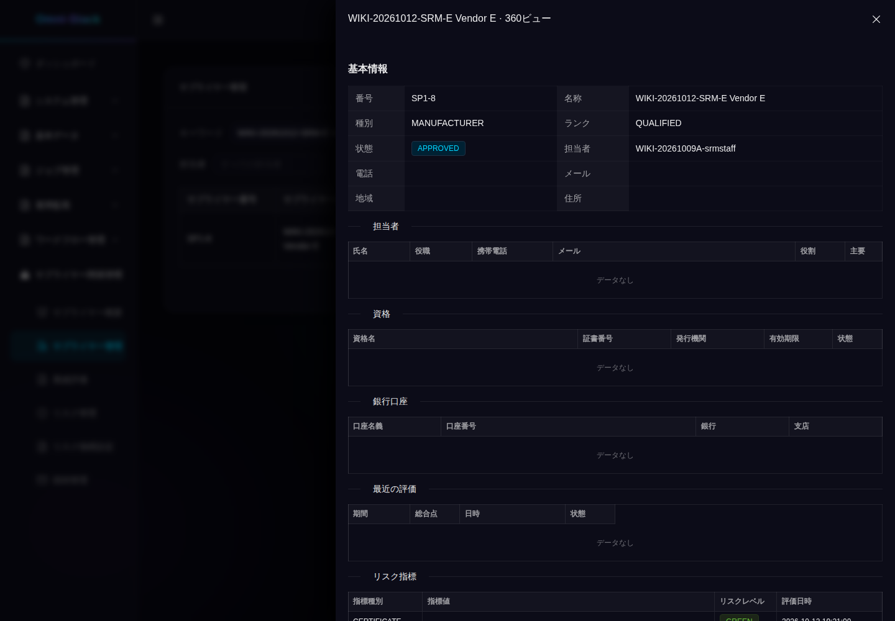
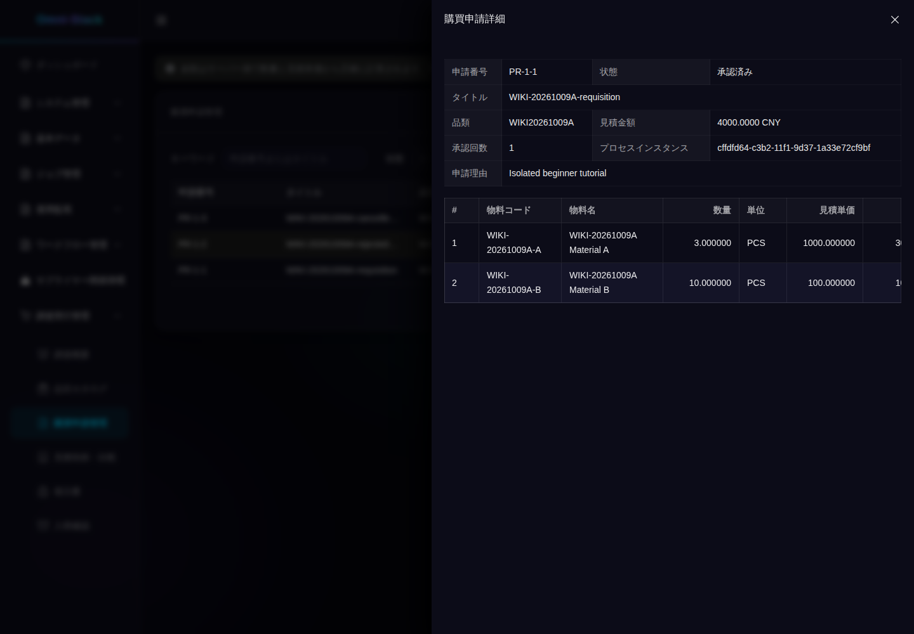
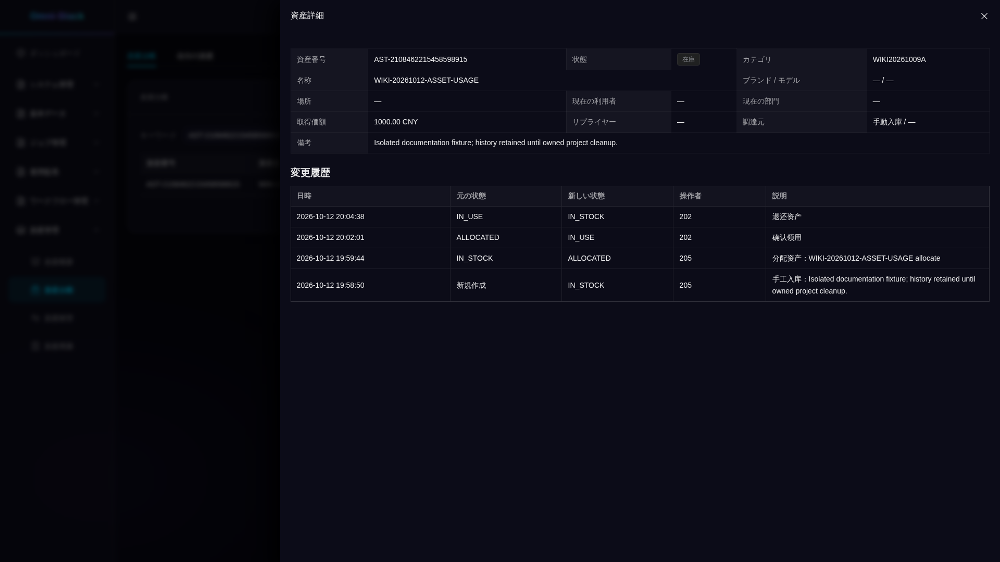

# 機能紹介と実際の画面への入口

まず本ページで構成を理解し、各ガイドの手順へ進みます。画像は分離した Docker 環境で取得し、登録した原画像です。写っている画面を示すものであり、自分の環境に同じ業務データがあることや、三つのソーシャルログインが検証済みであることは証明しません。過去の業務 ID は再利用しません。

初めて使う場合は[学習パス](index.jp.md)と[初回起動](../guides/quick-start.jp.md)から始めます。プリセットがモジュールを選び、テナント、機能権限、データ範囲が現在のユーザーのアクセス範囲を決めます。

<!-- omni:modules:auth -->
## 認証とテナント

ログイン、テナント、CAPTCHA の入口を確認します。実際の CAPTCHA は人が入力します。

[手順、期待結果、失敗条件](../guides/authentication.jp.md)

<!-- omni:modules:end -->

<!-- omni:modules:platform -->
## システム、セキュリティ、監査

ユーザー、ロール、組織、メニュー、辞書、安全設定を管理し、監査と権限拒否を確認します。

[手順、期待結果、失敗条件](../guides/system-security-audit.jp.md)

<!-- omni:modules:end -->

<!-- omni:modules:xxl-job -->
## 個人タスクとシステムタスク

タスク種別が処理先を決め、個人タスクは所有権を確認します。作成、実行予約、一時停止、失敗を個別に検証します。

[手順、期待結果、失敗条件](../guides/scheduling.jp.md)

<!-- omni:modules:end -->

<!-- omni:modules:workflow -->
## ワークフローと承認

モデルと候補者を検証してから公開し、業務を申請します。合議、委任、却下、撤回を比較します。

[手順、期待結果、失敗条件](../guides/workflow-approval.jp.md)

<!-- omni:modules:end -->

<!-- omni:modules:crm -->
## CRM 営業

リードから顧客、連絡先、商談、活動まで追跡し、ロールとデータ範囲を守って変換と受注を確認します。

[手順、期待結果、失敗条件](../guides/crm-flow.jp.md)

<!-- omni:modules:end -->

<!-- omni:modules:srm -->
## SRM 仕入先

招待とポータルの関連付け、登録審査、評価、リスク、凍結、取引終了にはそれぞれ前提条件があります。

[手順、期待結果、失敗条件](../guides/srm-flow.jp.md)

<!-- omni:modules:end -->

<!-- omni:modules:procurement -->
## 購買連携

購買申請、承認、見積依頼、仕入先の見積、選定、注文、入荷の順にデータを準備します。

[手順、期待結果、失敗条件](../guides/procurement-flow.jp.md)

<!-- omni:modules:end -->

<!-- omni:modules:asset -->
## 資産ライフサイクル

合格した資産対象の入荷から台帳を作成します。本人の利用と管理の範囲は異なり、移管と処分には承認が必要です。

[手順、期待結果、失敗条件](../guides/asset-flow.jp.md)

<!-- omni:modules:end -->

## 画像と再現の範囲

各言語のページは対応する言語ディレクトリの画像を使います。業務名、プロトコルの状態値、サーバー診断は元の値が残る場合があります。切れ、折り返し、確認できる項目の制約は[画像一覧](../../omni-frontend/e2e-docs/screenshot-manifest.yaml)から参照する証拠に記録しています。画面、API 検証、翻訳レビューは別々に記録します。

ソースの説明は[デバッグ経路](source-debugging.jp.md)、基本シードとデモ記録の違いは[データガイド](data-and-fixtures.jp.md)を参照します。[過去の画面資料](interface-reference.jp.md)は以前のレイアウトと出所を保持します。現在の操作は対応するガイドとソースを基準にします。
