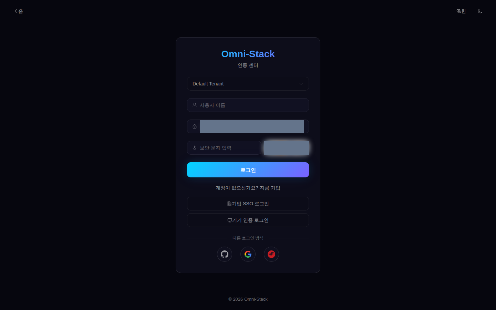
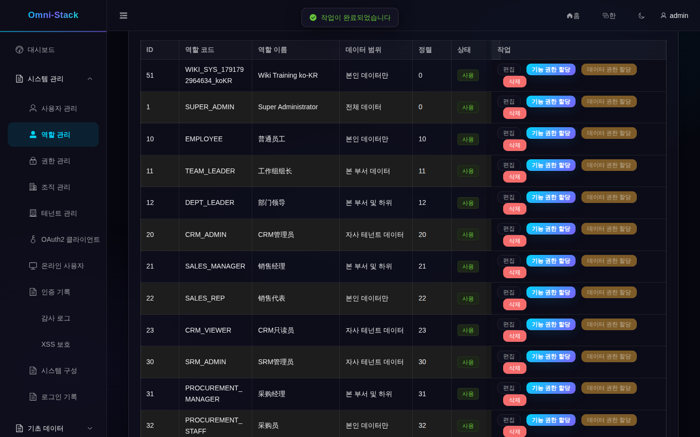
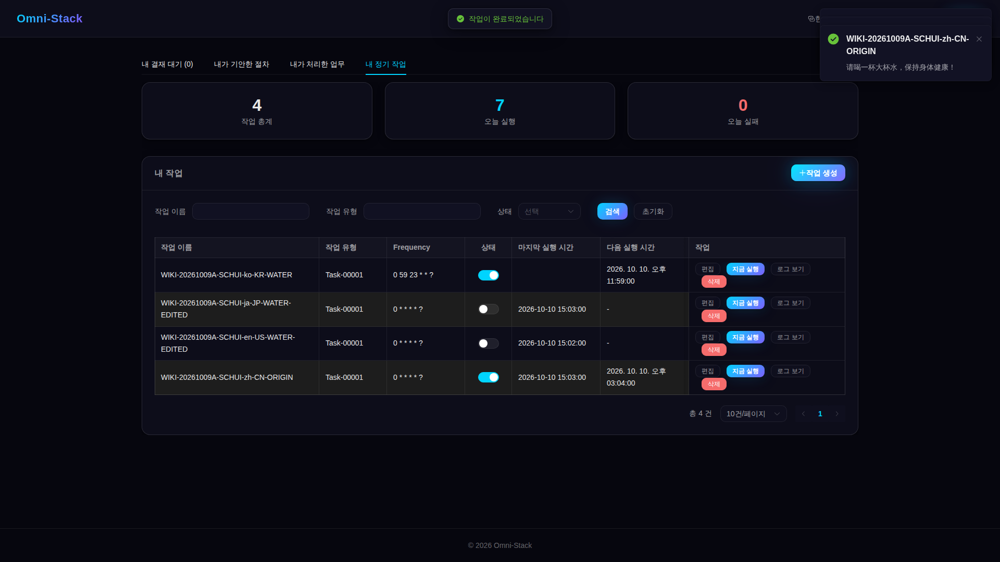
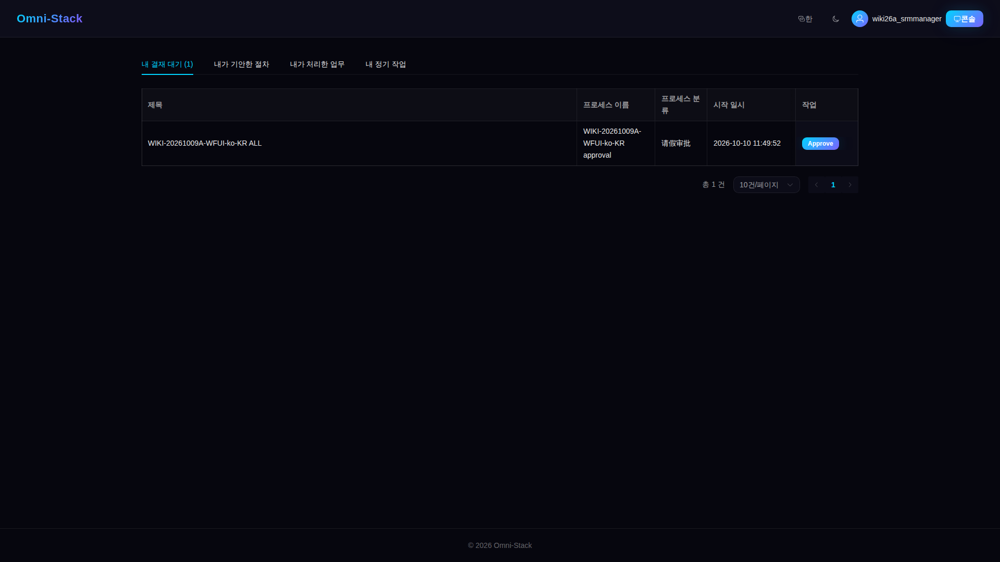
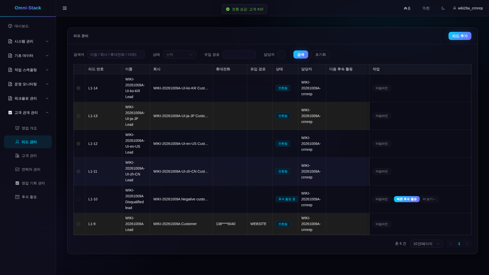
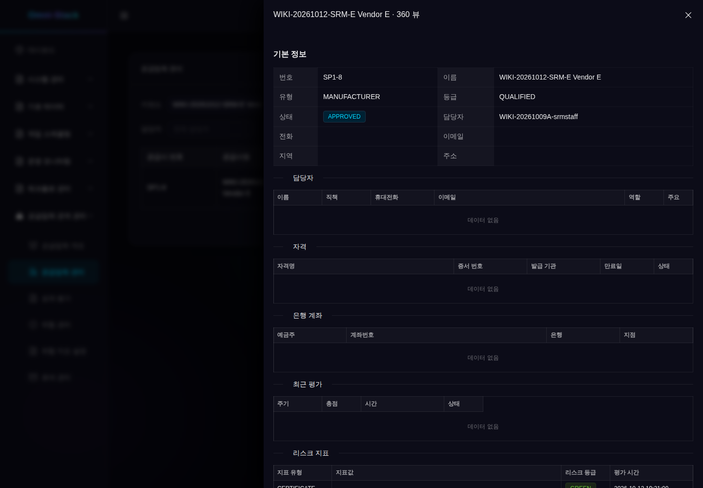
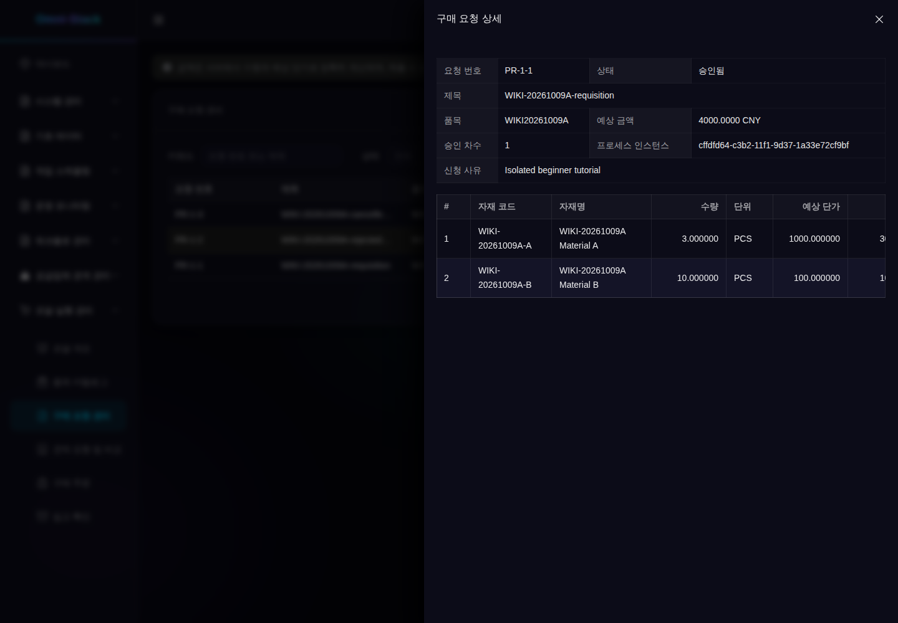
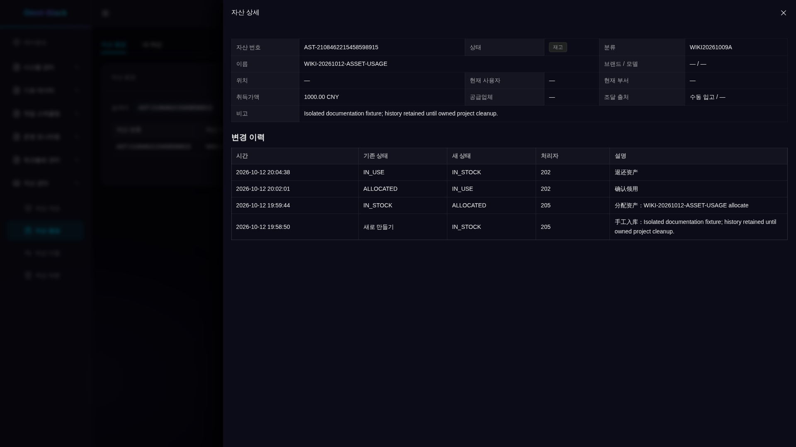

# 기능 소개와 실제 화면 진입점

이 페이지에서 프로젝트를 파악한 다음 각 안내의 절차를 따르세요. 이미지는 격리된 Docker 환경에서 촬영하고 등록한 원본입니다. 해당 화면을 보여 줄 뿐, 현재 환경에 같은 업무 기록이 있거나 세 소셜 로그인 검증이 완료되었다는 뜻은 아닙니다. 과거 업무 ID를 재사용하지 않습니다.

처음에는 [학습 경로](index.kr.md)와 [첫 실행](../guides/quick-start.kr.md)을 읽으세요. 프리셋은 모듈을 선택하고 테넌트, 기능 권한, 데이터 범위는 현재 사용자의 접근 범위를 결정합니다.

<!-- omni:modules:auth -->
## 인증과 테넌트

로그인, 테넌트, CAPTCHA 진입점을 확인합니다. 실제 CAPTCHA는 사람이 입력합니다.

[절차, 예상 결과, 실패 조건](../guides/authentication.kr.md)

<!-- omni:modules:end -->

<!-- omni:modules:platform -->
## 시스템, 보안, 감사

사용자, 역할, 조직, 메뉴, 사전, 보안 정책을 관리하고 감사와 권한 거부를 확인합니다.

[절차, 예상 결과, 실패 조건](../guides/system-security-audit.kr.md)

<!-- omni:modules:end -->

<!-- omni:modules:xxl-job -->
## 개인 작업과 시스템 작업

작업 유형이 처리 경로를 정하며 개인 작업은 소유권을 검사합니다. 생성, 예약 실행, 일시 중지, 실패를 각각 검증합니다.

[절차, 예상 결과, 실패 조건](../guides/scheduling.kr.md)

<!-- omni:modules:end -->

<!-- omni:modules:workflow -->
## 워크플로우와 승인

모델과 후보자를 검증한 뒤 게시하고 업무를 제출합니다. 다중 승인, 위임, 거절, 철회를 비교합니다.

[절차, 예상 결과, 실패 조건](../guides/workflow-approval.kr.md)

<!-- omni:modules:end -->

<!-- omni:modules:crm -->
## CRM 영업

리드에서 고객, 연락처, 영업 기회, 활동까지 추적하며 역할과 데이터 범위에 따라 전환과 수주를 검증합니다.

[절차, 예상 결과, 실패 조건](../guides/crm-flow.kr.md)

<!-- omni:modules:end -->

<!-- omni:modules:srm -->
## SRM 공급업체

초대와 포털 연결, 입점 승인, 평가, 위험, 동결, 퇴출은 각각 전제 조건이 있습니다.

[절차, 예상 결과, 실패 조건](../guides/srm-flow.kr.md)

<!-- omni:modules:end -->

<!-- omni:modules:procurement -->
## 구매 협업

구매 요청, 승인, 견적 요청, 공급업체 견적, 선정, 주문, 입고 순서로 데이터를 준비합니다.

[절차, 예상 결과, 실패 조건](../guides/procurement-flow.kr.md)

<!-- omni:modules:end -->

<!-- omni:modules:asset -->
## 자산 수명주기

합격한 자산 관리 대상 입고에서 카드를 만듭니다. 본인 사용과 관리 범위는 다르며 이전과 처분에는 승인이 필요합니다.

[절차, 예상 결과, 실패 조건](../guides/asset-flow.kr.md)

<!-- omni:modules:end -->

## 이미지와 재현 범위

각 언어는 해당 언어 디렉터리의 이미지를 사용합니다. 업무 이름, 프로토콜 상태, 서버 진단은 원래 값을 유지할 수 있습니다. 잘림, 줄바꿈, 확인 가능한 필드의 한계는 [이미지 매니페스트](../../omni-frontend/e2e-docs/screenshot-manifest.yaml)가 참조하는 증거에 기록합니다. 화면 촬영, API 검증, 번역 검토는 각각 기록합니다.

소스 설명은 [디버깅 경로](source-debugging.kr.md), 기본 시드와 데모 기록의 차이는 [데이터 안내](data-and-fixtures.kr.md)를 참고하세요. [과거 화면 자료](interface-reference.kr.md)는 이전 레이아웃과 출처를 보존합니다. 현재 작업은 해당 안내와 소스를 기준으로 합니다.
