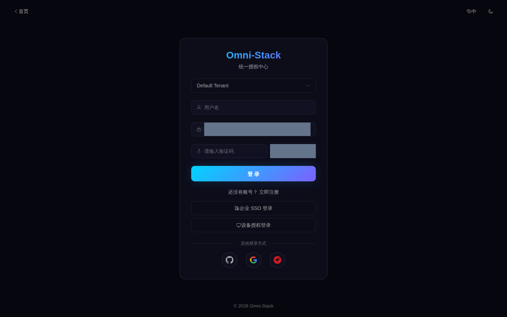
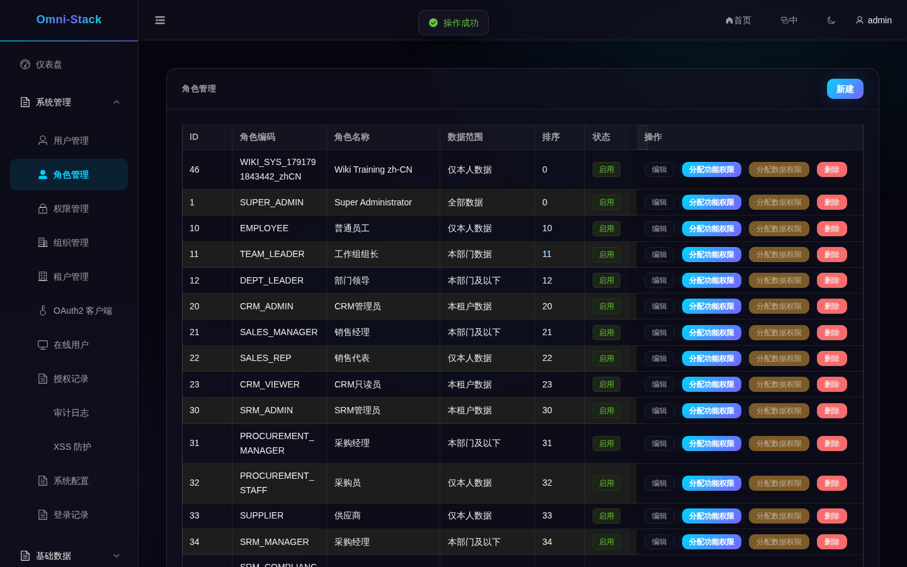
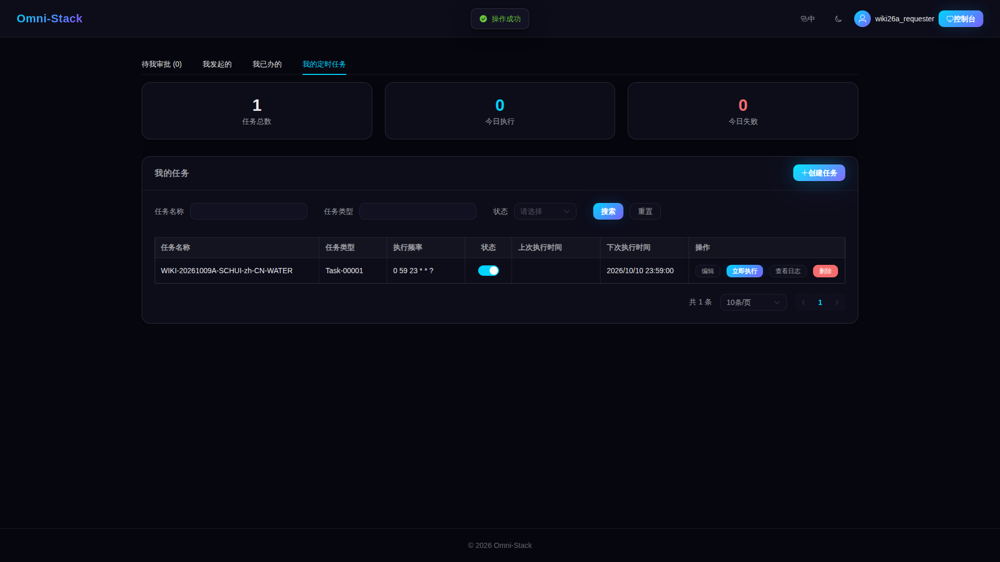
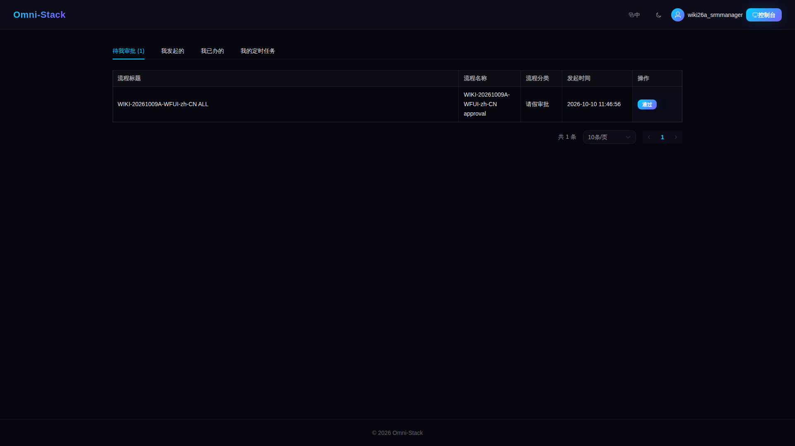
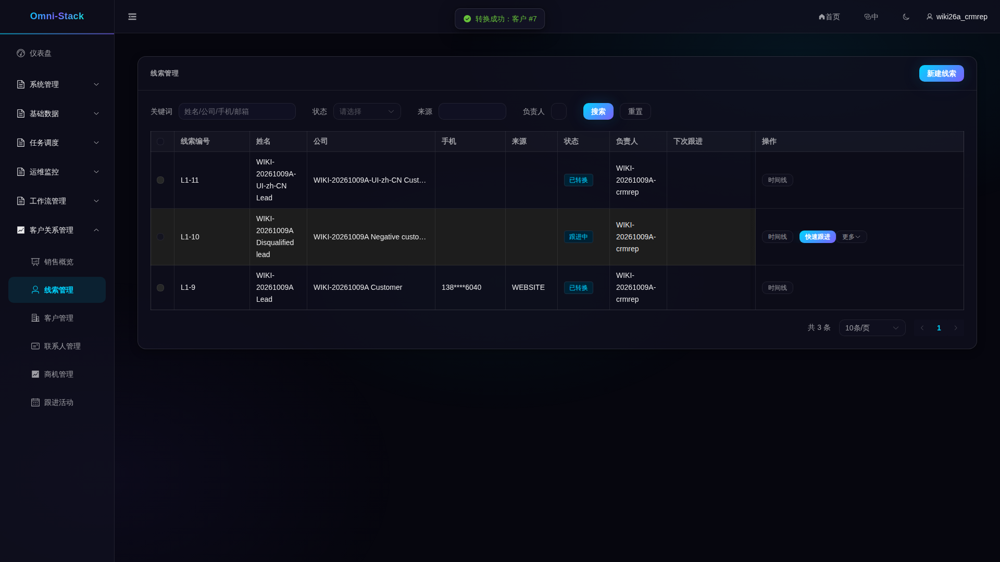
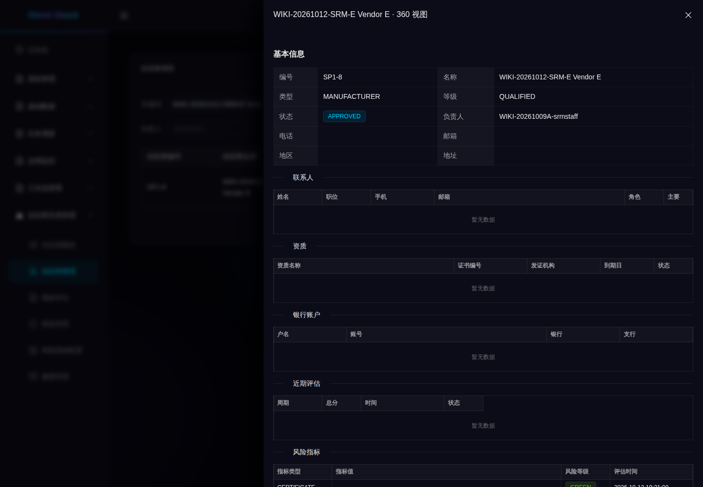
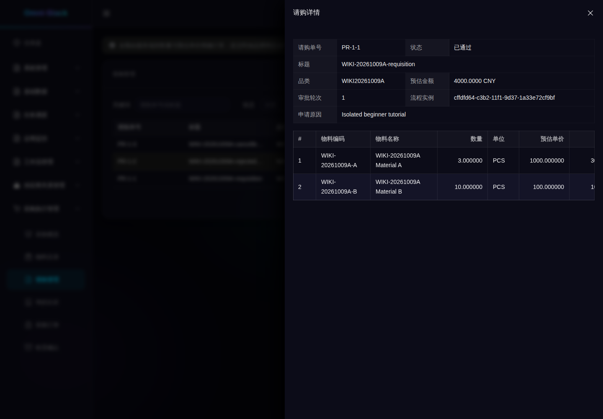
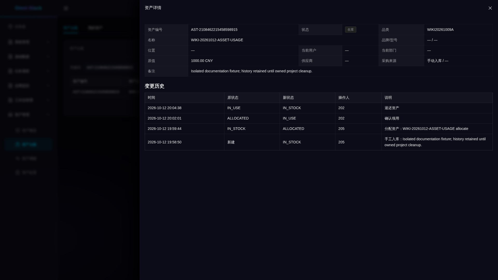

# 功能导览与真实界面入口

先用本页认识项目，再按链接完成操作。本页引用隔离 Docker 环境已经登记的原始截图；它们说明所示页面，不证明你的环境已有相同业务记录，也不证明三家社交登录已完成。历史图库的业务号不能直接复用。

第一次使用先读[学习路径](index.md)和[首次启动](../guides/quick-start.md)。预设决定有哪些模块，租户、功能权限和数据范围决定当前身份能看到什么。

<!-- omni:modules:auth -->
## 认证与租户

识别登录、租户和验证码入口；真实验证码由人输入。

[步骤、预期结果和失败场景](../guides/authentication.md)

<!-- omni:modules:end -->

<!-- omni:modules:platform -->
## 系统、安全与审计

管理用户、角色、组织、菜单、字典和安全策略，核对审计与权限拒绝。

[步骤、预期结果和失败场景](../guides/system-security-audit.md)

<!-- omni:modules:end -->

<!-- omni:modules:xxl-job -->
## 个人与系统任务

任务类型决定路由，个人任务检查所有权；创建、调度、暂停和失败分别验证。

[步骤、预期结果和失败场景](../guides/scheduling.md)

<!-- omni:modules:end -->

<!-- omni:modules:workflow -->
## 工作流与审批

先验证模型和候选人，再发布并提交业务；比较会签、委派、拒绝和撤回。

[步骤、预期结果和失败场景](../guides/workflow-approval.md)

<!-- omni:modules:end -->

<!-- omni:modules:crm -->
## CRM 销售

从线索到客户、联系人、商机和跟进，按角色与数据范围验证转换和赢单。

[步骤、预期结果和失败场景](../guides/crm-flow.md)

<!-- omni:modules:end -->

<!-- omni:modules:srm -->
## SRM 供应商

邀请与门户关联、准入审批、评价、风险及冻结/淘汰各有前置条件。

[步骤、预期结果和失败场景](../guides/srm-flow.md)

<!-- omni:modules:end -->

<!-- omni:modules:procurement -->
## 采购协作

按请购、审批、询价、供应商报价、定标、订单、收货的顺序准备数据。

[步骤、预期结果和失败场景](../guides/procurement-flow.md)

<!-- omni:modules:end -->

<!-- omni:modules:asset -->
## 资产生命周期

合格资产化收货建卡；本人领用与管理范围不同，调拨和处置需审批。

[步骤、预期结果和失败场景](../guides/asset-flow.md)

<!-- omni:modules:end -->

## 图片与复现边界

每种语言引用对应语言目录的截图。业务名称、协议状态和服务端诊断可能保留原值；裁切、换行和可见字段限制见[截图清单](../../omni-frontend/e2e-docs/screenshot-manifest.yaml)所指证据。页面截图、API 验证和译文审校分别记录，不相互代替。

源码讲解见[调试路径](source-debugging.md)；基础种子与演示记录的区别见[数据说明](data-and-fixtures.md)。[历史界面参考](interface-reference.md)保留原有布局与来源，当前操作以对应教程和源码为准。
