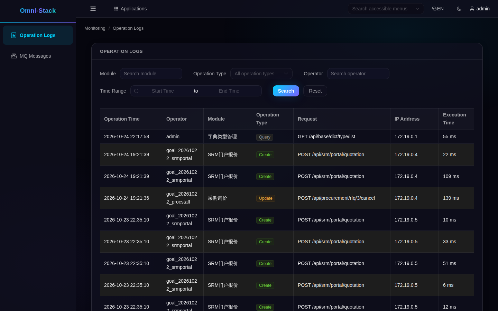

# 5. Query practice: find the record before the cause

Start with the running application. After signing in, open My Workspace and enter Monitoring from the application catalog or Applications drawer. It opens in a new tab. Select Operation Logs. If the entry is missing, check permissions first; do not casually give ordinary users an administrator role.

## Read the operation-log page

This is a real read-only page from the same local omni-stack environment, using an explicitly registered test identity. It shows the page and existing records. It does not prove a new business action occurred during capture and is not a Loki or Grafana screen.

Choose the event's time range, then inspect module, action, and outcome. Confirm the account and tenant. Counts, business IDs, and times depend on your environment. For technical investigation, note the actual time and available correlation ID, then examine the corresponding service's runtime logs.

## Query centralized logs in order

Without the observability stack, first open the relevant business container's Logs in Docker Desktop. If Grafana and Loki are already enabled through the formal deployment in the same environment, choose Loki in Grafana Explore, narrow service_name and time, then filter by message or correlation ID.

Service and container names come from actual collection labels. Do not copy another machine's container name. Query failure, mismatched filters, collection delay, and genuinely absent events are different results.

## When an operation record is missing

| Symptom | First check | Safe recovery |
|---|---|---|
| Missing menu or 403 | Permission, tenant, account | Use an authorized identity or assign existing permissions through the formal process |
| Successful query with no records | Time and filters | Expand a reasonable time range without inventing data |
| Business action exists but its log is missing | Annotation proxy, sanitization, Outbox, relay, consumer | Follow existing messages; do not repeat real business just to create a log |
| Docker output exists but Loki has no result | Project filter, Alloy, Loki, query labels | Fix the actual collection fault; do not start by clearing volumes |

No second environment, extra observability containers, or business replay was used for these screenshots. Next, consider [extension and maintenance](logging-extension.en.md).
