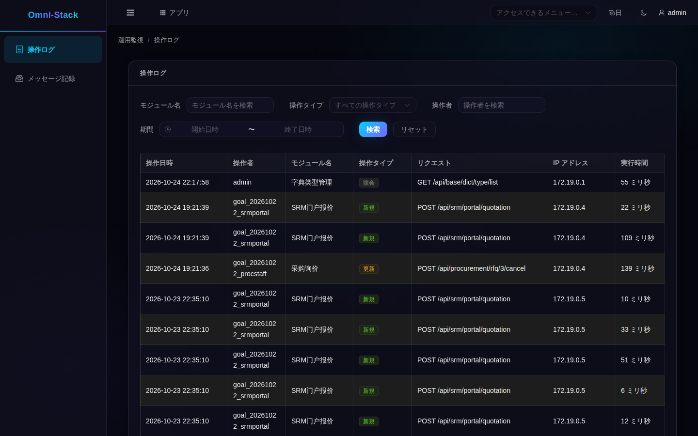

# 5. 検索の練習：記録を探してから原因を追う

稼働中のアプリから始めます。ログイン後にマイワークスペースを開き、アプリ一覧または「アプリ」から「運用監視」へ進むと、新しいタブで業務画面が開きます。「操作ログ」を選びます。入口がなければ権限を確認し、通常の利用者に安易に管理者ロールを付けないでください。

## 操作ログ画面を読む

同じローカルomni-stack環境で、登録済みのテスト用アカウントを使った実際の読み取り専用画面です。既存記録と画面構成を示し、撮影時の新規業務実行やLoki/Grafanaの稼働を証明する画像ではありません。

発生時刻に合う範囲を選び、モジュール、操作、結果を確認します。アカウントとテナントも確かめます。件数、業務番号、時刻は自分の環境の値を使います。さらに調べるときは実際の時刻と利用可能な関連番号を控え、対応するサービスの実行ログへ進みます。

## 集中ログを調べる順序

観測スタックを有効にしていなければ、Docker Desktopで該当コンテナのLogsを開きます。同じ環境で正式な構成によりGrafana/Lokiが有効なら、Grafana ExploreでLokiを選び、service_nameと時間を絞ってからメッセージや関連番号を探します。

サービス名とコンテナ名は実際の収集ラベルに従います。他の機械の名前をそのまま使わないでください。検索失敗、条件不一致、収集遅延、イベント不在は別の結果です。

## 記録が見つからないとき

| 現象 | 最初の確認先 | 安全な復旧 |
|---|---|---|
| メニューがない、403 | 権限、テナント、アカウント | 権限のあるアカウントか正式な既存権限の割り当てを使う |
| 検索成功だが空 | 時間と条件 | 妥当な範囲を広げ、データは捏造しない |
| 業務は実行済みだがログがない | 注釈のプロキシ、サニタイズ、Outbox、中継、消費側 | 既存メッセージを追い、ログを作るために業務を再実行しない |
| Dockerに出力があるがLokiにない | プロジェクト絞り込み、Alloy、Loki、検索ラベル | 実際の故障を直す。最初にボリュームを消さない |

撮影のために別環境や追加の観測コンテナを起動したり、業務を再実行したりしていません。次は[拡張と保守](logging-extension.jp.md)です。
