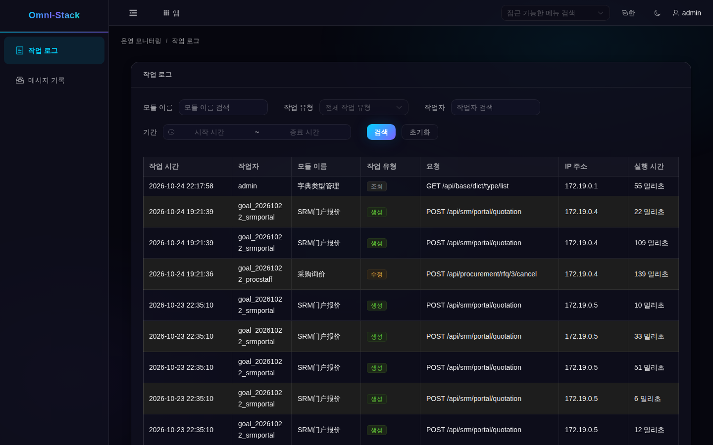

# 5. 조회 연습: 기록을 찾은 뒤 원인 추적하기

실행 중인 앱부터 시작합니다. 로그인 후 내 작업대에서 앱 목록이나 “앱” 팝업으로 “운영 모니터링”에 들어가면 업무 화면이 새 탭으로 열립니다. “작업 로그”를 선택합니다. 메뉴가 없다면 권한부터 확인하고 일반 사용자에게 관리자 역할을 임의로 부여하지 마세요.

## 작업 로그 화면 읽기

같은 로컬 omni-stack 환경에서 명시적으로 등록된 테스트 계정을 사용한 실제 읽기 전용 화면입니다. 기존 기록과 화면을 보여 주며 촬영 중 새 업무 실행이나 Loki/Grafana 동작을 증명하는 이미지는 아닙니다.

발생 시간에 맞는 범위를 고르고 모듈, 작업, 결과를 확인합니다. 계정과 테넌트도 확인하세요. 개수, 업무 ID, 시간은 자신의 실행 환경 값을 사용합니다. 더 조사하려면 실제 시간과 사용할 수 있는 상관관계 ID를 적고 해당 서비스의 실행 로그로 이동합니다.

## 통합 로그 조회 순서

관측 스택이 꺼져 있다면 Docker Desktop에서 해당 업무 컨테이너의 Logs를 먼저 엽니다. 같은 환경에 정식 배포 구성으로 Grafana/Loki가 켜져 있다면 Grafana Explore에서 Loki를 선택하고 service_name과 시간을 좁힌 후 메시지나 상관관계 ID를 검색합니다.

서비스와 컨테이너 이름은 실제 수집 레이블을 따릅니다. 다른 컴퓨터의 이름을 그대로 복사하지 마세요. 조회 실패, 필터 불일치, 수집 지연, 실제 이벤트 부재는 서로 다른 결과입니다.

## 기록이 보이지 않을 때

| 현상 | 먼저 확인할 곳 | 안전한 복구 |
|---|---|---|
| 메뉴 없음 또는 403 | 권한, 테넌트, 계정 | 권한 있는 계정이나 정식 기존 권한 할당 절차 사용 |
| 조회 성공인데 비어 있음 | 시간과 필터 | 합리적인 시간 범위를 넓히고 데이터는 만들지 않기 |
| 업무는 실행됐는데 작업 로그 없음 | 애너테이션 프록시, 정제, Outbox, 중계, 소비자 | 기존 메시지를 추적하고 로그를 만들려고 업무를 반복하지 않기 |
| Docker 출력은 있는데 Loki 결과 없음 | 프로젝트 필터, Alloy, Loki, 조회 레이블 | 실제 수집 장애를 고치고 볼륨 삭제부터 하지 않기 |

촬영을 위해 별도 환경이나 추가 관측 컨테이너를 띄우거나 업무를 재실행하지 않았습니다. 다음은 [확장과 유지보수](logging-extension.kr.md)입니다.
