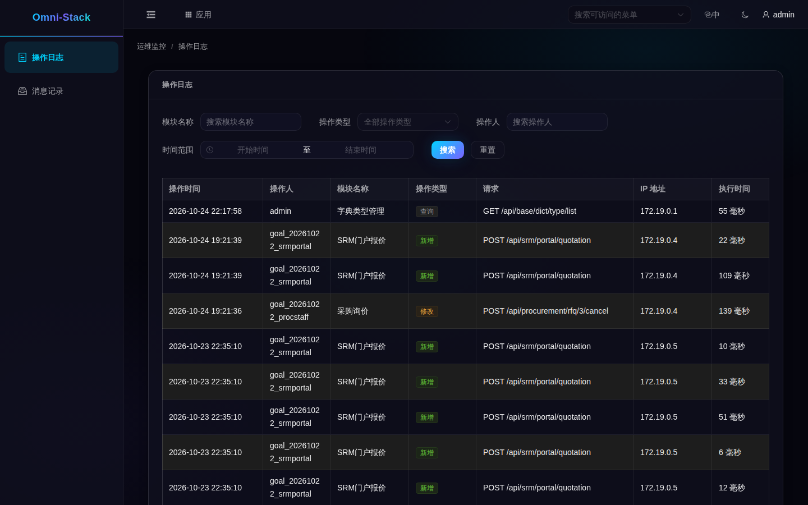

# 5. 查询练习：先找记录，再找原因

先从已运行的应用页面入手。登录后进入“我的工作台”，在应用目录或“应用”弹窗进入“运维监控”，业务页面会在新标签打开；选择“操作日志”。看不到入口时先检查账号权限，不要把管理员角色随意加给普通账号。

## 看懂操作日志页面

本图来自本地同一套 omni-stack 应用的真实只读页面，使用明确登记的测试身份。它展示页面和当前已有记录，不证明这次新做了一笔业务，也不是 Loki 或 Grafana 的界面。

先选择与事件相符的时间，再看模块、操作类型和结果。确认记录所属的账号与租户；数量、业务号和时间以你本次环境为准。需要进一步排错时记下实际发生时间和可用的关联编号，转到对应服务的运行日志。

## 集中查询按什么顺序进行

当前环境没有启用观测栈时，可以先在 Docker Desktop 打开对应业务容器的 Logs 查看输出。若同一环境已经按正式部署启用了 Grafana/Loki，则在 Grafana Explore 选择 Loki，先筛 service_name 与时间，再缩小消息或关联编号。

记录里的服务名、容器名来自实际采集标签；不要照抄另一台机器的容器名。查询失败、筛选不匹配、采集延迟和确实没有事件，是四种不同结果。

## 找不到操作记录怎么办

| 现象 | 先检查哪里 | 安全恢复方法 |
|---|---|---|
| 菜单不可见或403 | 功能权限、租户与账号 | 使用有权账号或按正式流程分配既有权限 |
| 页面空白但查询成功 | 时间和筛选条件 | 扩大合理时间范围，不伪造数据 |
| 业务发生而操作日志缺失 | 注解代理、清洗、Outbox、中继和消费者 | 从已有消息查链路，避免重做真实业务来补日志 |
| 容器有输出而Loki查不到 | 项目筛选、Alloy、Loki与查询标签 | 修复实际采集故障后再查，不先清卷 |

本章没有为截图启动第二套环境、开启额外观测容器或重放业务。下一篇讨论[扩展与长期维护](logging-extension.md)。
